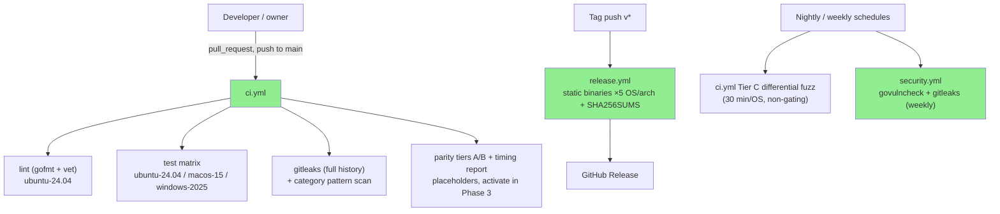
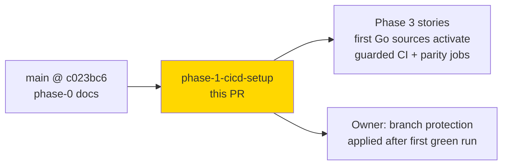
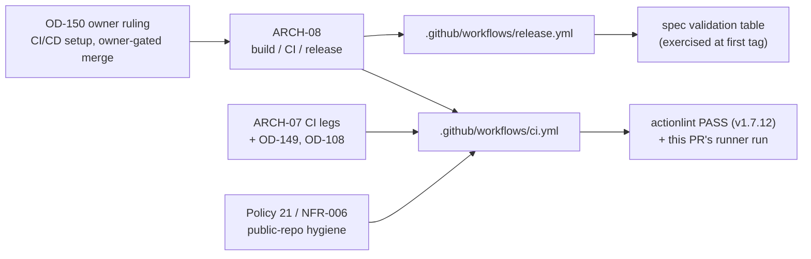
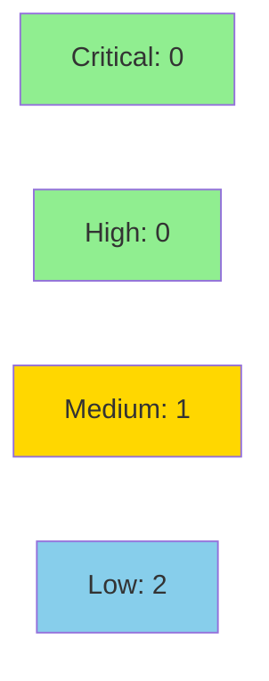

# [phase-1-cicd-setup] CI, release and security workflows

**Mode:** greenfield (infrastructure step)
**Owner ruling:** OD-150 (branch worktree, owner-reviewed merge; autonomy level 3 — **human merge approval required**)
**Design source:** `ARCH-08-build-ci-release.md`, CI legs of `ARCH-07-parity-harness.md` (specs on the `factory-artifacts` branch)

> **Attention — restricted files (owner flag):** this PR touches files on the
> always-flag list from `.factory/merge-config.yaml`: `.github/**` (three new
> workflows), `go.mod` (initial module file), `.gitignore`. Owner review of
> these paths is the merge gate; nothing here merges without it.

This PR bootstraps the repository's CI/CD skeleton ahead of any product code:
three GitHub Actions workflows (CI on every PR/push, tag-triggered releases,
scheduled + PR security audits), the initial `go.mod` (bare module, go 1.26.0,
zero dependencies), a secret-scan allowlist entry, and a `.gitignore` addition
for per-branch worktrees. Because the module has no Go sources yet (Phase 3
writes tests first), every Go invocation in CI is guarded to pass cleanly on the
empty module — verified locally with go1.26 that `go vet ./...` / `go test ./...`
exit 1 with "matched no packages" on a bare `go.mod`, and `gofmt -l .` does not.

---

## Architecture Changes



Key design points (all traceable to ARCH-08):

- **Least privilege everywhere.** Workflow-level `permissions: contents: read`;
  the only escalation is `contents: write` scoped to the single release job
  (needed by `gh release create`). `persist-credentials: false` on all checkouts.
- **Deterministic builds and tools.** All three actions pinned to full commit
  SHAs (versions in comments): checkout v7.0.1, setup-go v7.0.0, setup-python
  v7.1.0. Tool invocations pinned by version too: `gitleaks/v8@v8.30.1`,
  `govulncheck@v1.9.0`. No third-party release/publish actions.
- **Empty-module guard.** Every Go step checks `git ls-files '*.go'` first and
  exits 0 with a notice while the module is a skeleton, so the first CI run is
  meaningful (lint/format/secrets) instead of red for a benign reason. Guards
  pass through untouched once sources land.
- **Concurrency + timeouts.** Superseded runs cancel per ref; every job sets
  `timeout-minutes`.
- **Check-run name separation.** `security.yml` suffixes its weekly job names
  (`gitleaks (weekly)`, `govulncheck`) so its PR check runs cannot collide with
  the ci.yml required-check names (`gitleaks (full history)`, `test (os)`,
  `lint (gofmt + vet)`).
- **Branch protection compatibility.** The parity/timing placeholder jobs gate
  on a probe job's outputs (job-level `if` cannot use `hashFiles()` —
  actionlint-enforced); skipped placeholders count as success, so required
  checks introduced in Phase 3 can be added to protection without restructuring.
  Branch protection itself is a **later owner action** (OD-150), after this PR's
  first green run.

## Story Dependencies



No upstream dependencies (greenfield step, cut from `main` at `c023bc6`).
Nothing in the repo depends on this PR except Phase 3's Go stories, which
inherit green CI.

## Spec Traceability



| Requirement | Source | Implementation | Verification |
|---|---|---|---|
| Three-OS test matrix on every change (D5) | BC-6.04.001 | `ci.yml` `test` matrix, `-race` off Windows | This PR's CI run |
| Per-OS timing report, non-gating in CI | BC-6.04.002, OD-117 | `ci.yml` `timing report` job | Placeholder; body lands in Phase 3 |
| Nightly differential fuzz, 30 min/OS | OD-149, ARCH-07 | `ci.yml` Tier C, `HYLO_PARITY_FUZZSECONDS=1800` | Schedule-only; activates in Phase 3 |
| Static cross-built binaries + checksums | ARCH-08, BC-4.01.003 | `release.yml` (CGO off, trimpath, ldflags version stamp) | First `v*` tag |
| Secret scan equivalent to pre-push rule | CLAUDE.md hygiene, policy 21 | `ci.yml` gitleaks full history + category pattern scan | This PR's CI run |
| Weekly dependency/vulnerability audit | ARCH-08 | `security.yml` govulncheck + gitleaks | Weekly schedule / PR run |
| Absolute interpreter path for parity oracle | OD-108 | `setup-python` `python-path` output wired to `HYLO_PARITY_PYTHON` | Placeholder wiring |
| `.worktrees/` never committed | OD-150 setup finding | `.gitignore` addition (+ corrected `.factory/` comment) | Diff inspection |

## Test Evidence

There is no product code in this PR (bare `go.mod`); evidence is the
infrastructure validation performed before landing, plus this PR's own CI run:

| Check | Result |
|---|---|
| `actionlint` v1.7.12 on all three workflows | PASS (two real findings fixed pre-landing: job-level `hashFiles()`, shellcheck SC2012) |
| `gofmt -l .` on worktree (go1.26.5) | Clean |
| Empty-module behavior of `go vet`/`go test` | Verified exit-1 locally; guarded in all Go steps |
| Harness-probe logic (3 fixture layouts) | PASS — empty / both / statusline-only |
| Pattern-scan regexes (positive + negative fixtures) | PASS — private IPs (incl. `ip:port`), home paths, personal emails; RFC 5737 + no-reply excluded |
| Full-worktree pattern scan | Clean |
| gitleaks full history (`--all`) over what GitHub hosts | Clean (one reviewed false-positive allowlisted, see below) |

Not verified here, by design: runner behavior of the `-race` split (asserted
from ARCH-08; first observed on this PR's run) and the release pipeline
(exercises at the first tag).

**Coverage / mutation / holdout:** N/A — no Go sources; evaluated at the wave
gate per the standard pipeline. **Adversarial review of product code:** N/A —
Phase 5 applies to implementation, not workflow scaffolding.

### `.gitleaksignore` entry (one, reviewed)

The full-history scan flagged one `generic-api-key` heuristic hit on ordinary
prose (a coverage-domain list in a factory research doc on the public
`factory-artifacts` branch — reachable from `main` checkout with
`fetch-depth: 0`, so it would fail the required check on every PR). It is not a
credential and not a deleted file. `.gitleaksignore` carries the single
fingerprint plus a comment that does not quote the flagged text. Reviewed
2026-11-15; remainder of history (`main` + `factory-artifacts`) is clean.

## Demo Evidence

Per-AC demo recordings do not apply to this step: it has no story (owner ruling
OD-150), no acceptance criteria, and no user-visible surface — no CLI, UI, or
API exists to record. The demonstrable equivalent is:

- the PR's own CI run (job-by-job results reported with the merge request),
- the validation table above (actionlint, pattern-scan fixtures, gitleaks),
- the release workflow's first real exercise, which occurs at the first `v*`
  tag after merge and is observable as a published GitHub Release.

## Adversarial Review

| Cycle | Reviewer | Findings | Blocking | Status |
|-------|----------|----------|----------|--------|
| 1 | pr-reviewer (fresh eyes) + security-reviewer | 10 NB + 3 nits; 1 MED + 2 LOW + 4 INFO | 0 | 7 fixes landed in `66dd7fa`; 6 deferred with reasons (triage comment) |
| 2 | pr-reviewer (delta on `66dd7fa`) | 3 NB + 1 nit, all operational/cosmetic | 0 | **APPROVE — converged (2 of max 3 cycles)** |

Fix commit `66dd7fa` (`d88e5ea..66dd7fa`): Tier C trigger aligned with its
comment; concurrency keyed per event with cancel-in-progress on PRs only;
pattern-scan allowlist made span-scoped and fail-closed on `git grep` errors
(also SEC-001/SEC-002); release fails on a source-less tagged commit; tag
filter `v[0-9]*` + draft-then-publish; `shell: bash` default on the timing
job; corrected gitleaks Go module path
(`github.com/zricethezav/gitleaks/v8`) that failed the first CI run.

Product-code adversarial passes (Phase 5 multi-model loop): N/A — this PR is
workflow scaffolding; the review table above tracks this PR's own review
convergence (max 3 cycles per `.factory/merge-config.yaml`).

## Security Review



**Verdict: no blocking findings (0 CRITICAL, 0 HIGH).** Dedicated security
review of the workflow attack surface:

| ID | Sev | Area | Disposition |
|---|---|---|---|
| SEC-001 | MEDIUM | Whole-line allowlist exclusions in the pattern scan can hide a private IP/email sharing a line with an exempted address (CWE-693) | Fixed in this PR (split passes: IP/home unfiltered, email pass filtered; fail on `git grep` rc>=2) |
| SEC-002 | LOW | Pattern scan failed open if `git grep` errored (CWE-636) | Fixed in this PR (same restructure) |
| SEC-003 | LOW | Pattern families miss IPv6 ULA/link-local, CGNAT 100.64/10, `/root/`, UNC paths | Deferred — documented as fast-follow policy widening |
| SEC-004 | LOW | Release binaries unsigned, no build provenance (CWE-494) | Deferred — attest-build-provenance/cosign follow-up |
| SEC-005 | INFO | Tag trigger executes the tagged commit's own release.yml | Accepted — single-owner repo; revisit with protected tags + environments when collaborators arrive |
| SEC-006 | INFO | `.gitleaksignore` entry adjudicated a reviewed true false positive; maximally bounded fingerprint + dated justification | Accepted |
| SEC-007 | INFO | Scan logic duplicated ci.yml/security.yml | Deferred — extract composite action at next touch |

Explicitly clean: workflow/job least privilege (`contents: read` everywhere;
single job-scoped `contents: write` for release), all 11 checkouts with
`persist-credentials: false`, zero third-party actions (all SHA-pinned
first-party), no `${{ }}` interpolation into any `run:` block, no
`pull_request_target`, no secrets consumed, gitleaks runs `--redact` in both
workflows, tools pinned through the Go checksum DB (`gitleaks@v8.30.1`,
`govulncheck@v1.9.0`).

## Risk Assessment & Deployment

### Blast Radius
- **Systems affected:** repository CI behavior only; no product code paths.
- **User impact:** none at merge; wasted Actions minutes if a job misfires
  (worst realistic case), bounded by per-job timeouts and concurrency
  cancellation.
- **Data impact:** none. Release job publishes only on future `v*` tags.
- **Risk Level:** LOW overall — but note the restricted-file flag: workflow
  files define what runs with the repository's token on every future commit,
  which is exactly why they are on the owner-attention list.

### Rollback

Single-commit history (`d88e5ea`) on `ci/phase-1-setup`; after a squash-merge,
revert the resulting merge commit on `main`, or delete `.github/workflows/` +
the two ignore/module files. No feature flags, no migrations, no runtime state.

## AI Pipeline Metadata

<details>
<summary><strong>Pipeline Details</strong></summary>

```yaml
ai-generated: true
pipeline-mode: greenfield
step: phase-1-cicd-setup          # infrastructure step, no STORY-NNN (OD-150)
branch: ci/phase-1-setup          # deviation from branch_prefix "feature/" — owner-approved; intentional, not renamed
implementer: devops-engineer
validation-actionlint: v1.7.12
go-toolchain-local: 1.26.5
models-used:
  implementer: sonnet-5.5
  review: sonnet-5.5
generated-at: "2026-11-16"
```

</details>

---

## Pre-Merge Checklist (autonomy level 3 — owner approves merge)

- [ ] All required CI checks passing (`lint`, `test` ×3 OS, `gitleaks (full history)`)
- [ ] Security review of workflow permissions complete, no critical/high findings
- [ ] PR review converged (0 blocking findings, max 3 cycles)
- [ ] Restricted files reviewed and accepted by owner (`.github/**`, `go.mod`, `.gitignore`)
- [ ] **Owner merge approval** (autonomy level 3 — hard gate, not performed by automation)
- [ ] After merge (owner): apply branch protection with the five required check names above
