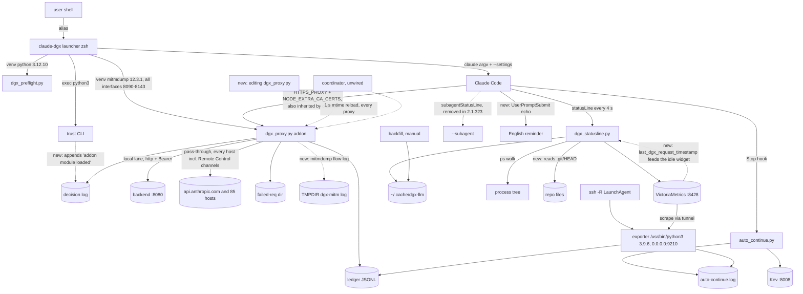

# Pass 0 Deepening, Round 1: Inventory (hylo-legacy)

- **Source:** `$HOME/Dev/hylo/legacy/`, read-only and static. Read in full this round: `claude-dgx`, `dgx-proxy-coordinator.sh`,
  `dgx_preflight.py`, both `deploy/*.plist`, `ROLLBACK.md`. Read in part: `dgx_proxy.py:1-60,76-100,280-310,510-764`;
  `dgx_statusline.py:70-125,150-205,262-300,360-415,925-940,1236-1245`; `auto_continue.py:1-60,94-170`; `dgx_ledger_exporter.py:1-30,268-290,405-414`;
  `tools/backfill_cost_history.py:1-26,84-90`. Every import line, subprocess call, network call and path literal in the 6 Python files was found with
  `grep`. All `def`/`class` line anchors were recounted.
- **Inputs read:** the broad pass 0 (`…-pass-0-inventory.md`), the extraction validation, pass-2 r8 (all of it, and §7 is the canonical pointer),
  pass-2 r9 (the §6 pointer delta), pass-3 r4 (header, §0-§7.2, and the §7.3 rows for LN/CO/PF/BF/SV/PX-030..045/EX-020..026/SL-085..099), pass-3 r8
  (§4 totals through the checkpoint), pass-2 r7 §1 (mitmproxy option audit), and the pass-2 r2 §1.4 interpreter table. Also `docs/PLAN.md` (whole).
  Pass-1 §4.8 (files table) was used for the cross-check in §3.
- **Method:** nothing in legacy ran. No proxy and nothing networked. `CLAUDE.local.md` was not read. Host facts come only from `command -v`,
  `--version` of interpreters and tools, `ls`, and `git -C … log/rev-list`. No file outside `.factory/semport/hylo-legacy/` was written. The sibling
  files for passes 1, 4 and 5 were not touched.
- **Masking:** the backend host is written `<backend>`. The source carries the scrubbed RFC 5737 default `192.0.2.10`. Home paths are written `~`.
- **Numbering:** this round issues **CONV-ABS-29** (§5), plus the new owner items **OD-46, OD-47 and OD-48** (§6). CONV-ABS-30..34 and OD-49 are not used.

---

## A. Components, entry points and invocation paths, mapped to hylo

### A.1 Complete invocation-path inventory

**New** marks a row the broad pass 0 did not have as an entry point or invocation path.

| # | Component / path | Entry (file:line) | Invoked by | Interpreter / host | hylo target (PLAN §4/§6) | Status |
|---|---|---|---|---|---|---|
| 1 | Launcher, session mode | `claude-dgx:1-185` | user alias | zsh 5.9 (host) | `hylo run` (+ config profiles) | P4 |
| 2 | Launcher, `trust` delegation | `claude-dgx:11-14` → `exec python3 "$HERE/dgx_proxy.py" trust "$@"` | `claude-dgx trust …` | `python3` on PATH (3.11.7) | `hylo ca` | OOS for parity (BC-PX-031, BC-LN-001; D13 removes keychain trust) |
| 3 | Launcher, dry run | `claude-dgx:182-184` (`DGX_PRINT_ARGS=1` prints the `claude` argv and exits 0) | user | zsh | `hylo run` dry run, and in part `hylo config` show | P4 (BC-LN-010) |
| 4 | Launcher, visible mode (`DGX_INVISIBLE=0`) | `claude-dgx:15-22,85-96,102` (port scan 4141-4199, `curl …/_opus_router/health`, `python3 opus_router.py`) | env | zsh + `python3` | none | **OOS (D6)**. Broken in the frozen tree: `opus_router.py` is absent. The 4141-4199 `nc` probe loop at `:15-22` still runs in invisible mode (§C) |
| 5 | Preflight | `dgx_preflight.py:18-41`, called at `claude-dgx:60-68` | launcher, unless `DGX_SKIP_PREFLIGHT=1` | **`$HERE/.mitmenv/bin/python` (venv, CPython 3.12.10)** in invisible mode (`:61`); `python3` only in visible mode (`:62`) | `hylo doctor` | P4 (BC-PF-001/002). **New detail:** broad pass 0 implied `python3` |
| 6 | mitmdump host process (new component row) | `claude-dgx:75`: `PYTHONUNBUFFERED=1 "$HERE/.mitmenv/bin/mitmdump" --set flow_detail=1 --listen-port "$MITM_PORT" -s "$HERE/dgx_proxy.py" >"$MLOG" 2>&1 &` | launcher, one per window | venv 3.12.10, mitmproxy 12.3.1 | `hylo proxy`, one per user | P3. Its behavior-shaping defaults are listed in A.2 |
| 7 | Proxy addon load | `dgx_proxy.py:518-548` (module-level `note(...)` `:518`, `_router = DGXRouter()` `:521`, hook functions) | mitmdump `-s` | venv | `internal/proxy`, `internal/ledger`, `internal/events` (D16) | P3 |
| 8 | **New: proxy live reload** | mitmproxy script watcher: 1 s mtime poll; a changed `dgx_proxy.py` is re-imported in **every** running proxy, and a failed re-import leaves plain pass-through (pass-2 r4 §2.1 D-2 and §3.1 "Addon generation"; CONV-ABS-12: at startup a failed load makes mitmdump exit 1) | editing the file | venv | none. A Go binary is not hot-reloaded. The nearest hylo concept is config reload (OD-26: keep the last good config, never fall back to pass-through) | Out of scope as a mechanism. Its config-reload successor is OD-26 |
| 9 | Trust CLI | `dgx_proxy.py:759-764` → `_build_parser()` `:737`; `install` `:625`, `status` `:648`, `remove` `:676`, `rotate` `:702`; bare invocation prints usage and exits 2 (`:763-764`) | row 2, or `python3 dgx_proxy.py trust …` | `python3` (3.11.7); the mitmproxy import is optional (`:42-46`) | `hylo ca` (create/install/rotate) | OOS (D13). **New side effects:** see A.3 |
| 10 | **New: trust `rotate` restart hook** | `dgx_proxy.py:719-725`: `DGX_PROXY_RESTART_CMD` runs with `subprocess.run(restart_cmd, shell=True)`, i.e. `/bin/sh -c <arbitrary text>`, then polls 30 s for a new CA | env, during `trust rotate` | `/bin/sh` | none. `hylo ca rotate` mints the CA itself (`internal/ca`) | OOS (D13) |
| 11 | Status line | `dgx_statusline.py:1238-1245` → `main()` `:1200` | Claude Code `statusLine`, `python3 '<HERE>/dgx_statusline.py'`, `refreshInterval` 4 (`claude-dgx:176`) | `python3` on Claude Code's PATH (3.11.7, the owner-ruled oracle) | `hylo statusline` (`internal/statusline`; `internal/platform` for ⌂) | P1 |
| 12 | Status line `--subagent` | `dgx_statusline.py:1240-1241` → `main_subagent()` `:928` → `render_subagent_rows()` `:888` | Claude Code `subagentStatusLine` (`claude-dgx:177`), still emitted by the launcher | same | none | **Out of scope:** PLAN §3 non-goal, because Claude Code 2.1.323 removed `subagentStatusLine`. The parity treatment is still pending as OD-14 (BC-SL-097). PLAN §3 and OD-14's "toggle, default on" recommendation pull in opposite directions; the owner's OD-14 ruling settles it |
| 13 | Stop hook | `auto_continue.py:274-275` → `main()` `:209` | Claude Code `Stop` hook, `python3 '<HERE>/auto_continue.py'`, timeout 30 (`claude-dgx:161`); emitted when `DGX_ENGLISH` or `DGX_AUTOCONTINUE` is not 0 (`:160`) | `python3` (3.11.7). Must be ≥ 3.10 because of PEP 604 at `auto_continue.py:94` | `hylo hook stop` (`internal/hook`; Kev is an optional URL, D11) | P4 |
| 14 | **New: UserPromptSubmit hook** | `claude-dgx:157-159`: an inline command `echo "[Reminder: reply and think in English only. No Chinese anywhere, including your reasoning.]"`, timeout 5, emitted when `DGX_ENGLISH != 0` | Claude Code, on every user prompt | Claude Code's hook shell (`echo`) | **No PLAN target.** PLAN §6 lists only `hook stop`. Candidates: a literal command in the `--settings` that `hylo run` writes, or a `hylo hook prompt` subcommand | **OD-46** (§6). Known to pass 2 (r2 §6.6) and pass 3 (BC-LN-009) as a settings fragment. Missing from pass 0 as an entry point |
| 15 | Ledger exporter | `dgx_ledger_exporter.py:410-414` | LaunchAgent `io.hylo.ledger-exporter` (`deploy/io.hylo.ledger-exporter.plist:5-10`, RunAtLoad and KeepAlive) | `/usr/bin/python3` = 3.9.6 (Command Line Tools) | `hylo exporter` (`internal/ledger`) plus per-OS service units | P2 |
| 16 | **New: exporter forced rebuild** | `dgx_ledger_exporter.py:273,285`: `GET /metrics?rebuild=<non-empty>` forces `rebuild()` even when the ledger size is unchanged | any HTTP client | same | `hylo exporter` (keep the query parameter or drop it: part of OD-39's rebuild-trigger design) | P2. Known to pass 3 (r2 l.616). Missing from pass 0 |
| 17 | Ledger tunnel | `deploy/io.hylo.ledger-tunnel.plist:5-13`: `/usr/bin/ssh -N -R 127.0.0.1:9210:127.0.0.1:9210 -o ServerAliveInterval=30 -o ServerAliveCountMax=3 -o ExitOnForwardFailure=yes dgx` | launchd | OpenSSH client; the `dgx` host alias comes from the user's ssh config, which is not in the tree | none in the binary. Home-lab deployment, docs only | OOS (BC-SV-002) |
| 18 | **New: LaunchAgent installation** | none. No file in `legacy/` calls `launchctl` (grep found 0 hits). Both agents are loaded by hand | owner, manually | — | per-OS service units (PLAN §4: launchd, systemd user unit, Windows scheduled task). An installer is **new hylo functionality** with no legacy counterpart, so it has no parity oracle | P2/P4 (design, not parity) |
| 19 | Coordinator (unwired) | `dgx-proxy-coordinator.sh:40-50` | nobody; manual only (it references only itself) | zsh + venv mitmdump (`:31`) | built into `hylo proxy` / `hylo run` (one proxy per user, a state file and a lock, PLAN §6) | OOS (BC-CO-001/002, OD-19) |
| 20 | Backfill | `tools/backfill_cost_history.py:120-121` → `main()` `:84`; `[--days 30] [--dry-run]` | manual, `python3 tools/backfill_cost_history.py` (docstring `:18`). The file mode is 0644, so it cannot run as `./…` | `python3` (3.11.7) | `hylo cost backfill` | **No phase and no package (OD-36)** |
| 21 | Dead in-process path: Opus arbitration | `auto_continue.py:141-166` (`opus_verdict`, never called) → `claude -p … --model opus` | — | — | none | Dead code (not ported) |
| 22 | Dead hooks: `websocket_start`/`websocket_end` | `dgx_proxy.py:528-536`, guarded by an attribute that nothing sets | — | — | none | Dead code |

hylo subcommands with **no legacy component** (from PLAN §6 and D16):

| hylo | Legacy nearest source of the same information | Note |
|---|---|---|
| `hylo ui` (P4), `hylo top` (P6), `internal/events`, `internal/ui`, `web/` | No event bus exists. The proxy's only outputs are the ledger (`dgx_proxy.py:56-62`), the decision log (`:65-74`), and mitmdump's flow log at `flow_detail` 1 (`claude-dgx:74-75`). That log is the de-facto "live flows" view, holding flow lines, WebSocket message lines and TLS failures (pass-2 r8 §0). The rate-limit state is `anth_ratelimit`. CA state is `trust status` (`dgx_proxy.py:648-673`). Backend health comes from preflight plus the status line's `up{job}` | D16 surfaces with **no legacy oracle**: connected clients, the rewritten-body diff, the SSE timeline, effective config. Of the WebSocket/Remote Control connections, only mitmdump log lines exist: the `bridge_ws_*` ledger events never fire (CONV-ABS-26, r9 §2.1) |
| `hylo config` (show/validate) | `DGX_PRINT_ARGS=1` (`claude-dgx:182-184`); `~/.config/dgx-llm/profile.env` (`:114-115`) | No config file and no validation exist in legacy (D15) |
| `hylo ca create` | mitmproxy mints `~/.mitmproxy/mitmproxy-ca*.pem` the first time it starts. Legacy code never creates a CA: `install` exits with "start the proxy once so mitmproxy generates one" (`dgx_proxy.py:626-627`) | CA generation is a **mitmproxy-side responsibility** today. In hylo it becomes `internal/ca`'s |

### A.2 mitmdump option defaults in effect (component row 6)

Source: pass-2 r7 §1, which audited all 93 options (93 = 3 set by the launcher + 90 at their defaults; no `config.yaml` exists, P3r4 §0), with r8
CONV-ABS-25. These are the defaults that shape the legacy component's observable behavior:

| Option (mitmproxy 12.3.1) | Value in effect | Inventory consequence | hylo |
|---|---|---|---|
| `listen_port` | `$MITM_PORT`, the first free port in 8090-8143 found by an `nc -z 127.0.0.1` probe (`claude-dgx:72-73`) | port range endpoint | one per-user port in a state file (PLAN §6) |
| `listen_host` | `""`, i.e. **all interfaces, IPv4 and IPv6** (pass-2 r4 l.138); observed as `*:8090-8098` (P3r4 §0) | endpoint correction: legacy is LAN-reachable, though the launcher only probes and exports `127.0.0.1` | HY-BIND-1: loopback (owner ruling) |
| `flow_detail` | 1 (the `--set` repeats the default) | writes `$TMPDIR/dgx-mitm.<pid>.<port>.log`; WebSocket messages logged without sizes | D16 event stream |
| `confdir` (default) | `~/.mitmproxy` | CA files read and created here; `NODE_EXTRA_CA_CERTS` points into it (`claude-dgx:80`) | `internal/ca` storage path (config, D15) |
| `ssl_insecure` False, `ssl_verify_upstream_trusted_ca`/`_confdir` None | upstream verification against **certifi's bundle only** (certifi 2026.10.23 in the venv) | the dependency inventory gains certifi (B.2) | HY-TLS-1, OD-41 |
| `http2` True | the upstream leg mirrors the client's ALPN; child tools use h2 (r8 CONV-ABS-25) | — | D14 removes the child traffic |
| `tcp_timeout` | 600 s idle cut on every intercepted connection | fired once on a pass-through MCP stream (r8 §1.1) | OD-37, HY-PASS-1, BC-PX-049 |
| `websocket` True | messages kept in memory for the life of the connection | — | HY-WS-1 |
| `connection_strategy` eager | upstream connects before the request is read | — | P3 |
| env `SSLKEYLOGFILE` / `MITMPROXY_SSLKEYLOGFILE` | read at import; not set in production (r8 §5) | hidden env input | HY-TLS-3 |

### A.3 Side effects of the trust-CLI invocation path (new; static, from source order)

`python3 dgx_proxy.py trust <cmd>` executes the **whole module top level** before argparse runs, because the `if __name__ == "__main__"` block is at
`:759`:

1. `note("addon module loaded (PID %d)" % os.getpid())` (`:518`) **appends a line to the routing-decision log** on every trust command
   (`DECISION_LOG`, `:53`; append at `:70-72`). Pass-2 r3 gap 3 and r6 O-3 proposed decision-log `addon module loaded` lines as markers of proxy
   restarts. Each `claude-dgx trust …` run adds a false marker. (That hypothesis is already closed by r9 §2.3, so no conclusion changes.)
2. `_router = DGXRouter()` (`:521`) parses `DGX_UPSTREAM` (`:79-83`). A non-numeric or out-of-range port raises `ValueError` from `u.port`
   **before** any trust subcommand runs, so a bad `DGX_UPSTREAM` in the shell breaks `trust status` as well.
3. The optional mitmproxy import (`:42-46`) succeeds or fails depending on whether the PATH `python3` has mitmproxy installed. Either way the CLI
   runs.

Spec impact: none for parity (the trust CLI is OOS, D13). For `hylo ca`, the inventory rule is "CA management must not write proxy diagnostic logs
or depend on proxy config parsing". This is a design default, not an OD.

---

## B. External dependencies

### B.1 Interpreters and runtimes per component

| Component | Interpreter as launched (file:line) | Version | Evidence | Minimum / sensitivity |
|---|---|---|---|---|
| Launcher, coordinator | `#!/bin/zsh` (`claude-dgx:1`, `dgx-proxy-coordinator.sh:1`) | zsh 5.9 (host `zsh --version`) | this round | zsh-only syntax: `${0:A:h}`, `${(j:,:)…}`, `{1..40}` |
| Proxy addon, coordinator mitmdump | `$HERE/.mitmenv/bin/mitmdump` (`claude-dgx:75`, coordinator `:31`) | CPython **3.12.10** venv, **mitmproxy 12.3.1** | pass-2 r4 header, r5 header | `from __future__ import annotations` (`dgx_proxy.py:26`) |
| Preflight | `$HERE/.mitmenv/bin/python` (`claude-dgx:61`) | **3.12.10** (same venv) | `:61` | stdlib only. Run under the venv on purpose: macOS Local Network permission belongs to the app and is inherited (`claude-dgx:56-59`, `dgx_preflight.py:5-9`) |
| Trust CLI | `python3` on PATH (`claude-dgx:13`) | 3.11.7 on this host | host `python3 --version` | stdlib only. PEP 604 annotations are safe under the future import |
| Status line | `python3` (`claude-dgx:176`) | **3.11.7** (owner-ruled oracle) | P3r4 §0 rulings | `fromisoformat` grammar, the 4,300-digit int limit (≥ 3.11) |
| Stop hook | `python3` (`claude-dgx:161`) | **3.11.7** | same | **≥ 3.10 required** (`auto_continue.py:94`, PEP 604 without the future import; pass-2 r3 E-6) |
| Exporter | `/usr/bin/python3` (`deploy/io.hylo.ledger-exporter.plist:6`) | **3.9.6** (Command Line Tools) | host `/usr/bin/python3 --version` | UTF-8 mode under launchd's empty environment (pass-2 r2 §1.4); OD-15 |
| Backfill | `python3` (docstring `:18`) | 3.11.7 | — | `fromisoformat` differences between 3.9 and 3.11 (pass-2 r2 §1.4) |

**Pinning gap (new):** the proxy venv is **not in the tree** (`legacy/.mitmenv` is absent) and no requirements or lock file records its versions
(Python 3.12.10, mitmproxy 12.3.1, certifi 2026.10.23). The launcher expects it at `$HERE/.mitmenv`, i.e. `legacy/.mitmenv` inside the hylo
checkout. `.gitignore` covers neither `legacy/.mitmenv/` nor the coordinator's `legacy/.proxy-state/`. The P3 replay harness must recreate this
venv. See **OD-47**.

### B.2 Third-party packages

| Package | Version | Used by | Evidence | hylo replacement |
|---|---|---|---|---|
| mitmproxy | 12.3.1 | proxy addon (`import mitmproxy.http`, `from mitmproxy import ctx`, `dgx_proxy.py:43-44`), and mitmdump as the host process | P2r4/r5/r7/r8 headers | Go `crypto/tls`, `net/http`, `httputil` (PLAN §6) |
| certifi (a mitmproxy dependency) | 2026.10.23 | the only upstream trust anchor | P2r7 §1.3 T-1, r8 §5 B-1 | per-backend CA config (OD-41), with Go's system roots for Anthropic |
| h11 (a mitmproxy dependency) | not recorded | HTTP/1 framing; source of one error-text string | P2r4 header | `net/http` |

The other five Python programs (status line, hook, exporter, preflight, backfill) are **stdlib only** (import census: `dgx_statusline.py:60-70,277,982`;
`auto_continue.py:15-22`; `dgx_ledger_exporter.py:15-20,124,144,229`; `dgx_preflight.py:13-16`; backfill `:20-26`). One dead import:
`dgx_ledger_exporter.py:20` imports `urlparse` and never uses it (`parse_qs` is used at `:274`).

Server-side dependencies **outside the tree** (PLAN §3 non-goal: they stay in the private repository): the VictoriaMetrics recording rules behind
`dgx_kv:*`, `dgx_tokens:*`, `dgx_ttft:*`, `dgx_preempt:*`, `dgx_power:*`, `dgx_cost:*` (named in `QUERY`, `dgx_statusline.py:102-123`; pass-2 r3
§2); the DCGM exporter (`DCGM_FI_DEV_*`); vLLM and LMCache scrape jobs (`up{job=~"vllm|lmcache"}`); the Kev service (`DGX_KEV_URL`); and VictoriaMetrics
scraping the tunnelled exporter.

### B.3 OS tools invoked, with per-OS replacement need (D5, policy 18)

"Active" means reachable in the invisible-mode production path. "Shell" means a zsh builtin or a binary called from zsh.

| Tool | Call sites (file:line) | Active? | macOS today | Linux | Windows | hylo replacement |
|---|---|---|---|---|---|---|
| `zsh` | `claude-dgx:1`, coordinator `:1` | yes | `/bin/zsh` | often absent | absent | Go `hylo run` |
| `nc -z` | `claude-dgx:21,73,77,78,89` | yes, including the visible-mode loop at `:21`, which runs in every mode | `/usr/bin/nc` | varies by netcat flavor | absent | `net.Listen` / `net.DialTimeout` |
| `sleep` (new) | `claude-dgx:77,94`; coordinator `:35` | yes | coreutils | yes | absent | `time.Sleep` |
| `kill` / `kill -0` (new; builtin) | `claude-dgx:97` (trap); coordinator `:23,36` | yes (trap) | builtin | builtin | no signals; `TerminateProcess` | `os.Process.Kill`/`Signal`; Windows job objects |
| `trap … EXIT INT TERM` (new; builtin) | `claude-dgx:97` | yes | — | — | console control events | `os/signal`; Windows `CTRL_CLOSE_EVENT` |
| `whoami` | `claude-dgx:43` | yes | `/usr/bin/whoami` | yes | yes, but prints `DOMAIN\user` | `os/user.Current().Username`. The Windows form differs. See **OD-48** |
| `basename` | `claude-dgx:44` | yes | yes | yes | absent | `filepath.Base` |
| `curl` | `claude-dgx:85` | no (visible mode only) | — | — | — | none (D6) |
| `grep` (new) | `claude-dgx:85` (visible); coordinator `:15,28` | no | — | — | — | none |
| `mkdir -p` (new) | coordinator `:12` | no (unwired) | — | — | — | `os.MkdirAll` |
| `lsof -nP -iTCP -sTCP:LISTEN` | coordinator `:15,28` | no (unwired) | `/usr/sbin/lsof` | often absent (`ss`) | absent | not needed: hylo owns the listener and its state file |
| `flock` | coordinator `:43` | no (unwired) | **Homebrew `flock` 0.4.0 at `/opt/homebrew/bin/flock` (supports the `flock fd#` form); not part of base macOS** (CONV-ABS-29) | util-linux | absent | Go file lock (`flock(2)` / `LockFileEx`) in `internal/platform` |
| `ps -o ppid=,comm=,lstart= -p` | `dgx_statusline.py:280` | yes (once per session, then cached) | BSD `ps` | procps (`lstart` exists, but the `time.strptime` C-locale parse `:286` is fragile) | absent | `internal/platform`: macOS `sysctl kern.proc.pid`; Linux `/proc/<pid>/stat` field 22 plus `btime`; Windows Toolhelp32 plus `GetProcessTimes`. The match on `comm == "claude"` (`:285`) must also accept `claude.exe` and npm/node launches on Windows (judgment) |
| `git` | **none**. The status line reads `.git` and `.git/HEAD` directly (`dgx_statusline.py:364-396`) | — | — | — | — | Go file reads. Correction: no `git` binary dependency exists |
| `security` (login-keychain, find-certificate, add-trusted-cert, delete-certificate) | `dgx_proxy.py:568,590,638,693` | trust CLI only | `/usr/bin/security` | absent | absent | **none**. D13: hylo never installs into an OS trust store; `NODE_EXTRA_CA_CERTS` on every OS |
| `openssl x509 -fingerprint -sha256` | `dgx_proxy.py:578` | trust CLI only | resolves from PATH (on this host a non-system OpenSSL comes first; the base system ships LibreSSL) | yes | usually absent | `crypto/x509` + `crypto/sha256` |
| `pgrep -f mitmdump` | `dgx_proxy.py:606` | trust CLI only | `/usr/bin/pgrep` | procps | absent | hylo state file and PID check |
| `/bin/sh -c "$DGX_PROXY_RESTART_CMD"` (new) | `dgx_proxy.py:722` (`shell=True`) | trust `rotate`, only if the env var is set | `/bin/sh` | `/bin/sh` | `cmd.exe` | none (OOS, D13) |
| `claude` | `claude-dgx:185` (the session itself); `auto_continue.py:155` (dead) | yes | PATH | PATH | `claude.exe` or an npm shim (`.cmd`) | `exec.LookPath` in `hylo run` (per-OS name) |
| `python3` (resolved by Claude Code at hook and status-line run time) | `claude-dgx:161,176,177` | yes | PATH | PATH | often `py`/`python` | replaced by `hylo statusline` / `hylo hook stop` in the settings commands. The quoting of the command string is per-OS (Claude Code's hook shell on Windows is not verified) |
| `echo` (hook command) | `claude-dgx:158` | yes, when `DGX_ENGLISH != 0` | sh builtin | sh builtin | depends on the hook shell; the `\"` quoting differs | OD-46 |
| `ssh` | `deploy/io.hylo.ledger-tunnel.plist:6` | yes (home lab) | `/usr/bin/ssh` | yes | OpenSSH optional feature | docs only (BC-SV-002) |
| launchd (`launchctl` **not** invoked) | `deploy/*.plist` | yes | — | systemd `--user` | Task Scheduler | per-OS service units (PLAN §4). The installer is new (row A.1 #18) |
| Text-only mentions (not invoked): `ssh dgx`, `sudo docker ps`, `curl` in preflight messages (`dgx_preflight.py:34,38`); `sudo security …` printed advice (`dgx_proxy.py:699`); `pkill`, `cp`, `rm`, `systemctl` in `ROLLBACK.md:11,13-14,23,31,41` | — | no | — | — | — | the `hylo doctor` message texts are generic (no DGX host alias) |

---

## C. File and network endpoint inventory

### C.1 Files and directories (cross-checked against pass-1 §4.8 and the pass-2 entity catalogue, r4 §3.1 via r8 §7)

**New** marks a row absent from both the broad pass 0 and the pass-1 §4.8 files table.

| Path (default) | Override | Access | Component (file:line) | Note |
|---|---|---|---|---|
| `~/dgx-llm-obs.jsonl` | `DGX_OBS_LEDGER` | append / full read | proxy `:52,56-62`; exporter `:22,115` | ledger (D7) |
| `~/dgx-llm-routing-decisions.log` | `DGX_PROXY_DECISIONS` | append | proxy `:53,65-74`; **also written by every trust-CLI run** (A.3) | — |
| `~/dgx-llm-obs/failed-req-<ms>.json` | — | write; prune to the 20 newest; directory created | proxy `:288-297` | body < 50,000,000 characters |
| `~/.config/dgx-llm/api-key` | `DGX_KEY_FILE` | read, cached | proxy `:88,91-95` | secret file (D15: path in config) |
| `~/.config/dgx-llm/kev-api-key` | `DGX_KEV_API_KEY` (value) | read | hook `:97-102` | secret file. Missing from the broad pass 0, present in pass 1 |
| `~/.config/dgx-llm/profile.env` | `DGX_PROFILE` | `source` | launcher `:114-115` | read after the proxy starts (BC-LN-006) |
| `~/.mitmproxy/` (`mitmproxy-ca.pem`, `-ca-cert.pem/.cer/.p12`, `-ca.p12`, dhparam) | — | created and read by mitmproxy; `-ca-cert.pem` read by Node through `NODE_EXTRA_CA_CERTS` (`claude-dgx:80`) and by the trust CLI (`dgx_proxy.py:560-561`) | mitmproxy; launcher; trust CLI | file list from P3r4 §0 |
| **New:** `~/.mitmproxy.bak-<YYYYmmdd-HHMMSS>/` | — | `shutil.move`; 3 newest kept, older ones `rmtree` | trust rotate `:709-717` | — |
| `~/.dgx/trust-state.json` (+ temp `.trust-state.*`) | `DGX_TRUST_STATE` | atomic write, read, unlink | trust CLI `:563,609-622,681,696` | — |
| **New:** login keychain (path from `security login-keychain`, fallback `~/Library/Keychains/login.keychain-db`) | — | add, find, delete certificate | trust CLI `:567-572` | OOS (D13). `/Library/Keychains/System.keychain` is printed advice only (`:699`) |
| `~/.cache/dgx-llm/statusline-<session_id>.json` | — | read, atomic write (`mkstemp` + `os.replace`) | status line `:198-206,1215` | — |
| `~/.cache/dgx-llm/statusline-mix-<sanitized sid[:40]>.json` | — | same | status line `:951,1017` | — |
| `~/.cache/dgx-llm/statusline-git-<sha1(path)[:16]>.json` | — | same | status line `:405-411` | — |
| `~/.cache/dgx-llm/cost-history.json` | — | read, atomic write | status line `:217,224-237`; backfill `:33,91,113-116` | — |
| `~/.cache/dgx-llm/auto-continue.log` | `DGX_FAKESTOP_LOG` (exporter reader only) | append (directory created); read | hook `:195-196`; exporter `:23,215` | the writer path is hard-coded, the reader path configurable (mismatch possible) |
| **New:** `<project_dir or cwd>/…/.git` (directory or `gitdir:` pointer file) and `<gitdir>/HEAD`, walking up to `/` | — | read | status line `:364-396` | no `git` binary |
| `transcript_path` (stdin field) | — | read (binary, incremental) | status line `:1009,1042`; hook `:68,245` | Claude Code input |
| stdin JSON | — | read | status line `:1200`ff and `:930`; hook | — |
| `~/.claude/projects/*/*.jsonl` | — | glob, read | backfill `:97` | — |
| `$TMPDIR/dgx-mitm.<pid>.<port>.log` | `TMPDIR` (fallback `/tmp`) | mitmdump stdout and stderr | launcher `:74-75` | 40 retained logs at r8/r9 time |
| **New:** `$TMPDIR/opus-router.<pid>.log` | `TMPDIR` | path assigned in every mode (`:23`), written only in visible mode (`:92`) | launcher | OOS (D6) |
| **New:** `$TMPDIR/dgx-shared-mitm.<port>.log` | `TMPDIR` | write | coordinator `:32` | unwired |
| **New:** `<legacy dir>/.proxy-state/{port,pid,lock}` | — | mkdir, write, flock | coordinator `:5,8-9,12,37,42` | unwired. The header comment path `~/hylo/legacy/.proxy-state` (`:5`) is a scrub artifact. Not gitignored (B.1) |
| **New:** `<legacy dir>/.mitmenv/` (venv: `bin/python`, `bin/mitmdump`, site-packages including certifi's `cacert.pem`) | — | executed and read | launcher `:61,75`; coordinator `:31` | absent from the tree; not gitignored (OD-47) |
| `/tmp/dgx-ledger-exporter.log`, `/tmp/dgx-ledger-tunnel.log` | — | launchd stdout and stderr | plists `:11-12`, `:16-17` | — |
| Exporter `ProgramArguments[1]` = `~/hylo/legacy/dgx_ledger_exporter.py` | — | — | `deploy/io.hylo.ledger-exporter.plist:7` | launchd does **not** expand `~`, so the committed plist cannot start the exporter as written (scrub artifact; BC-EX-023, BC-SV-001) |
| `~/.ssh/config` (`dgx` alias) and ssh keys | — | read by ssh | tunnel plist `:12` | implicit, outside the tree |

Cross-check result against pass-2's entity catalogue (r4 §3.1 + r5..r9 amendments): every file entity in pass 2 has a row above. **Rows that pass 2
models only implicitly or not at all:** the trust-CLI write to the decision log (A.3), the `.mitmproxy.bak-*` archives, the `.git` walk inputs (pass 2
has the git *cache*, not the inputs), and the venv/certifi bundle as a file input. None of them changes a pass-2 entity.

### C.2 Network endpoints (listen and connect)

| Endpoint | Direction | Protocol | Component (file:line) | Note |
|---|---|---|---|---|
| `*:8090-8143` (first free) | listen | HTTP CONNECT proxy, TLS-intercepting | mitmdump (`claude-dgx:72-75`) | **all interfaces** (`listen_host ""`); `HTTPS_PROXY=http://127.0.0.1:<port>` (`:79`); 9 observed on `*:8090-8098` (P3r4 §0) |
| `127.0.0.1:8090-8143` | connect (probe) | TCP `nc -z` | launcher `:73,77-78` | free-port scan and readiness poll (40 × 0.25 s) |
| **New:** `127.0.0.1:4141-4199` | connect (probe) | TCP `nc -z` | launcher `:17-22` | runs in **every** mode, invisible included: up to 59 probes per launch, and it exits 1 if all are busy (`:21`). Visible-mode code, OOS (D6), but it is live behavior |
| `127.0.0.1:<PORT>/_opus_router/health` | connect | HTTP (`curl -m 2`) | launcher `:85` | visible mode only (D6) |
| `${DGX_UPSTREAM:-http://<backend>:8080}` | connect | plain HTTP plus `Authorization: Bearer` | proxy `:79-83` (DGX lane) | the port defaults to **80 for any scheme** when the URL has none (`:83`; preflight `:20`) |
| `<backend>:8080` (from the same URL) | connect | raw TCP, 4 s timeout, no TLS or HTTP | preflight `:23` | — |
| `api.anthropic.com:443` | connect | TLS (certifi-verified) | proxy pass-through lane; eager connect | `/v1/messages` routed. **Remote Control channels** `/api/frame/sync` (WebSocket, 20 s pings) and `/v1/code/sessions/…` (long-poll SSE up to 3,600 s) pass through (r8 §2, r9 CONV-ABS-28) |
| **every other host Claude Code or its children contact** | connect | TLS-intercepted pass-through | proxy (D13); 85 distinct upstream hosts in 40 logs (r8 §0) | includes telemetry, release check, MCP servers, package registries. Child-process traffic is D14 evidence |
| `bridge.claudeusercontent.com` | (keyed in code only) | — | proxy `:17-19,100-102,211-214` | **never contacted** in production (CONV-ABS-26; 0 `bridge_ws_*` in the ledger, r9 §2.1) |
| `${DGX_SL_VM_URL:-http://<backend>:8428}/api/v1/query` | connect | HTTP GET, 1.5 s timeout, **env proxies bypassed** (`ProxyHandler({})`) | status line `:73,165-170` | — |
| `${DGX_KEV_URL:-http://<backend>:8008/v1/systemone}` | connect | HTTP POST, 2.5 s timeout; env proxies honored (an `https` URL would go through mitmdump, P2r2 l.299) | hook `:31,113`; launcher default `:154` | the default model differs between launcher (`:155`) and hook (`:32`); the launcher value wins in production |
| `0.0.0.0:9210` (`DGX_LEDGER_EXPORTER_PORT`) | listen | HTTP, `/metrics` (+ `?rebuild=`), otherwise 404 | exporter `:25,270-273,414` | all interfaces; synchronous server (F-1, BC-EX-026) |
| `dgx:22` → remote `127.0.0.1:9210` ⇢ local `127.0.0.1:9210` | connect + reverse forward | SSH | tunnel plist `:8,12` | lets the backend's VictoriaMetrics scrape the exporter |

### C.3 Dependency edge missing from the broad pass-0 graph (new)

The status line's `☾ idle` widget reads `dgx_llm_last_dgx_request_timestamp_seconds` (named in `QUERY`, `dgx_statusline.py:106`), which is an
**exporter** metric. The runtime chain is therefore:

`proxy` → ledger → `exporter` (`:9210`) → `ssh -R` tunnel LaunchAgent → VictoriaMetrics on `<backend>` (scrape) → `status line` (instant query)

The pass-0 graph drew the exporter only as a scrape target. In fact it sits **upstream of the status line**, and the tunnel LaunchAgent is a hidden
runtime dependency of a P1 widget (pass-2 r3 l.165,185 recorded the metric; the chain was never drawn). For hylo: D16's `internal/events` could feed
"last local-lane request" to `hylo statusline` locally, without the VM round trip, but that would be a **behavior change** after parity (D4). For P1
parity the golden inputs must include the VM response that carries this series.

Corrected graph (changes from the broad pass 0 marked "new"):



---

## D. Count correction and re-verification of every pass-0 number

| Pass-0 claim | Recounted | Command | Verdict |
|---|---|---|---|
| 11 files, 3,181 lines | 11, **3,181** | `find legacy -type f \| xargs wc -l` | confirmed |
| Per file 1245/764/414/275/185/50/41/121/13/18/55 | identical | same | confirmed |
| Python 2,860 / zsh 235 / plist 31 / md 55 | 1245+764+414+275+41+121 = 2,860; 185+50 = 235; 13+18 = 31; 55 | arithmetic | confirmed |
| Bytes (not in pass 0) | **164,151** | `wc -c` | added |
| Commits touching `legacy/`: 18 → 19 (validation) | **19** (`510c337` … `220e96c`) | `git -C … rev-list --count main -- legacy` | 19 confirmed. **Reconciles with PLAN §5's "18 of 82":** 18 commits came over from the source repository. The 19th, `220e96c` "Remove the visible-mode router", was made in hylo at 2026-11-13 22:18:27 -0600, the same second as the hylo-native `911380c` and `5d7afec`. Both numbers are right for their scopes |
| Repo commits (not in pass 0) | 26 on `main` | `rev-list --count main` | added |
| Symbol table line anchors | every `def`/`class` re-grepped; all anchors match. Only omission: `_SSETap.__init__` 370 | `grep -n '^\s*(def\|class) '` | confirmed (nit) |
| Test files: 0 | 0 | — | confirmed |
| Python statements (not in pass 0) | 1,809 (statusline 742, proxy 500, exporter 316, hook 146, backfill 86, preflight 19) | P3r8 §1 AST partition | added by reference |
| File modes (not in pass 0) | executable: `auto_continue.py`, `claude-dgx`, `dgx_ledger_exporter.py`, `dgx-proxy-coordinator.sh`; **not** executable: `dgx_proxy.py`, `dgx_statusline.py`, `dgx_preflight.py`, `tools/backfill_cost_history.py` | `ls -la` | added. Harmless, because every launch names an interpreter |
| "External tools: … `claude` (hook, dead path)" | `claude` is also the launcher's live child (`claude-dgx:185`) | read | incomplete; corrected in B.3 |
| "Python version in use: python3 3.11.7; exporter /usr/bin/python3" | incomplete: proxy **and preflight** run on venv 3.12.10; exporter 3.9.6 | B.1 | corrected |
| "`flock` absent from this macOS host" (validation l.71, l.81; P2r3 l.249 "runs unlocked"; P2r4 l.219) | Homebrew `flock` 0.4.0 is on PATH | `command -v flock`, `ls -la` | **retracted, CONV-ABS-29** |

---

## 5. Retraction

| Marker | Prior claim (file) | Ground truth | Evidence | Spec impact |
|---|---|---|---|---|
| **CONV-ABS-29** | Extraction validation l.71 ("`flock` also confirmed absent from this macOS host (`/usr/bin/flock` missing)") and l.81 ("flock absence verified on this host"); P2r3 §3.3 l.249 ("Without it the command fails (127) … the script **runs unlocked**"), as a statement about this host; P2r4 l.219 ("`flock` is missing on macOS") | `/usr/bin/flock` is indeed absent, but **`/opt/homebrew/bin/flock` → `Cellar/flock/0.4.0`** (symlinked 2026-07-22, before this analysis) is on the PATH. Its usage includes `flock [-sxun][-w #] fd#`, so `flock 9` at coordinator `:43` would lock as intended in a shell with Homebrew on the PATH. What survives: "`flock` is not part of base macOS" (BC-CO-001), and "without it the script runs unlocked" holds for hosts **without** Homebrew `flock` | `command -v flock`; `ls -la /opt/homebrew/bin/flock`; `flock -h` (this round) | **None.** The coordinator is unwired and OOS (OD-19); hylo uses an in-process file lock |

---

## 6. New owner items

| ID | Item | Recommendation |
|---|---|---|
| **OD-46** | **Where the UserPromptSubmit English reminder lives in hylo.** Legacy injects an inline `echo` hook (timeout 5) on every prompt when `DGX_ENGLISH != 0` (`claude-dgx:157-159`). PLAN §6 lists only `hook stop`, and the command's quoting (`\"…\"` inside JSON inside zsh) depends on the shell Claude Code runs hooks with, which differs on Windows (D5). Options: (a) `hylo run` writes the same literal `echo` command into `--settings`; (b) a `hylo hook prompt` subcommand that prints the reminder (text from config, D15); (c) drop it after cutover | **(b)**: one binary, no shell quoting, the same on every OS, and the text becomes a config value (D15). Parity is the stdout line plus the settings JSON shape, which is JE under BC-LN-009. Schedule it in P4 with `hook stop` |
| **OD-47** | **Proxy venv pin and location for the parity harness.** The tree has no venv and no lock file. Production is CPython 3.12.10 + mitmproxy 12.3.1 + certifi 2026.10.23. The launcher hard-codes `$HERE/.mitmenv` (= `legacy/.mitmenv`), and `.gitignore` covers neither `legacy/.mitmenv/` nor `legacy/.proxy-state/`. Options: (a) commit a pinned requirements file under `legacy/` (allowed by CLAUDE.md "to make it runnable for tests") and add both directories to `.gitignore`; (b) keep the pin in the harness directory and point the launcher at it by symlink; (c) leave it unpinned | **(a)**: the P3 replay oracle is only reproducible with the exact mitmproxy and certifi versions (T-1 trust anchor, the error texts of OD-28). Two `.gitignore` lines prevent an accidental commit of a venv in a public repository |
| **OD-48** | **User label on Windows.** Legacy derives `X-DGX-User` from `whoami` (`claude-dgx:43`), which lands in ledger `user` fields and in the exporter's `user` label (D7). On Windows, `whoami` and Go's `os/user.Current().Username` return `DOMAIN\user`, so the label value would differ by OS, and the backslash must be escaped in Prometheus label values (`esc`, `dgx_ledger_exporter.py:71`). Options: (a) strip the domain (`user` only); (b) keep `DOMAIN\user`; (c) require `DGX_USER`/config on Windows | **(a)**, with the existing override (`DGX_USER`, later a config key) for anyone who wants the domain. macOS and Linux are unchanged, so parity is unaffected (D4). Decide before P6 |

Owner list after this round: OD-01..OD-43, OD-45..OD-48. OD-44 is unused. 45 pending (the 42 carried + 3 new), 2 ruled (OD-24, OD-27).

---

## Delta Summary

| Target | New items | Refined / confirmed |
|---|---|---|
| A components / entry points | 6 invocation paths not in the broad pass 0: **UserPromptSubmit hook** (OD-46), **proxy live reload**, **trust `rotate` → `/bin/sh` restart hook**, **exporter `?rebuild=`**, **LaunchAgent installation (none exists; `launchctl` never called)**, the **mitmdump host process** as its own component with its 10 behavior-shaping defaults; plus the trust-CLI import side effects (decision-log write, `DGX_UPSTREAM` parse crash) | all 22 paths mapped to a hylo subcommand or marked out of scope with the reason; the D16 `ui`/`top`/`internal/events` and `config`/`ca create` mappings recorded; the conflict between OD-14 and the PLAN §3 non-goal flagged |
| B dependencies | per-component interpreter table (preflight on venv **3.12.10**, a correction); certifi 2026.10.23 and h11 as dependencies; server-side dependencies outside the tree; **pinning gap** (OD-47); OS tools added: `sleep`, `kill`, `trap`, `grep`, `mkdir`, `/bin/sh`, `echo`; per-OS replacement for all 24 tool rows; Windows `whoami` form (OD-48) | `git` is **not** a binary dependency; `launchctl` is never invoked; `openssl` resolves from PATH |
| C endpoints | proxy listens on **all interfaces**; the unconditional **4141-4199 probe loop**; all-host interception and the Remote Control channels; `bridge.claudeusercontent.com` never contacted; Kev honors env proxies while VM bypasses them; ssh reverse-forward endpoint; 9 file rows absent from pass 0 and pass 1 (`.mitmproxy.bak-*`, keychain, `.git` walk, opus-router log, shared-mitm log, `.proxy-state`, `.mitmenv`, the `~`-in-plist artifact, ssh config); **missing dependency edge** exporter → tunnel → VM → status line | cross-checked against pass-1 §4.8 and pass-2 r4 §3.1 (no pass-2 entity changed) |
| D counts | bytes 164,151; 26 repo commits; 1,809 statements; file modes | 11 / 3,181 / per-file / per-language / 19 commits re-confirmed; 18-vs-19 reconciled with PLAN §5; symbol anchors re-verified |
| Retractions | **CONV-ABS-29** (`flock` absent) | — |
| Owner items | OD-46, OD-47, OD-48 | — |

## Remaining Gaps (verbatim-carryable)

1. Pass 0 round 2 should audit this round against the 5 Known Hallucination Classes, especially: the 24-row OS-tool table (B.3; every call-site line),
   the 10 mitmdump defaults in A.2 (re-check each against pass-2 r7 §1 and r4 l.138, not against this file), and the 9 "new" file rows in C.1.
2. Not verified statically (LOW): how Claude Code runs hook and status-line command strings on Windows (which shell, quoting rules). OD-46 and the
   per-OS `python3`/`hylo` command rows depend on it. Check this on Windows in P4.
3. Not verified (LOW): whether `lsof`'s COMMAND column reads `mitmdump` for a venv console script (P2r3 l.249, UNVERIFIED). It is moot while the
   coordinator stays unwired.
4. Not recorded anywhere in authorized sources: the h11 version and the full package list of the production venv. Recording them belongs to OD-47
   (owner action, read-only `pip freeze` in the venv, after the soak).
5. Downstream notes, not pass-0 gaps: pass 1 should draw the exporter → tunnel → VictoriaMetrics → status line chain (C.3) and the mitmdump host
   component (A.2). Pass 4 should record that the proxy listens on all interfaces and the 4141-4199 probe loop (startup cost, a failure exit when all
   are busy). Pass 5 should record the hard-coded hook-log writer path vs the configurable exporter reader path (`auto_continue.py:195-196` vs
   `dgx_ledger_exporter.py:23`).
6. Owner decisions: 45 pending (OD-01..OD-23, OD-25, OD-26, OD-28..OD-43, OD-45..OD-48); OD-44 unused.

## Novelty Assessment

Novelty: SUBSTANTIVE

The broad pass 0 lacked six entry points or invocation paths (UserPromptSubmit hook, live reload, the `/bin/sh` restart hook, exporter
`?rebuild=`, the absent LaunchAgent installer, mitmdump as a component with defaults in effect). It also lacked one runtime dependency edge (the
exporter feeds the status line through the tunnel and VictoriaMetrics), several endpoints (all-interface proxy listen, the always-on 4141-4199
probe, all-host interception, the Remote Control channels), and dependency facts (the preflight interpreter, certifi, the unpinned venv). By the
round's stated rule, a new component, entry point, dependency or endpoint missing from the broad sweep is SUBSTANTIVE. Three of these produce new
owner items (OD-46..OD-48), and one recorded claim is retracted (CONV-ABS-29). Removing them would change how `hylo run`'s settings, the P3 harness
setup and the Windows user label are specified.

## Convergence Declaration

Another round needed: this round added entry points, endpoints and a dependency edge to the inventory and retracted one claim. Round 2 should
audit them (Remaining Gap 1) and look for anything still missing.

## State Checkpoint

```yaml
pass: 0
round: 1
status: complete
timestamp: 2026-11-14T08:22:47Z
novelty: SUBSTANTIVE
files_scanned: claude-dgx (all), dgx-proxy-coordinator.sh (all), dgx_preflight.py (all), deploy/*.plist (all), ROLLBACK.md (all), dgx_proxy.py (1-60, 76-100, 280-310, 510-764), dgx_statusline.py (70-125, 150-205, 262-300, 360-415, 925-940, 1236-1245), auto_continue.py (1-60, 94-170), dgx_ledger_exporter.py (1-30, 268-290, 405-414), tools/backfill_cost_history.py (1-26, 84-90); import/subprocess/network/path grep over all 6 .py files; git rev-list/log; .gitignore
host_facts: {python3: 3.11.7, usr_bin_python3: 3.9.6, zsh: 5.9, flock: homebrew 0.4.0 at /opt/homebrew/bin, launchctl: present but never invoked by legacy}
retractions: [CONV-ABS-29 (flock absent on this host)]
new_owner_items: [OD-46 UserPromptSubmit hook target, OD-47 proxy venv pin + gitignore, OD-48 Windows user label]
conv_abs_used: [29]
next: pass 0 round 2 (audit per Remaining Gap 1)
```
