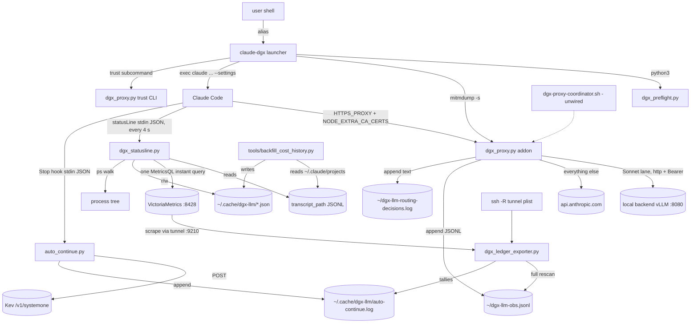

# Pass 0: Inventory — hylo-legacy

<!-- validated 2026-11-14: fresh-context cross-check against legacy/ source (static, read-only).
     Corrections applied: commit count 18 -> 19 (git rev-list --count HEAD -- legacy).
     See hylo-legacy-extraction-validation.md. -->


Scope: `$HOME/Dev/hylo/legacy/` only (the frozen, scrubbed Python/zsh prototype `claude-dgx`),
analyzed statically for a semantic port Python -> Go (`hylo`). Supporting inputs read: `docs/PLAN.md`
(D1-D12), `docs/STATUSLINE-WIDGETS.md`, `docs/STATUSLINE-REVIEW-2026-11-13.md`, `docs/RESUME.md`,
`legacy/ROLLBACK.md`. Nothing in `legacy/` was executed; files were only read, AST-parsed and
byte-compiled from a scratchpad script (all 6 Python files compile under Python 3.11.7).

## Tech Stack

| Aspect | Finding | Evidence |
|---|---|---|
| Language | Python 3 (stdlib only, except the proxy addon), zsh | shebangs `#!/usr/bin/env python3`, `#!/bin/zsh` |
| Python version in use | `python3` on PATH (3.11.7 on the analysis host); exporter plist pins `/usr/bin/python3` | `claude-dgx:161,176`, `deploy/io.hylo.ledger-exporter.plist:6` |
| Third-party deps | **mitmproxy** (only `dgx_proxy.py`, imported optionally; runs in a venv `legacy/.mitmenv`, not in tree) | `dgx_proxy.py:42-46`, `claude-dgx:61,75` |
| External tools shelled out | `ps` (statusline), `security`, `openssl`, `pgrep` (trust CLI), `claude` (hook, dead path), `nc`, `curl`, `whoami`, `basename` (launcher), `lsof`, `flock` (coordinator), `ssh` (tunnel plist) | `dgx_statusline.py:280`, `dgx_proxy.py:568-606`, `auto_continue.py:155`, `claude-dgx:21,43,73,85`, `dgx-proxy-coordinator.sh:15,43`, `deploy/io.hylo.ledger-tunnel.plist:6` |
| Build system | none (scripts run in place) | — |
| Test framework | **none in tree** — 0 test files. Verification evidence lives only in `docs/STATUSLINE-REVIEW-2026-11-13.md` ("N/N cases pass") | `find legacy -name '*test*'` = 0 |
| Service manager | macOS launchd (2 LaunchAgents) | `deploy/*.plist` |

## File Manifest (recounted with `find … -exec wc -l`)

| Path | Type | Priority | Lines | Purpose | Invoked by | Go target (PLAN.md §4/§6) |
|---|---|---|---|---|---|---|
| `dgx_statusline.py` | Python | 1 (entry) | 1245 | Two-row status line: session row + GB300 telemetry row; incremental transcript parser; cost history; `--subagent` panel rows | Claude Code `statusLine` setting injected by launcher (`claude-dgx:176`), stdin JSON, every refresh (`refreshInterval: 4`) | `hylo statusline` (`internal/statusline`, `internal/platform` for `⌂`) |
| `dgx_proxy.py` | Python (mitmproxy addon + CLI) | 1 (entry) | 764 | TLS-intercepting router: lane decision, request normalization, SSE usage tap, ledger, routing-decision log, `anth_ratelimit`; plus `trust {install,status,remove,rotate}` CLI | `mitmdump -s dgx_proxy.py` launched per window by the launcher (`claude-dgx:75`); CLI via `claude-dgx trust …` (`claude-dgx:11-14`) | `hylo proxy` (`internal/proxy`, `internal/ledger`); trust CLI -> `hylo ca` (`internal/ca`) |
| `dgx_ledger_exporter.py` | Python | 1 (entry) | 414 | Prometheus exporter over the ledger + Stop-hook log, `:9210/metrics` | LaunchAgent `io.hylo.ledger-exporter` (`deploy/io.hylo.ledger-exporter.plist:5-8`) | `hylo exporter` (`internal/ledger`) + per-OS service units |
| `auto_continue.py` | Python | 1 (entry) | 275 | Claude Code Stop hook: non-English policing, colon-fake catch, Kev p(done) oracle, regex fallback | Stop hook in launcher `--settings` (`claude-dgx:161`), stdin JSON | `hylo hook stop` (`internal/hook`; Kev = optional URL, D11) |
| `claude-dgx` | zsh | 1 (entry) | 185 | Launcher: env, attribution headers, preflight, per-window mitmdump, Claude Code args + `--settings` JSON | user alias | `hylo run` (+ config profiles) |
| `dgx-proxy-coordinator.sh` | zsh | 3 | 50 | Singleton proxy coordinator (flock + port state). **Not referenced by any other file** (grep: only self-references) — an unwired prototype of the "one proxy per user" model | nobody (manual) | built into `hylo proxy` / `hylo run` |
| `dgx_preflight.py` | Python | 2 | 41 | TCP reachability check to the upstream (macOS Local Network diagnosis) | launcher (`claude-dgx:63`) | `hylo doctor` |
| `tools/backfill_cost_history.py` | Python | 3 | 121 | One-off seeding of `cost-history.json` from `~/.claude/projects/*/*.jsonl` | manual | `hylo cost backfill` |
| `deploy/io.hylo.ledger-exporter.plist` | launchd XML | 2 | 13 | Keeps the exporter alive (RunAtLoad, KeepAlive) | launchd | per-OS service unit for `hylo exporter` |
| `deploy/io.hylo.ledger-tunnel.plist` | launchd XML | 2 | 18 | `ssh -N -R 127.0.0.1:9210:127.0.0.1:9210 dgx` so the DGX VictoriaMetrics can scrape the exporter | launchd | per-OS service unit (or doc) |
| `ROLLBACK.md` | doc | 4 | 55 | Rollback/handoff notes (refers to checkpoint dirs and `opus_router.py` that are **not** in the tree) | — | `docs/` |
| **Total** | 11 files | | **3181** | Python 2860, zsh 235, plist 31, md 55 | | |

Out of scope (per D6 / task brief):
- `opus_router.py` (visible mode) — **absent from `legacy/`** (removed in commit `220e96c`), yet still referenced by the launcher's `DGX_INVISIBLE=0` path (`claude-dgx:85-96,102`) and `ROLLBACK.md:9-14`. That path is broken in the frozen tree. Not ported.
- `dgx_statusline.py --subagent` (`render_subagent_rows`/`main_subagent`, `dgx_statusline.py:837-936`, dispatch `:1240-1241`) — `subagentStatusLine` removed in Claude Code 2.1.323. Not ported.

## Symbol inventory (AST)

| File | Functions / classes (line) |
|---|---|
| `dgx_statusline.py` | `truecolor` 140, `heat` 144, `visible` 151, `fetch_sample` 158, `load_cache` 190, `save_cache` 198, `record_cost` 224, `cost_thresholds` 240 (`pct` 257), `claude_window_start` 265, `effective_rl` 298, `get_sample` 315, `git_branch` 364, `git_segment` 399, `fmt_ctx` 418, `render_lane` 440 (`_hm` 545), `_norm_pt` 652, `sparkline` 659 (`idx` 673), `render_telemetry` 693, `serving_state` 705, `render_telemetry_fields` 725, `_fmt_lines` 849, `_fmt_tok_c` 863, `_fmt_tokens` 876 (subagent only), `render_subagent_rows` 888, `main_subagent` 928, `_iso_ts` 977, `_finish_turn` 988, `_mix_counts` 999, `mix_labels` 1157, `mix_segment` 1177, `term_cols` 1185, `trim_to_fit` 1193, `main` 1200 |
| `dgx_proxy.py` | `ledger` 56, `note` 65, `class DGXRouter` 77 (`__init__` 78, `_key` 91, `request` 98, `responseheaders` 170, `response` 210, `error` 311), `_account_hint` 326, `cache_fields` 339, `class _SSETap` 362 (`cache` 381, `_absorb_cache` 389, `feed` 398, `_scan` 412), `extract_stop_reason` 439, `uses_server_tool` 459, `normalize_for_dgx` 467, module hooks `request` 524 / `websocket_start` 528 / `websocket_end` 533 / `responseheaders` 539 / `response` 543 / `error` 547, trust CLI `_login_keychain` 567 … `_build_parser` 737 |
| `dgx_ledger_exporter.py` | `_current_size` 64, `esc` 71, `_account_device` 75, `rebuild` 94, `class Handler` 269 (`do_GET` 270, `log_message` 406) |
| `auto_continue.py` | `kev_state` 64, `kev_pdone` 94, `kev_pdone_median` 124, `opus_verdict` 141 (**dead: never called**), `should_continue` 169, `non_english` 187, `_log` 193, `emit` 204, `main` 209 |
| `tools/backfill_cost_history.py` | `ts` 38, `session_cost` 42, `main` 84 |
| `dgx_preflight.py` | module-level script |

Dead code found: `opus_verdict` (`auto_continue.py:141-166`), `KEV_MESSAGES` (`auto_continue.py:35`, never read), `fetch_sample(sid8=None)` parameter (`dgx_statusline.py:158`), `websocket_start`/`websocket_end` (`dgx_proxy.py:528-536`, guarded by `hasattr(flow,"_ws_started")` which is never set), `STALE_SEC` (`dgx-proxy-coordinator.sh:11`, unused).

## Dependency Graph (runtime, not imports — the scripts never import each other)



## Entry Points and invocation

| Component | Entry | How invoked | Inputs | Outputs |
|---|---|---|---|---|
| Launcher | `claude-dgx:1` | `claude-dgx [trust …] [claude args…]` | env, `$PWD`, `~/.config/dgx-llm/profile.env` | starts mitmdump (bg), execs `claude` (not `exec`; waits, trap kills proxy) |
| Proxy addon | module load `dgx_proxy.py:518-548` | `mitmdump --set flow_detail=1 --listen-port $P -s dgx_proxy.py` (`claude-dgx:75`); one per window | env, API key file, flows | ledger, decision log, `~/dgx-llm-obs/failed-req-*.json` |
| Trust CLI | `dgx_proxy.py:759-764` | `python3 dgx_proxy.py trust <cmd>` | `~/.mitmproxy/mitmproxy-ca-cert.pem`, keychain | `~/.dgx/trust-state.json`, keychain entries |
| Statusline | `dgx_statusline.py:1238-1245` | `python3 '<HERE>/dgx_statusline.py'` per refresh | stdin JSON, env, transcript, VM, caches, `ps` | stdout 1-2 rows, exit 0 |
| Stop hook | `auto_continue.py:274-275` | `python3 '<HERE>/auto_continue.py'`, timeout 30 s | stdin JSON, transcript, Kev | stdout JSON or nothing |
| Exporter | `dgx_ledger_exporter.py:410-414` | `/usr/bin/python3 ~/hylo/legacy/dgx_ledger_exporter.py` (launchd) | ledger, auto-continue.log | HTTP `0.0.0.0:9210/metrics` |
| Preflight | `dgx_preflight.py:18` | `"$PF_PY" dgx_preflight.py "${DGX_UPSTREAM:-…}"` | URL arg | exit 0/1, message on stdout |
| Backfill | `tools/backfill_cost_history.py:120-121` | manual `[--days 30] [--dry-run]` | `~/.claude/projects/*/*.jsonl` | `~/.cache/dgx-llm/cost-history.json` |
| Coordinator | `dgx-proxy-coordinator.sh:40-50` | manual (unwired) | `$BASE/.proxy-state/` | `PORT=<p>` |

## Git provenance

19 commits touch `legacy/` (first `510c337` "Initial commit", last `220e96c` "Remove the visible-mode router"). The statusline is the post-review version (`464018b`, `fe93d81`, `16bb955`, `ad98c46`) per `docs/RESUME.md`.

## Anomalies noted during inventory

- `claude-dgx:27` contains mojibake bytes (`\xe2\x94\x80` sequences corrupted to `?`) in a comment — cosmetic.
- `claude-dgx:31-36` comment block duplicates text (copy/paste residue).
- `ROLLBACK.md` references `checkpoint-20261109-*` directories and `opus_router.py`, none present.
- The launcher's router port scan (`claude-dgx:15-22`) runs unconditionally, even in invisible mode.

## State Checkpoint
```yaml
pass: 0
status: complete
files_scanned: 11
timestamp: 2026-11-14T05:09:24Z
next_pass: 1
```
