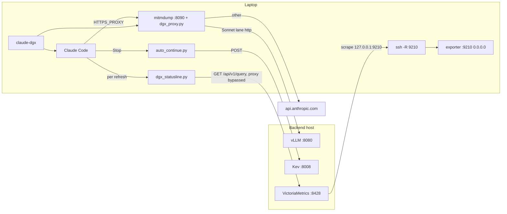
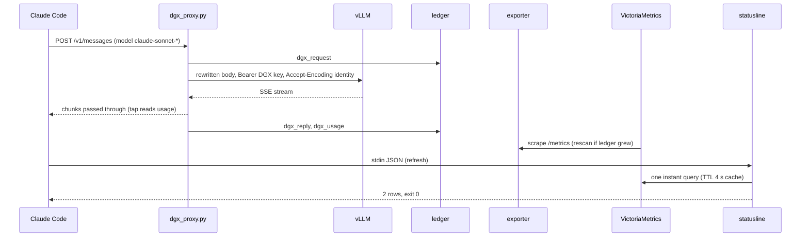

# Pass 1: Architecture — hylo-legacy

## 1. Component catalog

| # | Component | File | Responsibility | Process model | Go target |
|---|---|---|---|---|---|
| C1 | Launcher | `claude-dgx` | Build env + attribution headers, preflight, start a per-window mitmdump, assemble `claude` argv and `--settings` JSON, clean up on exit | short shell; parent of mitmdump and `claude` | `hylo run` |
| C2 | Proxy addon (router) | `dgx_proxy.py:26-548` | Intercept `api.anthropic.com`, decide lane per `/v1/messages` request, normalize DGX-bound bodies, tap SSE for usage, write ledger + decision log, capture plan-limit headers | long-lived mitmdump, **one per window** (ports 8090-8143) | `hylo proxy` (one per user) |
| C3 | CA trust CLI | `dgx_proxy.py:551-764` | Install/status/remove/rotate the mitmproxy CA in the macOS login keychain | one-shot CLI | `hylo ca` |
| C4 | Status line | `dgx_statusline.py` | Render row 1 (session/lane) and row 2 (backend telemetry) from stdin + transcript + VictoriaMetrics + caches | one process per refresh (stateless; state in cache files) | `hylo statusline` |
| C5 | Ledger exporter | `dgx_ledger_exporter.py` | Re-derive Prometheus counters from the full ledger + Stop-hook log on each scrape where the file grew | long-lived HTTP server (launchd) | `hylo exporter` |
| C6 | Stop hook | `auto_continue.py` | Decide whether to force a continuation (non-English, colon fake-stop, Kev p(done), regex fallback) | one process per Stop event | `hylo hook stop` |
| C7 | Preflight | `dgx_preflight.py` | TCP connect test to the upstream with OS-error diagnosis | one-shot | `hylo doctor` |
| C8 | Coordinator | `dgx-proxy-coordinator.sh` | Singleton mitmdump via flock + port/pid state (unwired) | one-shot | folded into `hylo proxy`/`run` |
| C9 | Cost backfill | `tools/backfill_cost_history.py` | Seed `cost-history.json` from historical transcripts | one-shot | `hylo cost backfill` |
| C10 | Services | `deploy/*.plist` | Keep exporter + reverse SSH tunnel alive | launchd agents | per-OS units |

Layering: there is no shared library. Coupling is **entirely through files, env vars and HTTP**:
the ledger (C2 -> C5), `auto-continue.log` (C6 -> C5), `cost-history.json` (C9 -> C4), env exported by
C1 and inherited by C2/C4/C6, and the VictoriaMetrics series fed by C5 through the tunnel (C5 -> VM -> C4).
Shared rules are **duplicated** rather than shared: the lane prefix rule (`dgx_proxy.py:85-87,132` vs
`dgx_statusline.py:444-446` vs `tools/backfill_cost_history.py:77,89`), account hint (`dgx_proxy.py:326-336`
vs `dgx_ledger_exporter.py:75-91`), stale-span rule (`dgx_statusline.py:994` vs `tools/backfill_cost_history.py:78`).

## 2. Deployment topology

Single-user laptop (macOS). Per Claude Code window: 1 launcher shell, 1 mitmdump (C2), N short-lived
statusline/hook processes. Per user: 1 exporter + 1 ssh tunnel (launchd). Remote: the backend host
(vLLM :8080, Kev :8008, VictoriaMetrics :8428) reached over plain HTTP on the LAN (`192.0.2.10` in the
scrubbed tree). The DGX-side recording rules that produce `dgx_*:*` series are **outside this repo**.



## 3. Data flow (one Sonnet request and its status-line echo)



## 4. External interfaces (verbatim)

### 4.1 Claude Code status line stdin — fields actually consumed (`dgx_statusline.py`)

| Field | Use | Line |
|---|---|---|
| `session_id` | cache keys, cost history key, `⌂` gate | 1016, 1214-1215, 605, 1229 |
| `transcript_path` | incremental parse | 1009 |
| `model.id` | lane pill, fallback model name | 442-446 |
| `model.display_name` | model label | 442 |
| `workspace.project_dir` -> `workspace.current_dir` -> `cwd` | git branch + project label | 451-452 |
| `context_window.used_percentage` | thermometer % (null before first call) | 419-422 |
| `context_window.context_window_size` | denominator | 423 |
| `prompt_cache.hit_ratio` | `♻` | 477 |
| `rate_limits.five_hour.{used_percentage,resets_at}`, `rate_limits.seven_day.{…}` | plan limits | 489, 501-509 |
| `cost.total_lines_added`, `cost.total_lines_removed` | `▲▼` | 535 |
| `cost.total_duration_ms` | timer, `⌂` delta | 539 |
| `cost.total_api_duration_ms` | api time, `$/h` | 550, 603 |
| `cost.total_cost_usd` | `$`, cost history | 601 |
| env `COLUMNS` | width (absent/non-numeric -> 0) | 1185-1190 |

Not consumed: `context_window.total_input_tokens/total_output_tokens` (deliberately, review #10.1),
`prompt_cache.cache_write_tokens`, `LINES`. Out of scope: `--subagent` stdin `columns`, `tasks[]` (`:888-925`).

### 4.2 Transcript JSONL — fields consumed

| Field | Consumer | Line |
|---|---|---|
| `type` (`assistant`/`user`/`system`), `subtype == "compact_boundary"` | turn state machine, compaction reset | 1069, 1086, 1088 |
| `timestamp` (ISO, `Z`) | turn timing | 1069, 977-985 |
| `message.id` | usage dedup, turn keying | 1072, 1098 |
| `message.usage.{input_tokens,cache_creation_input_tokens,cache_read_input_tokens,output_tokens}` | token totals, rebuilds, turn out | 1079, 1104-1112 |
| `message.content` str or blocks `tool_result{content}`, `text{text}`, `thinking{thinking}`, `tool_use{input}`, `image`; nested `image` items inside `tool_result.content` | composition; tool_result detection | 1081-1083, 1120-1149 |
| (backfill) `message.model`, `usage.cache_creation.ephemeral_{1h,5m}_input_tokens` | pricing/lane | `tools/backfill_cost_history.py:59,71-73` |
| (hook) `message.role` or `type`, `message.content` blocks `text`, `type`, `name` | Kev state | `auto_continue.py:74-83` |

### 4.3 Stop hook contract (`auto_continue.py`)

- Input (stdin JSON): `last_assistant_message`, `stop_hook_active`, `session_id`, `transcript_path` (`:214,226,198,245`).
- Output: either nothing (allow stop), or exactly one line
  `{"hookSpecificOutput": {"hookEventName": "Stop", "additionalContext": "<text>"}}` (`:206`). Exit code 0 in all
  handled paths; invalid JSON -> silent return (`:210-213`). A non-dict JSON body would raise (uncaught) -> exit 1.
- Registered with `"timeout":30` (`claude-dgx:161`). Whether Claude Code honors `additionalContext` for Stop
  (vs the documented `decision:"block"` form) is not verifiable from source — comments state production use
  (`auto_continue.py:233`). **UNVERIFIED — confirm against current Claude Code hook docs.**
- Side effects: append to `~/.cache/dgx-llm/auto-continue.log` (`:193-201`); POST to Kev (`:94-121`).

### 4.4 mitmproxy addon hooks used (`dgx_proxy.py:524-548`)

| Hook | Behavior |
|---|---|
| `request` | bridge WS connect log; lane decision; rewrite DGX-bound flows (`:98-167`) |
| `responseheaders` | `anth_ratelimit` capture; choose streaming vs buffering; attach SSE tap (`:170-208`) |
| `response` | `anth_reply`/`anth_usage`, `dgx_reply`/`dgx_usage`, failed-request capture (`:210-309`) |
| `error` | `{dgx,anthropic}_upstream_error` (`:311-323`) |
| `websocket_start`/`websocket_end` | effectively dead (`hasattr` guard never true, `:528-536`) |

mitmproxy options used: `flow_detail=1`, `--listen-port`, `response.stream = callable|bool`, `flow.request.{host,path,scheme,port,headers,get_text,set_text}`, `flow.response.{headers,status_code,get_text(strict=False),stream}`, `flow.error`. Custom attributes stashed on flows: `_attrib`, `_t0`, `_dgx`, `_dgx_t0`, `_sse_tap`.

### 4.5 Upstream HTTP calls

| Caller | Target | Method / details | Line |
|---|---|---|---|
| Proxy, DGX lane | `DGX_UPSTREAM` (default `http://192.0.2.10:8080`), same path | scheme/host/port swapped; `Authorization: Bearer <key file>`; `anthropic-beta` removed; `Accept-Encoding: identity`; `X-DGX-Project/User/Session` added | `dgx_proxy.py:79-83,156-166` |
| Proxy, Anthropic lane | `api.anthropic.com` unchanged | only `Accept-Encoding: identity` forced | `:131` |
| Statusline | `{DGX_SL_VM_URL}/api/v1/query?query=<urlquoted QUERY>` | GET, `ProxyHandler({})` (env proxy bypassed), timeout 1.5 s | `dgx_statusline.py:165-171` |
| Stop hook | `DGX_KEV_URL` (default `http://192.0.2.10:8008/v1/systemone`) | POST JSON `{"model","state","questions":{"turn_complete":DONE_QUESTION}}`, optional Bearer from `DGX_KEV_API_KEY` or `~/.config/dgx-llm/kev-api-key`, timeout 2.5 s, up to 3 tries; reads `answers.turn_complete.noul` | `auto_continue.py:94-121` |
| Preflight | TCP connect host:port of the URL arg | timeout 4 s | `dgx_preflight.py:18-24` |
| Launcher | `nc -z 127.0.0.1 <port>` probes | port scans | `claude-dgx:21,73,77-78` |

### 4.6 VictoriaMetrics query (verbatim, `dgx_statusline.py:102-123`)

It is **MetricsQL**, not portable PromQL (`alias`, `label_set` are VictoriaMetrics extensions):

```
{__name__=~"vllm:num_requests_running|vllm:num_requests_waiting|vllm:kv_cache_usage_perc|dgx_kv:host_hit_share|dgx_tokens:gen_rate5m|dgx_ttft:p95_30m|dgx_preempt:rate5m|dgx_llm_last_dgx_request_timestamp_seconds|dgx_power:est_wall_watts|dgx_power:rate_usd_per_kwh|dgx_cost:dgx_usd_per_mtok|dgx_tokens:rate_mtok_month|vllm:lmcache_mp_lookup_duration_seconds_count|DCGM_FI_DEV_POWER_USAGE|DCGM_FI_DEV_GPU_TEMP"} or up{job=~"vllm|lmcache"} or label_set(alias(sum(rate(vllm:generation_tokens_total[1m])), "dgx_sl:gen_rate1m"), "sl", "1m") or label_set(alias(sum(increase(vllm:time_to_first_token_seconds_count[30m])), "dgx_sl:ttft_n30m"), "sl", "n30m")
```

Result handling (`:172-185`): `status != "success"` -> None; per series `__name__` (`up` -> `up:<job>`); first
value per name wins; unparseable values skipped; empty map -> None. Series consumed by name:

| Series | Widget | Line |
|---|---|---|
| `vllm:num_requests_running`, `vllm:num_requests_waiting` | queue, idle gate | 732-741, 825 |
| `vllm:kv_cache_usage_perc` | KV gauge, spark `k` | 754, 340 |
| `dgx_kv:host_hit_share` | `↺host` | 755 |
| `dgx_sl:gen_rate1m` (fallback `dgx_tokens:gen_rate5m`) | `▣box`, spark `v` | 772, 339, 344 |
| `dgx_ttft:p95_30m`, `dgx_sl:ttft_n30m` | `◔`, spark `f` | 792-794, 341 |
| `dgx_preempt:rate5m` | queue yellow, spark amber | 740, 346 |
| `dgx_llm_last_dgx_request_timestamp_seconds` | `☾ idle` | 824 |
| `DCGM_FI_DEV_POWER_USAGE`, `DCGM_FI_DEV_GPU_TEMP`, `dgx_power:est_wall_watts`, `dgx_power:rate_usd_per_kwh` | `⚡` | 801-804 |
| `dgx_cost:dgx_usd_per_mtok`, `dgx_tokens:rate_mtok_month` | `⛏` | 1220-1223 |
| `vllm:lmcache_mp_lookup_duration_seconds_count`, `up:vllm`, `up:lmcache`, any `vllm:*` | health dot | 716-721 |

### 4.7 Prometheus metrics exported (`dgx_ledger_exporter.py:288-398`, verbatim names; D7 freezes them)

| Metric | TYPE line | Labels | Value fmt | Source events |
|---|---|---|---|---|
| `dgx_llm_requests_total` | counter | `project,user,model,account,device` | int | `dgx_request` (`:184-187`) |
| `dgx_llm_est_prompt_tokens_total` | counter | `project,user,account` | `%.0f` | `dgx_request.req_bytes/4` (`:190-193`) |
| `dgx_llm_tokens_input_total` | counter | `project,user,account` | int | `dgx_usage.in_tok` |
| `dgx_llm_tokens_output_total` | counter | `project,user,account` | int | `dgx_usage.out_tok` |
| `dgx_llm_tokens_cache_read_total` | counter | `project,user,account` | int | `dgx_usage.cache_read_tok` |
| `dgx_llm_tokens_input_captured_total` | counter | `project,user,account` | int | `dgx_usage.in_tok` where cache field present |
| `dgx_llm_anthropic_requests_total` | counter | `project,user,model,account` | int | `anth_request` (account is **always `unknown`**: event has no `account` field) |
| `dgx_llm_anthropic_tokens_input_total` | counter | `project,user,model,account` | int | `anth_usage.in_tok` |
| `dgx_llm_anthropic_tokens_output_total` | counter | same | int | `anth_usage.out_tok` |
| `dgx_llm_anthropic_request_duration_seconds_sum` | counter | same | `%.3f` | `anth_usage.duration_s` — **field never written by the proxy -> always 0.000** |
| `dgx_llm_anthropic_request_duration_seconds_count` | counter (TYPE only, no HELP) | same | int | same -> always 0 |
| `dgx_llm_anthropic_tokens_cache_read_total` | counter | same | int | `anth_usage.cache_read_tok` |
| `dgx_llm_anthropic_tokens_cache_write_total` | counter | same + `ttl="5m"` or `ttl="1h"` | int | derived 5m = write - min(1h, write) |
| `dgx_llm_anthropic_usage_cache_captured_total` | counter | same | int | count of usage events with cache fields |
| `dgx_llm_request_duration_seconds_sum` | counter | `project,user` | `%.3f` | `dgx_reply.duration_s` |
| `dgx_llm_request_duration_seconds_count` | counter (TYPE only) | `project,user` | int | same |
| `dgx_llm_request_errors_total` | counter | `project,user` | int | `dgx_reply.status>=400` + `dgx_upstream_error` |
| `dgx_llm_anthropic_passthrough_total` | counter | — | int | `anth_reply`/`anthropic_reply` with `status==200` |
| `dgx_llm_last_request_timestamp_seconds` | gauge | — | `%.0f` | max `t` of any event |
| `dgx_llm_last_dgx_request_timestamp_seconds` | gauge (only if >0) | — | `%.0f` | max `t` of `dgx_request` |
| `dgx_llm_last_anthropic_request_timestamp_seconds` | gauge (only if >0) | — | `%.0f` | max `t` of `anth_request` |
| `dgx_llm_session_requests` | gauge | `session(8 chars),project,user` | int | recent 50 DGX sessions |
| `dgx_llm_session_tokens_in`, `dgx_llm_session_tokens_out`, `dgx_llm_session_errors` | **no HELP/TYPE** (HELP/TYPE emitted for a non-existent `dgx_llm_session_tokens`) | same | int | same |
| `dgx_llm_fakestop_events` | counter | `kind` in {`kev_caught`, `colon_caught`, `heuristic`, `kev_plus_opus`, `allowed`} | int | `auto-continue.log` |
| `dgx_llm_fakestop_p_done_latest` | gauge (TYPE only, conditional) | — | `%.3f` | last `p_done=` in log |

Served `HTTP 200`, `Content-Type: text/plain; version=0.0.4`, on `0.0.0.0:9210`, path `/metrics` only (else 404).

### 4.8 Files read/written

| Path (default) | Override env | Writer | Reader | Format |
|---|---|---|---|---|
| `~/dgx-llm-obs.jsonl` | `DGX_OBS_LEDGER` | proxy `ledger()` append (`dgx_proxy.py:56-62`) | exporter (`:115`) | JSONL, schema in Pass 2 |
| `~/dgx-llm-routing-decisions.log` | `DGX_PROXY_DECISIONS` | proxy `note()` (`:65-74`) | humans | `YYYY-mm-dd HH:MM:SS <msg>` local time |
| `~/dgx-llm-obs/failed-req-<ms>.json` | — | proxy on DGX >=400 (`:288-299`) | humans | raw request body, 20 newest kept |
| `~/.config/dgx-llm/api-key` | `DGX_KEY_FILE` | — | proxy (`:88-95`) | text, stripped |
| `~/.config/dgx-llm/kev-api-key` | `DGX_KEV_API_KEY` (value) | — | hook (`:97-102`) | text |
| `~/.config/dgx-llm/profile.env` | `DGX_PROFILE` | — | launcher (`:114-115`) | zsh `set -a` source |
| `~/.mitmproxy/mitmproxy-ca-cert.pem` | — | mitmproxy | launcher (`NODE_EXTRA_CA_CERTS`), trust CLI | PEM |
| `~/.dgx/trust-state.json` | `DGX_TRUST_STATE` | trust CLI (`:616-622`) | trust CLI | JSON indent 2, sorted keys |
| `~/.cache/dgx-llm/statusline-<session_id>.json` | — | statusline | statusline | JSON: `fetch_ts, up, ts, sample{}, hist[], rl{}, rl_ts, proc_start` |
| `~/.cache/dgx-llm/statusline-mix-<sanitized sid[:40]>.json` | — | statusline | statusline | JSON: `size,res,conv,think,tin,tout,c_wr,c_rd,mixv6,c_in,rb,pp,ids[≤256],lr,lu,cur` (`:1150-1153`) |
| `~/.cache/dgx-llm/statusline-git-<sha1(path)[:16]>.json` | — | statusline | statusline | `{ts, branch}` (`:405-411`) |
| `~/.cache/dgx-llm/cost-history.json` | — | statusline `record_cost`, backfill | statusline | `{"sessions":{sid:{lane,usd,api_ms,ts,src}}}` with src `cc` or `backfill` |
| `~/.cache/dgx-llm/auto-continue.log` | `DGX_FAKESTOP_LOG` (reader only) | hook (`:193-201`) | exporter (`:214-236`) | `YYYY-mm-dd HH:MM:SS [kind] kev=<v> session=<sid> stop_hook_active=<b> tail=<python repr>` |
| `$TMPDIR/dgx-mitm.<pid>.<port>.log` | `TMPDIR` | mitmdump stdout | humans | text |
| `/tmp/dgx-ledger-{exporter,tunnel}.log` | — | launchd | humans | text |
| `~/.claude/projects/*/*.jsonl` | — | Claude Code | backfill | transcripts |

## 5. Cross-cutting concerns

| Concern | Pattern | Evidence |
|---|---|---|
| Error handling | "never raise" swallow-all in every I/O helper; statusline top-level fallback `statusline degraded` | `dgx_statusline.py:186,194,205,1243-1245`; `dgx_proxy.py:61,73,189,298`; `auto_continue.py:84,119,200` |
| Logging | append-only text files opened per write (immune to buffering) | `dgx_proxy.py:70-73` |
| Atomic writes | `mkstemp` + `os.replace` | `dgx_statusline.py:198-206`, `dgx_proxy.py:616-622`, backfill `:113-116` |
| Configuration | env vars read at import time with defaults; no config file except `profile.env` | Pass 5 inventory |
| Auth | DGX Bearer key from file; Anthropic credentials pass through untouched | `dgx_proxy.py:91-95,164` |
| Time | local wall clock strings in ledger/logs; unix floats in caches | Pass 5 determinism inventory |
| Attribution | `ANTHROPIC_CUSTOM_HEADERS` -> `X-DGX-Project`/`X-DGX-User` + CC's `X-Claude-Code-Session-Id` | `claude-dgx:43-53`, `dgx_proxy.py:117-121` |

## State Checkpoint
```yaml
pass: 1
status: complete
files_scanned: 11
timestamp: 2026-11-14T05:09:24Z
next_pass: 2
```
