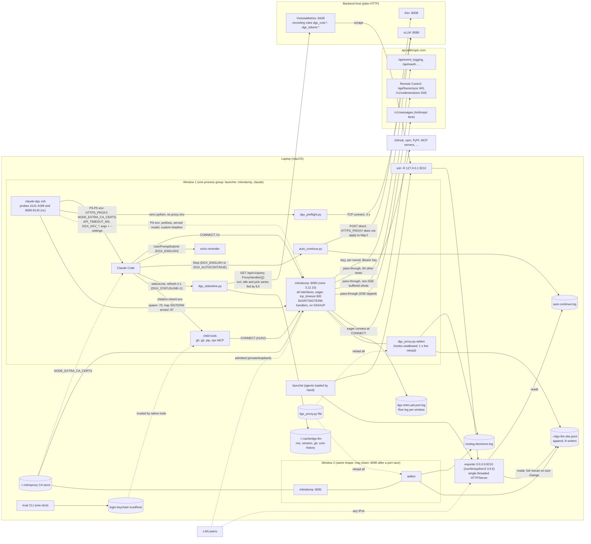
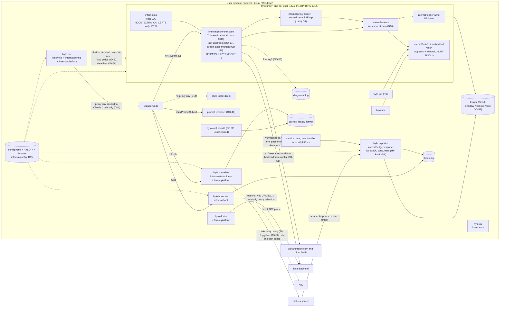

# Pass 1 Deepening — Round 2: Architecture audit, Kev proxy-selection verdict, sibling reconciliation, diagram re-check — hylo-legacy

- Source: `$HOME/Dev/hylo/legacy/` (read-only, static). Re-read this round: `claude-dgx` (all 185 lines), `dgx_proxy.py:50-106,168-210,294-324,400-408,515-548`,
  `dgx_statusline.py:73-89,158-206,298-312,415-606,820-834,1198-1245`, `auto_continue.py:20-36,88-140`, `dgx_ledger_exporter.py:20-28,262-290,396-414`
  (plus a name census of `:289-398`), `dgx_preflight.py:13-41`, both `deploy/*.plist` (all).
- Authorized extra sources, read-only. **mitmproxy 12.3.1** (cited as m/`<module>:<line>`): `options:9,78-100,131-136,159-180,240-246`,
  `addons/proxyserver:147-176`, `addons/block:8-48`, `addons/dumper:54-58`, `addons/script:71-150,205-220`, `addonmanager:44-59`,
  `proxy/server:106-110,206,344-354`, `proxy/layers/http/__init__:786-800,930-946`, `proxy/mode_servers:252-266`, `addons/errorcheck:28-46`,
  `net/tls:13,217-220`, `certs:40-41`, `tools/main:115-140`. **CPython 3.11 stdlib** (cited as u/`<line>` = `/opt/homebrew/anaconda3/lib/python3.11/urllib/request.py`):
  `138-216, 438-468, 500-541, 569-600, 791-832, 2499-2545, 2632-2663`. This was used only for the urllib proxy-selection claim.
- Inputs read: this pass's round 1 (all of it) and the broad sweep (all of it); pass-0 deep r1 (all of it) and **r2** (all of it; it appeared during this round). Also pass-4 deep r1
  (header, §0, threshold rows T-118..T-127, R-/S- rows, OD-54..57) and pass-5 deep r1 (header, ENV-19..22, ENV-I12..I15, DET-26). From passes 2 and 3: pass-3 r4 §7 (BC-LN and BC-PX
  index rows), pass-3 r8 §4 (totals), and `docs/PLAN.md` §6. Pass-2 r8 §7 was used as the pointer table. Its facts are cited, not re-derived.
- Method: nothing from legacy ran. No proxy ran and nothing was networked. `CLAUDE.local.md` was not read and nothing was committed. Two local host facts were checked: `command -v python3`, which gives
  `/opt/homebrew/anaconda3/bin/python3` = 3.11.7, and `python3 -I -c 'import ssl; print(ssl.get_default_verify_paths())'`, which gives cafile
  `/opt/homebrew/anaconda3/ssl/cert.pem`. The metric census used `awk` over a copy of `EX:289-398`, kept in scratch `p1r2/ex.txt`.
- Numbering: **CONV-ABS-57..59** are used and 60 is not. One new owner item, **OD-66** (OD-67..69 unused). Cross-pass markers are cited by their existing numbers:
  CONV-ABS-29 (pass 0, `flock`), CONV-ABS-44 (pass 4, pass-through buffering) and CONV-ABS-53 (pass 0, venv package list).
- Notation: a bare `:N` means `dgx_proxy.py`. `L:` = `claude-dgx`, `EX:` = exporter, `SL:` = status line, `HK:` = hook, `PF:` = preflight.

---

## 0. Audit of round 1 against the five hallucination classes

| Class | Finding in round 1 | Verdict |
|---|---|---|
| 1 Over-extrapolated lists | §A.3 option values. All 10 option rows and 4 built-in rows match mitmproxy 12.3.1 source (§A.1 rows 7a-7n). §B.1 stdin list: a full census of nested `.get` reads on the main path found no extra field and no phantom field (§A.1 row 8) | none |
| 2 Miscounted enumerations | §A.3 is called a "13-row" table (Remaining Gaps 1) with "13 behavior-deciding defaults" (Delta). It has **14 rows**: 10 options and 4 built-in behaviors. The env-input count "40" (§C, Configuration row) is **42** per pass-2 r2 l.25 and r4 l.221, re-confirmed by pass-0 r2 §2.5 | **CONV-ABS-58** (14), **CONV-ABS-59** (42) |
| 3 Named-pattern fabrication | none | — |
| 4 Same-basename conflation | none. `python3` is resolved three ways (Anaconda 3.11.7, Homebrew 3.15.0, `/usr/bin` 3.9.6; pass-0 r2 §2.6). Round 1 kept the status line/hook interpreter and the exporter interpreter apart | — |
| 5 Inflated metrics | 28 / 27 metric names, 13 events, 19 + 8 stdin paths and 18 mapping rows were all recounted. They hold (§A.1). The 85 upstream hosts and the per-event ledger counts are **carried** from P2r8 §0 / P2r9 §2.1 and were not re-derived, because the production logs and ledger are not authorized for this pass | none |

---

## A. Round-2 audit of every new round-1 claim

### A.1 Verification table

| # | Round-1 claim | Check this round | Evidence | Verdict |
|---|---|---|---|---|
| 1 | **CONV-ABS-35**: every tunnelled host is TLS-terminated; only `api.anthropic.com` + `/v1/messages*` is routed | `ignore_hosts` default `[]`, `allow_hosts` default `[]`, launcher sets neither; request hook returns early for everything else | m/`options:82-84,93`; `L:75`; `:103-104` | **confirmed** (85-host count carried, P2r8 §0) |
| 2 | **CONV-ABS-36**: proxy env reaches the whole process tree; no `NO_PROXY` | Proxy-variable census over all 11 files: the only references are `L:79` (export), the `:3` docstring and `SL:166-168` (bypass). `claude` is a child, not `exec`'d (`L:185`) | `L:79-80,185` | **confirmed**. Refined in §B.2: the *proxy* and the *preflight* do **not** get the proxy env (both start before `L:79`) |
| 3 | **CONV-ABS-37**: rescan on any size change or non-empty `rebuild`; second `stat` after rebuild | `grew = os.stat(LEDGER).st_size != processed_size`; `if params.get("rebuild") or grew: rebuild(); processed_size = _current_size()`; startup `rebuild()` before bind | `EX:271-287,411-414` | **confirmed** |
| 4 | **CONV-ABS-38**: I/O helpers catch `OSError` only; true swallow-all sites are `:189`, `:406`, `SL:1243` | `ledger()` `except OSError` `:61`; `note()` write `except OSError` `:73`; capture `:298`; `:189` and `:406` `except Exception`; `SL:1243` `except Exception` | `:56-74,189,298,404-407`; `SL:1238-1245` | **confirmed, one refinement**: `note()`'s **format** step is also a swallow-all (`:66-69`, `except Exception: pass`). Only its write is `OSError`-only. The catalogue of swallow-all sites gains `:68` |
| 5 | **C2a** mitmproxy runtime as its own component | listener, admission, eager CONNECT, TLS for all hosts, certifi, per-tunnel pools, watchdog, safecall, script reload, CA, flow log: each is backed by a row below | rows 7a-7n | **confirmed**; two built-in behaviors added (§B.4) |
| 6 | **C6b** UserPromptSubmit hook, inline `echo`, timeout 5, iff `DGX_ENGLISH != 0` | verbatim | `L:156-159` | **confirmed**; mapping now blocked by **OD-46** (pass 0) |
| 7a | `listen_host` `""` | default `""` | m/`options:94-99` | confirmed |
| 7b | `block_global` True / `block_private` False; loopback always admitted | defaults and `client_connected` logic | m/`addons/block:10-48` | confirmed |
| 7c | `connection_strategy` eager → 502 at CONNECT on connect failure | default `"eager"`; `handle_connect_regular` opens the server connection and makes a 502 | m/`addons/proxyserver:154-161`; m/`proxy/layers/http/__init__:786-800` | confirmed |
| 7d | `ignore_hosts` `[]` | see row 1 | m/`options:82-84` | confirmed |
| 7e | `ssl_insecure` False; certifi only | default False; `ca_pemfile = certifi.where()` when no CA path is set | m/`options:173-180`; m/`net/tls:13,217-220` | confirmed |
| 7f | `http2` True | default True | m/`options:131-135` | confirmed |
| 7g | `websocket` True | default True | m/`options:159-164` | confirmed |
| 7h | `tcp_timeout` 600 s, watchdog cancels the handler | default 600; `on_timeout` → `handler.cancel("timeout")` | m/`options:240-246`; m/`proxy/server:344-354` | confirmed |
| 7i | `store_streamed_bodies` False | default False | m/`addons/proxyserver:147-153` | confirmed |
| 7j | `max_conns` 5 per address per client connection | `defaultdict(lambda: asyncio.Semaphore(5))` on the per-client `ConnectionHandler`, keyed by `command.connection.address` | m/`proxy/server:106-110,206` | confirmed |
| 7k | Hook dispatch `safecall` | re-raises only `AddonHalt`/`OptionsError`; otherwise logs `Addon error` | m/`addonmanager:44-59` | confirmed |
| 7l | Script loader: `reload=True`, 1 s poll; failed import at reload leaves no addon; vanished file removes the script | `Script(s, True)`; `ReloadInterval = 1`; `loadscript` removes the old ns before the guarded load; `FileNotFoundError` → script removed from options, watcher returns; at startup a missing file raises `OptionsError` | m/`addons/script:74,82-100,113-131,133-150,218` (round 1 cited only `:210-218`) | confirmed (cite widened) |
| 7m | Signals: SIGINT/SIGTERM → shutdown; SIGHUP/SIGKILL → immediate death | `loop.add_signal_handler(SIGINT, …)` and `(SIGTERM, …)` → `master.shutdown` (DumpMaster has no `prompt_for_exit`); no SIGHUP handler; SIGPIPE ignored | m/`tools/main:115-138` | **confirmed**. New consequence in §B.3 |
| 7n | CA store: RSA 2048, CA 10 y, leaves 199 d | `KEY_SIZE = 2048`; `CA_EXPIRY = 10*365 d`; `CERT_EXPIRY = 199 d` | m/`options:9`; m/`certs:40-41` | confirmed |
| 7o | Port-race loser exits on bind failure | `OSError` re-raised from `_start`; `ErrorCheck` exits 1 on startup errors | m/`proxy/mode_servers:252-266`; m/`addons/errorcheck:28-46` | confirmed |
| 8 | stdin: **19 leaf paths, 8 objects** | full census of `d.get` / nested `.get` on the main path (`SL:419,423,441-452,463,477,489,501-504,534-550,601-605,1009,1016,1214-1216,1229`) | as cited | **confirmed** (19 leaves + `rate_limits` stored whole; objects `model, workspace, context_window, prompt_cache, rate_limits, five_hour, seven_day, cost`) |
| 9 | **6 addon hooks** (4 live, 2 dead) | module functions `request :524`, `websocket_start :528`, `websocket_end :533`, `responseheaders :539`, `response :543`, `error :547`; ws guard `hasattr(flow, "_ws_started")` never true | `:524-548` | **confirmed**. The Claude Code-side hooks are 2: Stop and UserPromptSubmit |
| 10 | **85 upstream hosts** | not re-derived | P2r8 §0 | carried |
| 11 | **28 names declared, 27 with samples**; TYPE/HELP column | awk census: **28** distinct `dgx_llm_*` names; **25** with a TYPE line; **22** with HELP. TYPE without HELP: `…anthropic_request_duration_seconds_count`, `…request_duration_seconds_count`, `…fakestop_p_done_latest` (#11, #16, #28). Neither: `session_tokens_in/out`, `session_errors` (#24-26). HELP/TYPE only, no sample: `session_tokens` (#23) | `EX:289-398` | **confirmed** (all six "no HELP" marks in §B.6 correct) |
| 12 | **13 ledger events** | 11 `ledger(` call sites write 12 names: `bridge_ws_connect :101`, `anth_request :134,:139`, `dgx_request :154`, `anth_ratelimit :188`, `bridge_ws_close :213`, `anth_reply :245`, `anth_usage :247`, `dgx_reply :272`, `dgx_usage :276`, `{dgx,anthropic}_upstream_error :322`, `ws_closed :536`. The 13th is the historical `anthropic_reply`, which is read only | as cited | **confirmed** (counts carried, P2r9 §2.1) |
| 13 | **18-row target mapping** | 18 rows counted. BC ranges: PX 49 + SL 103 + EX 27 + HK 23 + LN 11 + PF 2 + CO 2 + BF 13 + SV 2 = **232**, matching P3r8 §4. Every BC-PX-001..049 is placed at least once (022 and 048 twice, by design) | P3r4 §7 l.400-423; P3r8 l.245 | **confirmed, 6 corrections** (§C) |
| 14 | `C7` preflight "run with the proxy's Python" (`L:60-67`) | `PF_PY="$HERE/.mitmenv/bin/python"` in invisible mode, `python3` otherwise; raw `socket.create_connection`, 4 s; runs **before** `HTTPS_PROXY` is exported | `L:60-68`; `PF:18-41` | confirmed; version **3.12.10** (pass-0 r1 B.1); cite is `L:60-68` |
| 15 | `C8` "`flock` absent on macOS, so it would run unlocked" | `command -v flock` → `/opt/homebrew/bin/flock` | pass-0 r1 §5, r2 V7 | **wrong as written**. Corrected under the existing **CONV-ABS-29** (not part of *base* macOS; present on this host and supports `flock 9`). It is moot anyway: the coordinator's `lsof` line grep for `mitmdump` can never match, because the processes show as `python3.12` (pass-0 r2 §3.1) |
| 16 | **Kev-direct claim** (§B.4: "with the default `http://` URL the exported `HTTPS_PROXY` does not apply … not source-read here") | read from source (§A.2) | u/`2499-2528, 795-804, 438-468, 569-597, 212-216, 2662-2663` | **CONFIRMED** (label "not source-read" removed) |
| 17 | Round-1 Remaining Gaps: "OD-44 and OD-46..OD-49 unused" | pass 0 issued OD-46..48 | pass-0 r1 §6 | wording fix: only **OD-44, OD-49** unused (plus OD-62..65 per pass-0 r2; OD-67..69 after this round) |

### A.2 Kev-direct verdict (settled from the CPython 3.11 source)

**Verdict: in production the Stop hook's Kev POST goes direct, not through mitmdump. It uses neither `HTTPS_PROXY` nor `HTTP_PROXY`.** Round 1's statement holds. Pass 0's
"the hook honors env proxies / does not bypass the proxy" is also true. The two statements do not contradict each other: the hook never opts out, but no
configured proxy matches its scheme.

The source chain:
1. `auto_continue.py:110,113` builds `urllib.request.Request(KEV_URL, …)` and calls the module-level `urlopen(req, timeout=…)`. No `context`, `cafile` or opener is passed.
2. u/`212-216`: with no context and no installed opener, `urlopen` uses `build_opener()`. u/`579-597`: the default handler classes start with
   **`ProxyHandler`**, which is instantiated with no argument.
3. u/`795-804`: `ProxyHandler(None)` → `proxies = getproxies()`, and for **each key** of that dict it creates one method `<key>_open`.
4. u/`2662-2663` (darwin): `getproxies() = getproxies_environment() or getproxies_macosx_sysconf()`. u/`2499-2528`: each non-empty env var whose
   lowercased name ends in `_proxy` gives the key `name[:-6]`, so the launcher's `HTTPS_PROXY` gives `{"https": "http://127.0.0.1:<port>"}`. The dict is non-empty,
   so **the macOS system proxy settings are never consulted**.
5. u/`438-468`: `OpenerDirector.add_handler` registers handlers by method name. `ProxyHandler` therefore registers `https_open` only, and an `http://` request
   reaches only `HTTPHandler.http_open`, a direct TCP connection to the Kev host.
6. The launcher exports only `HTTPS_PROXY` (`L:79`). No file in the tree sets `HTTP_PROXY`, `http_proxy`, `ALL_PROXY` or `NO_PROXY` (census, row 2).

Conditions and consequences (new this round):
- **Conditional on the inherited environment.** If the user's shell, or `profile.env` (sourced with `set -a` after the proxy starts, `L:114-115`), sets
  `HTTP_PROXY`/`http_proxy`, the hook sends Kev through *that* proxy, because `http_open` gets installed. If it sets a lowercase `https_proxy`, the second pass at u/`2521-2527`
  **overrides** the launcher's uppercase `HTTPS_PROXY` for every urllib child. Neither case is determinable from the tree (LOW).
- **An `https://` Kev URL** would go through mitmdump (`https_open` exists). mitmdump would terminate TLS with its own leaf, and the hook's Python verifies against
  Anaconda's OpenSSL bundle (`/opt/homebrew/anaconda3/ssl/cert.pem`, by `create_default_context`), not the login keychain or `NODE_EXTRA_CA_CERTS`. The
  handshake would therefore fail, `URLError` is caught (`HK:119`), and the hook silently falls back to its heuristic. This is static inference, MEDIUM-LOW: a search for the string `mitmproxy` in the bundle
  found 0 hits, which is weak evidence for a PEM file.
- **Status line contrast:** `ProxyHandler({})` (`SL:168`) installs no `*_open` methods and is passed explicitly, so it skips the env proxies **and** the macOS system
  settings.
- **hylo consequence (feeds pass-5 DET-26 / ENV-I15):** under D14 the hook gets no proxy env. A urllib-style client would then fall back to **OS proxy settings**,
  which legacy production never consulted (step 4). Go's `http.ProxyFromEnvironment` reads env only, so a Go hook Kev client with env-only proxy selection reproduces
  legacy's effective "direct" behavior. Stated as a design default for `internal/hook`. No new OD.
- Not checked: the Homebrew `python3` 3.15.0 that a PATH without Anaconda would pick (pass-0 r2 §2.6). Only the 3.11 stdlib is authorized.

---

## B. Reconciliation with pass-0 deep r1 and r2, and the facts folded into the architecture

### B.1 Pass-0 findings against pass-1 round 1

| Pass-0 item | Pass-1 r1 state | Resolution |
|---|---|---|
| Preflight on venv **3.12.10** (r1 B.1) | C7 "proxy's Python", no version | consistent; version folded into C7 |
| Status line bypasses the proxy for VM; hook's Kev call does not bypass (r1 C.2) | B.4: VM bypass, Kev "direct (http)" | **no contradiction** (§A.2). Pass 0 states the opt-out fact and pass 1 the effective path. Both are true |
| 4141-4199 `nc` probe in every mode, exit 1 if all busy (r1 C.2; r2 V4: skipped when `ROUTER_PORT` is set, runs before preflight) | B.4 row "Launcher" | consistent; C1 gains the failure exit (`L:17-22`) |
| Hidden tunnel dependency of the idle widget (r1 C.3), **widened to 2 widgets** in r2 V6: `☾` (`SL:824`) and `⛏` (`SL:1220-1223`), whose `dgx_cost:dgx_usd_per_mtok` / `dgx_tokens:rate_mtok_month` are recording rules over the exporter's token counters (P2r3 l.168-169, 184) | B.5 names only `☾`'s series; D.1 does not draw the chain | folded: §B.5 and diagram D.1. The recording rules are outside the tree (PLAN §3), so for `⛏` the link is carried from P2r3, not source-read |
| LaunchAgents never installed by any legacy code (`launchctl` 0 hits; r1 A.1 #18); committed exporter plist path uses `~`, which launchd does not expand (r1 C.1) | C10 "2 launchd agents" | folded into C10; hylo's installer is new function with no parity oracle (§C) |
| UserPromptSubmit hook as an entry point, **OD-46** | C6b + mapping "Open ODs: —" | mapping row now blocked by OD-46 (§C) |
| CONV-ABS-29 (`flock`) | C8 and §C row C8 | corrected (row 15) |
| Coordinator can never succeed (lsof shows `python3.12`) (r2 §3.1) | C8 "unwired" | folded into C8 |
| **Pre-trap window** (r2 §3.2): mitmdump starts at `L:75`, trap armed at `L:97`; `exit 1` at `:78` orphans it; "Ctrl-C during the 10 s wait also leaves it running" | not in round 1 | first half **confirmed**, second half **narrowed**: **CONV-ABS-57**, §B.3 |
| 42 env inputs (r2 §2.5) | §C "40" | **CONV-ABS-59** |
| Venv packages recorded (CONV-ABS-53: certifi 2026.10.23, pyOpenSSL 26.4.0, cryptography 50.0.2, h11 0.16.0, h2 4.4.1, wsproto 1.3.2; base CPython 3.12.10 via uv; P2r7 l.9-11) | C2a "venv package" | folded into C2a; OD-47 (harness pin) added to the C2a mapping row |
| OD-47 (venv pin), OD-48 (Windows user label) | absent | added to the mapping (§C) |

### B.2 The launcher → Claude Code contract and environment phases (interface missing from round 1's census)

Round 1's §B listed the status line, hooks, addon hooks, upstream calls, VM, exposition, events and files. It did not list the largest Claude Code-facing contract,
the argv and environment that `claude` is started with. Pass-3 BC-LN-002..011 contract it, but pass 1 had no interface row for it. The environment is
partitioned by **when** each variable is exported, relative to the mitmdump spawn (`L:75`) and the `HTTPS_PROXY` export (`L:79`):

| Phase (lines) | Variables / argv | Who inherits | Note |
|---|---|---|---|
| P0, before preflight (`L:38-53`) | `LOCAL_MODEL_PREFIXES=claude-sonnet`, `DGX_SERVED_MODEL=claude-sonnet-5-5` (forced, `L:38-39`); `ANTHROPIC_CUSTOM_HEADERS` += `X-DGX-Project: <basename $PWD>`, `X-DGX-User: <DGX_USER or whoami>` (`L:43-53`) | preflight, **mitmdump**, `claude` and all descendants | the prefixes and served model reach the router (C2b). The custom headers are the attribution channel the proxy reads, which Claude Code stamps on its API requests. mitmdump inherits the header variable harmlessly |
| P1, preflight (`L:60-68`) | none; runs `.mitmenv/bin/python dgx_preflight.py <DGX_UPSTREAM>` | — | runs with **no proxy env** (before `L:79`); raw TCP |
| P2, proxy spawn (`L:71-76`) | `unset ANTHROPIC_BASE_URL`; `PYTHONUNBUFFERED=1` for mitmdump only | mitmdump | mitmdump **never has `HTTPS_PROXY`** (exported later), so there is no proxy loop by environment |
| P3, after spawn (`L:79-80,100,104,109`) | `HTTPS_PROXY=http://127.0.0.1:<port>`, `NODE_EXTRA_CA_CERTS=~/.mitmproxy/mitmproxy-ca-cert.pem`, `unset ANTHROPIC_BASE_URL` again, `API_TIMEOUT_MS=1800000`, `CLAUDE_CODE_AUTO_MODE_SERVER=0` | `claude` and descendants only | the source of CONV-ABS-36 (children). The CA trust that matters for Claude Code is `NODE_EXTRA_CA_CERTS`, not the keychain |
| P4, profile (`L:114-115`) | everything in `profile.env` (`set -a`) | `claude` and descendants only | BC-LN-006; OD-51 |
| P5, hook env (`L:148-155`) | `DGX_ENGLISH`, `DGX_AUTOCONTINUE`, `DGX_KEV_THRESHOLD`, `DGX_KEV_URL`, `DGX_KEV_MODEL` | `claude` → Stop hook | the launcher's Kev model wins over the hook default (`L:155` vs `HK:32`) |
| argv (`L:128-139,180,185`) | `--model sonnet` or `--model opus` (`DGX_MAIN_MODEL`); `--remote-control` iff `DGX_REMOTE=1`; `--append-system-prompt <language rule>` iff `DGX_ENGLISH != 0`; `--dangerously-skip-permissions` unless `DGX_SAFE=1`; `--settings {hooks, sandbox iff DGX_SANDBOX=1, statusLine, subagentStatusLine}`; then user args `"$@"` | `claude` | BC-LN-007/009; dry-run print `L:182-184` (BC-LN-010) |

Architectural consequence for hylo: in legacy the router's configuration comes from P0 environment that the **proxy** inherits, while Claude Code's
configuration comes from P0+P3+P4+P5. With one shared per-user proxy (PLAN §6), the P0 router inputs can no longer come from a window's environment
(already OD-51). P3's `HTTPS_PROXY`/`NODE_EXTRA_CA_CERTS` must reach `claude` only (D14). P1's preflight carries no proxy env, and hylo keeps that, because `hylo doctor`
probes the backend directly.

### B.3 Proxy lifecycle and signal model (pre-trap window, process group, OD-66)

Facts (static):
1. **The proxy shares the launcher's process group.** `claude-dgx` runs as a non-interactive zsh, where job control is off, so `… &` at `L:75` does not create a new process group.
   mitmdump, the launcher and later `claude` sit in the terminal's foreground process group.
2. **mitmdump installs SIGINT/SIGTERM handlers before it binds** (m/`tools/main:115-133`, before `master.run()` at `:140`). These replace the SIG_IGN that a
   non-interactive shell gives `&` children for SIGINT. A terminal-generated SIGINT therefore reaches mitmdump and runs `master.shutdown` (DumpMaster has no
   `prompt_for_exit`).
3. **The trap is armed late:** spawn at `L:75`, readiness wait `L:77`, `exit 1` at `L:78`, `trap … EXIT INT TERM` only at `L:97`.

| Event | Window | Result | Confidence |
|---|---|---|---|
| Readiness timeout, `exit 1` at `L:78` | after spawn, before trap | the still-starting mitmdump is **orphaned**: no trap, no signal. It keeps its port, and later launches skip that port | MEDIUM (static) — pass-0 r2 §3.2 confirmed |
| Ctrl-C while mitmdump is still importing | spawn → m/`tools/main:128` | SIGINT is still ignored (inherited SIG_IGN), so mitmdump survives and the launcher dies untrapped: **orphan** | MEDIUM-LOW |
| Ctrl-C after mitmdump installed its handler, before `L:97` | `tools/main:128` → `L:97` | mitmdump receives SIGINT itself and shuts down. **No orphan** | MEDIUM (source) — **CONV-ABS-57** narrows pass-0 r2's "Ctrl-C during the 10 s wait also leaves it running" to the import-time sub-window |
| Normal exit or Ctrl-C after `L:97` | session | trap → `kill $MITM_PID` (SIGTERM) → graceful shutdown (in-flight flows get `error`) | HIGH |
| Ctrl-C inside the running Claude Code UI | session | no SIGINT, provided Claude Code reads the terminal in raw mode (not verifiable from authorized sources). Otherwise the same group-wide SIGINT would stop the proxy | LOW |
| Terminal closed | session | SIGHUP to the foreground group reaches mitmdump, which has no SIGHUP handler: immediate death, no ledger line (round-1 A.3 "Signals"; OD-38) | MEDIUM (raises round-1 gap 5 from LOW by fact 1) |

Consequence for hylo (new, see **OD-66**): legacy's per-window proxy *dies with its window*, and that is harmless because only one window uses it. PLAN §6's shared proxy, "started on
demand by `hylo run`", inherits the same exposure if it is spawned as an ordinary child. A Ctrl-C during startup, or closing the window that happened to start it,
would then kill **every** window's API path. OD-50 (when the proxy stops) does not cover *how it is detached* from the window that starts it.

### B.4 Pass-4 cross-check (folded): pass-through buffering

Pass-4 deep r1 CONV-ABS-44 was confirmed against source this round. The addon sets `response.stream` only for `text/event-stream` (any host, `:195-199`) and for
`/v1/messages*` paths (any host, `:200-208`). Every other response keeps mitmproxy's default `stream_large_bodies = None` and `body_size_limit = None`
(m/`addons/proxyserver:165-176`), so it is **buffered whole before relay**, with no size cap. Request bodies are likewise read whole before the `request` hook.
Round 1's §A.3 omitted these two options, and its Flow 2 said pass-through bytes are "unchanged", which is true, but they are not *streamed*. PLAN §6's "Streaming end to
end … (today's behavior)" is therefore a deviation for non-SSE pass-through (OD-54, pass 4). Rows added to §A.3 below.

### B.5 The exporter → status line feedback chain (folded)

`proxy → ledger → exporter (:9210, full rescan on size change) → ssh -R tunnel (LaunchAgent) → VictoriaMetrics (scrape; recording rules) → status line row 2`,
which feeds **two** widgets:
- `☾ idle`: raw exporter gauge `dgx_llm_last_dgx_request_timestamp_seconds` (`SL:106`, rendered `SL:824-834`).
- `⛏`: `dgx_cost:dgx_usd_per_mtok` and `dgx_tokens:rate_mtok_month` (`SL:107-108`, read `SL:1220-1223`), recording rules over the exporter's
  `dgx_llm_tokens_{input,output}_total` (P2r3 l.168-169, 184; outside the tree).

So the status line, a P1 component, depends at run time on the exporter (P2), on two hand-loaded LaunchAgents, and on server-side rules. The P1 golden inputs must
carry VM responses that include these series. A failure anywhere in the chain looks like "DGX idle" or a missing `⛏`, never like an error.

### B.6 Amendments to round-1 component rows (C1, C2a, C7, C8, C10; others stand)

| # | Amended responsibility / process model |
|---|---|
| C1 | add: router-port probe 4141-4199 in every mode unless `ROUTER_PORT` is set, `exit 1` if all are busy (`L:17-22`); env phases P0-P5 (§B.2); trap armed after spawn (§B.3) |
| C2a | add: process group shared with the launcher; SIGINT/SIGTERM handlers installed before bind, no SIGHUP handler, SIGPIPE ignored (m/`tools/main:115-138`); non-SSE pass-through buffered whole (§B.4); venv = uv-managed CPython 3.12.10 + mitmproxy 12.3.1 + certifi 2026.10.23, pyOpenSSL 26.4.0, cryptography 50.0.2, h11 0.16.0, h2 4.4.1, wsproto 1.3.2 (P2r7 l.9-11; CONV-ABS-53); the venv is absent from the tree (OD-47) |
| C7 | venv CPython **3.12.10** (`L:61`), no proxy env, raw TCP 4 s, OS-error diagnosis (`PF:22-41`); cite `L:60-68` |
| C8 | `flock` is not part of base macOS but is present on this host (Homebrew 0.4.0, CONV-ABS-29). Whatever `flock` does, the `lsof`-line grep for `mitmdump` (liveness check) never matches (processes show as `python3.12`), so the coordinator cannot succeed (pass-0 r2 §3.1) |
| C10 | loaded **by hand** (no `launchctl` call in the tree); both `RunAtLoad`+`KeepAlive`, logs to `/tmp/dgx-ledger-{exporter,tunnel}.log` (`deploy/*.plist:9-12`, `:14-17`); the committed exporter plist's `~` path is not expanded by launchd (pass-0 r1 C.1) |

### B.7 §A.3 table: rows added (now 17 rows: 12 options, 5 built-in behaviors)

| Option / built-in behavior | Value | Architectural consequence | Source |
|---|---|---|---|
| `stream_large_bodies` / `body_size_limit` | None / None | every non-SSE response outside `/v1/messages*`, on every host, is buffered whole, with no cap. Request bodies are read whole | m/`addons/proxyserver:165-176`; `:195-208`; CONV-ABS-44 |
| `allow_hosts` | `[]` | no allow-list; with `ignore_hosts` `[]`, every host is intercepted | m/`options:93` |
| Process signals (split from "Signals") | SIGINT/SIGTERM handlers installed before bind; no SIGHUP; SIGPIPE ignored | the proxy reacts to terminal SIGINT itself (§B.3) | m/`tools/main:115-138` |

---

## C. Target mapping: corrections to round 1 §C (other 12 rows stand as written)

| Row | Correction | Basis |
|---|---|---|
| C1 Launcher | Open ODs += **OD-48** (Windows `whoami` → `DOMAIN\user` in `X-DGX-User`, D7 label), **OD-66** (detach shared proxy). Design note: P1 preflight carries no proxy env | pass-0 r1 §6; §B.2, §B.3 |
| C2a runtime | subcommand **`hylo proxy`** (PLAN §6 l.96; round 1 named only the package). Open ODs += **OD-47** (venv pin for the P3 replay oracle), **OD-54** (pass-through buffering), **OD-66** | PLAN §6; pass-0 r1; pass-4 r1; §B.3 |
| C6b UserPromptSubmit | round 1 pre-decided "`cmd/hylo` (`run`, settings JSON)" with Open ODs "—". It is now **blocked by OD-46**: (a) literal `echo` in `--settings`, (b) `hylo hook prompt` + `internal/hook` (pass-0 recommendation), (c) drop | pass-0 r1 §6 |
| C8 Coordinator | Decisions: "D5 (no `flock` in *base* macOS; Windows locking)", not "no `flock` on macOS"; replacement uses a PID/state-file check, not name matching | CONV-ABS-29; pass-0 r2 §3.1 |
| C10 Services | add: a per-OS **installer** is new hylo function with no parity oracle (legacy has none); Open ODs += OD-50 (the proxy is not a service today; whether hylo's becomes one is part of OD-66's options) | pass-0 r1 A.1 #18 |
| Configuration | "**42** env inputs" (was 40) | CONV-ABS-59 |
| C6 Stop hook | design default: Kev client uses env-only proxy selection (Go `ProxyFromEnvironment`), never OS proxy settings, to keep legacy's effective direct path (§A.2) | §A.2 |

### C.1 New owner item

| ID | Decision | Why it is new | Recommendation |
|---|---|---|---|
| **OD-66** | **How the shared proxy is detached from the window that starts it.** Legacy's proxy is a child in the launcher's foreground process group (§B.3). Terminal SIGINT (during startup) and SIGHUP (window close) reach it, and an `exit` before `L:97` orphans it. Harmless per window, but fatal for PLAN §6's shared proxy, where one window's Ctrl-C or close would cut every window's API path. Options: (a) `hylo run` spawns `hylo proxy` **detached**: new session/process group (`setsid` on Unix; `CREATE_NEW_PROCESS_GROUP` + `DETACHED_PROCESS` on Windows), stdio to a log file, no inherited terminal; (b) the proxy runs as a **per-OS user service** (launchd / systemd user unit / scheduled task, the same mechanism as the exporter), and `hylo run` only checks or starts it; (c) keep the legacy child model (one window owns the proxy) | OD-50 decides *when* the proxy stops and how it upgrades. OD-19 is the legacy port race. Neither covers signal and terminal isolation or orphan cleanup, and no pass recorded the process-group fact | **(a)** by default (works without an installer, all three OSes, D5), with the state file + lock (PLAN §6) as the orphan guard: a starting `hylo run` that finds a live, healthy proxy in the state file reuses it; a stale PID is reaped. (b) offered as an opt-in later. Lifecycle stop policy stays with OD-50 |

---

## D. Diagrams: edge-by-edge re-check and corrected versions

### D.1 Legacy diagram: round-1 edges checked

| Round-1 edge | Verdict | Fix |
|---|---|---|
| `L1 -- spawn, trap SIGTERM --> M1` | correct, but the trap is armed after the spawn | label "spawn :75; trap SIGTERM from :97" |
| `L1 -- env … (whole tree) --> CC1` | correct for P3 vars; P0 vars also reach M1 | add `L1 -. P0 env: prefixes, served model .-> M1` |
| `CC1 -- children inherit env --> CH1` | correct | — |
| `CC1 -- refresh 4 s --> SL1`; `-- Stop -->`; `-- UserPromptSubmit -->` | correct; conditional on `DGX_STATUSLINE`, `DGX_ENGLISH`/`DGX_AUTOCONTINUE` | conditions in labels |
| `M1 --- AD1`, W2, `SRC -. reload all .->` | correct | — |
| `CA --- M1/M2` | correct; **missing** trust edge to Claude Code | add `CA -. NODE_EXTRA_CA_CERTS .-> CC1` |
| `KC -. trusted by native tools .-> CH1` | correct, but KC had no writer | add `TC[trust CLI] --> KC` |
| `AD1 --> LG`, `AD2 --> LG`, `AD1 --> DL` | **incomplete**: AD2 also writes DL | add `AD2 --> DL` |
| `M1 --> FL` | correct (per window) | — |
| `SL1 --> CACHE`, `HK1 --> HL`, `EX --> LG`, `EX --> HL`, `T --> EX` | correct (EX edges are reads) | — |
| `CC1 -- CONNECT, h1 --> M1`; `CH1 -- CONNECT (h1/h2) --> M1` | correct | — |
| `LAN -. admitted .-> M1`; `LAN -. any IPv4 .-> EX` | correct (private and loopback admitted, global refused; exporter has no admission) | label "private/loopback" |
| `M1 -- eager connect at CONNECT --> MSG`; pass-through to RC, TEL, OTH | correct; pass-through non-SSE is buffered | label "non-SSE buffered whole" on OTH/TEL |
| `M1 -- lazy, per tunnel, Bearer key --> V` | correct | — |
| `HK1 -- POST, direct (http) --> K` | **confirmed** (§A.2) | label "direct: HTTPS_PROXY n/a to http://" |
| `SL1 -- GET …, proxy bypassed --> VM` | correct; under-labelled | label "incl. ☾ and ⛏ series fed by EX" |
| `VM -- scrape --> T` | correct | — |
| missing: preflight probe | — | add `PF -- TCP 4 s, no proxy env --> V` |
| missing: router-port probe, launchd | — | add a note node for L1; `LD[launchd, loaded by hand] --> EX`, `LD --> T` |

### D.1' Legacy as it really runs (corrected)



### D.2 hylo target: round-1 edges checked against PLAN §6 and the decisions

| Round-1 edge / node | Verdict | Fix |
|---|---|---|
| `RUN -- start on demand, state file + lock (OD-50) --> PX` | matches PLAN §6 l.111-112; **detachment undecided** | label += "detached? (OD-66)" |
| `RUN -- proxy env scoped (D14) --> CC`; `CC -. no proxy env .-> CH` | matches PLAN §6 l.114-115, D14 | — |
| PX subgraph `127.0.0.1 (HY-BIND-1/4/6)` | matches the rulings | subgraph title += `hylo proxy` (PLAN §6 l.96) |
| TR "lazy upstream (OD-17), HY-PASS-1, HY-TIMEOUT-1" | OD-17 open; streaming end to end is a deviation for non-SSE pass-through | label += "stream pass-through (OD-54)" |
| `CAI` "NODE_EXTRA_CA_CERTS only (D13)" | matches D13; PLAN §6 l.109-110 says "same as today", but legacy's optional keychain install (C3) is the difference, handled by OD-41 (c) | — |
| `RT/TR --> EV --> LW, UI` | matches PLAN §6 l.99-101 (D16) | — |
| `LW --> LG (OD-52)`, `TR -. flow log? (OD-53) .->` | correct | — |
| `EXP --> LG`, `EXP --> HL`, `SL --> CACHE`, `HK --> HL`, `TOP --> UI`, `CFG -.->` | correct | — |
| `CC -- refresh --> SL`, `CC -- Stop --> HK` | correct; **missing** the UserPromptSubmit hook | add `CC -- UserPromptSubmit --> UPH["reminder (OD-46)"]` |
| `HK -. optional Kev URL (D11) .-> K` | correct | label += "env-only proxy selection" |
| `SL -- telemetry query (OD-20) --> TM`; `TM -- scrape --> EXP` | correct; the `☾`/`⛏` dependency on EXP via TM is implicit; the exporter binds loopback (HY-BIND-5), so a remote TM needs a user-supplied tunnel (docs only, BC-SV-002) | label scrape "loopback or user tunnel" |
| missing: `hylo cost backfill` (unscheduled, OD-36), service installer | — | add BF node with OD-36; `SVC["service units (new installer)"] --> EXP` |

### D.2' hylo target (corrected)



---

## E. Retractions this round

| Marker | Statement | Ground truth | Evidence |
|---|---|---|---|
| **CONV-ABS-57** | pass-0 deep r2 §3.2: "in a non-interactive shell, `&` jobs start with SIGINT ignored, so Ctrl-C during the 10 s wait also leaves it running" | true only until mitmdump installs its own SIGINT handler (m/`tools/main:128`, before bind at `:140`). The readiness wait runs until the port answers, so most of it lies after the handler is installed. A Ctrl-C then reaches mitmdump (same process group) and shuts it down. Orphaning by Ctrl-C is limited to the import-time sub-window. Orphaning by the `exit 1` at `L:78` stands | m/`tools/main:115-140`; `L:75-78,97` |
| **CONV-ABS-58** | round 1 §A.3 "13 rows" / "13 behavior-deciding defaults" | 14 rows (10 options + 4 built-in behaviors); 17 after this round's additions (§B.7) | round-1 file §A.3 |
| **CONV-ABS-59** | round 1 §C Configuration row "40 env inputs" | 42 | pass-2 r2 l.25, r4 l.221; pass-0 r2 §2.5 |

Cross-pass corrections applied under existing numbers: CONV-ABS-29 (C8 `flock` wording), CONV-ABS-44 (pass-through buffering, §B.4), CONV-ABS-53 (venv packages, C2a).
CONV-ABS-60 unused.

---

## Delta Summary

| Target | New | Refined / confirmed |
|---|---|---|
| A audit | 17-row verification table; **Kev-direct settled from CPython source** (direct; neither proxy variable applies; macOS system proxies suppressed by the presence of `HTTPS_PROXY`; lowercase `https_proxy` override; an `https` Kev URL would fail TLS silently); 2 retractions of round-1 counts (CONV-ABS-58, -59) | CONV-ABS-35..38 confirmed (38 gains the `note()` format swallow-all at `:68`); C2a/C6b confirmed; all 14 §A.3 rows confirmed against mitmproxy source; 19/8 stdin, 6 addon hooks, 28/25/22 metric census, 13 events, 18 rows / 232 BCs recounted |
| B reconciliation | **missing interface**: launcher → Claude Code argv and env contract with the 6-phase environment partition (§B.2); **signal and process-group model** of the proxy and the pre-trap orphan window (§B.3); CONV-ABS-57 narrows pass-0 r2's Ctrl-C claim; pass-through buffering and 3 rows added to the runtime table (§B.4, §B.7); 2-widget feedback chain (§B.5) | pass-0 preflight version, VM vs Kev, 4141-4199 probe, LaunchAgents by hand, OD-46..48, CONV-ABS-29, coordinator lsof failure, 42 env inputs, venv packages all folded; 5 component rows amended |
| C mapping | **OD-66** (shared-proxy detachment); 7 row corrections (C1, C2a + `hylo proxy`, C6b → OD-46, C8, C10 installer, Configuration 42, C6 Kev proxy default) | 12 rows unchanged |
| D diagrams | D.1: 5 edges added (CA→CC trust, AD2→DL, P0 env→M1, preflight→backend, launchd→EX/T, trust CLI→keychain), 6 labels corrected; D.2: UserPromptSubmit, backfill, installer, doctor probe added; OD-54/OD-66 labels | all other edges confirmed |

Counts: retractions 3 (CONV-ABS-57..59; 60 unused). New owner items 1 (OD-66; OD-67..69 unused). New interface 1 (launch contract). Component rows amended 5.
Runtime-table rows 14 → 17. BCs unchanged (232).

## Remaining Gaps (verbatim-carryable)

1. Round-3 audit of this round's new claims: the §B.2 six-phase environment partition (every line anchor), the §B.3 signal table (especially "non-interactive
   zsh `&` keeps the process group" and the SIGINT timing relative to the readiness poll), the §A.2 urllib chain, and the 17-row runtime table additions.
2. Not determinable from authorized sources (LOW): whether Claude Code reads the terminal in raw mode (decides whether an in-UI Ctrl-C would signal the
   proxy); whether the user's environment or `profile.env` sets `HTTP_PROXY`/`http_proxy`/lowercase `https_proxy`; whether Claude Code (Node) prefers
   uppercase or lowercase proxy variables; how Claude Code runs hook commands on Windows (OD-46); urllib behavior of the Homebrew 3.15.0 `python3`.
3. The `⛏` dependency on the exporter rests on the recording-rule definitions, which live outside the tree (carried from P2r3 l.168-169, 184).
4. Owner decisions: OD-66 added. Pending: OD-01..OD-23, OD-25, OD-26, OD-28..OD-43, OD-45..OD-48, OD-50..OD-61, OD-66 (and any pass-0 r2 items); OD-24, OD-27
   ruled; OD-44, OD-49, OD-67..OD-69 unused.

## Novelty Assessment

Novelty: SUBSTANTIVE

Most of this round confirms round 1: every option default, count and interface census checked out, and the Kev-direct claim is now proved from source, not
retracted. Three findings change the architecture model, though. (1) Round 1's interface census lacked the launcher → Claude Code contract. That contract includes the
environment phase partition, which shows that the proxy and the preflight never carry proxy env and that the router's inputs come from the launching window's P0 environment. (2) The proxy's
process-group and signal model was missing. The proxy shares the window's foreground process group and handles SIGINT itself, and the pre-trap window orphans it on
`exit 1`. This narrows a sibling claim (CONV-ABS-57) and exposes a design question that no OD covered: how PLAN §6's shared proxy is isolated from the window that starts it
(OD-66). Without it, one window's Ctrl-C or close cuts every window. (3) The runtime table omitted the buffering defaults that make non-SSE pass-through
store-and-forward. Removing this round would leave the spec with an incomplete Claude Code interface and no detachment requirement for the shared proxy. By the
stated rule, a missing interface and a retraction are SUBSTANTIVE.

## Convergence Declaration

Another round needed: a missing interface (§B.2), a missing lifecycle and signal model with a new owner item (OD-66), and a narrowing retraction (CONV-ABS-57). Round 3
should audit them (Remaining Gap 1).

## State Checkpoint

```yaml
pass: 1
round: 2
status: complete
timestamp: 2026-11-14T09:45:00Z
novelty: SUBSTANTIVE
files_scanned: claude-dgx (1-185); dgx_proxy.py (50-106, 168-210, 294-324, 400-408, 515-548); dgx_statusline.py (73-89, 158-206, 298-312, 415-606, 820-834, 1198-1245); auto_continue.py (20-36, 88-140); dgx_ledger_exporter.py (20-28, 262-414); dgx_preflight.py (13-41); deploy/*.plist; mitmproxy 12.3.1 (options, addons/proxyserver, addons/block, addons/dumper, addons/script, addonmanager, proxy/server, proxy/layers/http/__init__, proxy/mode_servers, addons/errorcheck, net/tls, certs, tools/main); CPython 3.11 urllib/request.py
retractions: [CONV-ABS-57 (Ctrl-C orphan narrowed), CONV-ABS-58 (runtime table 14 rows), CONV-ABS-59 (42 env inputs)]
conv_abs_unused_in_range: [60]
new_owner_items: [OD-66 shared-proxy detachment from the starting window]
od_unused_in_range: [OD-67, OD-68, OD-69]
kev_direct: confirmed (urllib registers https_open only; http:// Kev URL goes direct; macOS system proxies not consulted while HTTPS_PROXY is set)
new_interfaces: [launcher -> Claude Code argv/env contract, 6 env phases]
bc_index_total: 232 (unchanged)
next: pass 1 round 3 (audit of §A.2, §B.2, §B.3, §B.7)
```
