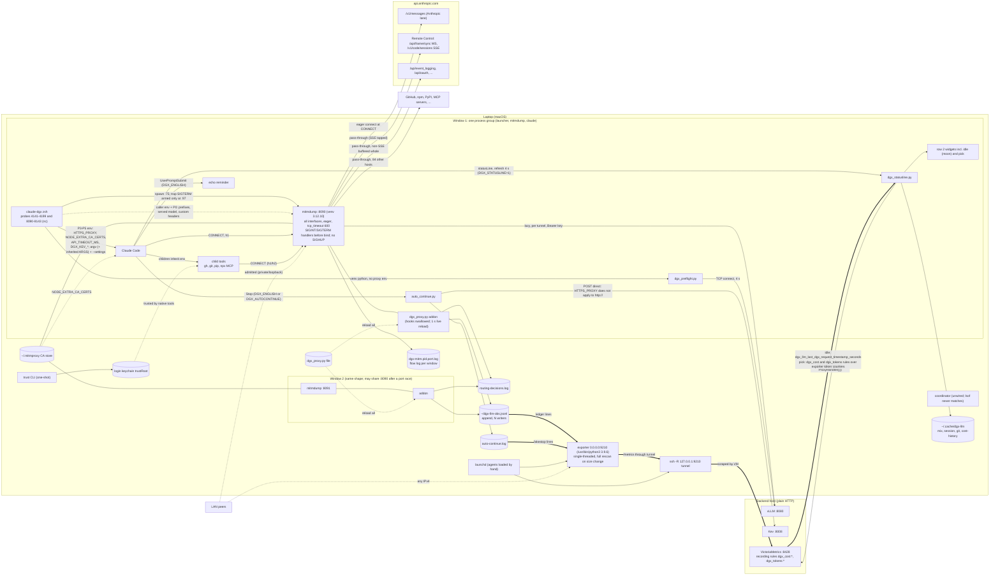
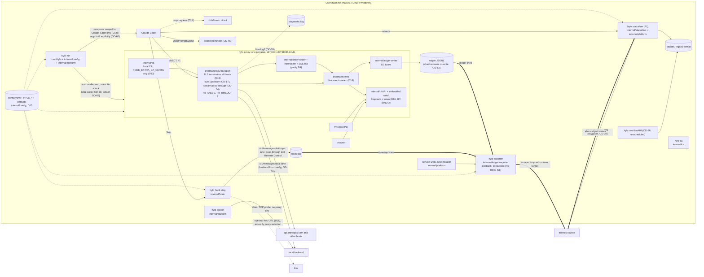

# Pass 1 Deepening — Round 3: verification of round 2, consolidated Phase-1 architecture, sibling reconciliation — hylo-legacy

- Source: `$HOME/Dev/hylo/legacy/`, read-only and static. Re-read this round with fresh line numbers: `claude-dgx` (all 185 lines),
  `dgx_proxy.py:1-110,168-215,510-549`, `auto_continue.py:28-37,94-122`, `dgx_statusline.py:98-126,150-189`, `dgx_preflight.py:13-26`,
  `dgx-proxy-coordinator.sh` (all 50 lines), both `deploy/*.plist` (all), `dgx_ledger_exporter.py:268-290,405-414`.
- Authorized extra sources, read-only. **mitmproxy 12.3.1** (cited m/`<module>:<line>`): `tools/main:1-150`, `master:54-95`, `addons/script:25-60,66-160,195-225`,
  `addons/errorcheck:1-55`, `addons/proxyserver:140-185,306-310`, `options:75-100`, `proxy/server:100-112,200-210`, `proxy/mode_servers:240-310`,
  plus whole-package searches for `SIGHUP`, `prompt_for_exit`, `*_proxy`/`getproxies` and `os.environ`. **CPython 3.11 stdlib** (cited u/`<line>` =
  `urllib/request.py`; `asyncio/unix_events.py` as ue/; `asyncio/base_events.py` as be/): u/`210-217,575-600,788-832,436-470,2495-2532,2640-2668`,
  ue/`88-131`, be/`860-871,1410-1481`.
- Inputs read: this pass's broad sweep (all), r1 (all) and r2 (all); pass-0 deep **r3** (all; converged, the inventory source of truth); pass-4 deep
  r1 (header, §0 retractions, T-121, T-127, OD-54..57) and **r2** (header, §0, R-10, R-11, CONV-ABS-61..64; it appeared during this round); pass-5
  deep r1 (header, §A rows ENV-39/ENV-43, ENV-I12..I15, DET-26, §E OD-58..61). `docs/PLAN.md` §6 (l.94-118). Sibling files were not edited.
- Method: nothing from legacy ran. No proxy ran and nothing was networked. `CLAUDE.local.md` was not read and nothing was committed. No shell probe was run this
  round; zsh job-control facts are cited from pass-0 r3's host probe (§1 A8). Scratch dir `scratchpad/p1r3/` created; no file was needed in it.
- Numbering: **no new CONV-ABS** (69-72 unused). **No new owner item** (OD-78..OD-81 unused). Cross-pass markers are cited by their existing numbers.
- Notation: a bare `:N` means `dgx_proxy.py`. `L:` = `claude-dgx`, `EX:` = exporter, `SL:` = status line, `HK:` = hook, `PF:` = preflight, `CO:` = coordinator.
  Source tags in §B: `B` broad sweep, `R1`/`R2`/`R3` this pass's rounds, `P0r3`, `P4r1`, `P4r2`, `P5r1` sibling files, `P2rN`/`P3rN` cited pass files.

---

## A. Verification of round 2's new claims (fresh evidence)

### A.1 Verification table

| # | Round-2 claim | Fresh evidence this round | Verdict |
|---|---|---|---|
| V1 | **§A.2 / refined CONV-ABS-36**: the proxy and the preflight never get the proxy env (both start before `L:79`) | `HTTPS_PROXY` export is `L:79`; preflight runs `L:60-68`, mitmdump spawns `L:75`. Two new checks: (a) mitmproxy 12.3.1 reads **no** proxy variable (package-wide search for `https_proxy`, `http_proxy`, `no_proxy`, `getproxies`: 0 hits outside its own `_upstream_proxy` layer, which only `mode upstream:` uses; its only `os.environ` reads are `MITMPROXY_CASE_SENSITIVE_FILTERS` and console-only `EDITOR`/`PAGER`); (b) the preflight is a raw `socket.create_connection` (`PF:23`), which never consults env | **CONFIRMED, wording refined.** Exact form: "neither gets the **launcher's** `HTTPS_PROXY`; an `HTTPS_PROXY` inherited from the caller (e.g. `claude-dgx` started from a Bash tool inside another window) does reach mitmdump's environment, but mitmproxy ignores it, and the preflight cannot use it". So the effective claim (no proxy loop, no proxied preflight) holds unconditionally |
| V2 | **§A.1 row 4**: the `note()` **format** step is a swallow-all (`:66-69`); only its write is `OSError`-only | `:66-69` `try: msg = msg % args if args else msg` / `except Exception: pass`; write `:70-74` `except OSError: pass`. `ledger()` `:58-62` `except OSError` only (its `json.dumps` can raise `TypeError`/`ValueError` uncaught) | **CONFIRMED** (catch-all at `:68`) |
| V3 | **§B.2**: launcher → Claude Code contract, argv plus env in six phases P0-P5 | Every anchor re-read: P0 `L:38-39,43-53` (`L:54` unsets the temporaries); P1 `L:60-68` (`PF_PY` venv `:61`, `python3` only if `DGX_INVISIBLE != 1` `:62`); P2 `L:71,75` (`PYTHONUNBUFFERED=1` is a command-prefix assignment, so mitmdump only); P3 `L:79-80,100,104,109`; P4 `L:114-115`; P5 `L:148,152,154,155`; argv `L:128-139,164-181,185`; dry run `L:182-184`. `HK:32` default `kev-latest` vs `L:155` `jaredpalmer/kev-4b@v1.0` | **CONFIRMED.** Three omissions added (refinements, §B.4 row I-1): (a) a **pre-phase**: the caller's whole environment is inherited, and it carries the router inputs that the launcher does not export (`DGX_UPSTREAM`, `DGX_KEY_FILE`, `DGX_OBS_LEDGER`, `DGX_PROXY_DECISIONS`, read at `:53-54,79,88`) and **`ARGS`**, which the launcher never initializes, so an exported `ARGS` is prepended to `claude`'s argv (pass-5 ENV-43, OD-60); (b) the `trust` early exit `L:11-14` and the router-port probe `L:17-22` both run before P0; (c) `--settings` is passed only if `SETTINGS` is non-empty (`L:179-181`), and `hooks` is itself conditional (`L:157-164`) |
| V4 | **§B.3 fact 1**: non-interactive zsh, so `&` creates no new process group; mitmdump shares the launcher's (the terminal's foreground) group | Static: `#!/bin/zsh` (`L:1`), no `setopt monitor`, no `setsid`/`nohup` anywhere in the launcher. Host evidence (pass-0 r3 §1 A8): in `zsh -f -c`, a `&` job's pgid equals the shell's, and its SIGINT disposition is `SIG_IGN` | **CONFIRMED** (static + sibling host probe; zsh source is not an authorized source) |
| V5 | **§B.3 fact 2**: mitmdump installs SIGINT/SIGTERM handlers **before it binds** | Startup order in m/`tools/main` + m/`master`: options and `-s` parsed (`main:84-91`) → ScriptLoader creates `Script(path, reload=True)` (`script:218`), which only **schedules** a watcher task and imports nothing (`script:93-98`) → `loop.add_signal_handler(SIGINT/SIGTERM)` (`main:125-129`) → SIGPIPE `SIG_IGN` (`main:137-138`) → `await master.run()` (`main:140`) → ErrorCheck (`master:62-63`) → `setup_servers` (`master:64-76`) → `asyncio.start_server` (`mode_servers:307`). asyncio's `add_signal_handler` calls `signal.signal(sig, _sighandler_noop)` unconditionally (ue/`116`), so it **replaces an inherited `SIG_IGN`**. DumpMaster has no `prompt_for_exit` (only `tools/console/master:80`), so SIGINT → `master.shutdown` | **CONFIRMED and sharpened.** New detail: the **addon import also comes after the handler**. The watcher's first `loadscript()` runs only after `asyncio.sleep(0)` (`script:136,147-148`), i.e. inside `master.run()`. Bind with `listen_host ""` resolves via `getaddrinfo` in an executor (be/`1480-1481`, `860-871`), so the already-queued import almost certainly runs **before `listen()`** (MEDIUM, scheduling inference). Consequence: in practice the readiness probe (`L:77`) succeeds only after the addon is loaded. A startup import failure is logged at ERROR (`script:51-55`), and ErrorCheck exits 1 right after `setup_servers` (`master:80-81`, `errorcheck:28-46`). The listener is up for at most a few loop turns, so the probe rarely sees it |
| V6 | **CONV-ABS-57**: Ctrl-C orphaning narrowed to the import-time sub-window (spawn → `tools/main:128`) | V5's order: the exposed span is interpreter start + `mitmproxy` package imports + option parsing; it excludes the addon import and the bind, both of which follow the handler | **CONFIRMED, window narrower than r2 stated** ("still importing" = importing mitmproxy, not `dgx_proxy.py`). Closes **pass-0 r3 Remaining Gap 1** (handler-vs-bind order) from the authorized mitmproxy source |
| V7 | **§B.3**: no SIGHUP handler; SIGPIPE ignored | package-wide search: **0** `SIGHUP` hits in mitmproxy 12.3.1; `main:137-138` sets SIGPIPE `SIG_IGN`. CPython installs a handler only for SIGINT at startup, so SIGHUP keeps `SIG_DFL` (terminate) unless inherited as ignored | **CONFIRMED.** Delivery to mitmdump on terminal close stays MEDIUM: it rests on V4's shared group plus shell/tty hangup semantics, which no authorized source covers |
| V8 | **§B.3 fact 3**: trap armed late (spawn `L:75`, wait `L:77`, `exit 1` `L:78`, trap `L:97`); readiness-timeout exit orphans mitmdump | `grep trap` → only `L:97`. `L:78` `exit 1` sits inside the invisible block, before `L:97`. Pass-4 r2 R-10 adds that visible mode's `L:95` exits the same way (OOS, D6) | **CONFIRMED** |
| V9 | **§B.7**: three runtime-table rows added (`stream_large_bodies`/`body_size_limit` None/None; `allow_hosts` `[]`; process signals) | m/`addons/proxyserver:164-183` (r2 cited `:165-176`; the `body_size_limit` registration runs to `:183`); m/`options:93`; m/`tools/main:115-138` | **CONFIRMED** (cite widened). Wording fix to the table's category count (V12) |
| V10 | **Kev-direct urllib verdict**: the hook's Kev POST goes direct; neither `HTTPS_PROXY` nor `HTTP_PROXY` applies; macOS system proxies are not consulted while `HTTPS_PROXY` is set; lowercase overrides uppercase | Fresh re-trace: `HK:110,113` build a `Request` and call module `urlopen` with no context → `_opener = build_opener()` (u/`212-213`) → default classes start with `ProxyHandler` (u/`579-582`), instantiated bare (u/`596-597`) → `ProxyHandler(None)` → `getproxies()` (u/`795-797`) → darwin `getproxies_environment() or getproxies_macosx_sysconf()` (u/`2662-2663`) → first pass: any non-empty `*_proxy` (case-folded) → key `name[:-6]` (u/`2511-2514`), so `HTTPS_PROXY` → `{"https": …}`, non-empty, so **SystemConfiguration is never read** → one `<type>_open` per key (u/`800-804`) → `add_handler` registers `https_open` only (u/`444-464`; `proxy_open` excluded at u/`445`) → an `http://` request finds no proxy `http_open` and reaches `HTTPHandler` directly | **CONFIRMED.** Lowercase rule confirmed at u/`2521-2525`: the second pass matches only names whose last six characters are literally `_proxy`, so a non-empty lowercase `https_proxy` **overrides** `HTTPS_PROXY`. New edge: an **empty** lowercase `https_proxy=` **pops** the key (u/`2526-2527`), deleting the launcher's `HTTPS_PROXY` for urllib children. If that leaves the dict empty, urllib falls back to macOS system proxies. LOW (depends on the user's env, not determinable). `ALL_PROXY` would yield key `all`, which no urllib handler uses |
| V11 | **CONV-ABS-58**: r1's runtime table has 14 rows (10 options + 4 built-in) | 14 rows recounted. But `max_conns` is **not an option**: it is the hard-coded `collections.defaultdict(lambda: asyncio.Semaphore(5))` (m/`proxy/server:109`, used `:206`) | **CONFIRMED (row count).** Category wording: r1 = **9 option rows + 5 built-in**; after r2, 17 rows = **11 option rows + 6 built-in** (`stream_large_bodies`/`body_size_limit` share one row). §B.3 re-arranges them and keeps 17. Not a retraction; consolidated in §B.3 |
| V12 | **CONV-ABS-59**: env inputs 40 → 42 | pass-5 r1 ENV-43 (`ARGS`, pinned by a zsh probe in pass 5) and pass-0 r3 §1 A9 / §2.6: 27 Python + 22 launcher (21 explicit + `ARGS`) − 6 overlap = **43** | **SUPERSEDED: 43.** r2's retraction of "40" stands; its replacement value 42 missed `ARGS`. Adopted from pass 5, so no new marker (pass 0 handled it the same way) |
| V13 | Mapping row **C1**: Open ODs += OD-48, OD-66; preflight carries no proxy env | OD-48 issued by pass-0 r1 (pass-0 r3 §2.5 `whoami` row); OD-66 is r2's own | **CONFIRMED**, plus **OD-60** (`ARGS` leak, pass 5) |
| V14 | Row **C2a**: subcommand `hylo proxy` (PLAN §6 l.96); += OD-47, OD-54, OD-66 | PLAN l.96 lists `proxy`; OD-47 pass-0 (venv pin, P0r3 §2.3); OD-54 pass-4 r1 l.436 | **CONFIRMED** |
| V15 | Row **C6b**: blocked by OD-46 | pass-0 r3 §2.2 row 14 ("`hylo hook prompt` recommended, **OD-46**"); PLAN l.96 lists only `hook stop` | **CONFIRMED** |
| V16 | Row **C8**: "no `flock` in *base* macOS"; replacement uses PID/state, not name matching; coordinator cannot succeed because lsof shows `python3.12` | `CO:15` `lsof … \| grep -q mitmdump` gates `state_valid` (`CO:22`) **and** `start_new`'s readiness wait (`CO:35-36`), so even a fresh start kills its own mitmdump after 10 s and returns 1. Pass-0 r3 §1 A7: lsof's default COMMAND width is 9, so it prints **`python3.1`** | **CONFIRMED, literal refined**: `flock` is present at `/opt/homebrew/bin/flock` (Homebrew 0.4.0, not base macOS, CONV-ABS-29); the coordinator fails anyway, because lsof's 9-char COMMAND is `python3.1`, never `mitmdump` |
| V17 | Row **C10**: per-OS installer is new function with no oracle; += OD-50 | `launchctl` 0 hits (P0r3 §2.2 row 18); plists `RunAtLoad`+`KeepAlive` (`deploy/io.hylo.ledger-exporter.plist:9-10`, tunnel `:14-15`), logs `:11-12` / `:16-17` | **CONFIRMED** |
| V18 | Row **Configuration**: 42 env inputs | see V12 | **CORRECTED to 43** |
| V19 | Row **C6**: Kev client uses env-only proxy selection (Go `http.ProxyFromEnvironment`), never OS settings | Legacy effective path: direct (V10). Pass-5 DET-26 states the same Go default | **CONFIRMED as a design default.** Note, not source-read (Go stdlib is not an authorized source): Go's env lookup prefers the **uppercase** name (`HTTPS_PROXY` before `https_proxy`), the reverse of urllib. That only matters if a user sets both with different values; under D14 the hook gets neither |

**Result:** 19 checks. 15 confirmed (5 with sharpened wording or widened cites), 1 superseded by a sibling finding already recorded (V12, mirrored in V18),
3 confirmed with a non-architectural wording fix (V3 omissions, V11 categories, V16 literal). **No retraction.**

---

## B. Consolidated final architecture for Phase 1 (broad sweep + R1 + R2 + R3)

This section supersedes the component, interface, mapping and diagram sections of the broad pass 1 (§1-§4), R1 (§A.2, §A.3, §B, §C, §D) and R2 (§B.2,
§B.6, §B.7, §C, §D) for downstream use. Inventory facts (files, interpreters, packages, tools, paths, endpoints) live in **pass-0 r3 §2** and are
referenced, not repeated.

### B.1 Component catalogue

| # | Component | File / origin | Responsibility | Process model and lifecycle | Shared state | Source |
|---|---|---|---|---|---|---|
| C1 | Launcher | `claude-dgx` | `trust` delegation (`L:11-14`); router-port probe 4141-4199 in every mode unless `ROUTER_PORT` is set, `exit 1` if all busy (`L:17-22`); env phases P0-P5 (§B.4 I-1); preflight call; per-window mitmdump start and readiness wait; argv and `--settings` assembly; trap-kill the proxy | one non-interactive zsh per window; parent of mitmdump and `claude` (not `exec`'d, `L:185`); job control off, so a **single process group** holds launcher, mitmdump and `claude`; trap armed only at `L:97`, after the spawn | env of the whole tree; `profile.env` sourced after the proxy started (`L:114-115`) | B, R1, R2, R3 |
| C2a | mitmproxy 12.3.1 runtime (mitmdump) | venv, `L:75` | listener (all interfaces), admission (private + loopback), **eager** CONNECT, TLS termination for every host, certifi-only upstream verification, per-client-connection upstream pools (≤ 5 per address, hard-coded), ALPN mirroring, HTTP/1+2+WebSocket relay, non-SSE bodies buffered whole, 600 s inactivity watchdog, `safecall` hook dispatch, 1 s script live reload, CA creation, flow log | one per window, long-lived. Startup: handlers for SIGINT/SIGTERM installed **before** addon import and bind; no SIGHUP handler; SIGPIPE ignored. Venv: uv-managed CPython 3.12.10 base + certifi 2026.10.23, pyOpenSSL 26.4.0, cryptography 50.0.2, h11 0.16.0, h2 4.4.1, wsproto 1.3.2 (venv absent from the tree, OD-47) | `~/.mitmproxy/` CA store (all proxies); `$TMPDIR/dgx-mitm.<pid>.<port>.log` | R1, R2, R3 (P0r3 §2.3-2.4) |
| C2b | Proxy addon (router) | `dgx_proxy.py:26-548` | route `/v1/messages*` on `api.anthropic.com` (R0..R5), normalize DGX-bound bodies, SSE tap (any host), ledger + decision-log writes, plan-limit header capture | imported into each mitmdump by the script watcher; **re-imported on every mtime change** of the one shared file; module import writes `addon module loaded` (`:518`) and builds `_router` from env (`:521`) | ledger, decision log, `failed-req-*.json`, backend key file | B, R1, R3 |
| C3 | CA trust CLI | `dgx_proxy.py:551-764` | install/status/remove/rotate the mitmproxy CA as a login-keychain `trustRoot` | one-shot via `claude-dgx trust` → `exec python3` (`L:11-14`) | keychain, `~/.dgx/trust-state.json`, `~/.mitmproxy.bak-*`, decision log (false "loaded" line) | B, R1, P0r3 |
| C4 | Status line | `dgx_statusline.py` | row 1 (session/lane) and row 2 (backend telemetry) from stdin, transcript, VictoriaMetrics, caches | one process per refresh (`refreshInterval` 4); child of Claude Code, so it inherits the proxy env, and it **bypasses all proxies** with `ProxyHandler({})` (`SL:168`) | 4 cache files, 6 ordered write steps (§B.4 I-21); `ps` ancestry walk | B, R1 |
| C5 | Ledger exporter | `dgx_ledger_exporter.py` | 28 metric names from a **full rescan** of ledger + hook log when the ledger size changes (`EX:282-287`) or on `?rebuild=<non-empty>` | one per user; launchd `RunAtLoad`+`KeepAlive`; single-threaded `HTTPServer` on `0.0.0.0:9210`, no socket timeout; rebuild before bind (`EX:411-414`); no exception guard | reads ledger and hook log | B, R1, R2 |
| C6 | Stop hook | `auto_continue.py` | decide whether to force a continuation; log every decision; ask Kev | one process per Stop event (timeout 30) | appends `auto-continue.log`; reads transcript, Kev key file | B, R1 |
| C6b | UserPromptSubmit hook | inline `echo` in `L:158` | restate the English-only rule with every prompt iff `DGX_ENGLISH != 0` | one hook-shell per prompt (timeout 5) | none | R1 |
| C7 | Preflight | `dgx_preflight.py` | raw TCP connect to the backend (4 s), OS-error diagnosis | one-shot per launch, venv CPython 3.12.10 (`L:61`), **no proxy env** and env-agnostic | none | B, R2, R3 |
| C8 | Coordinator (unwired) | `dgx-proxy-coordinator.sh` | singleton mitmdump via `flock` + port/pid state | no caller. `flock` is present at `/opt/homebrew/bin/flock` (Homebrew, not base macOS). The coordinator fails anyway: its `lsof … \| grep -q mitmdump` (`CO:15`) never matches, because lsof's 9-char COMMAND is `python3.1`. So `state_valid` is always false and `start_new` kills its own mitmdump after 10 s (`CO:35-36`) | `.proxy-state/{port,pid,lock}`, `dgx-shared-mitm.<port>.log` | B, R1, R2, R3 (P0r3 A7) |
| C9 | Cost backfill | `tools/backfill_cost_history.py` | seed `cost-history.json` from transcripts | one-shot, manual | `cost-history.json` | B |
| C10 | Services | `deploy/*.plist` | keep the exporter and `ssh -N -R 127.0.0.1:9210:127.0.0.1:9210 dgx` alive | 2 LaunchAgents, **loaded by hand** (no `launchctl` in the tree); exporter plist argv uses a literal `~` that launchd does not expand | `/tmp/dgx-ledger-{exporter,tunnel}.log` | B, R1, R2 |
| X1 | Server-side telemetry (outside the tree) | backend host | VictoriaMetrics scrape of vLLM, LMCache, DCGM and the tunnelled exporter; recording rules `dgx_kv:*`, `dgx_tokens:*`, `dgx_ttft:*`, `dgx_preempt:*`, `dgx_power:*`, `dgx_cost:*` | external | — | R1, R2 (P2r3 l.168-169, 184) |

**Coupling.** There is no shared library. Coupling runs through:
- **Files with many writers:** ledger and decision log (N proxies), `cost-history.json` (every status-line run of every window, plus backfill), git cache (per project).
- **One file, many importers:** every mitmdump imports `dgx_proxy.py` with a 1 s reload, so one edit changes or breaks every window at once.
- **Environment:** the caller env plus P0 reaches the proxy; P3-P5 reach only `claude` and its descendants.
- **Process relations:** one process group per window; the trap kills mitmdump on exit; the status line walks `ps` ancestry.
- **HTTP:** the main flows.
- **Duplicated rules:** lane prefix, account hint, stale span.

Sources: B, R1, R2.

### B.2 Data-flow narrative

1. **Startup (per window).** The launcher probes 4141-4199 (`L:17-22`) and exports P0 (`L:38-53`). It runs the preflight on the venv Python with no proxy env (`L:60-68`).
   It picks the first free port in 8090-8143 (`L:72-73`) and spawns mitmdump in the background, in the same process group (`L:75`). mitmdump installs its SIGINT/SIGTERM
   handlers (m/`tools/main:128-129`), then imports the addon and binds `*:<port>`, with the import almost certainly first (m/`script:136-148`, m/`master:64-76`).
   The launcher polls `nc -z` 40 × 0.25 s (`L:77`). On failure it `exit 1`s at `L:78` **before** the trap exists, so a still-starting mitmdump is orphaned.
   On success it exports P3 (`L:79-80,100,104,109`), arms the trap (`L:97`), sources `profile.env` (P4), exports the hook env (P5), builds argv and
   `--settings`, and runs `claude` as a child (`L:185`). Sources: R1, R2, R3.
2. **One DGX-lane request.** Claude Code connects to `127.0.0.1:<port>` and sends `CONNECT api.anthropic.com:443`. mitmproxy (eager) connects to Anthropic first:
   a failure gives 502 at CONNECT and no ledger line. The client then does the TLS handshake against a minted leaf. In the `request` hook, `POST /v1/messages` is parsed,
   attributed, lane-decided, normalized and logged (`dgx_request`). The rewrite swaps host/scheme/port to the backend, sets `Authorization: Bearer <key>` and drops `anthropic-beta`.
   mitmproxy then opens a plain-HTTP backend connection lazily, inside this tunnel's own pool. In `responseheaders`, SSE gets the tap and JSON or ≥ 400 is buffered. `response` writes
   `dgx_reply` + `dgx_usage`; on a failed flow, `error` writes `dgx_upstream_error`. Sources: B, R1.
3. **Anthropic lane and pass-through.** Anthropic-lane `/v1/messages*` only gets `Accept-Encoding: identity`. Every other path and host is relayed without changes
   to its own host, TLS re-terminated. Non-SSE bodies are buffered whole, SSE is tapped, and WebSockets are relayed and retained. `anth_ratelimit` is captured on any
   `api.anthropic.com` response. Remote Control is `/api/frame/sync` (WS) plus `/v1/code/sessions/…` (SSE/POST/PUT) on `api.anthropic.com`. Sources: R1, R2 (P4r1 CONV-ABS-44).
4. **Child-process traffic (legacy only, removed by D14).** Bash-tool children inherit `HTTPS_PROXY`/`NODE_EXTRA_CA_CERTS` and take flows 2-3. Tools with their
   own trust store fail at the handshake. Tools that trust the login keychain (C3) are decrypted. A child's Sonnet-prefixed `/v1/messages` is routed to the
   backend with the owner's key. Source: R1.
5. **Telemetry feedback chain.** proxy → ledger → exporter (full rescan on size change) → `ssh -R` tunnel → VictoriaMetrics scrape + recording rules
   → status line row 2. It feeds **two** widgets: `☾ idle` (raw exporter gauge `dgx_llm_last_dgx_request_timestamp_seconds`, `SL:106`, rendered `SL:824-834`)
   and `⛏` (`dgx_cost:dgx_usd_per_mtok`, `dgx_tokens:rate_mtok_month`, `SL:107-108`, read `SL:1220-1223`, recording rules over the exporter's
   `dgx_llm_tokens_{input,output}_total`, outside the tree). Any break looks like "idle" or a missing `⛏`, never an error. Sources: R1 (☾), R2 (⛏), R3 (drawn).
6. **Status line refresh.** Claude Code pipes stdin JSON every 4 s. The status line reads the transcript incrementally, queries VM direct (TTL 4 s cache, 1.5 s per socket operation),
   writes caches in a fixed 6-step order, and prints 1-2 rows (or the 29-byte degraded line, exit 0). Sources: B, R1, P4r2.
7. **Stop hook.** Claude Code passes stdin JSON. The hook runs its checks and makes up to 3 Kev POSTs, **direct** (V10), at 2.5 s per socket operation (worst case 15 s without
   dribbling, P4r2 CONV-ABS-63). It prints nothing or one `hookSpecificOutput` line and appends one log line per decision. Sources: B, R1, R2, R3.
8. **Shutdown.** Normal exit or Ctrl-C after `L:97` fires the trap: SIGTERM to mitmdump, which drains, so in-flight flows get `error` lines. Terminal close sends SIGHUP to
   the whole group, and mitmdump dies immediately with no ledger line (OD-38). Ctrl-C before `L:97` orphans mitmdump only before `tools/main:128`. Sources: R1, R2, R3.

### B.3 The mitmproxy runtime as configured (17 rows: 11 option rows, 6 built-in behaviors)

| Option / built-in | Value | Architectural consequence | Source (m/) | Round |
|---|---|---|---|---|
| `listen_host` | `""` (all interfaces) | LAN-reachable proxy (OD-24 ruled for legacy) | `options:94-99` | R1 |
| `block_global` / `block_private` | True / False | loopback + private admitted, global refused | `addons/block:10-48` | R1 |
| `connection_strategy` | `eager` | Anthropic TCP reachability gates every new tunnel, including the DGX lane | `addons/proxyserver:154-163` | R1 |
| `ignore_hosts` / `allow_hosts` | `[]` / `[]` | every host TLS-terminated (CONV-ABS-35) | `options:81-93` | R1, R2 |
| `ssl_insecure` + trust | False; certifi only | strict upstream verification; private-CA HTTPS backends fail (OD-41) | `options:173-180`; `net/tls:13,217-220` | R1 |
| `http2` | True | ALPN mirrors the client (Claude Code h1, some children h2) | `options:131-135` | R1 |
| `websocket` | True | WS relayed, messages retained per connection | `options:159-164` | R1 |
| `tcp_timeout` | 600 s | inactivity watchdog cancels the handler | `options:240-246`; `proxy/server:344-354` | R1 |
| `store_streamed_bodies` | False | streamed bodies unreadable, hence the SSE tap | `addons/proxyserver:147-153` | R1 |
| `stream_large_bodies` / `body_size_limit` | None / None | non-SSE responses outside `/v1/messages*` buffered whole, no cap; request bodies read whole (OD-54) | `addons/proxyserver:164-183` | R2, R3 (cite) |
| `flow_detail` | 1 (default; also set by `L:75`) | one flow-log line per flow, no bodies (OD-53) | `addons/dumper:54-58` | R1 |
| Upstream concurrency (built-in) | ≤ 5 per address per client connection, **hard-coded** | caps concurrent upstream connections per tunnel | `proxy/server:109,206` | R1, R3 (category) |
| Hook dispatch (built-in) | `safecall` swallows all but `AddonHalt`/`OptionsError` | a raising hook leaves the flow as rewritten so far | `addonmanager:44-59` | R1 |
| Script loader (built-in) | `reload=True`, 1 s poll; import deferred to the watcher; failed reload = no addon (pass-through); vanished file removes the script; startup import error → exit 1 after bind | live reload can de-route every window (OD-26) | `addons/script:74,82-100,113-150,218`; `master:80-81` | R1, R2, R3 |
| Signals (built-in) | SIGINT/SIGTERM → `master.shutdown` via asyncio handlers installed before import and bind (Windows fallback `signal.signal`, `main:130-133`); **no SIGHUP**; SIGPIPE ignored | proxy reacts to terminal SIGINT itself; dies on SIGHUP (§B.2 step 8) | `tools/main:115-140` | R1, R2, R3 |
| CA store (built-in) | created iff missing; RSA 2048, CA 10 y, leaves 199 d | shared by all proxies | `options:9`; `certs:40-41` | R1 |
| Bind failure (built-in) | `OSError` from `_start`, ErrorCheck exit 1 | port-race loser exits; its launcher's probe sees the winner (port race, OD-19) | `proxy/mode_servers:252-266`; `addons/errorcheck:28-46` | R1, R2 |

(Arrangement versus R2's 17 rows: `ignore_hosts` and `allow_hosts` share one row here; `flow_detail`, which R1/R2 mentioned only as launcher argv, gets
its own option row; `max_conns` moves from the options to the built-ins (V11); R1's "Signals" and R2's "Process signals" rows are merged, and the
bind-failure behavior (R2 §A.1 row 7o) gets its own built-in row. The result is 17 rows again: 11 option rows covering 14 option names, plus 6
built-ins.)

### B.4 External interfaces

| # | Interface | Direction / transport | Contract (summary) | Anchor | Source |
|---|---|---|---|---|---|
| I-1 | **Launcher → Claude Code** (argv + env) | process spawn | **Pre-phase:** caller env inherited whole: router inputs `DGX_UPSTREAM`/`DGX_KEY_FILE`/`DGX_OBS_LEDGER`/`DGX_PROXY_DECISIONS` reach the proxy; an exported `ARGS` is prepended to argv (OD-60); `trust` exits early; router-port probe. **P0** prefixes, served model, `ANTHROPIC_CUSTOM_HEADERS` += `X-DGX-Project`/`X-DGX-User` (reach proxy and `claude`). **P1** preflight, no proxy env. **P2** `unset ANTHROPIC_BASE_URL`; `PYTHONUNBUFFERED=1` for mitmdump only. **P3** `HTTPS_PROXY`, `NODE_EXTRA_CA_CERTS`, `ANTHROPIC_BASE_URL` unset again, `API_TIMEOUT_MS=1800000`, `CLAUDE_CODE_AUTO_MODE_SERVER=0` (`claude` tree only). **P4** `profile.env` (`set -a`). **P5** `DGX_ENGLISH`, `DGX_AUTOCONTINUE`, `DGX_KEV_THRESHOLD/URL/MODEL`. **argv** `--model sonnet\|opus`, `--remote-control` iff `DGX_REMOTE=1`, `--append-system-prompt` iff `DGX_ENGLISH != 0`, `--dangerously-skip-permissions` unless `DGX_SAFE=1`, `--settings {hooks?, sandbox?, statusLine?, subagentStatusLine?}` iff non-empty, then `"$@"`; dry run prints and exits 0 | `L:11-22,38-185` | R2, R3 (P5r1 ENV-43) |
| I-2 | Claude Code → status line | stdin JSON / stdout | 19 leaf paths, 8 objects; env `DGX_SL_*`, `LOCAL_MODEL_PREFIXES`, `COLUMNS`; rows trimmed to `COLUMNS`; degraded line + exit 0 on any exception (import-time env crash excepted) | `SL:419-605,1009-1016,1186,1214-1245` | B, R1, R2, P4r1 |
| I-3 | Claude Code → Stop hook | stdin JSON / stdout | `last_assistant_message`, `stop_hook_active`, `transcript_path`, `session_id`; output nothing or one `hookSpecificOutput` line (`additionalContext` acceptance UNVERIFIED, BC-HK-013) | `HK:198-245`; `L:160-161` | B, R1 |
| I-4 | Claude Code → UserPromptSubmit hook | inline shell `echo` | reminder text on stdout, timeout 5, iff `DGX_ENGLISH != 0` | `L:157-158` | R1 |
| I-5 | Clients → proxy listener | HTTP CONNECT on `*:<port>` | Claude Code h1; children h1/h2; LAN peers admitted (private/loopback) | `L:75`; m/`addons/block` | R1 |
| I-6 | mitmproxy → addon | in-process hooks | 6 module hooks: `request`, `responseheaders`, `response`, `error` live; `websocket_start/_end` dead | `:524-548` | B, R1, R2 |
| I-7 | Proxy → backend (vLLM) | plain HTTP, lazy, per tunnel | path kept; `Authorization: Bearer <key file>`; `anthropic-beta` removed; `Accept-Encoding: identity`; `X-DGX-*`; client `x-api-key`/cookies forwarded (OD-07) | `:79-83,155-166` | B, R1 |
| I-8 | Proxy → `api.anthropic.com` + 84 other hosts | TLS, eager for each tunnel's CONNECT host | Anthropic lane unchanged except `Accept-Encoding`; pass-through relayed, non-SSE buffered | `:103-104,131` | B, R1, R2 |
| I-9 | Proxy → ledger | append JSONL, one `write()` per line, N writers | 13 event names (12 written, 1 historical) | `:56-62` | B, R1, R2 |
| I-10 | Proxy → decision log; failed-request captures | append text; JSON files (20 newest) | format step swallow-all (`:66-69`), write `OSError`-only | `:53,65-74,288-299` | B, R1, R2, R3 |
| I-11 | mitmdump → flow log | stdout+stderr to `$TMPDIR/dgx-mitm.<pid>.<port>.log` | sole record of pass-through traffic; never rotated (OD-53) | `L:74-75` | R1 |
| I-12 | Status line → VictoriaMetrics | HTTP GET, `ProxyHandler({})`, 1.5 s per socket operation | one MetricsQL instant query (byte-exact, 18 names / 19 result keys) | `SL:102-123,165-187` | B, R1, P4r2 |
| I-13 | Stop hook → Kev | HTTP POST, default opener, 2.5 s per socket operation, ≤ 3 calls | **direct** in production (V10); optional Bearer from `DGX_KEV_API_KEY` or key file; reads `answers.turn_complete.noul` | `HK:94-138` | B, R1, R2, R3, P4r2 |
| I-14 | Preflight → backend | raw TCP, 4 s | port default 80 whatever the scheme | `PF:18-24` | B, R2 |
| I-15 | Launcher → localhost probes | `nc -z` | 4141-4199 scan (every mode), 8090-8143 scan, readiness 40 × 0.25 s | `L:21,73,77-78` | B, R1, R2, P4r2 |
| I-16 | Exporter `/metrics` | HTTP on `0.0.0.0:9210` | 28 names (25 TYPE, 22 HELP, 27 with samples); `?rebuild=<non-empty>`; other paths 404 | `EX:269-414` | B, R1, R2 |
| I-17 | Tunnel | `ssh -N -R 127.0.0.1:9210:127.0.0.1:9210 dgx` | `ServerAliveInterval=30`, `ServerAliveCountMax=3`, `ExitOnForwardFailure=yes` | tunnel plist `:5-13` | B, R1 |
| I-18 | VictoriaMetrics recording rules | server-side | `dgx_*:*` series consumed by I-12, two of them derived from I-16 | outside the tree | R1, R2 |
| I-19 | Trust CLI → login keychain | `security` CLI | add/find/delete `trustRoot` (OOS, D13) | `:551-764` | B, R1 |
| I-20 | CA store → Claude Code trust | file `~/.mitmproxy/mitmproxy-ca-cert.pem` via `NODE_EXTRA_CA_CERTS` | the trust that matters for Claude Code; keychain matters only for native child tools | `L:80` | R1, R2 |
| I-21 | Status line caches | atomic `mkstemp` + `os.replace`, errors swallowed | 6 ordered write steps over 4 files | `SL:190-206` + call sites | R1, P0r3 |
| I-22 | Status line → OS | `ps -o ppid=,comm=,lstart=` (≤ 6 × 1 s, uncached on failure); direct `.git` reads | `⌂` and branch | `SL:264-294,364-411` | R1, P0r3, P4r2 |
| I-23 | Terminal → process group | signals | SIGINT (pre-trap: shuts mitmdump down once its handler exists), SIGHUP (immediate death), trap SIGTERM (graceful) | `L:75-97`; m/`tools/main:115-140` | R2, R3 |
| I-24 | Transcript JSONL | file read | status line incremental, hook whole file, backfill glob | B §4.2 | B |
| I-25 | Configuration inputs | env | **43** explicit env inputs + 17 implicit (P5r1 ENV-I1..I17) + `profile.env` | P5r1 §A; P0r3 §2.6 | B, R1, R2, P5r1 |
| I-26 | launchd → exporter, tunnel | LaunchAgents, loaded by hand | `RunAtLoad`, `KeepAlive` | `deploy/*.plist` | R2 |

### B.5 Target mapping (legacy → hylo, PLAN §6)

Decision keys as in R1 §C: D4/D4-EX-1/D4-EX-2, D6, D7, D11, D13, D14, D15, D16, HY-BIND-1..6, HY-PASS-1, HY-TIMEOUT-1, HY-TLS-1/3, HY-PROTO-1, HY-WS-1.

| Legacy component | hylo package(s), subcommand | Ph | Shaping decisions | Blocking ODs | BCs | Source |
|---|---|---|---|---|---|---|
| C1 Launcher | `cmd/hylo` (`run`) + `internal/config` + `internal/platform` | P4 | D6 (no visible mode; keep `ANTHROPIC_BASE_URL` unset; `--remote-control`), D14 (proxy env to Claude Code only), D15, HY-BIND-1, HY-TIMEOUT-1 (from `API_TIMEOUT_MS=1800000`); argv built explicitly; preflight probes without proxy env | OD-05, OD-14, OD-19, OD-34, OD-48, OD-50, OD-51, **OD-60**, OD-66 | BC-LN-001..011 | R1, R2, R3 |
| C2a mitmproxy runtime | `internal/proxy` (transport) + `internal/ca` (leaf minting), `hylo proxy` | P3 | D13, D6, HY-BIND-1/3/4/6, HY-PASS-1, HY-TIMEOUT-1, HY-TLS-1/3, HY-PROTO-1, HY-WS-1 | OD-17, OD-28, OD-34, OD-37, OD-38, OD-41, OD-42, OD-47, OD-54, OD-66 | BC-PX-037, -039, -043, -044, -046, -047, -049 | R1, R2 |
| C2b Router / normalizer / SSE tap / attribution | `internal/proxy` | P3 | D4, D13, D15 | OD-06, OD-07, OD-08, OD-09, OD-10, OD-18, OD-35, OD-40 | BC-PX-001..027, -032..036, -038, -040..042, -045, -048 | R1 |
| Ledger writer `ledger()` | `internal/ledger` (writer) fed by `internal/events` | P3 | D7, D4 | OD-25, OD-43, OD-52 | BC-PX-028 | R1 |
| Decision log `note()` | `internal/proxy` / `internal/events` | P3 | D15, D16 | OD-40, OD-45 | BC-PX-022, -029, -048 | R1 |
| Flow log | none specified | P3 | D16 guardrail (no bodies on disk) | OD-53 | — | R1 |
| Live event stream (new) | `internal/events` | P3 | D16, D7 | OD-25, OD-43 | — | R1 |
| Web UI / event API (new) | `internal/ui` + `web/` (`hylo ui`); `hylo top` | P4 / P6 | D16, HY-BIND-2/3 | OD-43 | — | R1 |
| C3 Trust CLI + CA store | `internal/ca` (`hylo ca`) + `internal/platform` | P4 | D13 (no OS store), D5 | OD-41 (c) | BC-PX-031 (OOS, replaced), BC-LN-001 | R1 |
| C4 Status line | `internal/statusline` (`hylo statusline`) + `internal/platform` + `internal/config` | **P1** | D4, D4-EX-1, D4-EX-2, D15, D14 (bypass becomes defense in depth); golden inputs must include VM responses carrying the `☾`/`⛏` series | OD-01, OD-02, OD-03, OD-14, OD-20, OD-21, OD-30, OD-32, OD-55, OD-56 | BC-SL-001..103 | R1, R2, R3 (P4r1 OD-55/56) |
| C5 Exporter | `internal/ledger` (exporter), `hylo exporter` | P2 | D7, D4, HY-BIND-5, HY-BIND-6 | OD-04, OD-11, OD-15, OD-22, OD-23, OD-27, OD-29, OD-33, OD-39 | BC-EX-001..027 | R1 |
| C6 Stop hook | `internal/hook` (`hylo hook stop`) | P4 | D11, D4, D14, D15; Kev client uses env-only proxy selection (never OS settings) | OD-04, OD-05, OD-12, OD-45, OD-56 | BC-HK-001..023 | R1, R2, R3 |
| C6b UserPromptSubmit hook | (a) literal `echo` in `--settings`, (b) `hylo hook prompt` + `internal/hook` (pass-0 recommendation), (c) drop | P4 | D15 (reminder text as config) | **OD-46** | BC-LN-009 | R1, R2 |
| C7 Preflight | `internal/platform` (`hylo doctor`) | P4 | D5, D15; direct probe, no proxy env | OD-42 | BC-PF-001..002 | R1, R2 |
| C8 Coordinator (unwired) | `internal/proxy` + `cmd/hylo` (`run`): state file + lock | P4 | PLAN §6 one proxy per user; D5 (`flock` not in base macOS, Windows locking); liveness by PID/state file and health check, never by process name | OD-19, OD-50, OD-66 | BC-CO-001..002 (OOS) | R1, R2, R3 |
| C9 Backfill | `cmd/hylo` (`cost backfill`), proposed | unscheduled | D15 | OD-13, OD-31, OD-36 | BC-BF-001..013 | R1 |
| C10 Services | `internal/platform` (launchd / systemd user / scheduled task); per-OS **installer** is new function with no oracle | P2 | D5, HY-BIND-5 | OD-15, OD-50 (and OD-66 option b) | BC-SV-001..002 (OOS) | R1, R2 |
| Configuration (**43** env inputs, `profile.env`) | `internal/config` (`hylo config`) | P1-P6 | D15, D4 | OD-01, OD-05, OD-26, OD-51, OD-60, OD-61 | BC-PX-030 | R1, R2, R3 (P5r1) |

BC total unchanged: **232** (PX 49 + SL 103 + EX 27 + HK 23 + LN 11 + PF 2 + CO 2 + BF 13 + SV 2; P3r8 §4).

### B.6 Diagram 1: legacy as it really runs

Solid arrows = connections / control (arrow points at the side that is called). Thick arrows = the telemetry data chain (data direction).



### B.7 Diagram 2: hylo target



---

## C. Reconciliation with the sibling deep files

Present at write time: pass-0 r1, r2, **r3** (converged); pass-4 r1, **r2** (appeared during this round); pass-5 r1. Pass-5 r2 was not present. None was edited.

### C.1 Items the orchestrator required (all applied)

| # | Requirement | Where applied | Status |
|---|---|---|---|
| 1 | Corrected `flock` sentence: present at `/opt/homebrew/bin/flock`; coordinator fails anyway because lsof shows `python3.1` (9-char COMMAND), never `mitmdump` | §B.1 C8, §B.5 C8, V16 | applied |
| 2 | Env inputs = **43** (pass-5 `ARGS`, never initialized, leaks into argv) | V12, §B.4 I-1 and I-25, §B.5 Configuration and C1 (OD-60) | applied |
| 3 | OD-46..OD-48 are issued by pass 0, not unused | §B.5 (C6b OD-46, C2a OD-47, C1 OD-48); Remaining Gaps owner list | applied (already corrected in R2 §A.1 row 17) |
| 4 | Draw exporter → ssh tunnel → VictoriaMetrics → status line, feeding `☾` and `⛏` | §B.6 thick-arrow chain `LG/HL ⇒ EX ⇒ T ⇒ VM ⇒ SL1 → WIDG`; §B.2 step 5 | applied |
| 5 | Pass 0 adopts pass-5's note that with no proxy env urllib on macOS follows OS settings; R2's Kev verdict stands because `HTTPS_PROXY` suppresses the system lookup | V10 (u/`2662-2663` + u/`2511-2514`) | consistent; see C.2 row 2 for one wording gap in pass 0 |

### C.2 Pass-by-pass

| # | Sibling statement | This pass | Status |
|---|---|---|---|
| 1 | P0r3 Remaining Gap 1: "whether mitmproxy installs its SIGINT handler before or after the listener binds … not verifiable on this host" | V5/V6: **before** (m/`tools/main:128-129` → `master:64-76` → `mode_servers:307`), and before the addon import | **Resolved here** (authorized source). Pass 0 converged, so the resolution lives in this file |
| 2 | P0r3 §2.8 Kev row: "env **and macOS system** proxies honored" | V10: system proxies are consulted only when **no** non-empty `*_proxy` var exists; in production the hook always inherits `HTTPS_PROXY` (P3), so they are never consulted. P0r3 §2.6 states the condition correctly ("no env proxy set"); §2.8 drops it | **Wording disagreement (minor)**: §2.8 should read "env proxies honored; macOS system proxies only if no `*_proxy` variable is set (never in legacy production)" |
| 3 | P0r3 §2.2 row 6: "Defaults in effect: R1 §A.2 (10 rows, re-audited R2)" | R1's runtime table is **§A.3**, 14 rows; 17 after R2; consolidated here as §B.3 | **Pointer/count disagreement (minor)**; downstream should cite this file's §B.3 |
| 4 | P0r3 §2.9 last row and §2.3 zsh row (Ctrl-C exposure only before the handler; `&` jobs get SIGINT ignored) | V4-V6 | consistent (now with source order) |
| 5 | P0r3 C1-C3, C6 open pass-1 items | §C.1 rows 1-4 | **closed** |
| 6 | P4r2 **CONV-ABS-61** (T-121: the 4141-4199 scan is live in invisible mode) | §B.1 C1, §B.4 I-15 (since R2) | consistent; the P0r3 C7 disagreement is closed by pass 4 |
| 7 | P4r2 **R-10** pre-trap orphan window (incl. visible-mode `L:95`) | §B.2 step 1/8, V6 | consistent. R-10's "only before mitmdump installs its own SIGINT handler" can now cite the exact span (interpreter + mitmproxy import + option parsing; addon import and bind come later) |
| 8 | P4r2 has no row for **terminal close → SIGHUP kills the proxy with no ledger line** (process-group fact, OD-38) | §B.2 step 8, §B.3 Signals, I-23 | **Remaining gap in pass 4** (reliability NFR; pass-4 r3 can add it under OD-38/OD-66) |
| 9 | P4r2 **CONV-ABS-63** (Kev 2.5 s is per socket operation; 15 s no-dribble bound) and F-6 | §B.2 step 7, I-12, I-13 labels | adopted |
| 10 | P4r1 CONV-ABS-44 / OD-54 (pass-through buffering) | §B.3 row, diagrams | consistent |
| 11 | P5r1 ENV-43 / OD-60 (`ARGS`) | adopted (V12, I-1, C1) | consistent |
| 12 | P5r1 ENV-I12..I15, DET-26 (urllib env and OS proxy discovery; harness pins `no_proxy=*`) | V10 | consistent. Refinement for pass 5: an **empty** lowercase `https_proxy` removes the uppercase entry (u/`2526-2527`). The harness's `no_proxy=*` is non-empty, so it is unaffected |
| 13 | P5r1 OD-61 (`~` in env paths) | §B.5 Configuration | added to the blocking list |

Remaining disagreements after this round: **C.2 rows 2 and 3** (pass-0 wording/pointer; pass 0 is converged, so these are notes for the Pass-8 synthesis)
and the **pass-4 SIGHUP gap** (row 8). No disagreement changes the architecture model.

---

## Delta Summary

| Target | New | Refined / confirmed |
|---|---|---|
| A verification | none that changes the model | 19 checks: 15 confirmed, 1 superseded by a sibling (env count 43), 3 wording fixes. Sharpened: mitmproxy reads no proxy env (V1); the addon import and the bind both follow the signal-handler install (V5), so CONV-ABS-57's exposed span is interpreter + mitmproxy import only (V6) and pass-0 r3 Gap 1 is closed; empty lowercase `https_proxy` pops the key (V10); `max_conns` is hard-coded, not an option (V11); lsof literal `python3.1` (V16); `--settings`/hooks conditionality, the pre-phase and the `ARGS` argv leak (V3) |
| B consolidation | one merged architecture: 12 components + 1 external (X1), 8-step data-flow narrative, 17-row runtime table, **26-row** interface table, 18-row target mapping, 2 diagrams. Every row tagged with its source round | legacy diagram now draws the exporter → tunnel → VM → status line chain (thick arrows) and the two widgets; it marks the coordinator as unwired and the ARGS argv input; the hylo diagram draws the data direction of the telemetry chain |
| C reconciliation | none | 5 orchestrator items applied; 13 sibling rows: 1 sibling gap resolved here (P0r3 Gap 1), 2 minor pass-0 wording/pointer notes, 1 pass-4 gap (SIGHUP), the rest consistent or adopted |

Counts: retractions **0** (CONV-ABS-69..72 unused). New owner items **0** (OD-78..OD-81 unused). Components 12 (C1, C2a, C2b, C3-C6, C6b, C7-C10) + 1 external (unchanged since R2).
Interfaces 26 (R1's 9 interface groups, R2's I-1 and R3's consolidation; no interface is new this round). BCs unchanged (232).

## Remaining Gaps

1. LOW, not determinable from authorized sources: whether Claude Code reads the terminal in raw mode (whether an in-UI Ctrl-C signals the proxy); shell/tty SIGHUP
   delivery on terminal close (MEDIUM by the shared-group fact); whether the user's env or `profile.env` sets `HTTP_PROXY`, `http_proxy` or a lowercase (possibly empty)
   `https_proxy`; Node's uppercase/lowercase proxy-variable precedence; Go's `ProxyFromEnvironment` precedence (not source-read); Homebrew 3.15.0 urllib; how Claude
   Code runs hook commands on Windows (OD-46).
2. MEDIUM, scheduling inference: the addon import precedes `listen()` (V5). A read of CPython 3.12's asyncio (the venv's interpreter; only 3.11 is authorized)
   would firm it up. It does not affect hylo, whose proxy loads config before it listens.
3. The `⛏` dependency on the exporter rests on recording-rule definitions outside the tree (P2r3 l.168-169, 184).
4. Sibling notes for the Pass-8 synthesis: pass-0 r3 §2.8 Kev wording and §2.2 row 6 pointer (C.2 rows 2-3); pass 4 to add the SIGHUP terminal-close
   item (C.2 row 8); pass 5 may add the empty-`https_proxy` edge (C.2 row 12).
5. Owner decisions, pending: OD-01..OD-23, OD-25, OD-26, OD-28..OD-43, OD-45..OD-48, OD-50..OD-61, OD-66 (plus any items issued by other passes in
   OD-67..OD-77). Ruled: OD-24, OD-27. Unused: OD-44, OD-49, OD-62..OD-65, OD-67..OD-69, OD-70..OD-73 (per pass-4 r2), OD-78..OD-81.

## Novelty Assessment

Novelty: NITPICK — findings are refinements, not gaps.

Every round-2 claim the orchestrator named was re-checked against fresh source, and none was retracted. The six-phase launch contract, the
process-group and signal model, CONV-ABS-57, the three runtime-table additions, the urllib Kev verdict (including the lowercase-override rule) and the
seven mapping corrections all hold. This round adds sharper evidence and wording, not new model elements:
- the exact startup order (handler, then addon import, then bind), which narrows CONV-ABS-57's span further and closes pass-0's open gap;
- mitmproxy's indifference to proxy env;
- the empty-`https_proxy` edge;
- `max_conns` reclassified as a built-in;
- the `python3.1` literal;
- the 43-input count, which pass 5 had already recorded.

The consolidation, the reconciliation and the drawn telemetry chain are consolidation and diagram work. Removing this round's findings would not
change how the system is specced: every component, interface, decision and blocking OD in §B was already present in the broad sweep, R1, R2 or a
sibling file.

## Convergence Declaration

Pass 1 has converged: findings are nitpicks, not gaps. (Rounds: r1 SUBSTANTIVE, r2 SUBSTANTIVE, r3 NITPICK; minimum of 2 deepening rounds met.)

## State Checkpoint

```yaml
pass: 1
round: 3
status: complete
timestamp: 2026-11-14T08:49:00Z
novelty: NITPICK
files_scanned: claude-dgx (1-185); dgx_proxy.py (1-110, 168-215, 510-549); auto_continue.py (28-37, 94-122); dgx_statusline.py (98-126, 150-189); dgx_preflight.py (13-26); dgx-proxy-coordinator.sh (1-50); deploy/*.plist (all); dgx_ledger_exporter.py (268-290, 405-414); mitmproxy 12.3.1 (tools/main, master, addons/script, addons/errorcheck, addons/proxyserver, options, proxy/server, proxy/mode_servers, package-wide searches); CPython 3.11 (urllib/request.py, asyncio/unix_events.py, asyncio/base_events.py); docs/PLAN.md §6
verification: {checks: 19, confirmed: 15, superseded_by_sibling: 1, wording_fixes: 3, retracted: 0}
retractions: []
conv_abs_unused_in_range: [69, 70, 71, 72]
new_owner_items: []
od_unused_in_range: [OD-78, OD-79, OD-80, OD-81]
kev_direct: confirmed (u/212-213, 579-597, 795-804, 444-464, 2511-2514, 2521-2527, 2662-2663)
sibling_gap_closed: pass-0 r3 Remaining Gap 1 (SIGINT handler installed before bind and before addon import)
consolidated_sections: [B.1 components, B.2 data flow, B.3 runtime table (17), B.4 interfaces (26), B.5 mapping (18), B.6 legacy diagram, B.7 hylo diagram]
bc_index_total: 232 (unchanged)
next: none for pass 1 (converged); Pass-8 synthesis consumes §B and §C
```
