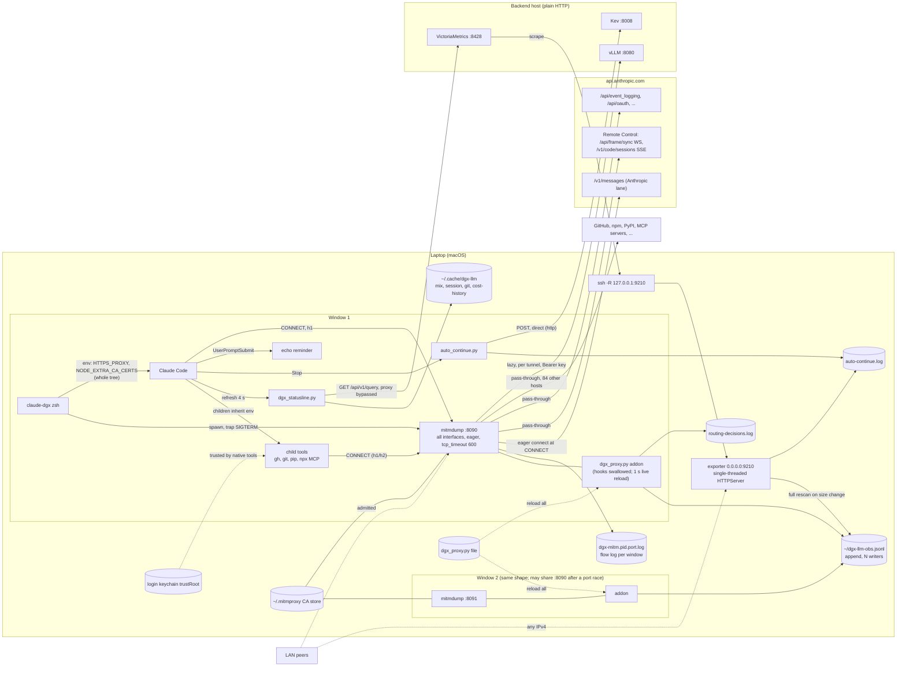
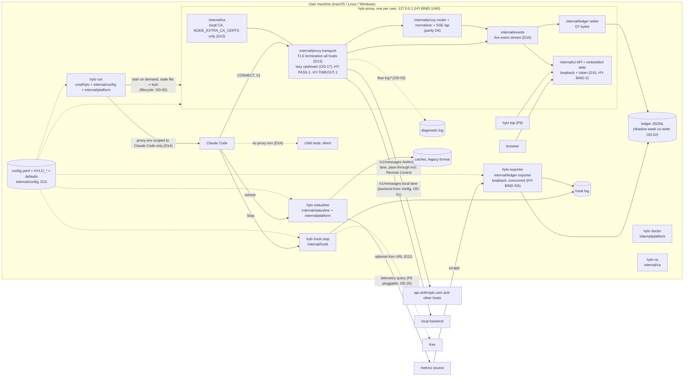

# Pass 1 Deepening — Round 1: Architecture (corrected component and data-flow model, verified external interfaces, legacy → hylo package map) — hylo-legacy

- Source: `$HOME/Dev/hylo/legacy/` (read-only, static). Re-read this round: `claude-dgx` (all 185 lines), `dgx_proxy.py:1-336,362-548`,
  `dgx_ledger_exporter.py` (all 414 lines), `dgx_statusline.py:60-125,160-206,264-312,419-606,1009-1017,1148-1154,1180-1245`,
  `auto_continue.py:20-60,90-140,190-275`, `dgx-proxy-coordinator.sh` (all), `dgx_preflight.py:1-30`, both `deploy/*.plist`.
- Authorized extra source: mitmproxy 12.3.1, read only, cited as "mitmproxy 12.3.1 `<module>:<line>`" (m/`<module>:<line>` in tables). Re-opened
  this round: `options:82,95,132,160,174,241`, `addons/proxyserver:148,150-163`, `addons/dumper:56`, `addons/block:8-50`, `addons/script:210-218`,
  `addonmanager:44-58`, `proxy/layers/http/__init__:786-800,930-946`, `proxy/server:105-110,344-354`, `proxy/layers/websocket:24,33,45`,
  `proxy/layers/http/_hooks:13,28,38,51,65`, `net/tls:13,218`.
- Inputs read: pass-1 broad sweep (complete), extraction validation (complete), pass-2 r8 (complete, §7 = canonical pointer table) and r9
  (complete, §6 = pointer delta), pass-2 r3 §1, §3; r4 §0-§3; r5 §1, §2.2-§2.5, §3.2; r6 §1.1-§1.3, §3; r7 §3 rows OD-37..OD-42; pass-3 r4 §6-§7
  (canonical BC index), r5 §6, r6 §6, r7 §7, r8 §4; `docs/PLAN.md` (all; §6 layout, D1-D16); `.factory/STATE.md` (rulings section).
- Method: nothing from legacy ran, no proxy, nothing networked, `CLAUDE.local.md` not read, no git commit. Two inline read-only checks with
  `/usr/bin/python3 -I`: (1) `ast.literal_eval` of the `QUERY` constant parsed from `dgx_statusline.py` (source text only, the module is never
  imported) to confirm the VictoriaMetrics query byte for byte; (2) a regex census of metric names in `dgx_ledger_exporter.py:289-398`. Shell
  `grep -n` for line anchors. Scratch dir `scratchpad/p1r1/` created; no file was needed in it.
- Numbering: retractions of pass-1 statements use **CONV-ABS-35..CONV-ABS-38** (35-40 reserved for this round; 39-40 unused). New owner items
  **OD-50..OD-53** (all four used). Cross-pass retractions are cited by their existing numbers (CONV-ABS-12, -14, -21, -25, -26, -27, -28).
- A bare `:N` means `dgx_proxy.py` unless the row says otherwise. `L:` = `claude-dgx`, `EX:` = `dgx_ledger_exporter.py`, `SL:` =
  `dgx_statusline.py`, `HK:` = `auto_continue.py`.

---

## 0. Audit of the broad sweep against the five hallucination classes

| Class | Finding in pass 1 | Verdict |
|---|---|---|
| 1 Over-extrapolated lists | §4.4 options list "`flow_detail=1`, `--listen-port`, …" is not over-extrapolated, but is **incomplete** in the other direction: it lists only what the launcher sets, not the mitmproxy defaults that decide behavior (§A.3) | omission, filled in §A.3 |
| 2 Miscounted enumerations | §4.7 heading "27 metric families" with 25 table rows. The code declares **28** names; 27 can carry samples (`dgx_llm_session_tokens` has HELP/TYPE only). Recounted this round (regex census: 25 names in HELP/TYPE lines, 27 in sample lines, 28 in the union) | refinement (pass-2 r5 C-5 already states it); full table in §B.6 |
| 3 Named-pattern fabrication | none found | — |
| 4 Same-basename conflation | none found (`dgx-mitm.<pid>.<port>.log` per window vs `dgx-shared-mitm.<port>.log` of the unwired coordinator are kept apart, `L:74` vs `dgx-proxy-coordinator.sh:32`) | — |
| 5 Inflated metrics | file and line counts recounted: 11 files, 3,181 lines (`find … -exec wc -l`), all 11 per-file counts identical to pass 0 | none |

**Wrong architectural statements** (not hallucinations of form, but facts later rounds disproved or the source contradicts) are retracted in §A.1.

---

## A. Corrected component and data-flow architecture

### A.1 Retractions of pass-1 statements

| Marker | Pass-1 statement (location) | Ground truth | Evidence |
|---|---|---|---|
| **CONV-ABS-35** | §1 C2 responsibility "Intercept `api.anthropic.com`"; §2 diagram `M1 -- other --> A[api.anthropic.com]`; §4.5 lists only two proxy upstreams (DGX, `api.anthropic.com`) | The proxy **TLS-terminates every host** any client tunnels through it: mitmproxy's `ignore_hosts` default is `[]` and the launcher sets neither it nor `allow_hosts`. Only `api.anthropic.com` + `/v1/messages*` is inspected and routed (`:103`); everything else is forwarded unchanged to **its own host**. Production: **85 distinct upstream hosts** in 40 logs (telemetry intake, release check, GitHub, npm, PyPI, six MCP servers, …). "Other" therefore does not mean `api.anthropic.com`. This is D13's "intercept all" state, already true in legacy | m/`options:82`; `L:75`; `:103-104`; P2r8 §0 row 2 |
| **CONV-ABS-36** | §2 diagram and §3 sequence show **Claude Code** as the proxy's only client (`CC -- HTTPS_PROXY --> M1`) | The launcher exports `HTTPS_PROXY` and `NODE_EXTRA_CA_CERTS` to the **whole process tree** (`L:79-80`, no `NO_PROXY`). Child tools (Bash-tool commands, `gh`, `git`, `pip`, `npx`-launched MCP servers) are clients too. Production effects: 75 failed child TLS handshakes on 16 hosts, 7,566 intercepted child HTTP/2 flows, and **2 non-Claude-Code `POST /v1/messages` routed to the DGX** and written as `dgx_request` rows with empty `session`/`meta_user_id`/`project`. The client set is "Claude Code plus every descendant that honors `HTTPS_PROXY`" (plus LAN peers, §A.2 C2b) | `L:79-80`; P2r8 §3; P2r9 §2.2 |
| **CONV-ABS-37** | §1 C5 "on each scrape **where the file grew**"; §3 `VM->>EX: scrape /metrics (rescan if ledger grew)` | The trigger is `os.stat(LEDGER).st_size != processed_size` (any size **change**, including truncation or rotation) **or** a `rebuild` query parameter with a non-empty value (`parse_qs` drops a bare `?rebuild` or `?rebuild=`, so those do not force a rescan; checked with the standard-library `parse_qs`, not the exporter). `processed_size` is taken by a **second** `stat` after `rebuild()` returns, so lines appended during the rescan are covered by the new size without having been read (in-gap lag). A change to the hook log alone, or a same-size replacement of the ledger, never triggers a rescan (BC-EX-027, OD-39) | `EX:277-287,64-68`; pass-3 r5 §3.1, r6 §6 |
| **CONV-ABS-38** | §5 Error handling: "'never raise' swallow-all in **every** I/O helper", citing `dgx_proxy.py:61,73,189,298`, `auto_continue.py:84,119,200` | Only some sites swallow everything. The I/O helpers catch **`OSError` only**: `ledger()` (`:61`), `note()` write (`:73`), failed-request capture (`:298`), hook `_log` (`HK:200`). Text-encoding errors escape them: `note()` raises `UnicodeEncodeError` on an unencodable message and **aborts the calling hook** (BC-PX-048, P-E1/P-R5/P-S5/P-S6; CONV-ABS-21); hook `_log` the same (H-09, exit 1). True swallow-all sites are the rate-limit block (`:189`, `except Exception`), the tap feed (`:406`), and the status line's top-level guard (`SL:1238-1245`). The exporter has no guard around startup or `do_GET` (E-*) | `:56-74,189,298,404-407`; `HK:193-201`; `EX:270-287,409-414`; pass-3 r6 §2.3, r7 §2 |

Refinements of pass-1 statements (true as written, now incomplete; folded into §A.2-§A.4, not retracted):
- §2 "Per Claude Code window: 1 launcher shell, 1 mitmdump": normally true, but the launcher's port pick races; a losing window runs on **another
  window's** mitmdump and loses it when that window exits (P2r3 §3.3, confirmed P2r4 §0.2).
- §1 C3 "CA in the macOS login keychain → `hylo ca`": the target is a **replacement**, not a port: D13 forbids OS-store installation.
- §5 Auth "Anthropic credentials pass through untouched": true on the Anthropic lane; on the DGX lane `Authorization` is overwritten but
  `x-api-key` and cookies are forwarded to the backend (`:164-165`; OD-07).
- §1 C9 backfill → `hylo cost backfill`: PLAN names no phase or package for it (OD-36).
- §4.4: the mitmproxy runtime itself is an architectural component, not just "options used" (§A.2 C2a).

### A.2 Component catalogue (supersedes pass-1 §1)

| # | Component | File / origin | Responsibility | Process model and count | Shared state it touches |
|---|---|---|---|---|---|
| C1 | Launcher | `claude-dgx` | Build env and attribution headers, preflight, start a per-window mitmdump, assemble `claude` argv and the `--settings` JSON (status line, `subagentStatusLine`, Stop hook, UserPromptSubmit hook, sandbox), trap-kill the proxy on exit | one zsh per window; parent of mitmdump and `claude` (not `exec`'d, `L:185`) | env of the whole tree (`L:38-39,46-53,79-80,104,109,148-155`); `profile.env` sourced **after** the proxy started (`L:114-115`, BC-LN-006) |
| **C2a** (new) | **mitmproxy 12.3.1 runtime** (mitmdump) | venv package, `L:75` | Listener, client admission, CONNECT handling with **eager** upstream connect, TLS termination for every host with a minted leaf, upstream TLS verification against certifi, per-client-connection upstream pools, ALPN mirroring, HTTP/1+2+WebSocket relaying, 600 s inactivity watchdog, hook dispatch with exception swallowing, 1 s script live reload, CA creation, flow log on stdout | one per window, long-lived | `~/.mitmproxy/` CA store (shared by all proxies); stdout log `$TMPDIR/dgx-mitm.<pid>.<port>.log` (`L:74-75`) |
| C2b | Proxy addon (router) | `dgx_proxy.py:26-548` | Route `/v1/messages*` on `api.anthropic.com` (R0..R5), normalize DGX-bound bodies, SSE tap, ledger and decision-log writes, plan-limit header capture | loaded into each mitmdump; **re-imported on every mtime change** of the one shared file | ledger, decision log, `failed-req-*.json`, backend key file |
| C3 | CA trust CLI | `dgx_proxy.py:551-764` | install/status/remove/rotate the mitmproxy CA as a login-keychain `trustRoot` | one-shot (`claude-dgx trust …` → `exec python3 … trust`, `L:11-14`) | login keychain, `~/.dgx/trust-state.json`, `~/.mitmproxy.bak-*` |
| C4 | Status line | `dgx_statusline.py` | Render row 1 (session/lane) and row 2 (backend telemetry) from stdin, transcript, VictoriaMetrics, caches | one process per refresh (`refreshInterval: 4`, `L:176`); a child of Claude Code, so it inherits the proxy env, and **bypasses it explicitly** for the VM call (`SL:166-168`) | four cache files (§A.5); `ps` ancestry walk (`SL:276-291`) |
| C5 | Ledger exporter | `dgx_ledger_exporter.py` | Re-derive 28 metric names from a **full rescan** of ledger + hook log when the ledger size changes | one per user, launchd `KeepAlive`+`RunAtLoad`; **single-threaded** `HTTPServer`, no socket timeout, bound `0.0.0.0:9210` IPv4 (`EX:409-414`) | reads ledger and hook log |
| C6 | Stop hook | `auto_continue.py` | Decide whether to force a continuation; log every decision | one process per Stop event (`timeout: 30`, `L:161`) | appends `~/.cache/dgx-llm/auto-continue.log`; reads transcript, Kev key file |
| C6b (new) | UserPromptSubmit hook | inline in `L:158` | `echo` an English-only reminder next to every prompt (iff `DGX_ENGLISH != 0`) | one shell per prompt (`timeout: 5`) | none |
| C7 | Preflight | `dgx_preflight.py` | TCP connect to the backend (4 s) with OS-error diagnosis, run with the proxy's Python | one-shot per launch (`L:60-67`) | none |
| C8 | Coordinator | `dgx-proxy-coordinator.sh` | Singleton mitmdump via `flock` + port/pid state | **unwired** (no caller); `flock` absent on macOS, so it would run unlocked | `.proxy-state/{port,pid,lock}` |
| C9 | Cost backfill | `tools/backfill_cost_history.py` | Seed `cost-history.json` from transcripts | one-shot | `cost-history.json` |
| C10 | Services | `deploy/*.plist` | Keep exporter and `ssh -R 127.0.0.1:9210:127.0.0.1:9210` alive | 2 launchd agents | `/tmp/dgx-ledger-*.log` |

**Coupling (supersedes pass-1 §1 "Layering").** No shared library; coupling is through files, the environment, process relations and HTTP:
- **Files with many writers:** the ledger (N proxies append), the decision log (N proxies append), `cost-history.json` (every status-line run of
  every window, plus backfill; merge-by-reload, last writer wins), the git cache (per project dir, shared by windows on one project).
- **One file, many importers:** `dgx_proxy.py` is loaded by every running mitmdump with live reload, so **one edit changes every window's proxy at
  once**, and one bad edit can de-route all of them (§A.4 item 4).
- **Environment:** set by C1 before the proxy starts (prefixes, served model, `DGX_UPSTREAM` etc. reach C2b) or after (profile.env reaches only
  `claude` and its children). Inherited by **every** descendant (CONV-ABS-36).
- **Process relations:** the launcher's `trap … EXIT INT TERM` kills its mitmdump with SIGTERM (`L:97`); the status line finds the `claude`
  ancestor with `ps` for `⌂` (`SL:276-291`).
- **HTTP:** proxy → DGX/Anthropic/any host; status line → VictoriaMetrics; hook → Kev; VictoriaMetrics → exporter through the tunnel.
- **Duplicated rules** (unchanged from pass 1): lane prefix rule, account hint, stale-span rule.

### A.3 The mitmproxy runtime as configured (component C2a): defaults that shape legacy behavior

The launcher passes only `--set flow_detail=1 --listen-port <p> -s dgx_proxy.py` (`L:75`); `flow_detail` 1 is already the default
(m/`addons/dumper:56`). No `~/.mitmproxy/config.yaml` exists (P2r6 §0). So these defaults are in effect:

| Option / built-in behavior | Value | Architectural consequence | Source |
|---|---|---|---|
| `listen_host` | `""` = all interfaces, IPv4+IPv6 | LAN-reachable proxy (OD-24, ruled: accepted for legacy) | m/`options:95`; P2r5 §1.1 |
| `block_global` / `block_private` | True / False | loopback and private/link-local/ULA/100.64/10 peers admitted; global sources refused | m/`addons/block:8-50` |
| `connection_strategy` | `eager` | upstream connect at CONNECT time: **the DGX lane depends on `api.anthropic.com` TCP reachability** for every new client connection | m/`addons/proxyserver:155`; m/`proxy/layers/http/__init__:786-800` |
| `ignore_hosts` | `[]` | every tunnelled host is TLS-terminated (CONV-ABS-35) | m/`options:82` |
| `ssl_insecure` | False; trust store = certifi only | strict upstream verification; private-CA backends over `https` fail (OD-41) | m/`options:174`; m/`net/tls:13,218` |
| `http2` | True | upstream ALPN mirrors the client's offer: Claude Code is h1 on both legs; h2 child tools get h2 (CONV-ABS-25) | m/`options:132`; P2r7 §1.3 P-1 |
| `websocket` | True | WebSocket messages relayed and **retained per connection** (F-3) | m/`options:160`; P2r7 W-1 |
| `tcp_timeout` | 600 s | inactivity watchdog per client connection: cuts any flow silent for 600 s in both directions (F-2; observed once on an MCP SSE stream) | m/`options:241`; m/`proxy/server:344-354` |
| `store_streamed_bodies` | False | streamed bodies are unreadable in `response` (`get_text` → `None`), hence the SSE tap | m/`addons/proxyserver:148` |
| `max_conns` | 5 per address per client connection | caps concurrent upstream connections per tunnel | m/`proxy/server:109` |
| Hook dispatch | `safecall`: any exception other than `AddonHalt`/`OptionsError` logged as `Addon error` and swallowed; the flow continues as it stands | request-hook raise → flow forwarded with whatever was already rewritten (P-R1..R5); response-hook raise → reply still delivered, later ledger lines lost (P-S1..S6) | m/`addonmanager:44-58`; P2r3 §1.1 |
| Script loader | `-s` scripts always `reload=True`, 1 s mtime poll; failed import at reload = no addon registered; at startup = exit 1 | live reload into **plain pass-through** possible only after startup (CONV-ABS-12) | m/`addons/script:210-218`; P2r4 §0.2 |
| Signals | SIGINT/SIGTERM → shutdown (in-flight flows get the `error` hook, logged as cancels); SIGHUP/SIGKILL → immediate death, no ledger line | OD-38 | P2r6 §1.1-1.2, P2r7 §2 |
| CA store | created at first start iff `mitmproxy-ca.pem` is missing; RSA 2048, CA 10 y, leaves 199 d | shared by all proxies; regeneration keyed on a different file than the trust CLI checks | P2r3 §3.1 |

### A.4 The facts passes 2 and 3 established that pass 1 lacked (each now part of the architecture)

| # | Fact | Mechanism and evidence | Consequence for hylo |
|---|---|---|---|
| 1 | **One proxy per window, no coordinator, port-pick race** | Launcher scans 8090..8143 with `nc -z`, starts mitmdump in the background, and declares success as soon as **any** listener answers on that port (`L:72-78`). Two launches within the bind window pick the same port; the second mitmdump fails to bind and `ErrorCheck` exits it (m/`proxy/mode_servers:252-266`, `addons/errorcheck:28-46`), but the second launcher's probe succeeds against the first window's proxy. The second window then runs on the first window's proxy and environment and loses it when the first window's trap kills it. Coordinator unwired (no reference anywhere; `flock` missing on macOS). Router ports 4141..4199 are still probed in invisible mode (`L:15-22`) | PLAN §6: one proxy per user with state file + lock. OD-19 (race, OOS for parity); **OD-50** (shared-proxy lifecycle), **OD-51** (per-window config under one proxy) |
| 2 | **Eager CONNECT to Anthropic vs lazy DGX connect** | Every Claude Code connection starts with `CONNECT api.anthropic.com:443`; with `eager` the TCP connect to Anthropic happens before any request exists (502 to the CONNECT on failure, no ledger line: the addon has no `http_connect*` hook). DGX connections are opened **lazily, after the `request` hook**, chosen per flow from the rewritten `(host, port, scheme)`. Upstream TLS failure does not gate the tunnel (client TLS proceeds; the flow fails) | Offline local-only use impossible in legacy; Anthropic outage degrades the DGX lane per new connection. OD-17 recommends lazy connects (failure-mode deviation) |
| 3 | **Per-client-connection upstream pools** | Each tunnel's `HttpLayer` owns `connections: dict[Connection, Layer]` (m/`proxy/layers/http/__init__:934,946`); entries are only added; no pool is shared across client connections. A failed connect is cached for the tunnel (sticky for h2 clients only; h1 clients get 502 + close). No retry on a stale keep-alive (`server closed connection` → 502). ≤ 5 per address per tunnel | Go proxy will pool differently (shared, retrying); OD-17, OD-28 (error texts), OD-42 (connect timeout) |
| 4 | **Hook error swallowing and live reload into pass-through** | `safecall` swallows (A.3). Reload unregisters the old module first; a failed import leaves **no addon** → every running proxy forwards everything untouched (Sonnet to Anthropic on plan usage, no ledger). A vanished file at a poll removes the script **permanently** for that process. Production: 1 `Addon error` (`NameError` during a live reload, P-S class), 0 `error in script` | OD-26 (keep last good config, never pass through), OD-18, OD-45 |
| 5 | **Remote Control is on `api.anthropic.com`**, not `bridge.claudeusercontent.com` | Live channels: `/api/frame/sync` WebSocket (8 connections, 20 s server pings, up to 3 h 51 min, ≤ 1,151 messages) and `/v1/code/sessions/…` (10,399 POST, 825 PUT, 240 GET of which 216 streamed SSE, up to the server's 3,600 s cap, median 1,384 s). Both take the same eager tunnel as the routed lane and pass through untouched (`:103-104` returns early); SSE ones get a bounded `_SSETap` (`:192-198`, 64,000 B). `bridge.claudeusercontent.com`: 0 log lines, 0 `bridge_ws_*` ledger events (2026-11-09..14). The launcher's `--remote-control` (`DGX_REMOTE=1`, `L:133`) and the forced `unset ANTHROPIC_BASE_URL` (`L:71,100`) are the client-side half | D6 acceptance test targets these two channels (HY-PASS-1: no total-duration cap; HY-BIND-6 idle > 20 s ping). OD-43 (fate of `bridge_ws_*`). CONV-ABS-26, -28 |
| 6 | **Child-process proxy leakage** (D14 evidence) and its rerouting effect | §A.1 CONV-ABS-36. Tools with their own trust store fail at the handshake while the proxy is **up**; tools that trust the login keychain (where C3 installed the CA as `trustRoot`) are decrypted and re-encrypted; a child's Sonnet-prefixed `/v1/messages` is **routed to the DGX with the owner's backend key** | D14 (ruled) removes it; P4 test: a child `pip`, a child `gh`, a child API client. OD-41 (c) (legacy keychain root cleanup) |
| 7 | **Exporter: single-threaded `HTTPServer`, rebuild on size change** | `HTTPServer(("0.0.0.0", PORT), Handler).serve_forever()` (`EX:414`): one request at a time, `timeout=None`, so one idle TCP connection blocks every scrape (F-1). Rebuild runs **before bind** at start (`EX:411`) and inside `do_GET` on size change (`EX:282-287`), with no exception guard: one poison line → every scrape fails; restart → launchd crash loop. `state_lock` (`EX:27`) is a vestige: no second thread exists. `log_message` is a no-op | HY-BIND-5/6; OD-11, OD-33, OD-39 |
| 8 | **The shared append-only ledger written by many proxies** | `open(LEDGER, "a")` + one `write()` per line per event (`:56-62`), from N mitmdump processes; global order = write order across processes, not flow order; no flow ID; `t` local, 1 s, no offset. Child-process rows and empty-attribution rows are real inputs (P2r9 §2.2). Readers: exporter only (status line, hook, backfill never read it) | D7 freezes bytes; hylo has one writer per user but co-writes with legacy during the shadow week (**OD-52**). OD-25 (no correlation key) |
| 9 | **Status-line caches and their write order** | Per refresh, in order (§A.5): mix → session `rl` → session sample → `proc_start` → git → cost history. Each is a separate atomic `mkstemp`+`os.replace`; a crash or a cancelled run between steps leaves the earlier saves | P1 byte parity of caches after degraded refreshes needs the same order (BC-SL-052/091/093; Q-b) |
| 10 | **The flow log is the only record of pass-through traffic** | mitmdump's stdout (`flow_detail` 1: one line per finished flow, connection and TLS events, WebSocket message lines, no bodies) goes to a per-window file (`L:74-75`), never rotated. It is the only place the F-2 MCP cut, the 119 upstream TLS failures, the Remote Control channels and the D14 evidence were visible: the ledger records only `/v1/messages*` | No hylo counterpart is specified (D16 keeps bodies in memory only; the event API is live only): **OD-53** |
| 11 | **Upstream error events are named by host, not lane** | `error()` writes `<lane>_upstream_error` for any `/v1/messages*` flow; `lane = "anthropic"` for every non-DGX host (`:316-319`), so `anthropic_upstream_error` means "not the DGX host" (CONV-ABS-14) | OD-28 |

### A.5 Status line: caches and write order (component C4), verified this round

| Step | File | Call site → save | Condition | Merge rule |
|---|---|---|---|---|
| 1 | `statusline-mix-<re.sub([^A-Za-z0-9_-],_,sid or "nosession")[:40]>.json` | `_mix_counts` (`SL:1213`) → `SL:1150` | at least one complete new transcript line | full rewrite, 16 keys in fixed order |
| 2 | `statusline-<sid or "nosession">.json`, keys `rl`, `rl_ts` | `effective_rl` (`SL:1216`) → `SL:308` | stdin `rate_limits` is a non-empty object (stored **verbatim**) | reload, set, save |
| 3 | same file, keys `fetch_ts, up, ts, sample, hist` | `get_sample` (`SL:1218`) → `SL:351` (success) / `SL:355` (failure) | `ROWS >= 2` and TTL (4 s) expired | reload, set, save |
| 4 | same file, key `proc_start` | `claude_window_start` (`SL:1229`) → `SL:288` | truthy `session_id`, first successful `ps` walk | reload, set, save |
| 5 | `statusline-git-<sha1(raw dir)[:16]>.json` | `render_lane` → `git_segment` (`SL:455`) → `SL:411` | `DGX_SL_GIT != "0"`, cache older than 5 s | full rewrite `{ts, branch}` |
| 6 | `cost-history.json` | `render_lane` → `record_cost` (`SL:606`) → `SL:237` | truthy sid, lane known, numeric usd, not refreshed by `cc` in the last 60 s | reload, set, save; shared by all windows and backfill |

All writes: `save_cache` = `makedirs` + `mkstemp(dir=CACHE_DIR, prefix=<basename>.)` + `json.dump` (allows `NaN`/`Infinity`) + `os.replace`, all errors
swallowed (`SL:198-206`). Readers: `json.load`, any exception → `{}` (`SL:190-195`).

### A.6 Corrected data flows

**Flow 1 — one DGX-lane request (supersedes pass-1 §3).**
1. Claude Code opens a TCP connection to `127.0.0.1:<port>` and sends `CONNECT api.anthropic.com:443`. mitmproxy (eager) connects to Anthropic
   **first**; on TCP failure the CONNECT gets 502 and nothing reaches the ledger. Then the client TLS handshake with a minted leaf.
2. `POST /v1/messages` arrives in the tunnel. `request` hook: parse, stash `_attrib`, force `Accept-Encoding: identity`, decide the lane, normalize,
   write `dgx_request`, rewrite scheme/host/port, set `Authorization: Bearer <key>`, drop `anthropic-beta` (`:98-167`).
3. mitmproxy picks or lazily opens a plain-HTTP connection to the DGX **in this tunnel's own pool**.
4. `responseheaders`: SSE → `_SSETap` as `response.stream` (pass-through tap); JSON or ≥ 400 → buffered (`:191-208`).
5. `response`: `dgx_reply`, then `dgx_usage` if the tap saw usage; ≥ 400 → error note and `failed-req-*.json` (`:254-309`). Or, if the flow
   failed (connect error, client cancel, inactivity cut, SIGTERM drain), `error` → `dgx_upstream_error` (`:311-323`).
6. Later, independently: VictoriaMetrics scrapes the exporter through `ssh -R`; the exporter rescans the whole ledger iff its size changed.
   The status line's row 2 reads VictoriaMetrics directly (proxy bypassed); its row 1 never reads the ledger.

**Flow 2 — Remote Control and other pass-through traffic.** Same tunnel and eager connection for `api.anthropic.com`; `request` returns at `:103-104`;
`responseheaders` still runs the rate-limit capture on every `api.anthropic.com` response (`:176-190`, `anth_ratelimit` with `session: null` when
no `_attrib`) and taps any `text/event-stream`; WebSocket upgrades are relayed by mitmproxy with pings end to end. Other hosts: their own eager
upstream, no addon effect except the SSE tap. Nothing reaches the ledger except `anth_ratelimit`; everything reaches the flow log.

**Flow 3 — child process traffic (legacy only, removed by D14).** Same as flows 1-2 with a different client; trust failure kills the handshake
for tools that do not trust the CA; a child's Sonnet-prefixed `/v1/messages` takes flow 1.

---

## B. External interfaces (verified verbatim against the source this round)

### B.1 Claude Code status line contract

**Invocation** (`L:175-177`): `{"type":"command","command":"python3 '<HERE>/dgx_statusline.py'","padding":0,"refreshInterval":4}` and
`subagentStatusLine` `{"type":"command","command":"python3 '<HERE>/dgx_statusline.py' --subagent"}` (`--subagent` out of scope; removed in
Claude Code 2.1.323; OD-14). Disabled iff `DGX_STATUSLINE != "1"`.

**stdin fields consumed** (19 leaf paths, 8 objects traversed; every read verified by line):

| Path | Line | Path | Line |
|---|---|---|---|
| `session_id` | `SL:1016,1214,1229,605` | `rate_limits` (whole object, stored verbatim) | `SL:1216` → `:307` |
| `transcript_path` | `SL:1009` | `rate_limits.five_hour.used_percentage` / `.resets_at` | `SL:501-504` |
| `model.display_name` | `SL:442` | `rate_limits.seven_day.used_percentage` / `.resets_at` | `SL:501-504` |
| `model.id` | `SL:442-443` | `cost.total_lines_added` / `cost.total_lines_removed` | `SL:535` |
| `workspace.project_dir` → `workspace.current_dir` → `cwd` | `SL:451-452` | `cost.total_duration_ms` | `SL:539` |
| `context_window.used_percentage` | `SL:419` (via `:463`) | `cost.total_api_duration_ms` | `SL:550,603` |
| `context_window.context_window_size` | `SL:423` | `cost.total_cost_usd` | `SL:601` |
| `prompt_cache.hit_ratio` | `SL:477` | env `COLUMNS` | `SL:1186` |

Objects traversed with `or {}` fallbacks: `model`, `workspace`, `context_window`, `prompt_cache`, `rate_limits`, `rate_limits.five_hour`,
`rate_limits.seven_day`, `cost`. Process env read: `DGX_SL_VM_URL`, `DGX_SL_TTL`, `DGX_SL_ROWS`, `DGX_SL_SPARK`, `DGX_SL_GIT`, `DGX_SL_TRACE`
(`SL:73-77,89`), `LOCAL_MODEL_PREFIXES` (`SL:444`, default `""`). **stdout:** rows joined by `\n`, trimmed to `COLUMNS` when > 0
(`SL:1232-1234`); any exception → `"\x1b[…mstatusline degraded\x1b[0m"` and exit 0 (`SL:1238-1245`). Field-type and crash rules: P2r1 §1.2.

### B.2 Claude Code hook contracts

| Hook | Registration (`--settings`) | stdin consumed | stdout | Other effects |
|---|---|---|---|---|
| **Stop** (`auto_continue.py`) | `"Stop":[{"hooks":[{"type":"command","command":"python3 '<HERE>/auto_continue.py'","timeout":30}]}]` iff `DGX_ENGLISH != 0` or `DGX_AUTOCONTINUE != 0` (`L:160-161`) | `last_assistant_message` (`HK:214`), `stop_hook_active` (`HK:226`), `transcript_path` (`HK:245` → read at `:68`), `session_id` (log only, `HK:198`). Invalid JSON → return, exit 0 (`HK:210-213`) | nothing (allow), or exactly one line `{"hookSpecificOutput": {"hookEventName": "Stop", "additionalContext": "<text>"}}` (`HK:206`) for kinds `non-english`, `colon-fake`, `kev-continue`, `heuristic-continue` | log line per decision incl. `kev-allow` (`HK:193-201`); Kev POST (§B.4). Env: `DGX_ENGLISH`, `DGX_AUTOCONTINUE`, `DGX_KEV_URL/MODEL/THRESHOLD/TIMEOUT/MESSAGES/CHARS/API_KEY` (`HK:31-36,97,217,228`). `additionalContext` acceptance for Stop: UNVERIFIED (BC-HK-013) |
| **UserPromptSubmit** (new to pass 1) | `"UserPromptSubmit":[{"hooks":[{"type":"command","command":"echo \"[Reminder: reply and think in English only. No Chinese anywhere, including your reasoning.]\"","timeout":5}]}]` iff `DGX_ENGLISH != 0` (`L:157-158`) | none | the reminder text (plain stdout, added to context) | none. Covered by BC-LN-009 (settings JSON bytes) |

### B.3 mitmproxy hooks implemented by the addon

| Module function | Hook class (mitmproxy 12.3.1) | Behavior | Live? |
|---|---|---|---|
| `request` (`:524`) | `HttpRequestHook` "request" (m/`proxy/layers/http/_hooks:28`) | R0 bridge upgrade log; route `/v1/messages*` on `api.anthropic.com` | yes (R0 never matches in production) |
| `responseheaders` (`:539`) | "responseheaders" (`_hooks:38`) | `anth_ratelimit` on any `api.anthropic.com` response; stream/buffer choice; SSE tap on any host | yes |
| `response` (`:543`) | "response" (`_hooks:51`) | `bridge_ws_close`; `anth_reply`/`anth_usage`; `dgx_reply`/`dgx_usage`; failed-request capture | yes |
| `error` (`:547`) | "error" (`_hooks:65`) | `{dgx,anthropic}_upstream_error` for `/v1/messages*` only | yes |
| `websocket_start` (`:528`), `websocket_end` (`:533`) | `WebsocketStartHook`, `WebsocketEndHook` (m/`proxy/layers/websocket:24,45`) | guarded by `hasattr(flow, "_ws_started")`, never true → `ws_closed` never written | dead |

Not implemented (so the addon cannot see them): `requestheaders`, `http_connect*`, `websocket_message`, `client_connected`, `server_connect*`,
`tls_*`, `running`, `done`. Module-level side effects at import: `note("addon module loaded (PID …)")` (`:518`), `_router = DGXRouter()` (`:521`).

### B.4 Upstream HTTP calls (supersedes pass-1 §4.5)

| Caller | Target | Details | Line |
|---|---|---|---|
| Proxy, DGX lane | `DGX_UPSTREAM` (default `http://192.0.2.10:8080`), same path | scheme/host/port swapped; `Authorization: Bearer <key file>`; `anthropic-beta` removed; `Accept-Encoding: identity`; `X-DGX-Project`/`X-DGX-User` (`or "unknown"`), `X-DGX-Session` iff set; client `x-api-key`/cookies forwarded (OD-07); **lazy** connect per tunnel | `:79-83,155-166` |
| Proxy, Anthropic lane (`/v1/messages*`, dict body) | `api.anthropic.com` | only `Accept-Encoding: identity` added; **eager** connection at CONNECT | `:131` |
| Proxy, pass-through on `api.anthropic.com` | same host, other paths: `/v1/code/sessions/…` (Remote Control SSE/POST/PUT), `/api/frame/sync` (WebSocket), `/api/event_logging`, `/api/oauth`, `/api/eval`, `/mcp-registry/v0`, … | unchanged bytes | `:103-104`; P2r8 §0 row 3 |
| Proxy, pass-through on every other host | 84 further hosts observed | unchanged bytes, TLS re-terminated, certifi-verified | CONV-ABS-35 |
| Status line | `{DGX_SL_VM_URL}/api/v1/query?query=<quote(QUERY, safe='')>` | GET, `ProxyHandler({})` (env proxy bypassed), timeout 1.5 s | `SL:165-171` |
| Stop hook | `DGX_KEV_URL` (default `http://192.0.2.10:8008/v1/systemone`) | POST JSON `{"model","state","questions":{"turn_complete":…}}`, optional `Authorization: Bearer` (env `DGX_KEV_API_KEY` or `~/.config/dgx-llm/kev-api-key`), timeout 2.5 s per call, up to 3 calls (`HK:124-138`), reads `answers.turn_complete.noul`. No proxy bypass: with the default `http://` URL the exported `HTTPS_PROXY` does not apply (urllib selects proxies per scheme; standard-library behavior, not source-read here); an `https://` Kev URL would go through the proxy | `HK:94-121` |
| Preflight | TCP `host:port` of the URL argument | `socket.create_connection`, 4 s, port default 80 whatever the scheme | `dgx_preflight.py:18-24` |
| Launcher | `nc -z 127.0.0.1 <port>` | router-port scan 4141..4199 (`L:21`, runs even in invisible mode), proxy-port scan and readiness (`L:73,77-78`) | as cited |
| Exporter tunnel | `ssh -N -R 127.0.0.1:9210:127.0.0.1:9210 … dgx` | `ServerAliveInterval=30`, `ServerAliveCountMax=3`, `ExitOnForwardFailure=yes` | `deploy/io.hylo.ledger-tunnel.plist:5-12` |

### B.5 VictoriaMetrics query (verbatim, `SL:102-123`; byte-for-byte confirmed this round by `ast.literal_eval`)

```
{__name__=~"vllm:num_requests_running|vllm:num_requests_waiting|vllm:kv_cache_usage_perc|dgx_kv:host_hit_share|dgx_tokens:gen_rate5m|dgx_ttft:p95_30m|dgx_preempt:rate5m|dgx_llm_last_dgx_request_timestamp_seconds|dgx_power:est_wall_watts|dgx_power:rate_usd_per_kwh|dgx_cost:dgx_usd_per_mtok|dgx_tokens:rate_mtok_month|vllm:lmcache_mp_lookup_duration_seconds_count|DCGM_FI_DEV_POWER_USAGE|DCGM_FI_DEV_GPU_TEMP"} or up{job=~"vllm|lmcache"} or label_set(alias(sum(rate(vllm:generation_tokens_total[1m])), "dgx_sl:gen_rate1m"), "sl", "1m") or label_set(alias(sum(increase(vllm:time_to_first_token_seconds_count[30m])), "dgx_sl:ttft_n30m"), "sl", "n30m")
```

Shape: 15 names in the `__name__` regex, `up` for 2 jobs (stored as `up:vllm`, `up:lmcache`), 2 inline aliases → 18 names, 19 result keys. MetricsQL,
not PromQL (`alias`, `label_set`). Result handling `SL:172-185` (pass-1 §4.6 stands). Post-soak capture: all finite; idle windows absent, not NaN
(CP-N01/N02 latent). One series couples back to hylo: `dgx_llm_last_dgx_request_timestamp_seconds` is the exporter's own gauge (exporter → VM → status line).

### B.6 Prometheus exposition (`EX:289-398`; 28 names declared, 27 can carry samples)

Served `200`, `Content-Type: text/plain; version=0.0.4`, `Content-Length`, path `/metrics` only (other paths: `404`, no body); `?rebuild=<non-empty>` forces
a rescan (a bare `?rebuild` does not: `parse_qs` drops blank values) (`EX:270-287,399-404`). Labels shown in emission order.

| # | Name | TYPE | Labels | Samples? |
|---|---|---|---|---|
| 1 | `dgx_llm_requests_total` | counter | `project,user,model,account,device` | yes |
| 2 | `dgx_llm_est_prompt_tokens_total` | counter | `project,user,account` | yes |
| 3 | `dgx_llm_tokens_input_total` | counter | `project,user,account` | yes |
| 4 | `dgx_llm_tokens_output_total` | counter | `project,user,account` | yes |
| 5 | `dgx_llm_tokens_cache_read_total` | counter | `project,user,account` | yes (one per `tok_in` key) |
| 6 | `dgx_llm_tokens_input_captured_total` | counter | `project,user,account` | yes (interleaved with #5) |
| 7 | `dgx_llm_anthropic_requests_total` | counter | `project,user,model,account` | yes (`account` always `unknown`) |
| 8 | `dgx_llm_anthropic_tokens_input_total` | counter | `project,user,model,account` | yes |
| 9 | `dgx_llm_anthropic_tokens_output_total` | counter | same | yes |
| 10 | `dgx_llm_anthropic_request_duration_seconds_sum` | counter | same | yes, always `0.000` |
| 11 | `dgx_llm_anthropic_request_duration_seconds_count` | counter (TYPE, no HELP) | same | yes, always `0` |
| 12 | `dgx_llm_anthropic_tokens_cache_read_total` | counter | same | yes |
| 13 | `dgx_llm_anthropic_tokens_cache_write_total` | counter | same + `ttl="5m"` / `ttl="1h"` | yes (2 per key) |
| 14 | `dgx_llm_anthropic_usage_cache_captured_total` | counter | same | yes |
| 15 | `dgx_llm_request_duration_seconds_sum` | counter | `project,user` | yes |
| 16 | `dgx_llm_request_duration_seconds_count` | counter (TYPE, no HELP) | `project,user` | yes |
| 17 | `dgx_llm_request_errors_total` | counter | `project,user` | yes |
| 18 | `dgx_llm_anthropic_passthrough_total` | counter | none | yes |
| 19 | `dgx_llm_last_request_timestamp_seconds` | gauge | none | yes |
| 20 | `dgx_llm_last_dgx_request_timestamp_seconds` | gauge | none | iff > 0 (HELP/TYPE too) |
| 21 | `dgx_llm_last_anthropic_request_timestamp_seconds` | gauge | none | iff > 0 (HELP/TYPE too) |
| 22 | `dgx_llm_session_requests` | gauge | `session` (8 chars), `project`, `user` | yes |
| 23 | `dgx_llm_session_tokens` | gauge | — | **no** (HELP/TYPE only) |
| 24 | `dgx_llm_session_tokens_in` | — (no HELP/TYPE) | as #22 | yes |
| 25 | `dgx_llm_session_tokens_out` | — | as #22 | yes |
| 26 | `dgx_llm_session_errors` | — | as #22 | yes |
| 27 | `dgx_llm_fakestop_events` | counter | `kind` ∈ {`kev_caught`, `colon_caught`, `heuristic`, `kev_plus_opus`, `allowed`} | yes (5 fixed; `kev_plus_opus` has no producer in the current hook) |
| 28 | `dgx_llm_fakestop_p_done_latest` | gauge (TYPE, no HELP) | none | iff a `p_done=` line exists |

### B.7 Ledger events (13, including historical and dead names; `:56-62` writer; schema detail in P2r4 §3.2 + r5 C-1..C-4)

| # | Event | Emitter | Status | Consumer | Ledger count 2026-11-09..14 (P2r9 §2.1) |
|---|---|---|---|---|---|
| 1 | `dgx_request` | `:154` | live (also child traffic, CONV-ABS-36) | exporter | 4,755 |
| 2 | `dgx_reply` | `:272` | live | exporter | 4,696 |
| 3 | `dgx_usage` | `:276` | live | exporter | 4,564 |
| 4 | `dgx_upstream_error` | `:322` (f-string) | live | exporter (`errors`) | 23 |
| 5 | `anth_request` | `:134`, `:139` | live | exporter | 7,207 |
| 6 | `anth_reply` | `:245` | live | exporter (`passthrough` iff 200) | 7,183 |
| 7 | `anth_usage` | `:247` | live | exporter | 6,942 |
| 8 | `anthropic_upstream_error` | `:322` (f-string) | live (= any non-DGX host) | none | 22 |
| 9 | `anth_ratelimit` | `:188` | live (any `api.anthropic.com` response) | none | 705 |
| 10 | `bridge_ws_connect` | `:101` | code-live, never fires (OD-43) | `last_ts` only | 0 |
| 11 | `bridge_ws_close` | `:213` | code-live, never fires (OD-43) | `last_ts` only | 0 |
| 12 | `ws_closed` | `:536` | dead (guard never true) | — | 0 |
| 13 | `anthropic_reply` | none (historical, before 2026-11-10) | read only | exporter (`passthrough`) | 258 |

### B.8 Files (delta to pass-1 §4.8; all other rows stand)

| Path | Writers | Readers | Change vs pass 1 |
|---|---|---|---|
| `~/dgx-llm-obs.jsonl` | **every** running mitmdump (N per user) | exporter | multi-writer made explicit |
| `~/dgx-llm-routing-decisions.log` | every mitmdump; first line per process `addon module loaded (PID …)` (`:518`) | humans | multi-writer; raise path (CONV-ABS-38) |
| `$TMPDIR/dgx-mitm.<pid>.<port>.log` | mitmdump stdout+stderr, `PYTHONUNBUFFERED=1` | humans; the passes' production evidence | never rotated or deleted (40 files, ~13 MB observed) |
| `~/.mitmproxy/` | first mitmdump to start | all mitmdumps, launcher (`NODE_EXTRA_CA_CERTS`), trust CLI | shared CA store |
| login keychain `trustRoot` "mitmproxy" | trust CLI | macOS-native verifiers of **every** process (child tools included) | enables CONV-ABS-36 interception |

---

## C. Target-architecture mapping (legacy component → hylo package per `docs/PLAN.md` §6)

Decision keys: D4 parity; **D4-EX-1** `⌂` on Windows; **D4-EX-2** skip wrong-shape transcript lines; D6 invisible only; D7 frozen ledger/metrics;
D11 Kev optional; **D13** intercept all, rewrite only `POST /v1/messages` on `api.anthropic.com`, CA only via `NODE_EXTRA_CA_CERTS`; **D14** proxy
env not leaked to children; **D15** config over code; **D16** web + terminal UI on one local read-only event API. Defaults: **HY-BIND-1..6**
(loopback binds, opt-in wider bind with warning, admission allow-list, exporter loopback, timeouts + concurrency on every listener),
**HY-PASS-1** (pass-through: no total-duration cap, relay as it arrives), **HY-TIMEOUT-1** (routed in-flight timeout ≥ client API timeout),
HY-TLS-1/3, HY-PROTO-1, HY-WS-1.

| Legacy component | hylo package(s) and subcommand | Ph | Decisions that shape it | Open ODs that block its design | BCs |
|---|---|---|---|---|---|
| C1 Launcher (env, headers, argv, `--settings`, preflight call, proxy start, trap) | `cmd/hylo` (`run`) + `internal/config` + `internal/platform` | P4 | D6 (no visible mode; keep `ANTHROPIC_BASE_URL` unset; `--remote-control`), **D14** (proxy env scoped to Claude Code only; mechanism chosen in P4), D15 (every `DGX_*` knob a key), HY-BIND-1 (`HTTPS_PROXY` → loopback), HY-TIMEOUT-1 (derives from the exported `API_TIMEOUT_MS=1800000`, `L:104`) | OD-05 (env-bool grammar), OD-14 (`subagentStatusLine`), OD-19 (port race), OD-34 (per-launch proxy credential), **OD-50** (shared-proxy lifecycle), **OD-51** (per-window config under one proxy) | BC-LN-001..011 |
| C2a mitmproxy runtime: listener, admission, CONNECT, TLS termination, upstream pools, watchdog, WebSocket relay | `internal/proxy` (transport layer) + `internal/ca` (leaf minting) | P3 | D13 (every host terminated), D6 (Remote Control channels must survive), HY-BIND-1/3/4/6, **HY-PASS-1**, **HY-TIMEOUT-1**, HY-TLS-1/3, HY-PROTO-1 (mirror client HTTP version), HY-WS-1 (bounded WebSocket buffers, D16) | OD-17 (lazy connect, reconnect), OD-28 (error texts), OD-37 (inactivity ceiling), OD-38 (exit semantics), OD-41 (upstream TLS policy), OD-42 (connect timeout), OD-34 | BC-PX-037, -039, -043, -044, -046, -047, -049 |
| C2b Router / normalizer / SSE tap / attribution | `internal/proxy` | P3 | D4 (byte-exact rewritten bodies and routing), D13 (only `/v1/messages*` rewritten), D15 (prefixes, served model, block types as config; protocol strings as named constants) | OD-06, OD-07, OD-08, OD-09, OD-10, OD-18, OD-35, OD-40 | BC-PX-001..027, -032..036, -038, -040..042, -045, -048 |
| Ledger writer `ledger()` | `internal/ledger` (writer), fed by `internal/events` | P3 | **D7** (bytes frozen: separators, `ensure_ascii`, field order, local `t`), D4 | OD-25 (no correlation key), OD-43 (`bridge_ws_*`), **OD-52** (shadow-week co-writing) | BC-PX-028 |
| Decision log `note()` | `internal/proxy` (diagnostic log) / `internal/events` | P3 | D15 (path as config), D16 (event feed carries routing reasons) | OD-40 (what "routing decisions" means for replay), OD-45 (a log write never aborts routing) | BC-PX-022, -029, -048 |
| Flow log (mitmdump stdout) | none specified | P3 | D16 guardrail (no bodies on disk) | **OD-53** | — |
| Live event stream (no legacy counterpart; replaces in-process flow attributes) | `internal/events` | P3 | **D16** (one internal stream feeds ledger writer and UIs), D7 (ledger unchanged) | OD-25 (an internal `flow_id` is free; the ledger keeps none until P7), OD-43 (events for the real Remote Control channels) | — |
| Web UI / event API (no legacy counterpart) | `internal/ui` + `web/` (`hylo ui`); `hylo top` later | P4 / P6 | **D16** (localhost + per-launch token, credential redaction, bounded memory buffers, read-only, mockup first), HY-BIND-2/3 | OD-43 (what WebSocket/Remote Control rows show) | — |
| C3 Trust CLI + CA store | `internal/ca` (`hylo ca`) + `internal/platform` | P4 | **D13** (CA never added to an OS store; trusted via `NODE_EXTRA_CA_CERTS` only), D5 | OD-41 (c) (remove the legacy login-keychain `trustRoot` at cutover) | BC-PX-031 (OOS, replaced), BC-LN-001 |
| C4 Status line | `internal/statusline` (`hylo statusline`) + `internal/platform` (`ps` ancestry for `⌂`) + `internal/config` | P1 | D4 (byte-exact stdout and cache files), **D4-EX-1**, **D4-EX-2**, D15 (about 55 literal keys), D14 (runs as a child: no proxy env, so the explicit bypass becomes defense in depth) | OD-01, OD-02, OD-03, OD-14, OD-20, OD-21, OD-30, OD-32 | BC-SL-001..103 |
| C5 Exporter | `internal/ledger` (exporter) (`hylo exporter`) | P2 | **D7** (names, labels, values), D4, **HY-BIND-5** (loopback default), **HY-BIND-6** (concurrent, timeouts) | OD-04, OD-11, OD-15, OD-22, OD-23, OD-27 (hylo default awaiting confirmation), OD-29, OD-33, OD-39 | BC-EX-001..027 |
| C6 Stop hook | `internal/hook` (`hylo hook stop`) | P4 | D11 (Kev optional URL), D4 (decision and JSON equivalence), D14 (child process), D15 (threshold, timeouts, patterns) | OD-04, OD-05, OD-12, OD-45 (H-09 log raise) | BC-HK-001..023 |
| C6b UserPromptSubmit hook | `cmd/hylo` (`run`, settings JSON) | P4 | D15 (reminder text as config) | — | BC-LN-009 |
| C7 Preflight | `internal/platform` (`hylo doctor`) | P4 | D5 (macOS Local Network diagnosis is one OS case), D15 | OD-42 (connect timeout shares the probe's question) | BC-PF-001..002 |
| C8 Coordinator (unwired) | `internal/proxy` + `cmd/hylo` (`run`): state file + lock (PLAN §6) | P4 | PLAN §6 "one proxy per user", D5 (no `flock` on macOS; Windows locking) | OD-19, **OD-50** | BC-CO-001..002 (OOS) |
| C9 Backfill | `cmd/hylo` (`cost backfill`), proposed | unscheduled | D15 (price table as config) | OD-36 (no phase/package), OD-13, OD-31 | BC-BF-001..013 |
| C10 Services | `internal/platform` (launchd / systemd user unit / Windows scheduled task) | P2 | D5, HY-BIND-5 (the tunnel is loopback-to-loopback, so a loopback bind loses nothing) | OD-15 | BC-SV-001..002 (OOS) |
| Configuration (40 env inputs, `profile.env`) | `internal/config` (`hylo config`) | P1-P6 | **D15** (file → `HYLO_*` → default; `DGX_*` accepted until P6), D4 (defaults = legacy) | OD-01, OD-05, OD-26 (reload semantics), OD-51 | BC-PX-030 |

### C.1 New owner items (OD-50..OD-53)

| ID | Decision | Why it is new | Recommendation |
|---|---|---|---|
| **OD-50** | **Shared-proxy lifecycle.** Legacy ties each proxy's life to one window: started by its launcher, SIGTERM'd by its trap on exit (`L:75,97`), so a proxy crash or edit affects one window (except live reload, which hits all). PLAN §6 makes one long-lived proxy per user, "started on demand" by `hylo run`, but says nothing about when it stops, how a new binary or config reaches it, or the blast radius (one crash = every window loses its API path). Decide: stop policy (never / after a configurable idle period with no client connections / when the last `hylo run` exits), and the upgrade path (drain per OD-38, then hand over) | No OD covers lifecycle: OD-19 is the legacy port race, OD-26 config reload, OD-38 in-flight flows at exit | Keep the proxy running while any `hylo run` client is registered, stop after a configurable idle period (D15 key, labeled judgment default) once none is; `hylo run` restarts it on demand; upgrades and config changes drain first (OD-38) and never fall back to pass-through (OD-26). `hylo doctor` reports a stale state file |
| **OD-51** | **Per-window routing config under one proxy.** Legacy proxies read routing config from the **launching window's** environment at start: `DGX_UPSTREAM`, `DGX_KEY_FILE`, `DGX_OBS_LEDGER`, `DGX_PROXY_DECISIONS` can differ per window (the launcher force-exports only `LOCAL_MODEL_PREFIXES` and `DGX_SERVED_MODEL`, `L:38-39`; `profile.env` arrives after the proxy started, `L:114-115`). A single per-user proxy cannot see per-window env. Decide: routing config is per-user only (one profile per proxy), or per client (the launcher tags its Claude Code traffic with a profile id over the custom-header channel it already uses for `X-DGX-Project`/`X-DGX-User`, `L:44-53`, and the proxy selects backend and key by it) | BC-LN-006 is marked OOS citing "one proxy per user", but the consequence for per-window upstreams is not an OD anywhere | Per-user profile by default (parity holds: every legacy window that did not override env gets identical routing); per-client profile selection by header as a P6 option. Document that per-window `DGX_UPSTREAM` overrides stop working at cutover |
| **OD-52** | **Shadow-week ledger topology (P3).** PLAN P3 runs "one real window on hylo, the rest on Python, ledger diff clean". Either hylo appends to the **same** `~/dgx-llm-obs.jsonl` as the Python proxies (mixed-implementation multi-writer; dashboards stay complete; hylo must keep one `write()` per line on an `O_APPEND` descriptor; no field says which implementation wrote a line and D7 forbids adding one), or to a **separate** file (clean diff, but the legacy exporter reads one path, so the hylo window vanishes from the dashboards for a week) | No OD or BC covers co-writing across implementations; pass-2 r4 §3.2 states the multi-writer contract only for N identical Python writers | Same file, single-write lines; the diff partitions lines by the shadow window's `session` values (every Claude Code row carries one), and treats rows with empty `session` as unattributable. Keep `DGX_OBS_LEDGER`-equivalent config so a separate file remains possible |
| **OD-53** | **Persistent flow-level diagnostic log.** Legacy's mitmdump stdout (`flow_detail` 1) is a per-window, unrotated, metadata-only record of **every** flow and every connection/TLS event (`L:74-75`). It is the only source that showed the F-2 MCP cut, the upstream TLS episode, the Remote Control channels and the D14 leak; the ledger cannot (it records `/v1/messages*` only). hylo's D16 event API is live-only and keeps bodies in memory. Decide: ship a metadata-only flow log (method, host, path without query, status, bytes, duration, error text, connection and TLS events; never headers or bodies), off, on, or on with rotation | Not covered by OD-40 (replay meaning of the decision log) or OD-45 (decision-log write failure) | On by default, size-capped with rotation, path and cap as config (D15); format documented as diagnostic (not D7-frozen); excluded from parity. It does not conflict with D16's "bodies never written to disk" |

---

## D. Component diagrams

### D.1 Legacy as it really runs (one user, N windows; window 1 shown, window 2 sketched)



### D.2 hylo target (per `docs/PLAN.md` §6 and the decisions above; open ODs marked)



---

## Delta Summary

| Target | New | Refined / confirmed |
|---|---|---|
| A architecture | **4 retractions** of pass-1 statements (CONV-ABS-35 interception scope; CONV-ABS-36 client set; CONV-ABS-37 exporter trigger; CONV-ABS-38 error-handling claim). **2 new components** (C2a mitmproxy runtime as an architectural layer with 13 behavior-deciding defaults; C6b UserPromptSubmit hook). **11 architectural facts folded in** from passes 2-3 (§A.4: port race, eager vs lazy connect, per-tunnel pools, safecall and live reload, Remote Control channels, D14 leakage and rerouting, single-threaded exporter, multi-writer ledger, cache write order, flow log as sole pass-through record, host-named error events). Corrected data flows (3) | pass-1 C1, C3, C4, C7-C10 confirmed; 5 refinements (port race, `hylo ca` replacement, DGX-lane credential forwarding, backfill unscheduled, runtime-as-component) |
| B interfaces | UserPromptSubmit hook contract; pass-through upstream classes (other `api.anthropic.com` paths, 84 other hosts); Kev call proxy semantics; launcher router-port scan in invisible mode; tunnel options; unimplemented-hook list; files delta (multi-writers, CA store, keychain, flow log) | stdin 19 leaf paths + 8 objects re-anchored by line; Stop hook I/O re-verified; VM query **byte-for-byte** re-confirmed (AST); metric census 28 declared / 27 with samples re-derived; 13 ledger events re-listed with emitters and counts |
| C mapping | 18-row legacy → package table with decisions and blocking ODs; **OD-50** (shared-proxy lifecycle), **OD-51** (per-window config under one proxy), **OD-52** (shadow-week ledger co-writing), **OD-53** (flow-level diagnostic log) | every BC family placed (232 BCs, unchanged); PLAN §6 package list fully used |
| D diagrams | legacy as it runs (N proxies, children, LAN peers, live reload, shared files, 85 upstreams); hylo target with open ODs marked | — |

Counts: retractions 4 (CONV-ABS-35..38; 39-40 unused). New owner items 4 (OD-50..OD-53). New components 2. New interface rows 9. Architectural facts
folded in 11. BCs unchanged (232).

## Remaining Gaps (verbatim-carryable)

1. Round-2 audit of this file against the five hallucination classes, with particular checks on: the §A.3 option table (13 rows, each against
   mitmproxy 12.3.1 source), the §B.1 count "19 leaf paths, 8 objects", the §B.6 TYPE/HELP column, and the §C mapping's BC ranges per package.
2. Verify from source the one statement this round carries without a source read: urllib's per-scheme proxy selection (Kev `http://` URL not
   proxied under `HTTPS_PROXY`), if the CPython stdlib becomes an authorized source; otherwise keep it labeled.
3. Reconcile with the sibling pass-0, pass-4 and pass-5 round-1 files (not present at write time, checked 08:25Z): component names (C2a, C6b),
   the flow-log and multi-writer facts (pass 4 NFRs), and OD-50..OD-53 numbering.
4. Owner decisions: OD-50..OD-53 added to the 42 pending (OD-01..OD-23, OD-25, OD-26, OD-28..OD-43, OD-45); OD-44 and OD-46..OD-49 unused.
5. Not determinable from authorized sources (LOW): whether a terminal close delivers SIGHUP to the background mitmdump in practice (static
   reasoning in P2r6 §1.1); which `api.anthropic.com` channel Anthropic brands "Remote Control" (both must pass); the D14 mechanism (PLAN defers
   it to P4).

## Novelty Assessment

Novelty: SUBSTANTIVE

Four pass-1 statements are wrong and are retracted: the proxy intercepts every host, not `api.anthropic.com` (CONV-ABS-35); Claude Code is not its
only client, child processes are, and two of their requests were routed to the backend (CONV-ABS-36); the exporter rescans on any size change with
a post-read size, not "when the file grew" (CONV-ABS-37); the I/O helpers swallow `OSError` only, so encoding errors abort hooks (CONV-ABS-38). The
broad sweep also lacked a whole architectural layer (the mitmproxy runtime, whose defaults decide eager connects, per-tunnel pools, the 600 s cut,
LAN admission, exception swallowing and live reload) and a Claude Code interface (the UserPromptSubmit hook). Mapping legacy onto PLAN §6 exposed
four design questions no prior round raised (OD-50..OD-53). Removing this round would leave the architecture spec with a wrong interception scope,
a wrong client set, a wrong exporter trigger, and no lifecycle, per-window-config, shadow-week or diagnostic-log decision for the shared proxy.
By the binary rule, correcting a wrong architectural statement or adding a missing interface is SUBSTANTIVE.

## Convergence Declaration

Another round needed: four retractions, one new architectural layer and four new owner items. Round 2 should audit this file (Remaining Gaps 1),
reconcile with the sibling round-1 files (gap 3), and re-check the target mapping against PLAN §6 and the BC index.

## State Checkpoint

```yaml
pass: 1
round: 1
status: complete
timestamp: 2026-11-14T08:40:00Z
novelty: SUBSTANTIVE
files_scanned: claude-dgx (1-185); dgx_proxy.py (1-336, 362-548); dgx_ledger_exporter.py (1-414); dgx_statusline.py (60-125, 160-206, 264-312, 419-606, 1009-1017, 1148-1154, 1180-1245); auto_continue.py (20-60, 90-140, 190-275); dgx-proxy-coordinator.sh (all); dgx_preflight.py (1-30); deploy/*.plist; mitmproxy 12.3.1 (options, addons/proxyserver, addons/dumper, addons/block, addons/script, addonmanager, proxy/layers/http/__init__, proxy/layers/http/_hooks, proxy/layers/websocket, proxy/server, net/tls); docs/PLAN.md
retractions: [CONV-ABS-35 (interception scope), CONV-ABS-36 (client set), CONV-ABS-37 (exporter trigger), CONV-ABS-38 (error-handling claim)]
conv_abs_unused_in_range: [39, 40]
new_owner_items: [OD-50 shared-proxy lifecycle, OD-51 per-window config under one proxy, OD-52 shadow-week ledger co-writing, OD-53 flow-level diagnostic log]
new_components: [C2a mitmproxy runtime, C6b UserPromptSubmit hook]
interfaces_verified: {stdin_leaf_paths: 19, stdin_objects: 8, stop_hook_stdin_fields: 4, addon_hooks: 6 (4 live, 2 dead), vm_query: byte-exact (ast), metric_names: 28 declared / 27 with samples, ledger_events: 13}
bc_index_total: 232 (unchanged)
next: pass 1 round 2 (audit, sibling reconciliation, mapping re-check)
```
