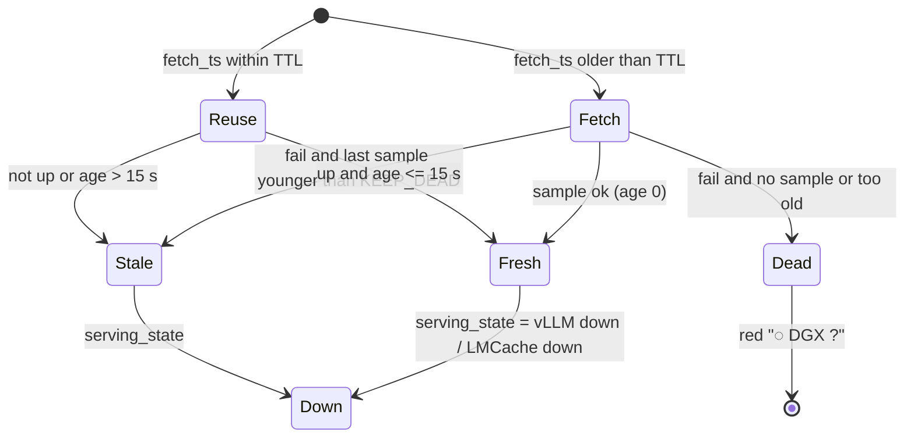
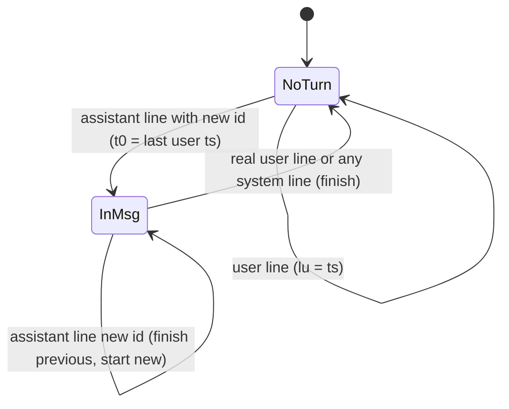

# Pass 2: Domain Model — hylo-legacy

## 2a. Structural extraction

### Entity catalog

| Entity | Representation | Key properties | Invariants / notes | Evidence |
|---|---|---|---|---|
| **Lane** | string | proxy: `"anthropic"`, `"anthropic-server-tools"`, implicit DGX (no `lane` key on DGX events); statusline/cost: `"dgx"`, `"anth"`, `None` | DGX lane iff `model.startswith(any LOCAL_MODEL_PREFIXES)` (case-sensitive) and no server tool declared | `dgx_proxy.py:132-141`, `dgx_statusline.py:446,604` |
| **Session** | Claude Code `session_id` (UUID string) | resets on `/clear`; header `X-Claude-Code-Session-Id` on requests | keys all statusline caches and cost history; ledger `session` | `dgx_statusline.py:1214`, `dgx_proxy.py:120` |
| **Window** | the Claude Code OS process | start time (`ps lstart`) | survives `/clear`; source of `⌂` | `dgx_statusline.py:265-295` |
| **Project** | basename of the start dir | launcher `basename "$PWD"` -> header `X-DGX-Project`; statusline `basename(normpath(project_dir))` | equal by construction except symlinked dirs (review #4.2) | `claude-dgx:44`, `dgx_statusline.py:460` |
| **User** | `DGX_USER` or `whoami` | header `X-DGX-User` | — | `claude-dgx:43-45` |
| **Account / Device hint** | first 8 chars of `account_uuid` / `device_id` from CC `metadata.user_id` (stringified JSON) | `"unknown"` fallback | proxy and exporter implement it twice with slightly different fallbacks | `dgx_proxy.py:326-336`, `dgx_ledger_exporter.py:75-91` |
| **Flow attribution** (`flow._attrib`) | dict | `project, user, session, meta_user_id, model_req, req_bytes, path` (+`lane` on Anthropic lane, +`model_served` on DGX) | `req_bytes` = `len(get_text())` = **characters, not bytes** | `dgx_proxy.py:117-127,133,144` |
| **Usage** | Anthropic `usage{}` | `input_tokens, output_tokens, cache_read_input_tokens, cache_creation_input_tokens, cache_creation.ephemeral_{5m,1h}_input_tokens` | price classes non-overlapping; ledger `cache_write_5m_tok + cache_write_1h_tok == cache_write_tok` | `dgx_proxy.py:339-359` |
| **Cache fields** | dict | `cache_read_tok, cache_write_tok, cache_write_5m_tok, cache_write_1h_tok` | 1h clamped to write; 5m = remainder; `{}` when no cache keys | `dgx_proxy.py:349-359,381-387` |
| **SSE tap** | `_SSETap` | `buf` (≤64,000 B tail), `usage` tuple, `_read/_write/_w1h` maxima, `stop_reason` | pass-through: `feed()` returns the chunk unchanged | `dgx_proxy.py:362-427` |
| **Ledger event** | JSONL line | see Ledger Schema below | append-only; D7 frozen | `dgx_proxy.py:56-62` |
| **Plan window** | `rate_limits.{five_hour,seven_day}` | `used_percentage`, `resets_at` (unix s); fixed length 5 h / 7 d | dropped once `resets_at <= now`; projection = pct / elapsed share | `dgx_statusline.py:501-531` |
| **Ratelimit header set** | dict suffix -> value | keys of `anthropic-ratelimit-unified-*` lowercased, prefix stripped | logged only on change per session per proxy process | `dgx_proxy.py:176-188` |
| **Telemetry sample** | `{metric_name: float}` | names per Pass 1 §4.6; `up:<job>` | first value per name wins | `dgx_statusline.py:174-185` |
| **Sparkline point** | `{"t","v","k","f","p"}` | `v` box tok/s, `k` KV fraction, `f` TTFT p95 s, `p`=1 preemption | missing series => key omitted (never 0); legacy `[ts, rate]` lists normalized | `dgx_statusline.py:333-348,652-656` |
| **Session cache** | `statusline-<sid>.json` | `fetch_ts, up, ts, sample, hist (≤32), rl, rl_ts, proc_start`; retired key `sess_state` popped | — | `dgx_statusline.py:307,324-355,287` |
| **Mix cache (parse state)** | `statusline-mix-<sid>.json` | `size` (byte offset), `res, conv, think` (bytes/chars), `tin, tout, c_wr, c_rd, c_in` (tokens), `rb` (rebuilds), `pp` (previous prompt), `ids` (≤256 recent message ids), `lr` ([rate, dim]), `lu` (last user ts), `cur` ({id,t0,t1,out}), `mixv6` marker | missing `tin`/`c_wr`/`mixv6` with offset>0 => full re-parse | `dgx_statusline.py:1018-1040,1150-1153` |
| **Composition** | (res, conv, think) | ▤ tool results, ❙ conversation, ◈ thinking | restarts at each `compact_boundary`; only first 3 tuple items participate | `dgx_statusline.py:1088-1095,1157-1174` |
| **Turn (last-turn rate)** | `cur` | `id` message id, `t0` preceding user line ts, `t1` last line ts, `out` output tokens | rate valid iff `out>0`, `span>0`, `span <= 4*out/15` | `dgx_statusline.py:988-996,1069-1087` |
| **Rebuild** | counter `rb` | per call: `write - max(0, prompt - pp) > 20000` | `pp` reset to None at compaction and on full reset | `dgx_statusline.py:1116-1119` |
| **Cost record** | `cost-history.json` `sessions[sid]` | `lane` (`dgx`/`anth`), `usd` (round 4), `api_ms` (number or null), `ts` (unix), `src` (`cc`/`backfill`) | `cc` records never overwritten by backfill; `cc` writes throttled 60 s | `dgx_statusline.py:224-237`, backfill `:101-108` |
| **Cost thresholds** | ((p75,p95) or None) × 2 | per lane, last 30 d, `usd >= 1`, excluding current sid | None when < 10 qualifying | `dgx_statusline.py:240-262` |
| **Git branch cache** | `{ts, branch}` | key sha1(full path)[:16] | 5 s TTL | `dgx_statusline.py:399-413` |
| **Kev verdict** | `(p_done, seconds)` | `answers.turn_complete.noul` | fake iff `p_done < KEV_THRESHOLD` | `auto_continue.py:115-118,249` |
| **Fake-stop log line** | text | `kind` in {`non-english`, `colon-fake`, `kev-continue`, `kev-allow`, `heuristic-continue`} | exporter also counts `kev+opus-continue` (never emitted now) | `auto_continue.py:197-199`, exporter `:217-226` |
| **Trust state** | `~/.dgx/trust-state.json` | `installed_sha256, keychain, installed_at` | fingerprint distinguishes our keychain entry | `dgx_proxy.py:631-632` |
| **Exporter state** | module dicts | keyed tuples, see Pass 1 §4.7 | rebuilt from scratch per rescan; counters reset on restart | `dgx_ledger_exporter.py:27-61,94-266` |

### Value objects / enumerations

| Vocabulary | Values | Evidence |
|---|---|---|
| DGX-accepted content block types | `text, image, tool_use, tool_result, thinking, redacted_thinking` (+ blocks with no `type`) | `dgx_proxy.py:49,493` |
| Mid-conversation tool blocks | `tool_addition` (append definition), `tool_removal` (drop by name) | `dgx_proxy.py:500-506` |
| Server tool type prefixes | `web_search_`, `web_fetch_`, `code_execution_` | `dgx_proxy.py:462` |
| Stop-reason aliases | `stop->end_turn`, `length->max_tokens`, `tool_calls->tool_use`, `function_call->tool_use` | `dgx_proxy.py:430-436` |
| Health states | green `◉`, yellow `◉ … (~Ns old)`, red `◉ vLLM down`, red `◉ LMCache down`, red `◌ DGX ?` | `dgx_statusline.py:693-730` |
| Sparkline traces | `rate`->`v`, `kv`->`k`, `ttft`->`f`; unknown/`mine` -> `v` | `dgx_statusline.py:644,662` |
| Fakestop metric kinds | `kev_caught, colon_caught, heuristic, kev_plus_opus, allowed` | exporter `:391-395` |

## LEDGER SCHEMA (frozen by D7)

Writer: `ledger(event, **fields)` (`dgx_proxy.py:56-62`) appends
`json.dumps({"t": time.strftime("%Y-%m-%dT%H:%M:%S"), "event": event, **fields}) + "\n"`.

Encoding facts that matter for byte parity: Python `json.dumps` defaults — separators `", "` and `": "`,
`ensure_ascii=True` (non-ASCII -> `\uXXXX`), key order = insertion order shown below, floats via `repr`
(`0.0`, `1.5`, `5e-05`), `None` -> `null`. `t` is **local wall time, second resolution, no timezone**.
Write failures (`OSError`) are silently dropped (`:61-62`). Every event begins `t, event`.

| # | Event | Emitted when | Field order after `t, event` (type) | Evidence |
|---|---|---|---|---|
| 1 | `bridge_ws_connect` | request to `bridge.claudeusercontent.com` with `Upgrade: websocket` | `host` (str) | `dgx_proxy.py:100-102` |
| 2 | `anth_request` | `/v1/messages*` to api.anthropic.com, model not a local prefix **or** server tool declared | `project` (str or null), `user` (str or null), `session` (str or null), `meta_user_id` (any JSON, usually str or null), `model_req` (str, `""` if absent), `req_bytes` (int, characters), `path` (str, query stripped), `lane` (`"anthropic"` or `"anthropic-server-tools"`) | `:113-141` |
| 3 | `dgx_request` | `/v1/messages*`, local-prefix model, no server tool | `project, user, session, meta_user_id, model_req, req_bytes, path` (as above), `model_served` (str — **the original requested model, captured before the rewrite**, so equal to `model_req`) | `:143-154` |
| 4 | `anth_reply` | `response` hook, host api.anthropic.com, path `/v1/messages*` (includes `count_tokens`) | `<anth_request attrib fields in their order>` (empty if body was unparseable), `status` (int), `duration_s` (float, `round(…,3)`), then only if usage found: `in_tok` (int, Anthropic uncached input), `out_tok` (int), `stop_reason` (str or null), then cache fields if present: `cache_read_tok, cache_write_tok, cache_write_5m_tok, cache_write_1h_tok` (int) | `:215-245` |
| 5 | `anth_usage` | same as 4, only when usage found (SSE tap usage, or buffered JSON body with status < 400) | `lane` (str, default `"anthropic"`), `project, user, session` , `account` (str, 8 chars or `"unknown"`), `model` (= `model_req`), `in_tok, out_tok` (int), `stop_reason`, then cache fields if present | `:246-253` |
| 6 | `dgx_reply` | `response` hook, host == DGX host, path `/v1/messages*` (every status) | `status` (int), `duration_s` (float 3 dp), then `<dgx_request attrib fields>`, then if SSE usage: `in_tok` (int, **whole prompt** = input + cache_read + cache_write), `out_tok` (int), then if SSE stop reason: `stream_stop_reason` (str) | `:254-274` |
| 7 | `dgx_usage` | after 6 when `in_tok` known (SSE only — non-streaming DGX JSON replies are **not** parsed for usage) | `project, user, session, account, in_tok, out_tok, stop_reason` (= `stream_stop_reason` or null), optional `cache_read_tok` (only when tap saw cache fields) | `:275-282` |
| 8 | `bridge_ws_close` | `response` hook for the bridge host (i.e. at the HTTP 101 upgrade response, not at close) | `duration_s` (float, 1 dp; **always 0.0**: `_bridge_dur` never set) | `:212-214` |
| 9 | `dgx_upstream_error` / `anthropic_upstream_error` | `error` hook, path `/v1/messages*`; lane by `host == dgx_host` | `error` (str ≤ 300 chars), then attribution fields (`_dgx` else `_attrib`, minus key `error`) | `:311-323` |
| 10 | `ws_closed` | never in practice (dead guard) | `duration_s` | `:528-536` |
| 11 | `anth_ratelimit` | `responseheaders`, host api.anthropic.com, any `anthropic-ratelimit-unified-*` header, and the sorted-JSON of the set differs from the last one logged for this `session` in this proxy process | `session` (str or null), `headers` (object: lowercase suffix -> string value, mitmproxy header order) | `:176-188` |
| — | `anthropic_reply` | historical name (before 2026-11-10); **read** by the exporter, never written now | — | exporter `:204-207` |

Semantic rule (critical): `in_tok` means **uncached input** on the Anthropic lane but **whole prompt** on the
DGX lane (`dgx_proxy.py:261-268`). Exporter metrics inherit this.

Sibling log formats (not ledger, also frozen in practice):
- Decision log line: `time.strftime("%Y-%m-%d %H:%M:%S ") + msg` (`:72`); messages at `:108,135,140,167,240,286,297,309,321,510,518`.
- Hook log line: see Entity table; `tail` uses Python `repr()` quoting (`auto_continue.py:199`).

## 2b. Behavioral extraction

### Domain operations

| Operation | Rule | Evidence |
|---|---|---|
| Route request | non-prefix -> Anthropic; prefix + server tool -> Anthropic (`anthropic-server-tools`); else DGX | `dgx_proxy.py:132-167` |
| Normalize for DGX | default `input_schema`; apply `tool_addition`/`tool_removal`; drop other unknown blocks (log once per type); empty message -> `[{"type":"text","text":"(tools updated)"}]`; rebuild `tools` in first-seen order | `:467-515` |
| Rewrite model | `req["model"] = DGX_SERVED_MODEL` when different; re-serialize only if changed | `:145-150` |
| Rebuild DGX prompt size | `in_tok = input + cache_read + cache_write` | `:267-268` |
| Count session tokens | per unique message id: `tin += in+w+r`, `c_in += in`, `c_wr += w`, `c_rd += r`, `tout += out` | `dgx_statusline.py:1104-1112` |
| Detect rebuild | `w - max(0, prompt - pp) > 20000` | `:1117` |
| Project plan usage | `proj = pct / (1 - rem/length)` when elapsed share in [0.10, 1.0] | `:515-521` |
| Price backfill | per-family list prices × usage classes | backfill `:30-32,66-76` |
| Decide fake stop | non-English > colon-ending > Kev threshold > regex heuristic | `auto_continue.py:209-270` |

### State machines

Telemetry health (per refresh, `dgx_statusline.py:315-359,693-730`):

Note: `Reuse` does not re-check `KEEP_DEAD`, so for up to TTL seconds after a failed fetch a sample older than 300 s is still rendered as stale (see Pass 3 BC-SL-041).

Turn tracking (`dgx_statusline.py:1069-1087`):


Parse cache lifecycle (`:1025-1040`): reset to zero when file shrank (`size < off`) or schema marker missing;
no-op when `size == off`; else consume complete lines up to 512 KB (extended to finish one long line).

Plan window: reported (stdin) -> remembered (`rl`, `rl_ts`) up to 1800 s -> dropped when `resets_at <= now`.

Cost record: absent -> `backfill` (one-off) -> `cc` (exact, replaces backfill; refreshed at most every 60 s).

Stop-hook decision tree (`auto_continue.py:209-270`): parse -> non-English? emit -> `stop_hook_active`? allow ->
`DGX_AUTOCONTINUE=0`? allow -> ends `?` allow -> ends `:` and len>20 emit colon-fake -> Kev reachable? (p<0.40 emit
kev-continue else log kev-allow) -> heuristic true? emit heuristic-continue else allow.

### Domain events (beyond the ledger)

Ledger events (above); hook log kinds; decision-log notes; `failed-req-*.json` captures.

## Ubiquitous language glossary

| Term | Meaning in code |
|---|---|
| Lane | where a request is served (DGX/local vs Anthropic); pill `◨ DGX`/`◨ ANTH`/`◨ ?` |
| Invisible mode | Claude Code talks to api.anthropic.com through `HTTPS_PROXY`; only mode ported (D6) |
| Served model | `DGX_SERVED_MODEL` alias the backend serves (`claude-sonnet-5-5`) |
| Server tool | Anthropic-executed tool (web search/fetch, code execution) — forces Anthropic lane |
| Ledger | `~/dgx-llm-obs.jsonl` append-only event log |
| Passthrough | Anthropic-lane traffic |
| Composition | byte shares ▤/❙/◈ of the post-compaction transcript |
| Compaction / `compact_boundary` | Claude Code appends a boundary; composition restarts there |
| Rebuild (`↻`) | a call that re-wrote already-cached context (>20K excess) |
| Price classes | in (fresh), ✍ (cache write), ⟳ (cache read), ↓ (output) |
| Last-turn rate (`»mine`) | output tokens / (triggering user line -> last line of the message) |
| Box rate (`▣`) | all-client vLLM generation tok/s over 1 min |
| Plan window | Anthropic 5-hour / 7-day unified rate-limit window |
| Pace / projection | used % ÷ share of window elapsed |
| Cold start | < 10 qualifying cost-history sessions in a lane |
| `⛏` cash basis | owned-hardware $/MTok × session tokens; `n/a` below 30.4 MTok/month |
| Fake stop | model ends its turn without doing announced work |
| Kev | external p(done) oracle (optional, D11) |
| Window age (`⌂`) | Claude Code process age; survives `/clear` |

## Bounded contexts

| Context | Components | Owns |
|---|---|---|
| Routing & capture | C1 (env), C2 | lane decision, normalization, ledger writing |
| Observability export | C5, C10 | metric derivation from the ledger |
| Session cockpit | C4, C9 | status line, caches, cost history |
| Turn quality | C6 | fake-stop / language policing |
| Trust & environment | C3, C7, C8 | CA trust, reachability, proxy lifecycle |

## State Checkpoint
```yaml
pass: 2
status: complete
files_scanned: 11
timestamp: 2026-11-14T05:09:24Z
next_pass: 3
```
