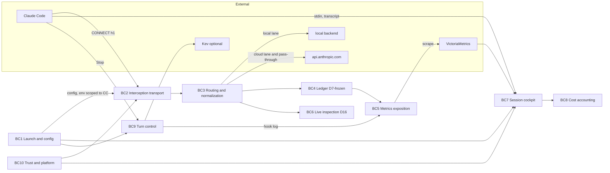

# Pass 8: Deep Synthesis (brownfield-ingest step C) — hylo-legacy

> Recovered by the brownfield-ingest final synthesis (step C), using the recovered-architecture template.
> Source codebase: `$HOME/Dev/hylo/legacy/` (11 files, 3,181 lines; read-only).
> Date: 2026-11-14
> Confidence: **high**. All six passes converged on a NITPICK round, the coverage audit passed with 0 gaps, and extraction validation r2
> returned PASS-WITH-FIXES (78/78 sampled BCs confirmed, 0 hallucinations, about 99 % accurate).
> **This document supersedes `hylo-legacy-pass-6-synthesis.md`.** It is the primary reference for create-brief, create-domain-spec,
> create-prd and semport-analyze. The owner decision list is a companion file, `hylo-legacy-owner-decisions.md`.

**How this was produced.** Read: every file in `.factory/semport/hylo-legacy/`. The canonical consolidations named in
extraction validation r2 were read in full, and the earlier rounds were read for each owner decision (OD) origin and each retraction. Also read:
`docs/PLAN.md` (D1-D16, P0-P7), `.factory/STATE.md`, the four research reports plus `RESEARCH-INDEX.md`, and the cycle's
`convergence-trajectory.md`. Legacy anchors used in §10 were re-read in `legacy/` (read-only). Nothing was run, nothing was networked,
`CLAUDE.local.md` was not read, and nothing was committed. Private addresses are written `<backend>`.

**Citation notation.** `SL` = `dgx_statusline.py`, `PX` = `dgx_proxy.py`, `EX` = `dgx_ledger_exporter.py`, `HK` = `auto_continue.py`,
`PF` = `dgx_preflight.py`, `BF` = `tools/backfill_cost_history.py`, `L` = `claude-dgx`, `CO` = `dgx-proxy-coordinator.sh`, `m/` = mitmproxy
12.3.1 (production venv). `PnrM` = pass n deepening round M (r1 = the un-suffixed `-deep-` file). `PLAN:N` = line N of `docs/PLAN.md`.

**Canonical inputs (from extraction validation r2 and STATE.md):**

| Topic | Canonical source (read base first, then the amendments) |
|---|---|
| Inventory | P0r3 §2 |
| Architecture | P1r3 §B (components B.1, data flow B.2, mitmproxy runtime B.3, 26 interfaces B.4, target map B.5, diagrams B.6/B.7) |
| Domain | P2r8 §7 pointer table, amended by P2r9 §6; entity catalogue P2r4 §3.1; ledger schema P2r4 §3.2; correlation P2r4 §3.3 |
| BC index | P3r4 §7 (227 BCs), amended by P3r5-r8 (+BC-EX-027, BC-PX-046..049) = **232** |
| Thresholds / NFR | P4r7 §B (147 thresholds, NFR catalogue, OD-57 lists, OD-94 fact sheet) |
| Conventions / env / determinism / pitfalls | P5r3 §B, amended by P5r4/r5 (43 explicit + 21 implicit env inputs, 54 determinism rows, 19 conventions, 22 pitfalls) |
| Coverage | `hylo-legacy-coverage-audit.md` (141 matrix rows, 0 gaps) |
| Validation | `hylo-legacy-extraction-validation.md` (broad sweep) and `hylo-legacy-extraction-validation-r2.md` (canonical consolidations) |

---

## 1. Executive summary

`legacy/` is the scrubbed, frozen copy of the working prototype `claude-dgx`: 11 files, 3,181 lines, 1,809 Python statements, 0 tests.
It is a set of separate processes with no shared library. They are coupled only through environment variables, files and HTTP:

- a zsh **launcher** that builds Claude Code's environment, argv and `--settings`, and starts one mitmproxy per window;
- a mitmproxy 12.3.1 **addon** that terminates TLS for every host, reroutes `/v1/messages*` on `api.anthropic.com` to a local backend
  when the model has a configured prefix, normalizes the body, taps SSE for usage, and appends a 13-event JSONL **ledger**;
- a Prometheus **exporter** that recomputes 28 metric names from the whole ledger;
- a two-row **status line**, recomputed on every refresh from stdin, an incremental transcript parser, one VictoriaMetrics query and four
  cache files;
- a **Stop hook** that polices language and "fake stops" through an optional Kev oracle with a regex fallback;
- a preflight, a CA trust CLI, a one-off cost backfill, two LaunchAgents and an unwired coordinator.

hylo ports this to one Go binary under decisions D1-D16. Parity comes first (D4). Six BCs carry owner-approved deviations (D4-EX-1, D4-EX-2,
D13, D14), and 64 owner decisions are issued (2 ruled, 62 pending).

The five findings that matter most:

1. **Parity is a byte-semantics problem, not a logic problem.** 137 of 232 BCs are byte-exact. They depend on Python behavior that Go does not
   share: banker's `round`, `json.dumps` separators and `ensure_ascii`, code-point lengths, NaN ordering in `max`/`min`, naive local time, and
   FMA fusion on arm64 (22 pitfalls, PR-01..PR-22). P1 cannot start without small `pyfmt`/`pyjson`/`pystr`/`pytime` packages.
2. **The proxy's real behavior lives in mitmproxy defaults, not in `dgx_proxy.py`.** Examples: eager upstream connect, certifi-only
   verification, ALPN mirroring, a 600 s inactivity cut, whole-body buffering of pass-through responses, `safecall` swallowing hook
   exceptions, and live reload. 17 runtime rows (P1r3 §B.3) and 31 thresholds have to be reproduced or deliberately replaced. Several of them
   are correctness and security defects for hylo: OD-06, OD-07, OD-17, OD-26, OD-37, OD-41, OD-42.
3. **The credential path fails open.** If the backend key file cannot be read, the request has already been retargeted to the backend, and
   it leaves with the client's own credentials (OD-06, `PX:91-95` after `:161-163`). Client `x-api-key`/cookies are always forwarded (OD-07).
   hylo must fail closed.
4. **The ledger is frozen but underspecified.** There is no flow id, timestamps are naive local time at one-second resolution, it has
   multiple writers, and some field meanings differ by lane (`in_tok`, `model_served`, `req_bytes` in characters). D7 freezes it until P7.
   The P3 replay therefore needs a composite near-key (OD-25), and the shadow week needs a co-writing rule (OD-52).
5. **Production evidence changed the spec several times.** About 50 retractions were issued across the passes. The ones with the largest
   effect: Claude Code itself is HTTP/1.1, but child tools used h2 (CONV-ABS-25); Remote Control runs on `api.anthropic.com`
   `/api/frame/sync` and `/v1/code/sessions/…`, never on the legacy bridge host (CONV-ABS-26); and every non-SSE pass-through response is
   buffered whole (CONV-ABS-44). D14 and D13 absorb most of these consequences.

---

## 2. Recovered architecture

### 2.1 Components

| # | Component | Path | Layer | Purpose | Dependents | Dependencies |
|---|---|---|---|---|---|---|
| C-1 | Launcher | `claude-dgx` (185) | presentation (CLI) | env phases P0-P5, preflight, per-window proxy spawn and trap, argv and `--settings`, dry run, `trust` delegation | user | C-2a, C-7, C-3, Claude Code |
| C-2a | mitmproxy runtime | venv, `L:75` | infrastructure | listener, admission, eager CONNECT, TLS termination for every host, upstream verification, HTTP/1+2+WS relay, 600 s watchdog, script reload, CA | C-2b, Claude Code, child tools | `~/.mitmproxy/`, certifi |
| C-2b | Router addon | `dgx_proxy.py:26-548` | business logic | routing R0-R5, normalization, SSE tap, attribution, ledger and decision-log writes, rate-limit capture | C-5 (via ledger) | C-2a, key file, backend |
| C-3 | CA trust CLI | `dgx_proxy.py:551-764` | infrastructure | install/status/remove/rotate the CA as a login-keychain `trustRoot` | C-1 | `security`, `openssl`, `pgrep` |
| C-4 | Status line | `dgx_statusline.py` (1,245) | presentation | row 1 (session/lane), row 2 (backend telemetry), cost history, caches | Claude Code | stdin, transcript, VictoriaMetrics, `ps`, `.git` |
| C-5 | Ledger exporter | `dgx_ledger_exporter.py` (414) | data access + presentation | full rescan of ledger and hook log into 28 metric names on `/metrics` | VictoriaMetrics, via tunnel | ledger, hook log |
| C-6 | Stop hook | `auto_continue.py` (275) | business logic | fake-stop and language policing, Kev median, regex fallback, decision log | Claude Code; C-5 reads its log | Kev, transcript |
| C-6b | UserPromptSubmit hook | `L:157-159` (inline shell command) | presentation | per-prompt language reminder when `DGX_ENGLISH != 0` | Claude Code | hook shell |
| C-7 | Preflight | `dgx_preflight.py` (41) | infrastructure | 4 s raw TCP probe, OS-error diagnosis | C-1 | backend |
| C-8 | Coordinator (unwired) | `dgx-proxy-coordinator.sh` (50) | infrastructure | singleton proxy via `flock`; cannot succeed on the host (`CO:15` lsof name) | nobody | `lsof`, `flock` |
| C-9 | Cost backfill | `tools/backfill_cost_history.py` (121) | business logic | seed `cost-history.json` from transcripts | owner, by hand | transcripts |
| C-10 | Services | `deploy/*.plist` | infrastructure | launchd agents: exporter, `ssh -R` tunnel | — | launchd, ssh |
| X-1 | Server-side telemetry | outside the tree | external | VictoriaMetrics scrape and `dgx_*:*` recording rules | C-4 | C-5 via tunnel |

### 2.2 Component map (machine-readable)

```yaml
components:
  - id: C-1
    name: "Launcher (-> hylo run)"
    path: "legacy/claude-dgx"
    layer: presentation
    purity: effectful-shell
    criticality: HIGH
    dependencies: ["C-2a", "C-3", "C-7"]
    interfaces_provided: ["I-1 argv+env+--settings to Claude Code", "dry run (DGX_PRINT_ARGS)"]
    interfaces_consumed: ["43 explicit env inputs", "profile.env", "nc -z probes", "mitmdump spawn"]
    confidence: high
  - id: C-2a
    name: "mitmproxy 12.3.1 runtime (-> internal/proxy transport + internal/ca)"
    path: "legacy/.mitmenv (absent from tree; launched at claude-dgx:75)"
    layer: infrastructure
    purity: opaque
    criticality: CRITICAL
    dependencies: []
    interfaces_provided: ["I-5 CONNECT listener", "I-6 addon hooks", "I-8 pass-through to 85 hosts", "I-11 flow log"]
    interfaces_consumed: ["certifi trust store", "~/.mitmproxy CA store"]
    confidence: high
  - id: C-2b
    name: "Router addon (-> internal/proxy, internal/ledger writer, internal/events)"
    path: "legacy/dgx_proxy.py:26-548"
    layer: business-logic
    purity: mixed
    criticality: CRITICAL
    dependencies: ["C-2a"]
    interfaces_provided: ["I-7 backend request", "I-9 ledger (13 events)", "I-10 decision log + failed-request captures"]
    interfaces_consumed: ["DGX_UPSTREAM", "DGX_KEY_FILE", "LOCAL_MODEL_PREFIXES", "DGX_SERVED_MODEL", "DGX_OBS_LEDGER", "DGX_PROXY_DECISIONS"]
    confidence: high
  - id: C-3
    name: "CA trust CLI (-> hylo ca; OOS by D13)"
    path: "legacy/dgx_proxy.py:551-764"
    layer: infrastructure
    purity: effectful-shell
    criticality: LOW
    dependencies: []
    interfaces_provided: ["install/status/remove/rotate"]
    interfaces_consumed: ["security", "openssl x509", "pgrep -f", "DGX_PROXY_RESTART_CMD (shell=True)"]
    confidence: high
  - id: C-4
    name: "Status line (-> internal/statusline, hylo statusline, P1)"
    path: "legacy/dgx_statusline.py"
    layer: presentation
    purity: mixed
    criticality: HIGH
    dependencies: ["X-1"]
    interfaces_provided: ["I-2 stdout rows / 29-byte degraded line", "I-21 four cache files"]
    interfaces_consumed: ["stdin JSON (19 leaf paths)", "transcript JSONL", "I-12 VictoriaMetrics query", "I-22 ps ancestry + .git"]
    confidence: high
  - id: C-5
    name: "Ledger exporter (-> internal/ledger exporter, hylo exporter, P2)"
    path: "legacy/dgx_ledger_exporter.py"
    layer: data-access
    purity: mixed
    criticality: HIGH
    dependencies: ["C-2b", "C-6"]
    interfaces_provided: ["I-16 /metrics (28 names) and ?rebuild="]
    interfaces_consumed: ["ledger", "hook log"]
    confidence: high
  - id: C-6
    name: "Stop hook (-> internal/hook, hylo hook stop, P4)"
    path: "legacy/auto_continue.py"
    layer: business-logic
    purity: mixed
    criticality: MEDIUM
    dependencies: []
    interfaces_provided: ["I-3 hookSpecificOutput", "hook log lines"]
    interfaces_consumed: ["Stop stdin JSON", "I-13 Kev POST", "transcript"]
    confidence: high
  - id: C-7
    name: "Preflight (-> hylo doctor)"
    path: "legacy/dgx_preflight.py"
    layer: infrastructure
    purity: effectful-shell
    criticality: LOW
    dependencies: []
    interfaces_provided: ["exit code + diagnosis"]
    interfaces_consumed: ["DGX_UPSTREAM"]
    confidence: high
  - id: C-9
    name: "Cost backfill (-> hylo cost backfill, unscheduled, OD-36)"
    path: "legacy/tools/backfill_cost_history.py"
    layer: business-logic
    purity: mixed
    criticality: LOW
    dependencies: []
    interfaces_provided: ["cost-history.json seed"]
    interfaces_consumed: ["~/.claude/projects/*/*.jsonl", "LOCAL_MODEL_PREFIXES"]
    confidence: high
  - id: C-10
    name: "Services (-> per-OS units in internal/platform)"
    path: "legacy/deploy/*.plist"
    layer: infrastructure
    purity: opaque
    criticality: LOW
    dependencies: ["C-5"]
    interfaces_provided: ["RunAtLoad+KeepAlive", "ssh -N -R tunnel"]
    interfaces_consumed: ["launchd", "~/.ssh/config"]
    confidence: medium
```

### 2.3 Layers

```text
+--------------------------------------------------------------------------------+
| Presentation / entry points                                                     |
|   C-1 launcher (user)  C-4 status line (Claude Code)  C-6/C-6b hooks (Claude Code) |
|   C-5 /metrics (VictoriaMetrics)                                               |
+--------------------------------------------------------------------------------+
                 | env, argv, --settings          | stdin/stdout, files
                 v                                v
+--------------------------------------------------------------------------------+
| Business logic                                                                  |
|   C-2b routing/normalization/tap   C-6 fake-stop policy   C-9 cost backfill     |
|   (C-4 and C-5 hold their own logic inline; there is no shared library)         |
+--------------------------------------------------------------------------------+
                 |                                |
                 v                                v
+--------------------------------------------------------------------------------+
| Infrastructure / data                                                           |
|   C-2a mitmproxy runtime + CA store   ledger, decision log, hook log, caches    |
|   C-7 preflight  C-3 trust CLI  C-10 launchd  C-8 coordinator (dead)            |
+--------------------------------------------------------------------------------+
```

| Rule | Observed? | Violations |
|---|---|---|
| Upper layers depend on lower layers only | mostly | C-4 and C-5 mix presentation, logic and I/O in one module; C-3 lives inside the addon file and its import side effects run at addon load (`PX:518,521`) |
| No circular dependencies | yes at code level | runtime feedback loop: proxy → ledger → exporter → tunnel → VictoriaMetrics → status line (P1r3 §B.2 step 5) |
| Data layer does not import presentation | yes | — |

### 2.4 Dependencies (DAG) and circularity

```text
C-1 launcher
  +-- C-7 preflight (venv Python, no proxy env)
  +-- C-2a mitmdump (one per window)
  |     +-- C-2b addon (re-imported on every mtime change, 1 s poll)
  |           +-- ledger file  ---> C-5 exporter ---> ssh -R tunnel ---> X-1 VictoriaMetrics ---> C-4 status line (row 2: idle, pick)
  +-- Claude Code (child; not exec'd)
        +-- C-4 status line (every 4 s)      +-- C-6 Stop hook ---> hook log ---> C-5
        +-- C-6b UserPromptSubmit hook       +-- child tools (inherit HTTPS_PROXY: D14 removes)
C-3 trust CLI, C-9 backfill (standalone, manual)    C-8 coordinator (standalone, unwired)
```

| Cycle | Components | Severity | Notes |
|---|---|---|---|
| Telemetry feedback (runtime, not code) | C-2b → C-5 → X-1 → C-4 | low | a break shows up as "idle" or a missing segment, never as an error (P1r3 §B.2) |

External dependencies (top 8): mitmproxy 12.3.1, certifi 2026.10.23 (sole upstream trust anchor), pyOpenSSL 26.4.0, cryptography 50.0.2,
h11 0.16.0, h2 4.4.1, wsproto 1.3.2 (all in the venv, which is absent from the tree, OD-47); CPython 3.11.7 (status line, hook, backfill),
3.9.6 (exporter), 3.12.10 (proxy, preflight). Everything else is stdlib. Source: P0r3 §2.3-2.4.

### 2.5 API surface

**HTTP endpoints**

| Method | Path | Handler | Auth | Request | Response |
|---|---|---|---|---|---|
| CONNECT | `*:8090-8143` (any host) | mitmproxy listener (`L:72-75`) | none; admits private and loopback clients | — | TLS-intercepted tunnel |
| POST | `/v1/messages*` on `api.anthropic.com` | `DGXRouter.request` `PX:98-168` | client's own credentials; backend gets `Authorization: Bearer <key>` | Messages API JSON | SSE or JSON, relayed |
| GET | `/metrics` on `0.0.0.0:9210` | `Handler.do_GET` `EX:270` | none | `?rebuild=<non-empty>` forces a rescan | Prometheus text 0.0.4; other paths 404 |

**CLI commands**

| Command | Flags / env | Handler | Description |
|---|---|---|---|
| `claude-dgx [args]` | 43 env inputs, `DGX_PRINT_ARGS=1` | `L:1-185` | launch Claude Code through a per-window proxy |
| `claude-dgx trust {install,status,remove,rotate}` | `--force` | `PX:737-764` | CA keychain management (OOS, D13) |
| `python3 dgx_statusline.py [--subagent]` | `DGX_SL_*`, `COLUMNS` | `SL:1200`, `SL:928` | status line (`--subagent`: OD-14) |
| `python3 auto_continue.py` | `DGX_KEV_*`, `DGX_ENGLISH`, `DGX_AUTOCONTINUE` | `HK:209` | Stop hook |
| `python3 dgx_ledger_exporter.py [-n]` | `DGX_LEDGER_EXPORTER_PORT` | `EX:410-414` | exporter |
| `python3 tools/backfill_cost_history.py` | `LOCAL_MODEL_PREFIXES` | `BF:84` | one-off backfill |

### 2.6 Data models

| Model | Path | Key fields | Relationships |
|---|---|---|---|
| Ledger event (13 names) | `PX:56-62` writer; P2r4 §3.2 | `t` (naive local, 1 s), `event`, then call-site-ordered fields | request → reply/usage/error by near-key only (P2r4 §3.3) |
| Flow attribution | `PX:117-127` | `project, user, session, meta_user_id, model_req, req_bytes (chars), path [, lane]` | copied into every reply/error |
| Session cache | `SL:190-206` | `rl, rl_ts, fetch_ts, up, ts, sample, hist, proc_start` | one per session id |
| Mix cache | `SL:999-1153` | 16 keys, `mixv6` marker, offset, `ids[-256:]` | one per sanitized sid |
| Git cache | `SL:402-411` | `{ts, branch}` keyed `sha1[:16]` of the project dir | — |
| Cost history | `SL:217-237`; `BF:91-116` | `sessions[sid] = {lane, usd, api_ms, ts, src}` | read by percentile colouring |
| Exporter state | `EX:94-266` | 19 accumulators + 3 dict states + 5 scalars (CONV-ABS-13) | derived from ledger + hook log |
| Hook stdin / log line | `HK:193-245` | `last_assistant_message, stop_hook_active, transcript_path, session_id`; log in Python `repr` | log feeds exporter tallies |
| Trust state | `PX:609-622` | `~/.dgx/trust-state.json`, 3 backups | OOS |

**Ledger schema (D7-frozen until P7).** 13 names: `dgx_request`, `dgx_reply`, `dgx_usage`, `dgx_upstream_error`, `anth_request`, `anth_reply`,
`anth_usage`, `anthropic_upstream_error`, `anth_ratelimit`, `bridge_ws_connect`, `bridge_ws_close`, `ws_closed` (dead: its guard attribute is
never set), and `anthropic_reply` (historical alias, still read). 11 `ledger(` call sites, one of them an f-string (`PX:322`). All 13 rows
were confirmed in EV r2 §1.2. The rules any new reader must follow are in P2r4 §3.2 ("Requirements for any new reader").

Data flow: `Claude Code request → C-2a tunnel → C-2b decision → backend | Anthropic → response hooks → ledger → C-5 → /metrics → X-1 → C-4 row 2`.

### 2.7 Integration points

| Service | Protocol | Configuration | Purpose | Error handling |
|---|---|---|---|---|
| Anthropic API (`api.anthropic.com`) | TLS, h1 from Claude Code | fixed host (D13 protocol constant) | cloud lane, Remote Control channels | no retry; mitmproxy 502 + `error` hook |
| Local backend (vLLM, `<backend>:8080`) | plain HTTP by default (`u.scheme or "http"`) | `DGX_UPSTREAM`, `DGX_KEY_FILE`, `DGX_SERVED_MODEL` | local lane | no connect timeout, no retry; per-tunnel pool |
| VictoriaMetrics (`<backend>:8428`) | HTTP GET, proxies bypassed | `DGX_SL_VM_URL`, `DGX_SL_TTL` | row-2 telemetry | 1.5 s per socket operation; degradation ladder |
| Kev (`<backend>:8008`) | HTTP POST; env **and** OS proxies honored | `DGX_KEV_URL`, `DGX_KEV_*` | fake-stop oracle | ≤ 3 calls, median; regex fallback; H-04 crash |
| 84 other hosts | TLS pass-through | none | everything Claude Code and its children contact | relayed unchanged |

File-system dependencies: P0r3 §2.7 (24 rows: ledger, decision log, failed-request captures, key files, `profile.env`, `~/.mitmproxy/`, trust
state, four status-line caches, hook log, transcripts, mitmdump logs, venv, launchd logs).

**DTU candidate assessment (DF-011)**

| # | Service | Priority | Fidelity | Rationale |
|---|---|---|---|---|
| DTU-1 | Fake Anthropic upstream (TLS, `api.anthropic.com` cert from a test CA) | high | L3 | P3 replay and shadow-week rehearsal: SSE with usage and cache fields, JSON, ≥ 400 bodies, rate-limit headers, Remote Control long-lived SSE and the `/api/frame/sync` WebSocket with 20 s pings, h1-only ALPN |
| DTU-2 | Fake local backend (Anthropic-compatible SSE over plain HTTP) | high | L4 | tap boundary insensitivity (BC-PX-045), connect refused / no route / mid-stream cut (OD-16, OD-28), slow first byte (OD-37) |
| DTU-3 | Fake VictoriaMetrics | high (P1) | L2 | P1 goldens need the exact 18-name/19-key response, including NaN/±Inf values, missing series, and the idle and pick series |
| DTU-4 | Fake Kev | medium (P4) | L4 | median-of-3, early stop, refused vs unanswered connect, dribbled bytes (OD-56) |

Assessment factors: all four are stateless request/response servers except DTU-1 (connection-level behavior), and all use synthetic data (public repo).

### 2.8 Technology stack

| Category | Technology | Version | Lock | Configuration |
|---|---|---|---|---|
| Language | CPython | 3.11.7 / 3.9.6 / 3.12.10 by component | none | PATH order on the host |
| Proxy framework | mitmproxy | 12.3.1 | none (venv absent, OD-47) | launcher flags only; no `config.yaml` |
| Shell | zsh | 5.9 | — | `#!/bin/zsh`, reads `.zshenv` (ENV-I18) |
| Services | launchd | macOS | — | `deploy/*.plist` |
| Tests | none | — | — | — |
| CI | none in legacy | — | — | hylo: GitHub Actions, 3 OSes (PLAN:124) |

### 2.9 Architecture smells

| Smell | Location | Severity | Description |
|---|---|---|---|
| God module | `dgx_statusline.py` (1,245 lines, 742 statements) | medium | rendering, parsing, caching, telemetry, ancestry and cost history in one file; `render_lane` 198 lines, `_mix_counts` 156 |
| Hot-reloaded shared code | `dgx_proxy.py` imported by every mitmdump | high | one edit changes or breaks every window within about 1 s; a failed reload means plain pass-through (OD-26) |
| Duplicated rules | prefix rule (3 defaults, `PX:86`, `SL:444,902`, `BF:89`); account hint (`PX:326`, `EX:75`) | medium | definitions diverge on edge inputs |
| Fail-open security path | `PX:91-95,161-166` | high | OD-06, OD-07 |
| Dead code paths | `ws_closed` (`PX:528-536`), Opus arbitration (`HK:141-166`), bridge host rules (`PX:100-102,211-214`), coordinator, visible-mode probe (`L:17-22`) | low | dead or never matched in production |
| Configuration at import time | `SL:73-100`, `HK:31-36`, `EX:22-25`, `PX:79-88` | medium | malformed env crashes before any guard (CP-X01/X02) |

---

## 3. Complete feature set

Feature IDs are new to this synthesis (F-<component>-NN). Each points to the BCs that pin it. "Fate" gives the hylo disposition under the
current decisions; items that depend on a pending OD say so.

### 3.1 Launcher → `hylo run` (P4)

| ID | Feature | BCs | Fate |
|---|---|---|---|
| F-LN-01 | Env phases P0-P5: prefixes and served model forced; `ANTHROPIC_BASE_URL` unset twice; `API_TIMEOUT_MS=1800000`; `CLAUDE_CODE_AUTO_MODE_SERVER=0` | BC-LN-002, -005 | port (JE) |
| F-LN-02 | Attribution headers `X-DGX-Project` / `X-DGX-User` via `ANTHROPIC_CUSTOM_HEADERS` | BC-LN-002 | port; Windows user label OD-48 |
| F-LN-03 | Preflight unless `DGX_SKIP_PREFLIGHT=1` | BC-LN-003 | port into `hylo doctor` / `run` |
| F-LN-04 | Per-window proxy spawn, readiness poll, trap kill | BC-LN-004, -011 | replaced: one proxy per user (PLAN:111), detach OD-66, lifecycle OD-50 |
| F-LN-05 | CA trust for Claude Code via `NODE_EXTRA_CA_CERTS`; `HTTPS_PROXY` | BC-LN-004 | port, scoped to Claude Code only (D14) |
| F-LN-06 | `profile.env` sourced after proxy start | BC-LN-006 | replaced by config profiles (OOS) |
| F-LN-07 | `--settings` assembly: Stop hook, UserPromptSubmit reminder, sandbox, statusLine, subagentStatusLine | BC-LN-009 | port (JE); subagent OD-14; reminder OD-46 |
| F-LN-08 | argv: `--model`, `--remote-control`, language system prompt, skip-permissions unless safe mode, then `"$@"` | BC-LN-007 | port; `ARGS` leak dropped (OD-60) |
| F-LN-09 | Hook env exports and defaults | BC-LN-008 | port as config |
| F-LN-10 | Dry run (`DGX_PRINT_ARGS=1`) | BC-LN-010 | port (`hylo run` dry run / `hylo config show`) |
| F-LN-11 | `trust` delegation | BC-LN-001 | replaced by `hylo ca` |
| F-LN-12 | Visible mode / router probe | — | dropped (D6) |

### 3.2 Proxy → `hylo proxy` (P3)

| ID | Feature | BCs | Fate |
|---|---|---|---|
| F-PX-01 | Intercept every host Claude Code contacts | BC-PX-002, P1r3 §B.3 | keep (D13); CA trusted by Claude Code only |
| F-PX-02 | Routing R0-R5: only `api.anthropic.com` + `/v1/messages*`; prefix `startswith`; server-tool requests to Anthropic; unparseable body passes through | BC-PX-002, -003, -006, -007, -035, -042 | keep; method-agnostic prefix is a D13 deviation (BC-PX-035), `count_tokens` OD-10 |
| F-PX-03 | Local-lane rewrite: model → served alias, body re-serialized only if changed, `X-DGX-*` headers, Bearer key, `anthropic-beta` removed, `Accept-Encoding: identity` | BC-PX-005, -008, -009, -010, -041, -043 | keep; credential handling OD-06/OD-07 |
| F-PX-04 | Normalization: six block types kept, tool-set rebuild, empty `input_schema` injected | BC-PX-011, -012 | keep for parity; dropped block types OD-09 |
| F-PX-05 | SSE tap (any host): complete lines, 64,000 B tail, usage only from a top-level `usage` | BC-PX-014, -016, -017, -018, -040, -045 | keep; boundary-insensitivity oracle; line cap OD-35 |
| F-PX-06 | Stream/buffer decision (SSE streamed; `/v1/messages*` JSON or ≥ 400 buffered) | BC-PX-015, -037, -038 | keep; pass-through buffering OD-54 |
| F-PX-07 | Ledger events (13) and writer contract | BC-PX-019, -020, -024, -028, -033, -034, -036 | keep byte-exact (D7) |
| F-PX-08 | Plan-limit header capture `anth_ratelimit` (on change, per session) | BC-PX-013 | keep |
| F-PX-09 | Decision log and failed-request capture (newest 20, 50 M-char skip) | BC-PX-021, -022, -029, -048 | text OOS (OD-40); write failure OD-45 |
| F-PX-10 | Error hook → `<host-class>_upstream_error` | BC-PX-024, -039, -044, -046 | keep; cancel counting OD-16; error text OD-28; exit semantics OD-38 |
| F-PX-11 | Bridge WebSocket instrumentation (keyed on a host never seen in production) | BC-PX-001, -026, -027 | reproduce through cutover (OD-43) |
| F-PX-12 | Upstream verification (certifi), eager connect, ALPN mirroring, 600 s idle cut | BC-PX-047, -049 | replace (OD-17, OD-37, OD-41, OD-42, OD-94) |
| F-PX-13 | Config read at import; live reload | BC-PX-030 | replace with config reload (OD-26) |
| F-PX-14 | Live event stream and UI API | none (new) | new (D16; `internal/events`, `internal/ui`) |

### 3.3 Exporter → `hylo exporter` (P2)

| ID | Feature | BCs | Fate |
|---|---|---|---|
| F-EX-01 | Rebuild before bind; serve `/metrics` forever; 404 elsewhere | BC-EX-001, -002 | port (JE); bind loopback (HY-BIND-5) |
| F-EX-02 | Rebuild trigger: ledger size change or `?rebuild=` | BC-EX-003, -022, -027 | OD-39 |
| F-EX-03 | Accumulators: request totals, prompt estimate, tokens, durations, errors, Anthropic pass-through, last timestamps, session funnel (50 newest) | BC-EX-005..013, -016, -017, -024 | port (JE) |
| F-EX-04 | Hook-log fake-stop tallies by substring | BC-EX-014, -019 | port; misattribution OD-23 |
| F-EX-05 | Exposition: 28 names (25 TYPE, 22 HELP, 27 with samples), irregular layout | BC-EX-015, -018, -025 | hand-written (OD-29) |
| F-EX-06 | Failure behavior: poison-line crash loop; one idle connection stalls every scrape; DST false idle | BC-EX-004, -020, -021, -026 | OD-11, OD-33, OD-22 |

### 3.4 Status line → `hylo statusline` (P1)

| ID | Feature | BCs |
|---|---|---|
| F-SL-01 | Guard: any exception → 29-byte degraded line, exit 0 (import-time env crash excepted) | BC-SL-001, -087 |
| F-SL-02 | Stdin handling (strict stdio; invalid → `{}`) and `COLUMNS` grammar; row 2 iff `ROWS >= 2` and the width rule | BC-SL-002, -003, -005, -055, -076 |
| F-SL-03 | Trim to visible width (code points after SGR strip) | BC-SL-004, -054, -090 |
| F-SL-04 | Row 1: lane pill, model, project, branch (git cache, TTL 5 s) | BC-SL-006..010, -058, -059 |
| F-SL-05 | Row 1: context thermometer, composition percentages (banker's rounding), cache-hit | BC-SL-011..013, -038, -056, -057, -060, -071, -096 |
| F-SL-06 | Row 1: plan-limit windows with pace and absolute colour bands, countdown, 1.15 gate, smoothing | BC-SL-014..018, -061, -093 |
| F-SL-07 | Row 1: lines, timer, API time, window age `⌂` (process ancestry) | BC-SL-019..023, -063, -064, -080, -081 |
| F-SL-08 | Row 1: tokens, `$`, `$/h`, pick (displaced cost), mine (last turn) | BC-SL-024..027, -062, -082, -083, -085 |
| F-SL-09 | Cost history and percentile colouring | BC-SL-028, -029, -079, -101, -102 |
| F-SL-10 | Transcript parser: 512 KB window, long-line completion, dedup of 256 ids, rebuild at 20,000 excess, compaction reset, turn machine | BC-SL-030..039, -065..067, -069, -072, -088, -094, -095 |
| F-SL-11 | Row 2 telemetry: fetch with TTL and KEEP_DEAD, history points, freshness ladder, health dot, queue, KV, throughput, sparkline, TTFT, power, idle `☾`, pick `⛏` | BC-SL-040..051, -053, -073..075, -084, -086, -091, -092 |
| F-SL-12 | Caches: atomic writes, side-effect order, raw sid in the session-cache name, sanitized mix sid | BC-SL-052, -070, -077, -078 |
| F-SL-13 | Sticky transcript crash replaced by skipping wrong-shape lines (D4-EX-2) | BC-SL-068, -098..100, -103 |
| F-SL-14 | `--subagent` rows | BC-SL-097 (OD-14) |
| F-SL-15 | Row goldens and cost-colour goldens | BC-SL-089, -101 |

### 3.5 Stop hook, UserPromptSubmit, preflight, backfill, services

| ID | Feature | BCs | Fate |
|---|---|---|---|
| F-HK-01 | Decision chain: invalid stdin → allow; non-English first; `stop_hook_active`; toggle; ends with `?`; colon fake | BC-HK-001..007, -017, -018 | port (JE) |
| F-HK-02 | Kev: state rendering, POST, median of up to 3 with early stop, verdict `p < 0.40` | BC-HK-008..011, -020, -022 | port; H-04 crash OD-12; Kev optional (D11) |
| F-HK-03 | Regex fallback (`ANNOUNCE`, Unicode `\b`, sentence split without lookbehind) | BC-HK-012, -014..016 | port with a hand-written splitter (PR-13) |
| F-HK-04 | Output and log (stdout JSON, log in Python `repr`, coupling to exporter tallies) | BC-HK-013, -019, -021, -023 | port; one `paths.hook_log` key (OD-04) |
| F-UP-01 | Per-prompt language reminder (inline shell command) | BC-LN-009 | OD-46 |
| F-PF-01 | Preflight TCP probe (4 s) with four error classes | BC-PF-001, -002 | `hylo doctor` |
| F-BF-01 | Backfill: per-message pricing, lane by max output, model time, session selection, atomic write | BC-BF-006..013 | `hylo cost backfill`, no phase yet (OD-36) |
| F-SV-01 | LaunchAgents: exporter and `ssh -R` tunnel | BC-SV-001, -002 | per-OS units; tunnel documentation only |
| F-CO-01 | Coordinator (unwired) | BC-CO-001, -002 | replaced (OD-19) |

Totals: 12 launcher, 14 proxy (one new), 6 exporter, 15 status line, 9 other = **56 features**, mapped to all 232 BCs.

---

## 4. Bounded-context map

| Context | Legacy home | hylo package (PLAN §6, `PLAN:98`) | Ubiquitous terms | Upstream of | Downstream of |
|---|---|---|---|---|---|
| **BC1 Session launch and configuration** | C-1, `profile.env`, 43 env inputs | `cmd/hylo` (`run`), `internal/config`, `internal/platform` | env phase, profile, `--settings`, alias (`DGX_*`), key (`HYLO_*`) | every other context (config) | user |
| **BC2 Interception transport** | C-2a mitmproxy runtime, CA store | `internal/proxy` (transport), `internal/ca` | tunnel, eager connect, ALPN, leaf, inactivity cut, pass-through | BC3 | Claude Code (client), Anthropic, other hosts |
| **BC3 Routing and normalization** | C-2b `request`/`responseheaders`/`response`/`error` | `internal/proxy` | lane, prefix, served model, routing decision R0-R5, server tool, six block types, SSE tap | BC4, BC5 | BC2, BC1 |
| **BC4 Observability ledger** | `ledger()`, decision log, failed captures | `internal/ledger` (writer), `internal/events` | ledger event, attribution, near-key, `t` | BC5, BC6 (history), BC8 | BC3 |
| **BC5 Metrics exposition** | C-5 | `internal/ledger` (exporter) | rebuild, accumulator, exposition, tally | X-1 telemetry → BC7 | BC4, BC9 hook log |
| **BC6 Live inspection (new)** | none (nearest: mitmdump flow log) | `internal/events`, `internal/ui`, `web/` | flow, live feed, redaction, access token | — | BC3, BC4 |
| **BC7 Session cockpit** | C-4 | `internal/statusline`, `internal/platform` | row, widget, pill, window, pace, freshness ladder, degraded line, mix cache | — | Claude Code stdin, transcripts, X-1 |
| **BC8 Cost accounting** | cost history in C-4, C-9, price table | `internal/statusline` (or `internal/cost`, OD-36), `cmd/hylo` (`cost backfill`) | usd, api_ms, p75/p95, lane-by-max-output | BC7 | transcripts, BC1 prices |
| **BC9 Turn control** | C-6, C-6b | `internal/hook` | fake stop, Kev verdict, colon fake, announce, English policing | BC5 (hook log) | Claude Code Stop / UserPromptSubmit |
| **BC10 Trust and platform** | C-3, C-7, C-10, C-8, `ps` walk | `internal/ca`, `internal/platform` (`doctor`, services, ancestry) | CA, trust root, preflight, unit, process start | BC1, BC2, BC7 | OS |



Context relations: BC4 is a **published language** frozen by D7 (conformist downstreams: BC5, Grafana). BC3 → BC4 is the only writer. BC6 shares the
event stream with BC4 (PLAN D16) but must not change BC4's bytes. BC7 is a **separate ways** context: it never reads the ledger (P2r4 §3.2), only
the telemetry derived from it. Ambiguous term to qualify everywhere: **lane** has three vocabularies (proxy, status line, backfill; P2r4 §3.1).

---

## 5. Complexity ranking

Ranked by spec-and-port risk, not size. Metrics are from P0r3 §2.1, P3r4 §7.2 + r5-r8, P4r7 §B.2.4, P1r3 §B.5 (blocking ODs).

| Rank | Unit | LOC / stmts | BCs (BX/JE/other) | Thresholds | Crash IDs | Blocking ODs | Why |
|---|---|---|---|---|---|---|---|
| 1 | **Proxy transport (BC2)**: mitmproxy runtime → Go `crypto/tls` + `net/http` | opaque (17 runtime rows) | 7 transport BCs (PX-037, -039, -043, -044, -046, -047, -049) | most of the 31 proxy rows (h2: T-124, T-140..T-147) | P-S1..S6, P-E1 | 10 (OD-17, -28, -34, -37, -38, -41, -42, -47, -54, -66) + OD-94 | no Go code to compare line by line; behavior comes from defaults; 50 retractions concentrated here; shadow week required |
| 2 | **Status line (BC7/BC8)** | 1,245 / 742 | 103 (97 BX, 4 D4-EX-2, 2 OD) | 79 (62 CFG) | 43 (CP-S/T/N/C/X/A) | 10 | the largest byte-exact surface; nearly every pitfall applies; a pure function, so the lowest operational risk |
| 3 | **Routing and normalization (BC3)** | ~400 of `dgx_proxy.py` | ≈ 40 (the other PX BCs; mostly BX) | rest of the 31 | P-R1..R5 | 8 (OD-06..10, -18, -35, -40) | rewritten body bytes, Python `json.dumps` re-serialization, credential handling |
| 4 | **Exporter (BC5)** | 414 / 316 | 27 (16 JE, 1 OOS, 10 OD) | ≈ 12 | E-01..E-09, E-20..E-22 | 9 | irregular exposition bytes, 3.9.6 oracle, DST, tally injection |
| 5 | **Ledger writer (BC4)** | 7 lines + call sites | BC-PX-028 + schema | — | — | 3 (OD-25, -43, -52) | tiny code, maximal blast radius (D7, multi-writer, shadow week) |
| 6 | **Live inspection (BC6)** | none (new) | none | none | none | OD-43, OD-53 | no oracle; D16 guardrails are the spec |
| 7 | **Launch and config (BC1)** | 185 + 43 env | 11 (8 JE, 2 OOS, 1 D14) | ≈ 6 | — | 9 (OD-05, -14, -19, -34, -48, -50, -51, -60, -66) | D14 mechanism, cross-OS detach, `DGX_*` alias grammar |
| 8 | **Stop hook (BC9)** | 275 / 146 | 23 (3 BX, 18 JE, 2 OD) | ≈ 9 | H-01..H-11 | 5 | Unicode `\b`, RE2 has no lookbehind, Python `repr` log, timeout semantics |
| 9 | **Trust and platform (BC10)** | 41 + trust CLI (OOS) | PF 2, SV 2, CO 2 | ≈ 5 | — | OD-41c, OD-42 | new per-OS installers and CA handling with no oracle |
| 10 | **Backfill** | 121 / 86 | 13 (all OD-36) | 3 | B-01..B-08 | 3 | unscheduled, one-off |

---

## 6. Critical design decisions: legacy, and what hylo changes

### 6.1 Legacy decisions (LD) and their hylo disposition

| # | Legacy decision | Evidence | hylo disposition | Governing decisions / ODs |
|---|---|---|---|---|
| LD-1 | Invisible mode: a TLS-intercepting proxy keeps `api.anthropic.com` and Remote Control working; Claude Code trusts the CA through `NODE_EXTRA_CA_CERTS` | `L:79-80`; P1r3 §B.2 | **kept**; the CA is never added to an OS trust store | D6, D13 (`PLAN:165`) |
| LD-2 | Intercept every host (no `ignore_hosts`) | P1r3 §B.3 row 4 | **kept**; only `POST /v1/messages` on `api.anthropic.com` is rewritten (BC-PX-035's method-agnostic prefix is a recorded D13 deviation) | D13; OD-10 |
| LD-3 | One proxy per window, child of the launcher, killed by a trap | `L:75,97` | **replaced** by one long-lived proxy per user | PLAN:111; OD-19, OD-50, OD-51, OD-66 |
| LD-4 | Route by case-sensitive model-prefix `startswith`; server-tool requests stay on Anthropic | `PX:86,98-168` | **kept** for parity; routing rules move to config in P6 | D4, D15; OD-08, OD-09 |
| LD-5 | Configuration = env read at import into constants (43 explicit inputs, per-variable boolean predicates) | CV-09, CV-10 | **replaced** by one config file → `HYLO_*` → defaults; `DGX_*` stays an alias with legacy parsing until the P6 shim | D15 (`PLAN:167`); OD-01, -05, -59, -61, -74, -75 |
| LD-6 | Append-only JSONL ledger, multi-writer, naive local `t`, no flow id | `PX:56-62` | **frozen** until P7; hylo writes byte-identical lines | D7; OD-25, OD-52; P7 |
| LD-7 | Exporter: full rescan on size change, hand-written exposition, `0.0.0.0`, single-threaded | `EX:94,282-287,414` | **names frozen**; bind loopback; concurrent server with timeouts; trigger per OD-39 | D7; HY-BIND-5/6; OD-11, -29, -33, -39 |
| LD-8 | Status line: a process per refresh, file caches, direct VictoriaMetrics GET that bypasses proxies | `SL:168,190-206` | **kept** (P1); the bypass becomes defense in depth under D14 | D4, D4-EX-1, D4-EX-2 |
| LD-9 | Error ladder: observability never raises; degraded line instead of a blank or non-zero exit | CV-08; `SL:1238-1245` | **kept**; degraded output reproduced byte for byte for catalogued crash paths (owner ruling O2); foreign-cache crash paths CP-C out of scope (Q-b) | D4 |
| LD-10 | Proxy env exported to the whole process tree | `L:79-80` | **changed**: scoped to Claude Code (approved deviation) | D14 (`PLAN:166`) |
| LD-11 | Backend credential: key file, cached, Bearer replaces only `Authorization`; on read failure the client's credentials go to the backend | `PX:88-95,161-166` | **must change** (fail closed, strip client credentials) | OD-06, OD-07; D16 credential rule |
| LD-12 | Upstream: eager connect, no retry, no connect timeout, certifi-only verification, 600 s idle cut, ALPN mirroring | P1r3 §B.3; BC-PX-047/049 | **changed**: lazy per-lane connects, OS trust + per-backend CA, timeouts as config, h1-only listener recommended | OD-17, -37, -41, -42, -94; HY-TLS-1, HY-TIMEOUT-1, HY-PASS-1, HY-PROTO-1 |
| LD-13 | Live reload of the addon; a failed reload means plain pass-through | m/`addons/script` | **replaced** by config reload that keeps the last good config | OD-26 |
| LD-14 | Listen on all interfaces; admit private and loopback clients | P1r3 §B.3 rows 1-2 | **changed**: loopback by default, admission check, non-loopback opt-in with warning | OD-24/OD-27 **ruled**; HY-BIND-1..6; OD-34 |
| LD-15 | Kev as an optional oracle with a regex fallback | `HK:94-138,169` | **kept** | D11 |
| LD-16 | Visible-mode router | `L:15-22,85-96` | **dropped** | D6 |
| LD-17 | Python output semantics (round, `json.dumps`, code points, `repr`) | P5r3 §B.6 | **reproduced** through `internal/pyfmt`-style helpers until cutover | D4, D7 |
| LD-18 | macOS-only tooling (`zsh`, `nc`, `ps`, launchd, `security`) | P0r3 §2.5 | **replaced** by `internal/platform` per OS; ⌂ allowed on Windows | D5, D4-EX-1 |
| LD-19 | No tests; the status-line review doc is the de facto spec | P0r3 §2.1 | **replaced** by parity harness + table tests + CI on 3 OSes | PLAN §8; policy 19 |
| LD-20 | Separate free-text decision log with no consumer | `PX:65-74` | text out of parity (OD-40); write failures must not change routing (OD-45); metadata flow log proposed (OD-53) | D16 |

### 6.2 How D1-D16 and D4-EX-1/2 change the spec, decision by decision

| Decision | Effect on the recovered system |
|---|---|
| D1 name, D2 public, D3 history | no "Claude" in names; fixtures synthetic or scrubbed by a committed script; production evidence (counts in P2r8/r9) stays in `.factory` |
| D4 parity first | 137 BX + 44 JE BCs are the acceptance criteria for P1-P4; every behavior change waits until cutover unless it is an approved deviation or an OD says otherwise |
| **D4-EX-1** | BC-SL-023/080: Go may show ⌂ on Windows (legacy has no `ps` there); `internal/platform.ProcessStart` |
| **D4-EX-2** | BC-SL-068 replaced by BC-SL-098/099: skip wrong-shape transcript lines as legacy skips invalid JSON (`SL:1060-1063`); excluded from the parity diff; 21 table tests; OD-21 and OD-32 refine its edges |
| D5 three OSes | `internal/platform` for ancestry, paths, services, signals, locks, CA file ACLs; OD-03, OD-48, OD-76 |
| D6 invisible only | visible mode and the router probe are dropped; `ANTHROPIC_BASE_URL` stays unset; Remote Control must be tested in the shadow week |
| D7 ledger and metrics frozen | 13 events, field order, `ensure_ascii`, naive `t`, the dead `ws_closed`, the misleading `bridge_ws_close` and constant metrics all stay until P7 |
| D8-D12 | Apache-2.0, history identity, `legacy/` kept until P5, Kev optional, GitHub Releases |
| D13 intercept all | the CA cannot be name-constrained (this supersedes the TLS research's recommendation); only `POST /v1/messages` is rewritten; `count_tokens`/batches wording is OD-10 |
| D14 no env leak | BC-LN-004 is a deviation; 75 child TLS failures and 7,566 child h2 flows in production disappear; the mechanism is chosen in P4 (research: launcher shim + SessionStart hook + hylo-owned commands ignore proxy env) |
| D15 config over code | 96 CFG thresholds become keys, 37 named constants carry reasons; defaults equal legacy literals; one registry generates `HYLO_*` names |
| D16 UIs on one feed | new context BC6; credentials always redacted, bodies in memory only, loopback + per-launch token; must not change ledger bytes |

---

## 7. Anti-patterns (do not port)

| # | Anti-pattern | Where | hylo rule |
|---|---|---|---|
| AP-1 | Fail-open credential path | `PX:91-95,161-166` | resolve the credential before any retargeting; fail closed (OD-06) |
| AP-2 | `safecall`-style swallow-all around routing hooks leaves a half-rewritten request in flight | m/`addonmanager:44-59`; P-R1..R5 | every routing step is all-or-nothing; errors produce a local error response plus an event |
| AP-3 | Configuration parsed at import, so a bad env value crashes before any guard | `SL:73-100`, `HK:31-36`, `EX:22-25` | parse and validate once at startup with clear errors; keep the legacy grammar only on the `DGX_*` alias path (OD-59) |
| AP-4 | One shared source file hot-reloaded into N processes | P1r3 §B.1 coupling | explicit config reload with last-good fallback (OD-26) |
| AP-5 | Duplicated business rules with divergent defaults | prefix rule ×3, account hint ×2, stale span ×2 | one definition in `internal/config` / a shared package |
| AP-6 | Misleading names frozen into a public schema | `model_served` = requested model; `bridge_ws_close` at upgrade with `0.0`; `in_tok` differs by lane; `req_bytes` counts characters | document as-is under D7, rename only in P7 |
| AP-7 | Naive local timestamps with no offset | ledger `t`, hook log, exporter parse | keep for D7; inject `*time.Location`; add offset and `flow_id` in P7 |
| AP-8 | Free-text log parsed by substring, with model text inside the parsed line | hook log → `EX:215-230` | structured log in P7; reproduce in P2 (OD-23) |
| AP-9 | Single-threaded server with no socket timeout | `EX:414` | `http.Server` with `ReadHeaderTimeout` and `IdleTimeout` (OD-33) |
| AP-10 | Unbounded growth | ledger and logs never rotated; per-WebSocket message list; `_last_rl` per session; whole-body buffering | bounded buffers (HY-WS-1), streaming pass-through (OD-54), rotation outside D7 surfaces |
| AP-11 | Dead or wrongly-keyed code kept alive | `ws_closed`, Opus arbitration, bridge host, coordinator, visible-mode probe in every mode | do not port; reproduce only the D7-visible effects (OD-43) |
| AP-12 | JSON built by string concatenation in shell | `L:156-181` (`--settings`, `<HERE>` unescaped) | build with `encoding/json`, compare JE |
| AP-13 | Liveness by process name | `CO:15` (`lsof` shows `python3.1`) | PID + state file + health check (OD-66) |
| AP-14 | Spawned child before the cleanup trap exists (orphan window) | `L:75` vs `L:97` | detach deliberately and record the PID in the state file before reporting ready |
| AP-15 | Literal `~` in service definitions | exporter plist `:7` | expand at install time (OD-61) |
| AP-16 | A cache parse failure wipes all history on the next write | cost history (P2r4 §3.1) | the Go writer reproduces the legacy format (Q-b); never overwrite an unreadable file silently |
| AP-17 | Per-socket-operation timeouts presented as "the timeout" | `SL:168`, `HK:113` | total deadlines with stated semantics (OD-56) |
| AP-18 | No automated tests | whole tree | parity harness, table tests, fuzz, 3-OS CI |

---

## 8. Spec crystallization recommendations (Phase 1)

### 8.1 How each Phase-0 register becomes PRD / BC / VP artifacts

| Register | Becomes | Rules |
|---|---|---|
| **232 BCs** (P3r4 §7 + r5-r8) | final BC files per component, grouped by phase (P1 = SL 103; P2 = EX 27 + SV 2; P3 = PX 48 excl. PX-031; P4 = HK 23, LN 11, PF 2, CO 2, PX-031; unscheduled BF 13) | Keep the draft IDs as a `legacy_id` field so the crosswalk survives renumbering. Carry the parity column (BX / JE / OOS / D4-EX-n / D13 / D14 / OD-NN) as a required field. **Do not promote** superseded drafts (BF-001..005, the replay rule in PX-040, PX-014/015/016 detail, EX-015 detail): fold them into their successors. The 35 BCs whose parity is "pending OD" get their final status from the owner gate; until then they are spec'd with legacy behavior plus a `pending: OD-NN` flag. Each crash catalogue (CP-*, P-*, E-*, H-*, B-*) becomes the error-case section of its BC plus a table test. Apply P3r8 §3.1's final wording (PR-3/5/6) and AM-1 when copying BC-PX-043/044/049. |
| **Ledger schema** (P2r4 §3.2 + r5 C-1..C-4, CONV-ABS-14, r8 §2.1) | one domain-spec section "Ledger (D7-frozen)" plus BC-PX-028 as the writer contract | One row per event: trigger, field order, optionality and variants, consumers. The writer contract: one `write()` per line on an `O_APPEND` descriptor, Python `json.dumps` defaults with `ensure_ascii`, surrogateescape-aware escaping (BC-PX-048), naive local `t` at write time. The reader requirements become an NFR for every new reader (replay, D16 history, P7). VP: "for every recorded flow, Go's ledger lines equal legacy's after normalizing `t` and `duration_s`" (golden replay), plus a fuzz property: every line Go writes parses with Python `json.loads` to the same object. |
| **147 thresholds** (P4r7 §B.2) | `internal/config` registry entries (CFG 96) and named constants (NC 37), with DROP/OOS/N-A/EXT/NEW-H rows in a traceability table | Each entry: key, type, default (= legacy literal), unit, **operator as written in the source**, rationale code (M/DOC/J/C/Dv), and class. A generated VP checks that every default equals the catalogue value. Boundary table tests for every strict/non-strict operator pair (e.g. T-038 `> 60000` vs T-039 `>= 60000`). OD-57 supplies the 45 rationales still open (18 bulk + 27 in 7 groups). OD-94 moves 9 rows between NC, CFG and N/A; both outcomes are tabulated. |
| **Config map** (P5r3 §B.1, 43 env + 21 implicit) | config-reference spec (key → type → default → `HYLO_*` name → `DGX_*` alias + alias parse predicate) | Names generated from the registry (OD-01, OD-74), never parsed back. Alias path keeps legacy grammar (OD-05, OD-59, OD-61, OD-75). The 21 implicit inputs (TZ, locale, `PYTHON*`, PATH, `*_proxy`, OS proxy, `.zshenv`, user site, `SSLKEYLOGFILE`, …) become **harness parameters**, not config keys. |
| **Determinism inventory** (54 rows + 6 Go pins) and per-phase pin sets (P5r3 §B.3-B.4) | parity-harness spec, one section per phase | Clock modes (OD-58), oracle interpreters (O1, OD-15, OD-47), strict stdio (Q-a), TZ grids, temp `HOME`/`USERPROFILE`/`ZDOTDIR`, fake VM and Kev, seeded `proc_start`. Go side: injected `Clock`, `httptest`, fake `ProcessStart`. |
| **Pitfall register** (22, P5r3 §B.6) | design spec for small helper packages (`pyfmt`, `pyjson`, `pystr`, `pytime`) plus one VP per pitfall | Test type from the register: T = table test against committed CPython-generated expectations, F = differential fuzz (nightly, non-gating per O5), G = golden. PR-15 (FMA) is tested on arm64 only (CONV-ABS-77). PR-14 uses the CPython `_mktime` port (0 mismatches in 7,228 goldens). |
| **NFR catalogue** (P4r7 §B.3: P-1..7, R-1..12, S-1..7, O-1..7, portability, missing NFRs) | PRD NFR section | The "missing NFRs" list (§B.3.6) becomes explicit hylo NFRs with phase tags, each tied to an OD or an HY-* default. |
| **Owner decisions** (64) | gate input (companion file); each ruling updates a BC's parity column, a config default or a PRD scope line | Record rulings in STATE.md and in the BC/registry entries they touch; do not re-open D1-D16 (policy 12). |
| **HY-* defaults** (HY-BIND-1..6, HY-TIMEOUT-1, HY-PASS-1, HY-TLS-1/3, HY-PROTO-1, HY-WS-1) | NFRs plus BCs for hylo-only behavior (no legacy oracle) | These are requirements derived from rulings, not open questions; give each a VP (e.g. "listener never binds a non-loopback address unless configured"). |

PRD shape: one PRD with a section per bounded context (§4), each with features (§3), the BCs that pin them, NFRs, and the ODs that gate them.
Phase exit criteria come from PLAN §7 (`PLAN:124-131`), unchanged.

### 8.2 What P1 (`hylo statusline`) needs first, in order

1. **Owner answers that block P1 BCs or keys:** OD-01 and OD-74 (key naming), OD-02 (glyphs), OD-03 (Windows cache names), OD-14 (`--subagent`),
   OD-21 and OD-32 (D4-EX-2 edges), OD-30 (numeric sid), OD-55 (inert thresholds), OD-56 (timeout semantics), OD-57 status-line rows
   (groups A, B, C, G and the bulk row), OD-58 (clock shim), OD-05/OD-59/OD-61 (alias parsing). See the companion file, sections B, D, E and F.
2. **Helper packages before any widget:** `pyfmt` (Round/RoundN, F, FloorDiv/Mod, Max with NaN, Int, Truthy/Num, Repr, ParseInt/ParseFloat),
   `pyjson.DumpsLen` (composition lengths, 63-case oracle BC-SL-096), `pystr` (code-point Len/Slice, splitlines, Python whitespace), `pytime`
   (lenient `fromisoformat`, `_mktime` port). Each with committed CPython-generated tables.
3. **The P1 subset of the config registry:** the 62 status-line CFG rows plus `DGX_SL_*`, `LOCAL_MODEL_PREFIXES`, `COLUMNS`, with the
   import-time crash grammar reproduced on the alias path (BC-SL-087).
4. **Harness:** Python 3.11.7 oracle with `-I`, the extended `sitecustomize` clock shim (mode 1), strict UTF-8 stdio, `TZ` grid (UTC + one west
   and one east-or-zero DST zone), temp `HOME`, fake VictoriaMetrics (DTU-3) whose responses include the idle (`☾`) and pick (`⛏`) series and
   NaN/±Inf values, seeded `proc_start`, synthetic transcripts covering compaction, lines over 512 KB, rebuilds and the CP-T shapes.
5. **Cache writers in the exact legacy format** (session, mix, git, cost history), so legacy and Go can share caches during the shadow week (Q-b).
6. **D4-EX-2** (BC-SL-098/099, 21 table tests) and **D4-EX-1** (`internal/platform.ProcessStart` for macOS, Linux and Windows).
7. **Goldens:** row goldens A/B/C (BC-SL-089), cost-colour goldens (BC-SL-101), trim breakpoints (BC-SL-090), then the full byte-diff corpus.
8. **Docs:** the WIDGETS Health-dot sentence correction (OD-55), owner-gated because the doc is public.

---

## 9. Convergence report

### 9.1 Rounds per pass and novelty trajectory

S = SUBSTANTIVE, N = NITPICK. "N→S" = a self-declared NITPICK that the orchestrator overrode.

| Pass | Rounds | Trajectory | Overrides | Canonical output |
|---|---|---|---|---|
| 0 inventory | **3** | S S N | — | P0r3 §2 |
| 1 architecture | **3** | S S N | — | P1r3 §B |
| 2 domain | **9** | S S S S S S S S N | — | P2r8 §7 + r9 |
| 3 behavioral contracts | **8** | S S S S S S (N→S) N | r7: new crash path H-09 and retraction CONV-ABS-22 | P3r4 §7 + r5-r8 |
| 4 NFR / thresholds | **7** | S S S (N→S) S S N | r4: contained retractions and relied on a retracted HTTP/2 fact | P4r7 §B |
| 5 conventions / env / determinism / pitfalls | **5** | S S S S N | — | P5r3 §B + r4/r5 |
| **Total** | **35 deepening rounds** + 6 broad passes + pass-6 synthesis | every pass ended on NITPICK | 2 | — |

What drove each pass's late SUBSTANTIVE rounds (from the rounds' own novelty statements):

- **Pass 2**: production evidence. The LAN exposure was confirmed and then ruled (r5). The exporter stall F-1 (r5) and the inactivity cut F-2
  (r6) were found. r7 added the upstream TLS policy, the connect timeout and the WebSocket retention F-3. r8 retracted the "no HTTP/2" claim
  and the bridge-host identification (CONV-ABS-25/26). r9 re-derived every count and converged.
- **Pass 3**: crash paths and contracts. r5 added BC-EX-027 and BC-PX-046, r6 BC-PX-047/048, and r7 BC-PX-049 plus H-09. r8 partitioned all
  1,809 statements (903 re-read + 422 in pinned tables + 133 out of scope + 351 read in r8; 0 unstated effects).
- **Pass 4**: mitmproxy and Go internals behind thresholds: buffering (CONV-ABS-44), leaf cache, h2 limits (CONV-ABS-93/94), and the Go
  1.26.5 h2 facts for OD-94.
- **Pass 5**: harness determinism (clock shim CONV-ABS-47/48), Go execution facts (`time.Date` vs `_mktime`, FMA on arm64, `Duration`
  conversion), and implicit inputs I18-I21.

### 9.2 Retractions

About **50 distinct retractions**, counted from the rounds' checkpoints and the P3r4 §6 crosswalk: pass 0: 2 (29, 53); pass 1: 7 (35-38,
57-59); pass 2: 14 (1-5, P2-6, 12-14, 20, 25-28); pass 3: 5 distinct (P3-6, 8, 15, 21, 22; P3-7 is an alias of P2-6); pass 4: 17 (41-44,
61-64, 73, 74, 81, 82, 85-87, 93, 94); pass 5: 5 (47-49, 77, 89). The highest numbers in use are CONV-ABS-94 (issued) and 101-104 (unused);
next free is 95. The retractions that changed the spec:

| ID | Retracted → ground truth | Spec consequence |
|---|---|---|
| CONV-ABS-3 | harness `LC_ALL=C` is safe → it is not; strict UTF-8 locale | P1 harness env (Q-a) |
| CONV-ABS-4 | `json.loads(bytes)` rejects invalid UTF-8 → it accepts BOM, UTF-16/32 and CESU surrogates | P1 transcript decoder |
| CONV-ABS-12 | plain pass-through reachable at launch → mitmdump exits 1 at startup | OD-26 scope |
| CONV-ABS-14 | `anthropic_upstream_error` = Anthropic lane → it covers any non-backend host | ledger semantics |
| CONV-ABS-15 | OD-32's reader rule is what Go would hold → wrong for the `t0`-null form | OD-32 amended |
| CONV-ABS-22 | "hook: no unstated effect" → H-09 surrogate crash | OD-45 covers the hook log too |
| CONV-ABS-25 | 0 HTTP/2 lines → 7,566 child h2 flows; Claude Code itself is h1 | OD-17 rationale, OD-94 |
| CONV-ABS-26 | the bridge host is Remote Control → Remote Control is `/api/frame/sync` + `/v1/code/sessions/…` on `api.anthropic.com` | OD-43, shadow-week test plan |
| CONV-ABS-27/28 | recurring TLS failures; 240 streamed GETs → one episode on one afternoon; 217 streamed + 24 buffered | wording only |
| CONV-ABS-44 | pass-through streams → every non-SSE pass-through response is buffered whole | OD-54 |
| CONV-ABS-47/48 | the research clock shim freezes everything → it does not freeze `strftime`, and a frozen clock hides the Kev early stop | OD-58 |
| CONV-ABS-77 | FMA test on amd64 → arm64 only | PR-15 test placement |
| CONV-ABS-86 | resolved IPs key the leaf cache → they never do | T-136 |
| CONV-ABS-93/94 | h2 → h1 wait and frame-size claims → corrected sites | T-137, T-142 (OD-94 (b) only) |

### 9.3 Coverage metrics

- **Coverage audit (step B.5): PASS, 0 gaps.** 141 matrix rows (102 in scope). Pass 3 has 129/5/7 yes/partial/no on all rows and **100/1/1 in
  scope**. Line-level pass-3 citation coverage is **100 %** of code lines in the status line, proxy, exporter, hook and launcher; the only
  uncited runs are docstrings and imports. Test A (cluster > 100 LOC undocumented) and test B (symbol > 20 LOC without a BC) both found no gap.
- **Statement partition:** 1,809 Python statements, 0 uncovered (P3r8 §1).
- **Mechanical domain diff:** 359 tokens enumerated, 0 new entities, 0 new ledger events, 0 new env inputs (P2r6 §4).
- **BC distribution:** 232 = 137 BX + 44 JE + 10 OOS + 6 approved deviation + 35 pending OD. By phase (r4 base 227): P1 103, P2 28, P3 44,
  P4 39, unscheduled 13; plus 5 later additions (EX-027 → P2, PX-046..049 → P3).

### 9.4 Validation results

| Check | Result |
|---|---|
| Extraction validation, broad sweep | PASS-WITH-FIXES; about 99 % (2 corrections across about 250 claims: commit count; "three defaults" wording) |
| Extraction validation r2, canonical consolidations | **PASS-WITH-FIXES**; 78/78 BCs (33.6 % sample), 13/13 ledger rows, 10/10 entities, 35+ thresholds with operators, 30 env/determinism/pitfall rows, 10/10 interfaces, 32/32 diagram edges confirmed; 26 of 27 recount groups exact; 1 fix (spawn census 10 → 9, P0r3 §2.5); 0 hallucinations; recommendation TRUST |
| Not recomputable | production-log counts (ledger tallies, inactivity closes, h2 flows, TLS failures, Remote Control counts) and runtime-only behaviors; marked as such in the artifacts |

### 9.5 Inconsistencies resolved by this synthesis

- Pass 6 says the trust CLI's `remove`/`rotate` "always crash". RET-06 narrows this: `rotate` crashes only while a mitmdump runs, `remove` whenever
  a keychain entry exists. The CLI is OOS anyway (D13).
- Pass 6 and pass-2 broad give an 11-event ledger; canonical is 13 (P2r4 §3.2).
- Pass-2 r4 counts "15 keyed accumulators" and "27 metric families"; canonical is 19 + 3 + 5 state and 28 names (CONV-ABS-13, r5 C-5).
- P2r6 numbered the inactivity and exit items OD-35/OD-36; P2r7 renumbered them **OD-37/OD-38**. OD-35 (tap line cap) and OD-36 (backfill phase)
  are pass-3 r4's. Use the companion file's numbering.
- The pass-5 implicit-input count went 17 → 19 → 20 → 21 across rounds; canonical is 21 (I1..I21, P5r4).
- The TLS research recommends intercepting only `api.anthropic.com` with a name-constrained CA. D13 overrides it, as the peer-tool report records.
- OD-14's recommendation in P2r5 ("toggle, default on for parity") conflicts with PLAN §3's non-goal (custom agent-panel rows not ported, removed
  in Claude Code 2.1.323). The companion file recommends following PLAN §3 and asks the owner to confirm.

---

## 10. Lessons for hylo

Priority buckets here are **lesson priorities**, not PLAN phases. Each lesson gives (a) what hylo has today (there is no Go code yet, so this
cites `docs/PLAN.md` or says "nothing in target"), (b) what legacy does, (c) the gap, and (d) actions: the future package per PLAN §6 and the
kind of work. The phase in brackets is when the lesson bites.

### P0: correctness and security gaps (must be specified before the phase that ships the component)

**L0-01. Fail closed when the backend credential cannot be read (OD-06) [P3]**
- (a) Nothing in target. PLAN D16 (`PLAN:168`) redacts credentials in the UI only; the proxy model (`PLAN:111-115`) says nothing about credential failure.
- (b) `PX:161-163` retargets scheme, host and port to the backend, then `PX:165` calls `_key()` (`PX:91-95`). If the key file is unreadable,
  `open()` raises, mitmproxy's `safecall` swallows it (m/`addonmanager:44-59`), and the flow goes to the backend over plain HTTP with the
  client's own `Authorization` header.
- (c) A missing or unreadable key file sends the user's Anthropic credentials to the local backend.
- (d) `internal/proxy`: build the outbound request in one step; resolve the backend credential before any retargeting; on failure answer with a
  local 502 and emit a routing-error event; never forward. `internal/config`: validate `backend.key_file` at load. `hylo doctor`: report an
  unreadable key file. Table test for the unreadable, empty and missing cases. The parity replay classifies this input as an approved deviation.

**L0-02. Strip client credentials on the local lane (OD-07) [P3]**
- (a) Nothing in target. D16 forbids storing or forwarding credentials in the UI feed (`PLAN:168`), but the proxy path is unspecified.
- (b) `PX:165` replaces only `Authorization`; `x-api-key`, cookies and other client headers are forwarded to the backend on every local-lane request.
- (c) Client credentials reach a third-party server on every local request.
- (d) `internal/proxy`: a header policy for the local lane: drop `authorization`, `x-api-key`, `cookie` and `proxy-authorization` before adding the
  backend credential; keep the legacy removal of `anthropic-beta` and the `Accept-Encoding: identity` rewrite. Make the policy a named,
  documented constant (D15 exception: protocol hygiene). Replay marks the stripped headers as a deviation.

**L0-03. Upstream TLS verification is never optional; choose the trust anchor (OD-41, HY-TLS-1, HY-TLS-3) [P3, P4]**
- (a) Nothing in target. PLAN covers only Claude Code's trust in the hylo CA (`PLAN:109`).
- (b) mitmproxy runs with `ssl_insecure` False and trusts certifi only (m/`net/tls:216-224`); the launcher passes no override (`L:75`). Seven
  self-signed upstream certificates were rejected in production. `SSLKEYLOGFILE` would be honored at import (T-3). The backend leg is plain
  HTTP by default (`PX:80-83`), so the backend Bearer key crosses the LAN in clear.
- (c) A Go port can easily ship `InsecureSkipVerify` or a different trust anchor, and the legacy login-keychain root would be trusted upstream by a
  Go OS-store verifier.
- (d) `internal/proxy`: verification always on; trust anchor per OD-41 (recommended: OS store + per-backend `ca_file`); TLS 1.2 minimum as a
  named constant; never read `SSLKEYLOGFILE` implicitly. `internal/ca` + `hylo doctor`: detect the legacy keychain `trustRoot` and offer removal
  at cutover. `hylo doctor`: warn when `backend.url` is `http://` to a non-loopback host.

**L0-04. Timeout and idle policy that never cuts a live stream (OD-37, OD-42, OD-56; HY-TIMEOUT-1, HY-PASS-1, HY-BIND-6) [P3, P1, P4]**
- (a) Nothing in target. PLAN says "streaming end to end" (`PLAN:112`) but sets no timeout policy.
- (b) mitmproxy cuts any connection silent for 600 s (`tcp_timeout`, m/`options:240-246`), below the client's 30-minute API timeout
  (`L:104`). It fired once in production on an in-flight MCP SSE stream, with no ledger trace. There is no upstream connect timeout (T-126).
  Remote Control uses SSE streams up to 3,600 s and WebSockets up to 3 h 51 min with 20 s pings. Status-line and hook timeouts are per socket
  operation (`SL:168`, `HK:113`).
- (c) Go's natural choices (`WriteTimeout`, `http.Client.Timeout`) either kill long streams or remove the bound entirely.
- (d) `internal/proxy`: no total-duration cap on routed or pass-through streams; in-flight timeout ≥ the client API timeout; idle cut only on
  connections with no flow in progress; WebSocket idle limit well above 20 s; `backend.connect_timeout` config key (legacy "none" until
  cutover, then a labeled judgment value). `internal/statusline`, `internal/hook`: total deadlines with DNS inside, validated before conversion
  (PR-22). Table tests for each knob.

**L0-05. A correlation key for the P3 replay without changing the ledger (OD-25, OD-52) [P3]**
- (a) Nothing in target. PLAN P3 requires "identical routing decisions, rewritten bodies and ledger lines" and a shadow-week ledger diff (`PLAN:127`).
- (b) The ledger has no flow id; `t` is naive local time at one-second resolution; several writers interleave (`PX:56-62`). Pairing works only
  through a composite near-key `(session, path, model_req, req_bytes)` plus `reply.t − duration_s ≈ request.t`, which is ambiguous for client
  retries (P2r4 §3.3).
- (c) Without a defined pairing rule, the P3 exit criterion cannot be evaluated, and a shared shadow-week ledger has no implementation marker.
- (d) `internal/events`: carry an internal `flow_id` on every event (not written to the ledger, D7). P3 harness: pair by the composite key,
  report ambiguous pairs, partition shadow-week lines by the hylo window's `session` values (OD-52). P7: add `flow_id` and a UTC offset to the
  redesigned schema.

**L0-06. Loopback by default, admission separate from bind, no implicit trust in loopback (OD-24/OD-27 ruled, OD-34, HY-BIND-1..6) [P2, P3, P4]**
- (a) PLAN D16 binds the UI to localhost with a token (`PLAN:168`); the proxy and exporter binds are unspecified in PLAN.
- (b) mitmdump listens on all interfaces and admits private and loopback clients (P1r3 §B.3 rows 1-2); the exporter binds `0.0.0.0:9210`
  unauthenticated (`EX:414`). Owner ruling: legacy risk accepted until cutover.
- (c) Any LAN host could use the backend key, cause an exporter outage or reach loopback services; hylo must not inherit this.
- (d) `internal/proxy`, `internal/ledger` (exporter), `internal/ui`: bind `127.0.0.1` (and `::1` if needed) by default; a separate admission
  check (HY-BIND-4); a non-loopback bind only by explicit config, with a warning. OD-34 decides whether an optional per-launch proxy credential is
  added later. VP: "no listener binds a non-loopback address unless configured".

**L0-07. Config reload and startup never degrade to plain pass-through (OD-26) [P3, P6]**
- (a) Nothing in target. PLAN §6 config (`PLAN:105-108`) has no reload semantics.
- (b) A failed addon reload leaves mitmproxy running with no addon, so every request silently goes to Anthropic (m/`addons/script:113-150`;
  `PX:518,521` run at import). A startup import failure exits mitmdump (CONV-ABS-12).
- (c) A bad edit can silently move local-lane traffic, and its billing, to the cloud.
- (d) `internal/config` + `internal/proxy`: validate before swapping; keep the last good config; emit an error event; refuse to start on an
  invalid config with a clear message. Never fall back to pass-through.

**L0-08. Exporter must survive bad lines and idle connections (OD-11, OD-33) [P2]**
- (a) Nothing in target. PLAN P2 requires equal metrics on the same ledger (`PLAN:126`).
- (b) `rebuild()` (`EX:94`) has no guard; a line with `"status": null` raises at `EX:200` (`ev.get("status", 0) >= 400`), so the exporter
  crash-loops under launchd `KeepAlive` and `:9210` is never served. A single-threaded `HTTPServer` with no socket timeout (`EX:414`) stalls
  every scrape behind one idle connection.
- (c) One malformed or hostile ledger line, or one idle client, takes the dashboards down indefinitely.
- (d) `internal/ledger` (exporter): skip and count bad lines (approved deviation; exposition bytes on good input unchanged); `http.Server` with
  `ReadHeaderTimeout` and `IdleTimeout`; table tests for each E-* crash row.

**L0-09. Proxy settings scoped to Claude Code only (D14) [P4]**
- (a) D14 is decided (`PLAN:166`); the mechanism is "chosen in P4".
- (b) `L:79-80` export `HTTPS_PROXY` and `NODE_EXTRA_CA_CERTS` to the whole tree; production shows 75 broken child TLS handshakes and 7,566
  intercepted child h2 flows, and a child's prefixed `/v1/messages` was routed with the owner's key.
- (c) Without a tested mechanism, children keep breaking when the proxy is down and keep using the backend key.
- (d) `cmd/hylo` (`run`) + `internal/platform`: implement the research recommendation (launcher shim plus a SessionStart hook that unsets the
  variables for Bash-tool commands; hylo-owned commands ignore proxy env). Integration test: a Bash-tool child sees no `HTTPS_PROXY`, and
  `git`/`curl` work with the proxy down.

**L0-10. Diagnostic writes never change routing; the ledger encoder handles invalid UTF-8 (OD-45, BC-PX-028/048) [P3, P4]**
- (a) Nothing in target.
- (b) `note()` catches only `OSError` on the write (`PX:65-74`); an unencodable message raises and stops the calling hook (P-E1, P-S5, P-S6,
  P-R5). The hook log has the same failure (H-09). `json.dumps` writes undecodable header bytes as `\udcXX`.
- (c) A log write can change a routing or ledger outcome, and Go's `json.Marshal` would write different bytes (U+FFFD, raw UTF-8).
- (d) `internal/proxy`, `internal/hook`: diagnostic writes are best-effort and isolated from decisions. `internal/ledger`: a Python-compatible
  `ensure_ascii` encoder with surrogateescape semantics; differential fuzz against the oracle.

**L0-11. Pin the HTTP protocol on both legs (OD-94, HY-PROTO-1) [P3]**
- (a) Nothing in target. PLAN §6 names `crypto/tls`, `net/http`, `httputil` (`PLAN:116`).
- (b) mitmproxy mirrors the client's ALPN offer upstream (m/`addons/tlsconfig:322-339`); Claude Code offers `http/1.1`, so both legs are h1.
- (c) Go's `DefaultTransport` (and a bare `&http.Transport{}`) negotiates h2 with `api.anthropic.com` by default, which breaks h1 ↔ h1 parity
  silently (P4r7 §B.5).
- (d) `internal/proxy`: set `Server.Protocols` and `Transport.Protocols` explicitly per OD-94 (recommended: HTTP/1.1 only); per-tunnel
  `NextProtos`; a test asserting `NegotiatedProtocol` on both legs; a warning if a client ever offers h2.

**L0-12. Replace the sticky transcript crash (D4-EX-2) [P1]**
- (a) D4-EX-2 is approved (STATE.md, owner ruling Q-c); no code yet.
- (b) A wrong-shape transcript line makes the status line degrade on every refresh until the transcript changes (BC-SL-068); legacy also
  persists a poisoned turn in the mix cache (BC-SL-100).
- (c) A byte-exact port would ship a permanent degraded status line.
- (d) `internal/statusline`: implement BC-SL-098 (W-predicates; skip like invalid JSON at `SL:1060-1063`) with the 21 table tests of
  BC-SL-099; reader rule for legacy-written poisoned caches per OD-32 (with the `t0` numeric condition); exclude these inputs from the parity diff.

**L0-13. Protect the CA key and re-mint leaves in a long-lived proxy (T-125, T-136; research) [P4]**
- (a) PLAN: `hylo ca` creates, installs and rotates the CA (`PLAN:96`); trust via `NODE_EXTRA_CA_CERTS` only (D13).
- (b) mitmproxy writes CA files with umask `0o77`; leaves last 199 days and are cached without re-validation (P4r7 §B.3 S-4). A per-window
  proxy restarts often enough that expiry never mattered.
- (c) On Windows, mode `0600` does nothing (an explicit DACL is needed), and a per-user proxy that runs for weeks can serve expired leaves.
- (d) `internal/ca` + `internal/platform`: owner-only ACLs per OS; leaf cache keyed as in T-136, with re-mint before expiry; `hylo doctor` checks
  the CA file permissions and expiry.

### P1: high-ROI improvements to adopt

**L1-01. Python-semantics helper packages first (pitfall register PR-01..PR-22) [P1-P4]**
- (a) Nothing in target; PLAN §8 asks for golden and table tests (`PLAN:136-141`).
- (b) Output depends on `round()` half-even (`SL:1171`), `json.dumps` lengths (`SL:1138-1147`), code-point slices (`PX` `error[:300]`), NaN in
  `max`/`min`, `int()` grammar, naive local time (`SL:983`, `EX:125`), FMA-sensitive expressions (`SL:146-147`, `SL:558-559`, `BF:75-76`).
- (c) Go's standard formatting differs on each of these.
- (d) New internal helper packages (`pyfmt`, `pyjson`, `pystr`, `pytime`) used by `internal/statusline`, `internal/ledger`, `internal/hook`;
  committed CPython-generated tables; FMA guard tests on arm64.

**L1-02. Generate the config registry from the threshold and env catalogues (D15) [P1-P6]**
- (a) PLAN D15 (`PLAN:167`): one schema, file → `HYLO_*` → default.
- (b) 147 literals across files, 43 env inputs with per-variable grammar (P4r7 §B.2, P5r3 §B.1).
- (c) Hand-copying defaults invites drift from the legacy literals.
- (d) `internal/config`: registry entries with type, default, unit, operator, rationale and alias predicate; a generated test that every default
  equals the catalogue value; generated config reference docs.

**L1-03. Build the parity harness as a first-class component [P1-P3]**
- (a) PLAN §8 describes it (`PLAN:136-141`).
- (b) Legacy output depends on 21 implicit inputs (TZ, locale, user site-packages, `.zshenv`, OS proxy settings) and on clock reads that the
  research shim does not freeze (CONV-ABS-47/48).
- (c) Without pinned inputs, diffs are noise.
- (d) Harness tree in the repo (location per Phase 1 design): oracle pins (3.11.7, 3.9.6, 3.12.10 venv per OD-47), the extended clock shim
  (OD-58), strict stdio, TZ grids, temp `HOME`/`ZDOTDIR`, DTU-1..4, synthetic fixtures only (public repo).

**L1-04. Native process-start probe (D4-EX-1, OD-76) [P1]**
- (a) PLAN: `internal/platform` handles process ancestry (`PLAN:98-103`).
- (b) `SL:278-295` walks up to 6 ancestors with `ps -o ppid=,comm=,lstart=` (1 s each, uncached on failure).
- (c) No `ps` on Windows; the walk costs up to 6 s per refresh on failure; libc `mktime` is wrong in the repeated DST hour.
- (d) `internal/platform.ProcessStart` per OS (sysctl / `/proc` / Toolhelp32), truncated to seconds; harness seeds `proc_start`.

**L1-05. Lazy, per-lane upstream connections (OD-17) [P3]**
- (a) Nothing in target.
- (b) mitmproxy's eager strategy connects to Anthropic at CONNECT time, so Anthropic reachability gates the local lane; no retry on a stale
  keep-alive; ≤ 5 connections per address per tunnel (P1r3 §B.3).
- (c) An Anthropic outage blocks local requests that never needed Anthropic.
- (d) `internal/proxy`: connect per lane on demand, reconnect on stale keep-alive, never couple lanes. Approved failure-mode deviation; replay
  unaffected on recorded inputs.

**L1-06. Detached shared proxy with a state file and lock (OD-66, OD-50, OD-19) [P4]**
- (a) PLAN: one proxy per user, port in a state file, lock, started on demand (`PLAN:111`).
- (b) Legacy proxy is a child in the launcher's process group; SIGHUP kills it without draining; the coordinator checks liveness by process
  name and can never succeed (`CO:15`).
- (c) A shared proxy started as an ordinary child dies when its window closes, cutting every window.
- (d) `cmd/hylo` (`run`) + `internal/platform`: spawn detached (new session / process group), record PID and port, health check, reap stale
  state; stop policy per OD-50; drain on SIGTERM/SIGHUP per OD-38.

**L1-07. Stream pass-through responses; bound in-memory retention (OD-54, HY-WS-1) [P3]**
- (a) PLAN: "streaming end to end; error bodies buffered" (`PLAN:112-113`).
- (b) Every non-SSE pass-through response is buffered whole with no cap (CONV-ABS-44); WebSocket messages are retained for the connection's life (F-3).
- (c) Memory and first-byte latency scale with unrelated downloads and long Remote Control sessions.
- (d) `internal/proxy`: relay as data arrives; buffer only `/v1/messages*` JSON or ≥ 400 and request bodies for routing, with
  `proxy.max_buffered_body_bytes`; ring buffers for the D16 feed.

**L1-08. SSE tap: prove boundary insensitivity (BC-PX-045, OD-35) [P3]**
- (a) Nothing in target.
- (b) `_SSETap.feed` (`PX:398-437`) keeps a 64,000-byte tail; results depend on chunk boundaries for malformed streams (BC-PX-040).
- (c) Capturing real chunk boundaries is impractical; a per-line oracle is needed.
- (d) `internal/proxy`: implement the per-line replay oracle; `go test -fuzz` with the property "result independent of chunking"; configurable
  line cap (default 64,000).

**L1-09. Metadata-only flow log (OD-53) [P3]**
- (a) D16 keeps bodies in memory only (`PLAN:168`); no persistent flow log is specified.
- (b) mitmdump's per-window log (`L:74-75`) is the only record that exposed the inactivity cut, the TLS episode, the Remote Control channels
  and the child-traffic leak.
- (c) hylo would lose its main post-mortem source.
- (d) `internal/events` + `internal/proxy`: rotated, size-capped log of method, host, path without query, status, bytes, duration, error text
  and TLS events; never headers or bodies; outside D7 and parity.

**L1-10. Exporter rebuild trigger and exposition writer (OD-39, OD-29) [P2]**
- (a) Nothing in target.
- (b) Rebuild only on ledger size change with a post-read `stat` (`EX:64-68,280-287`); hook-log-only changes lag; exposition is hand-built with
  irregular HELP/TYPE layout.
- (c) A client library would change bytes; a naive trigger changes timing.
- (d) `internal/ledger` (exporter): hand-written exposition during parity; record the consumed offset and rebuild when either file changes;
  harness scrapes only after quiescence.

**L1-11. Surface unknown request fields on the local lane (peer lesson L5) [P3, P6]**
- (a) Nothing in target.
- (b) `normalize_for_dgx` (`PX:467-515`) keeps six block types and drops others silently, logging each unknown type once.
- (c) Claude Code changes its request shape often (research: new fields and beta values break compatible servers); silent drops hide it.
- (d) `internal/proxy`: keep the legacy normalization for parity; emit an event for each unknown field or block type to the D16 feed; P6:
  per-backend allow-lists in config.

**L1-12. Stop-hook robustness (OD-12, OD-45, ENV-I15) [P4]**
- (a) Nothing in target; PLAN: `hylo hook stop`, Kev optional (`PLAN:62`, D11).
- (b) A final failed Kev call after a success crashes the hook (H-04, `HK:124-138`); the Kev request follows macOS system proxy settings
  through urllib (`HK:113`); a surrogate in `session_id` crashes the log write (H-09).
- (c) A crash returns no decision; Go's `ProxyFromEnvironment` does not read OS proxy settings, so behavior differs silently.
- (d) `internal/hook`: fix H-04 (documented deviation); env-only proxy selection, stated in the docs; log writes isolated from the decision.

**L1-13. `hylo doctor` as the operational safety net [P4]**
- (a) PLAN: `hylo doctor` replaces the preflight and reports the Claude Code version (`PLAN:63`, `PLAN:150`).
- (b) The preflight checks only TCP reachability in 4 s (`PF:18-24`), with port 80 as the default whatever the scheme.
- (c) Most legacy failure modes found in Phase 0 (stale proxy, keychain root, plain-HTTP backend, CA permissions, unreadable key) are invisible.
- (d) `internal/platform` (`doctor`): checks for each L0 item plus the Claude Code version range.

### P2: worth considering (trade-offs)

**L2-01. Opt-in failover to Anthropic when the backend is down (peer L6) [P6]**
- (a) Nothing in target. (b) Legacy fails: `dgx_upstream_error`, no retry (`PX:311-324`). (c) A down GPU box kills the session.
- (d) `internal/proxy`: opt-in only, visible on the status line. Trade-off: keeps the session alive but bills the subscription, and it touches
  the policy risk the domain research records.

**L2-02. Per-client routing profile under one proxy (OD-51 option) [P6]**
- (a) PLAN: one proxy per user. (b) Each legacy window could set its own `DGX_UPSTREAM`/key at launch (`L:38-39`, `L:114-115`).
- (c) Per-window overrides stop working at cutover. (d) `internal/proxy`: select a profile by a custom header later. Trade-off: flexibility vs
  a header-trust surface.

**L2-03. Optional per-launch proxy credential (OD-34) [P4]**
- (a) D16 uses a token for the UI only. (b) None; loopback is the only guard. (c) Other local accounts can use a loopback proxy and the key.
- (d) `cmd/hylo` (`run`) + `internal/proxy`: off by default; verify first that Claude Code honors credentials in `HTTPS_PROXY`. Trade-off:
  multi-user safety vs a new failure mode.

**L2-04. New life-cycle events for the real Remote Control channels (OD-43 (b)) [after P5]**
- (a) Nothing in target. (b) `bridge_ws_*` key on a host never seen (`PX:100-102,211-214`). (c) Remote Control is invisible in the ledger.
- (d) `internal/ledger`/`internal/events`: new event names after cutover (D7 forbids changing old names, not adding new ones). Trade-off:
  schema growth before P7.

**L2-05. Proxy as a per-OS user service (OD-66 (b)) [P4+]**
- (a) PLAN: started on demand by `hylo run`. (b) launchd is used only for the exporter (`deploy/*.plist`). (c) On-demand start has a cold start.
- (d) `internal/platform`: optional service install. Trade-off: robustness vs installer complexity on three OSes.

**L2-06. Ledger and log rotation (missing NFR) [P5+]**
- (a) Nothing in target. (b) The ledger, hook log and mitmdump logs are never rotated (P4r7 §B.3 O-4). (c) Unbounded disk growth.
- (d) `internal/ledger`: rotation that keeps the line format (D7) but needs the exporter to read rotated files. Trade-off: exporter parity.

**L2-07. Price tables in config keyed by model pattern (OD-13) [P6]**
- (a) D15 lists prices as config. (b) Exact-label pricing leaves Sonnet-on-Anthropic and variant ids unpriced; one Haiku price is wrong
  (`BF:30-35`). (c) Wrong or missing cost on the status line. (d) `internal/config` + cost package: pattern-keyed prices, legacy values for parity.

**L2-08. HTTP/2 mirroring instead of h1-only (OD-94 (b)) [P3]**
- (a) Nothing in target. (b) Legacy mirrors h2 for any client. (c) Only child tools used h2, and D14 removes them.
- (d) Trade-off: full parity for clients that do not exist under D14, at the cost of 9 h2 tuning rows, an idle-timer rule and a send-buffer bound.

**L2-09. Loop detection: refuse to proxy through yourself (peer L4) [P3]**
- (a) Nothing in target. (b) Legacy has none. (c) A shell that inherited `HTTPS_PROXY` could make hylo recurse into itself.
- (d) `internal/proxy`: drop an upstream proxy whose address is the own listener. Trade-off: negligible.

### P3: known divergences to document

| # | Divergence | Legacy (b) | hylo (a/d) | Governing |
|---|---|---|---|---|
| L3-01 | ⌂ shown on Windows | `ps` walk, macOS/Linux only (`SL:278-295`) | `internal/platform.ProcessStart` | D4-EX-1 |
| L3-02 | Wrong-shape transcript lines skipped | sticky crash (BC-SL-068) | BC-SL-098/099 | D4-EX-2 |
| L3-03 | Method-agnostic `/v1/messages*` prefix (incl. batches, `count_tokens`) | `PX:103` | rewrite only per D13; `count_tokens` per OD-10 | D13, BC-PX-035 |
| L3-04 | Proxy env not inherited by children | `L:79-80` | D14 mechanism | D14, BC-LN-004 |
| L3-05 | No visible mode, no router probe | `L:15-22,85-96` | dropped | D6 |
| L3-06 | Trust CLI replaced; no OS trust store | `PX:551-764` | `hylo ca` | D13 |
| L3-07 | Port race and coordinator replaced by one listener | `L:72-78`, `CO:*` | state file + lock | OD-19 |
| L3-08 | Per-window routing env overrides stop working | `L:38-39,114-115` | per-user profile | OD-51 |
| L3-09 | Windows user label without domain | `L:43` (`whoami`) | `os/user` with the domain stripped | OD-48 |
| L3-10 | Windows-safe cache file names | raw sid in name (`SL:1214-1215`) | sanitize on Windows only | OD-03 |
| L3-11 | Exported `ARGS` no longer prepended to argv | `L:129` | argv built explicitly | OD-60 |
| L3-12 | True window start in the repeated DST hour | libc `mktime` (`SL:286`) | native probe | OD-76 |
| L3-13 | Foreign-cache crash paths not reproduced | CP-C01..C10 | Go writes the exact legacy cache format | ruling Q-b |
| L3-14 | Upstream-error text outside byte parity | mitmproxy/OS strings | fixed strings for deterministic causes | OD-28 |
| L3-15 | Decision-log text outside parity | `PX:65-74` and 11 templates | lane decisions compared as data | OD-40 |
| L3-16 | Dead or misleading ledger events reproduced as-is | `ws_closed` never; `bridge_ws_close` `0.0` at upgrade | identical until P7 | D7, OD-43 |
| L3-17 | Constant metrics reproduced | `account="unknown"`, zero durations, missing HELP/TYPE (`EX:161-182,376-387`) | identical until P7 | D7 |
| L3-18 | `--subagent` rows and `subagentStatusLine` | `SL:845-936`, `L:177` | not ported if PLAN §3 holds | OD-14 |

---

## 11. Gaps and risks carried forward

- **Owner gate:** 62 pending ODs (companion file). Per P1r3 §B.5, P1 is blocked only by the status-line and config items listed in §8.2.
- **Owner captures (optional, after the DGX soak is scored):** one VictoriaMetrics response for the exact query on an idle box, under light
  load and with fewer than 20 TTFT samples, to pin NaN/±Inf handling (CP-N01/N02); the Grafana per-session panel; offline `promtool` validation.
- **Design-phase verification, not legacy analysis:** Go 1.26.5 h2 facts are source-read only; P3 must assert the negotiated ALPN in tests.
  V-1/V-2/V-3 replay items (Host header bytes incl. one h2 `:authority` case, mitmproxy 502 bytes for h1 and h2).
- **Not determinable from authorized sources (low, no spec impact):** how Claude Code encodes non-ASCII custom header values; whether Claude Code
  reports `total_cost_usd` ≤ 0 with tokens present; which duplicate session sample VictoriaMetrics keeps; message sizes on the Remote Control WebSocket.
- **Policy risk (owner awareness, research):** Usage Policy language on routing through consumer subscriptions; hylo is a user-run local proxy,
  but the risk is recorded.
- **Version churn:** Claude Code changes request shapes and settings often (2.1.323 removed `subagentStatusLine`); pin a tested range and report
  the version in `hylo doctor`.

## State Checkpoint

```yaml
pass: 8
status: complete
files_scanned: 46 semport files + docs/PLAN.md + .factory/STATE.md + 5 research files + convergence-trajectory.md + legacy anchors (read-only)
timestamp: 2026-11-14
supersedes: hylo-legacy-pass-6-synthesis.md
companion: hylo-legacy-owner-decisions.md
convergence: {pass0: 3, pass1: 3, pass2: 9, pass3: 8, pass4: 7, pass5: 5, total_rounds: 35, overrides: 2}
coverage_audit: PASS (0 gaps)
extraction_validation_r2: PASS-WITH-FIXES (~99%)
bcs: 232
thresholds: 147
owner_decisions: {issued: 64, ruled: 2, pending: 62}
next: input-hash drift check -> Phase 0 owner approval gate (present hylo-legacy-owner-decisions.md) -> Phase D disposition after the vision doc
```
