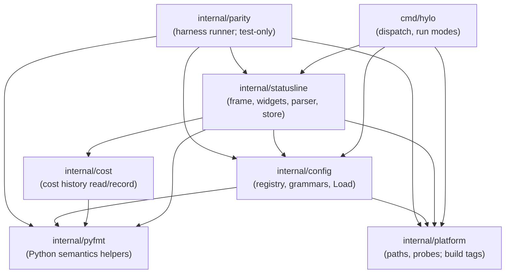

# ARCH-00 — System Overview

> hylo P1 is one static Go binary per OS (`github.com/drbothen/hylo`, D1) whose only
> active subcommand family this cycle is `hylo statusline` (+ `version`, `config`).
> The status line is a pure function of stdin + transcript + metrics + caches plus the
> injected git, process, clock and env seams (DI-007; the seam set per AD-10, prd.md:70),
> ported byte-exact from `legacy/dgx_statusline.py` under the CPython 3.11.x oracle
> (OD-104). Rendering never fails: every fault lands on the degraded ladder — one-line
> output, exit 0 (DI-008). Reference for all idiom rows (IM-nn), pitfalls (PR-nn),
> thresholds and the BC mapping: `../semport/hylo-legacy/statusline-target-design.md`
> ("the design doc"); this architecture diverges from it only where an AD below says so.

## Principles

1. **D4 parity first** — the Go port reproduces legacy byte-for-byte on the fixture
   corpus and the owner's recorded inputs before any behavior change. Every deviation
   rides the closed named exclusion set (DI-012) — the TWELVE ids {D4-EX-1, D4-EX-2,
   D4-EX-3, OD-30, OD-76, temp-file, cp-x03, OD-159, OD-160, OD-161, OD-166, OD-181},
   spelled exactly
   per BC-6.03.004 (pass-4 OD-169 adds `OD-166` — cost-history bytes written after a
   refresh whose `usd` or `api_ms` could not convert to float, nothing else — superseding
   the pass-3 "ten ids" description; pass-6 OD-181 adds `OD-181` — metrics transport
   beyond plain http: non-http(s) redirect targets and TLS trust-store differences for
   https; parity cases use plain http only).
2. **D15 config over code** — every behavior-shaping value is a registry key with type,
   range, default and rationale; no magic numbers in logic. Protocol/format constants
   (29-byte line, D7 ledger schema, cache file-name formats) are named constants with a
   "why not config" comment.
3. **Pure core / effects shell** — widgets, parsers and format helpers are pure functions
   over plain values; all I/O is injected through the `Env` seam set and executed in
   legacy's exact side-effect order (BC-1.01.009) by one orchestrator.
4. **Never blank / exit 0** — any panic or typed degrade prints the 29-byte grey line and
   returns 0 (DI-008, NFR-002); config errors and unknown flags are themselves one-line
   outputs. Non-zero exits exist only in validate/usage/harness contexts.
5. **Stdlib first** — the only runtime dependency in P1 is `golang.org/x/sys` (process
   probes); the YAML library arrives with the P4 file layer (OD-107).

## Package map and dependency direction (AD-01, AD-02)

Strictly acyclic: arrows point from importer to imported; `internal/pyfmt` and
`internal/platform` are sinks (nothing imports through them back upward). Package-level
purity classification (file detail in the per-section maps):

| Package | Classification | I/O boundary |
|---|---|---|
| `internal/pyfmt` | **pure core** | none — bytes/values in, values out; clock never read |
| `internal/config` | **boundary** | pure registry/grammars; `Load` reads env once at startup and delegates path-default resolution, `~` expansion and the Windows case-insensitive env lookup to `internal/platform` (ADV-P1-A16/D21) |
| `internal/statusline` | **mixed (core-dominant)** | pure widgets + effect script (AD-03); I/O only via `Env` seams |
| `internal/cost` | **boundary** | pure percentile math; writes via injected `Store` |
| `internal/platform` | **infrastructure** | syscalls, `/proc`, `sysctl`, Win32; build-tag confined |
| `cmd/hylo` | **effectful shell** | `os.Args`/`os.Std*`, `os.Exit`; no logic |
| `internal/parity` | **infrastructure** | spawns interpreters/builds; test-only, never shipped in render path |

## Component architecture

Single-responsibility components and their explicit interfaces are defined per section:
binary/CLI (ARCH-01), config (ARCH-02), statusline render pipeline (ARCH-03), data files
(ARCH-04), platform (ARCH-05), pyfmt (ARCH-06), parity harness (ARCH-07), build/CI
(ARCH-08), reserved boundaries (ARCH-09). Every component appears in exactly one ARCH
section as its home; cross-references are by Go interface.

## Verification feasibility (iron law, package level)

- **Provable (pure core):** pyfmt arithmetic/JSON/string/time helpers; width/trim math;
  widget segment formatting; transcript state transitions; sample TTL machine; config
  grammars and registry ordering. Strategy: oracle-pinned tables + property/fuzz targets
  (design doc §2.6). P1 gate for S1/S5: **line coverage >= 95%** per package — Go's
  statement-coverage figure; the gate name "line coverage" denotes it (ADV-P11-A03;
  OD-135
  CRITICAL tier as ruled by OD-158); the >= 95% **mutation kill rate is a Phase 6
  target** — reported by the formal-verifier, not gating P1 (OD-158). **Mutation
  tool (P19): gremlins** (go-gremlins/gremlins) — it drives the standard `go test`
  suite per mutant and reports per-package mutation coverage, so it plugs into the
  3-OS gate unchanged; go-mutesting is an aging research prototype needing custom
  driver integration. **Oracle for random property samples (ADV-P1-A07):** CPython is
  available only as committed expectation tables, never live, so a random sample is
  asserted against a metamorphic oracle (round-trip, idempotence, monotonicity,
  first-wins/positional identity invariants) and additionally spot-pinned: each
  generator deterministically re-draws a fixed sample list and checks those cases
  against the committed CPython tables.

- **Testable-only (effects):** env reads, cache file I/O, HTTP fetch, process probes,
  interpreter spawning. Strategy: fake-server and fake-seam integration tests plus seeded
  parity cases; no proof claimed — side effects are confined to thin, table-covered shells.
- The purity boundary is drawn **before** implementation design (ARCH-03, AD-03); a widget
  that needs I/O is redesigned, not patched (Critical Rules).
