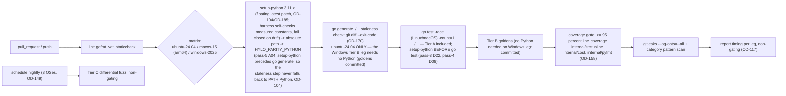

# ARCH-08 — Build, CI, release

> Implemented by the phase-1-cicd-setup step from this design. Classification:
> infrastructure (workflow YAML, release tooling); its logic lives in the repo, not the
> binary.

## Build

- Go >= 1.26: go.mod pins `go 1.26.0` only, **no toolchain directive** (actual repo
  state, ADV-P2-A14; cicd-setup.md agrees) — with `go-version-file`, CI therefore
  installs 1.26.0, the oldest 1.26 patch, so the "Go 1.26.x leg" lacks later stdlib
  security fixes. Approved-in-spec remedy: add a `toolchain go1.26.x` line to go.mod
  (lands on main with the owner's approval; spec-only here). `CGO_ENABLED=0`,
  one static binary per OS. Version stamping via `-ldflags "-X main.version=..."` from
  the released tag; fallback VCS stamp, then `dev` (BC-4.01.003).
- **Dependency policy (AD-02):** P1 runtime deps = `golang.org/x/sys` only; stdlib first
  each-new-dependency-needs-a-reason (CLAUDE.md); the YAML library lands with the P4
  file layer (OD-107). Build-time-only tooling (generators, Storybook-like tools) is not
  a runtime dep. Each new dependency needs an ADR line in ARCH-INDEX.

## CI workflow design (phase-1-cicd-setup implements; BC-6.04.001)

- Race detector on Linux and macOS; the resolved Python patch version is recorded in
  Tier B golden metadata (RK-4). Ordering (pass-3 D22; diagram corrected pass-4 D08 and
  again pass-5 A04): GitHub Actions always sets
  `CI=true`, and Tier A runs live inside the plain `go test ./...` step — so every
  `test` job installs setup-python and exports `HYLO_PARITY_PYTHON` BEFORE the
  `go test` step; the plain test step never discovers the interpreter afterwards.
  Alternatively a leg may exclude the Tier A selector from the plain step, but env-first
  is the designed default. RULED (pass-6 A12, orchestrator call 13): the dedicated
  `parity tier A (live corpus)` job (45-minute budget) is the ONE authoritative Tier A
  run — the plain `go test` step EXCLUDES the Tier A selector, so the corpus never
  executes under the test job's tighter 30-minute cap: one run, one timeout.
  Pin: setup-python installs **3.11.x** (python-version: '3.11', the latest patch —
  OD-104 stands; the pass-5 exact-3.11.7 pin is WITHDRAWN by OD-185, pass-6 A02).
  Because the measured constants (JSON depth limits, Unicode 14.0 tables) were taken on
  3.11.7, the harness SELF-CHECKS them against the resolved oracle at start — measuring
  the depth boundaries and `unicodedata.unidata_version`, failing closed on any mismatch
  and printing the resolved version — and Tier B golden metadata records the resolved
  patch (RK-4); a moved boundary fails the staleness check loudly instead of flapping
  silently on patch drift.
- **Generated-table staleness (OD-170):** the staleness step runs `go generate ./...` and then
  `git diff --exit-code` over the generated paths (Unicode 14.0 class tables and the
  pyfmt oracle tables, ARCH-06); any diff fails the leg — a stale committed table can
  never pass CI. It runs on ubuntu-24.04 ONLY (pass-5 A04): the generators are
  `testdata/gen/*.py` under the pinned oracle, and confining the step to ubuntu keeps
  Python off the Windows leg's critical path — Windows consumes committed Tier B
  goldens, which need no interpreter.
- **Coverage gate (OD-158, pass-4 A13):** a required `coverage` step produces the
  profile (`go test -count=1 -coverprofile` per package) and enforces **line coverage
  >= 95 %** per package for `internal/statusline`, `internal/cost` and
  `internal/pyfmt`. `internal/cost` IS gated: SS-01 comprises `internal/statusline` and
  `internal/cost` (ARCH-INDEX Subsystem Registry) and module-criticality.md classes it
  CRITICAL by inheritance, so the "S1/S5" gate reading covers all three packages. The
  mutation kill-rate targets stay Phase 6 targets (OD-158) — this gate is line coverage
  only. Designed behaviour; see cicd-setup.md for the landed-ci.yml lag note.
- **Timing (NFR-001, BC-6.04.002):** every leg prints the per-OS report — per corpus
  case, 1 discarded warm-up + **20 timed runs**, samples sorted per case, nearest-rank
  p95 = **19th of the 20 sorted samples** (per nfr-catalog.md; with 5 samples the
  statistic degenerates to the maximum), p95 computed **per case** and binding per case,
  no pooling; fake-VM handling time subtracted. The p95 <= 25 ms
  gate fails the build only with `HYLO_TIMING_GATE=1` (binds on the owner's Mac target).
- **Public-repo hygiene (policy 21, NFR-006):** committed fixtures synthetic-only;
  real inputs replayed from git-ignored `captures/`; gitleaks with
  `--log-opts="--all"` plus the category pattern scan; `TestCorpusHygiene` in-tree.
- **Positive coverage (ADV-P1-A09, process gap — implementation lands on main later with
  owner approval):** every regression-detector job must print a runtime-computed
  positive-coverage line and must treat "checked nothing" as failure, never as a pass:
  - Tier A: `parity: N cases compared, M exclusions validated, K caches swapped` — job
    fails if `N == 0` or if `N` differs from the number of case directories found (same
    runtime census the exclusions check applies to `M`; a partially lost corpus must not
    pass — ADV-P2-A15), or if `K == 0` while any compared case declares swap seeds — the
    four-cache swap tier (BC-6.02.004, VP-019, R-001 mitigation) must be unable to check
    nothing and pass (pass-6 A10, call 13).
  - Tier B: `tier-b: N goldens compared` — fails if `N == 0` OR if `N` differs from
    the number of committed golden files found by the same runtime census
    (pass-5 A19: a partially lost golden set must not pass — the Tier A
    case-directory census discipline applied to Tier B).
  - Tier C: `tier-c: N inputs per side, M oracle spawns`; the PR-side budget skip
    (`t.Skip` on unset/0 `HYLO_PARITY_FUZZSECONDS`) is allowed only because the job is
    non-gating — on the nightly schedule a 0/unset budget FAILS, it does not skip, and
    a scheduled run that compares `N == 0` inputs or spawns `M == 0` oracles FAILS
    (pass-6 A10, call 13; one clean nightly run is the P1 exit condition, OD-149).
  - Exclusion machinery / canary: `exclusions: M entries validated against the closed
    set` — `M` must equal the file's entry count; a missing exclusions file fails.
  - Go jobs (lint/test/vet/govulncheck): `go: K files scanned` counts source files, so
    it is paired with a **test-run line**: `go test: N tests run, S skipped` — fails if
    `N == 0`; the reported skip count keeps an all-skip suite visible (an all-skip pass
    standing in for coverage is investigated, not accepted — ADV-P2-A15). The skeleton-era
    empty-module guard prints `go: 0 Go files — guard path, NOT a vet/test pass` and is
    removed once Phase 3 lands sources (after which `K == 0` fails).
  - Pattern scan: `hygiene: K files scanned, H hits` — fails if `K == 0` (scan ran over
    nothing) AND if `H > 0` (a found hit is a failure, pass-3 A18), so the scan cannot
    pass while flagging hygiene terms.
  - Coverage gate (pass-5 A16): `coverage: P packages profiled, min line coverage
    M% >= 95` — fails if any of the three gated packages is ABSENT from the profile or
    reports `[no statements]` (a package trivially "passing" coverage by having no
    statements is a failure, not a pass).
  - Generated-table staleness (pass-5 A16): `generate: N generated paths checked,
    D regenerated` — fails if `N == 0` (a tree with zero `go:generate` directives
    checks nothing and must not pass) and if `D > 0`.
  - Timing report (pass-3 A16/D39): the timing job executes the in-tree timing test
    (`go test ./internal/parity -run '^TestTiming$' -count=1`, `par/timing.go`) and
    prints `timing: N cases timed > 0` — fails if `N == 0` (an activated job reporting
    on zero cases must not pass).
  A skipped required check must never stand in for a pass: probe-gated placeholder jobs
  are added to branch protection's required set only when they can execute (Phase 3),
  and from then on every activation of the job must satisfy its coverage line —
  `skip` on a required detector is investigated, not accepted.
  R-004 mitigation restated for P1 (pass-6 A17 adjudication inside call 13): the
  HIGH-impact fake-pass-parity risk is mitigated in P1 NOT by the HIGH kill-rate tier
  (a Phase 6 target, OD-158) but by THIS census discipline plus the >= 95 % line-coverage
  gate over the referee's own packages (`internal/parity` included via the gate's
  census lines) — the referee must demonstrably check something on every run; the
  kill-rate tier takes over in Phase 6.

### Decision: gate on three OSes per change; release via GitHub Releases (AD-11)

- **Context:** D5 cross-platform from day one; D12 distribution.
- **Decision:** every change runs the full matrix; releases publish to GitHub Releases
  (binaries + checksums), Homebrew tap/Scoop/`go install` as follow-ups.
- **Rationale:** parity must hold on all OSes before generalization (D4 ordering);
  GitHub Releases keeps the P1 toolchain zero-budget.
- **Consequences:** windows-2025 leg pins the "not executed" Windows assumptions
  (ASM-005, prd-supplements/assumptions-register.md) and the D4-EX-1 fake-probe test; the nightly Tier C exit condition is ONE
  clean nightly run on all three OSes, 30 minutes per OS (`HYLO_PARITY_FUZZSECONDS=1800`,
  OD-149).
- **Verification feasibility:** workflow behavior is testable-only (CI leg observation);
  the in-tree part (corpus hygiene test, timing report printer) is table-tested; gitleaks
  cleanliness is a push-gate, not a proof.

- **Hardening posture (P19, pass-4 A17):** the lint job runs a staticcheck-class
  analysis (`honnef.co/go/tools/cmd/staticcheck`, version-pinned, same empty-module
  guard) beside gofmt and vet, and govulncheck is promoted from the informational
  weekly sweep to a required PR check in ci.yml (distinct check-run name, e.g.
  `govulncheck (required)`, alongside the weekly `govulncheck` in security.yml).
  Workflow edits land on main with the owner's approval (spec-only here).

## Mapping

BC-6.04.001 -> matrix; BC-6.04.002 -> timing report + gate; BC-6.04.003 -> nightly
Tier C; hygiene legs serve NFR-006/policy 21.
