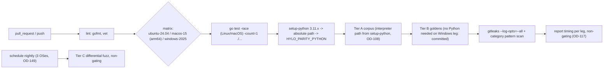

# ARCH-08 — Build, CI, release

> Implemented by the phase-1-cicd-setup step from this design. Classification:
> infrastructure (workflow YAML, release tooling); its logic lives in the repo, not the
> binary.

## Build

- Go >= 1.26: go.mod pins `go 1.26.0` only, **no toolchain directive** (actual repo
  state, ADV-P2-A14; cicd-setup.md agrees) — with `go-version-file`, CI therefore
  installs 1.26.0, the oldest 1.26 patch, so the "Go 1.26.x leg" lacks later stdlib
  security fixes. Approved-in-spec remedy: add a `toolchain go1.26.x` line to go.mod
  (lands on main with the owner's approval; spec-only here). `CGO_ENABLED=0`,
  one static binary per OS. Version stamping via `-ldflags "-X main.version=..."` from
  the released tag; fallback VCS stamp, then `dev` (BC-4.01.003).
- **Dependency policy (AD-02):** P1 runtime deps = `golang.org/x/sys` only; stdlib first
  each-new-dependency-needs-a-reason (CLAUDE.md); the YAML library lands with the P4
  file layer (OD-107). Build-time-only tooling (generators, Storybook-like tools) is not
  a runtime dep. Each new dependency needs an ADR line in ARCH-INDEX.

## CI workflow design (phase-1-cicd-setup implements; BC-6.04.001)

- Race detector on Linux and macOS; the resolved Python patch version is recorded in
  Tier B golden metadata (RK-4). Ordering (pass-3 D22): GitHub Actions always sets
  `CI=true`, and Tier A runs live inside the plain `go test ./...` step — so every
  `test` job installs setup-python and exports `HYLO_PARITY_PYTHON` BEFORE the
  `go test` step; the plain test step never discovers the interpreter afterwards.
  Alternatively a leg may exclude the Tier A selector from the plain step, but env-first
  is the designed default.
- **Timing (NFR-001, BC-6.04.002):** every leg prints the per-OS report — per corpus
  case, 1 discarded warm-up + **20 timed runs**, samples sorted per case, nearest-rank
  p95 = **19th of the 20 sorted samples** (per nfr-catalog.md; with 5 samples the
  statistic degenerates to the maximum), p95 computed **per case** and binding per case,
  no pooling; fake-VM handling time subtracted. The p95 <= 25 ms
  gate fails the build only with `HYLO_TIMING_GATE=1` (binds on the owner's Mac target).
- **Public-repo hygiene (policy 21, NFR-006):** committed fixtures synthetic-only;
  real inputs replayed from git-ignored `captures/`; gitleaks with
  `--log-opts="--all"` plus the category pattern scan; `TestCorpusHygiene` in-tree.
- **Positive coverage (ADV-P1-A09, process gap — implementation lands on main later with
  owner approval):** every regression-detector job must print a runtime-computed
  positive-coverage line and must treat "checked nothing" as failure, never as a pass:
  - Tier A: `parity: N cases compared, M exclusions validated, K caches swapped` — job
    fails if `N == 0` or if `N` differs from the number of case directories found (same
    runtime census the exclusions check applies to `M`; a partially lost corpus must not
    pass — ADV-P2-A15).
  - Tier B: `tier-b: N goldens compared` — fails if `N == 0`.
  - Tier C: `tier-c: N inputs per side, M oracle spawns`; the PR-side budget skip
    (`t.Skip` on unset/0 `HYLO_PARITY_FUZZSECONDS`) is allowed only because the job is
    non-gating — on the nightly schedule a 0/unset budget FAILS, it does not skip.
  - Exclusion machinery / canary: `exclusions: M entries validated against the closed
    set` — `M` must equal the file's entry count; a missing exclusions file fails.
  - Go jobs (lint/test/vet/govulncheck): `go: K files scanned` counts source files, so
    it is paired with a **test-run line**: `go test: N tests run, S skipped` — fails if
    `N == 0`; the reported skip count keeps an all-skip suite visible (an all-skip pass
    standing in for coverage is investigated, not accepted — ADV-P2-A15). The skeleton-era
    empty-module guard prints `go: 0 Go files — guard path, NOT a vet/test pass` and is
    removed once Phase 3 lands sources (after which `K == 0` fails).
  - Pattern scan: `hygiene: K files scanned, H hits` — fails if `K == 0` (scan ran over
    nothing) AND if `H > 0` (a found hit is a failure, pass-3 A18), so the scan cannot
    pass while flagging hygiene terms.
  - Timing report (pass-3 A16/D39): the timing job executes the in-tree timing test
    (`go test ./internal/parity -run '^TestTiming$' -count=1`, `par/timing.go`) and
    prints `timing: N cases timed > 0` — fails if `N == 0` (an activated job reporting
    on zero cases must not pass).
  A skipped required check must never stand in for a pass: probe-gated placeholder jobs
  are added to branch protection's required set only when they can execute (Phase 3),
  and from then on every activation of the job must satisfy its coverage line —
  `skip` on a required detector is investigated, not accepted.

### Decision: gate on three OSes per change; release via GitHub Releases (AD-11)

- **Context:** D5 cross-platform from day one; D12 distribution.
- **Decision:** every change runs the full matrix; releases publish to GitHub Releases
  (binaries + checksums), Homebrew tap/Scoop/`go install` as follow-ups.
- **Rationale:** parity must hold on all OSes before generalization (D4 ordering);
  GitHub Releases keeps the P1 toolchain zero-budget.
- **Consequences:** windows-2025 leg pins the "not executed" Windows assumptions
  (ASM-005, prd-supplements/assumptions-register.md) and the D4-EX-1 fake-probe test; the nightly Tier C exit condition is ONE
  clean nightly run on all three OSes, 30 minutes per OS (`HYLO_PARITY_FUZZSECONDS=1800`,
  OD-149).
- **Verification feasibility:** workflow behavior is testable-only (CI leg observation);
  the in-tree part (corpus hygiene test, timing report printer) is table-tested; gitleaks
  cleanliness is a push-gate, not a proof.

## Mapping

BC-6.04.001 -> matrix; BC-6.04.002 -> timing report + gate; BC-6.04.003 -> nightly
Tier C; hygiene legs serve NFR-006/policy 21.
