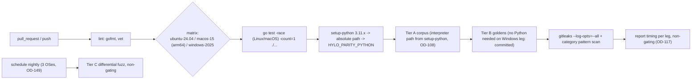

# ARCH-08 — Build, CI, release

> Implemented by the phase-1-cicd-setup step from this design. Classification:
> infrastructure (workflow YAML, release tooling); its logic lives in the repo, not the
> binary.

## Build

- Go >= 1.26 (go.mod `go 1.26.0` + toolchain line, design doc S0), `CGO_ENABLED=0`,
  one static binary per OS. Version stamping via `-ldflags "-X main.version=..."` from
  the released tag; fallback VCS stamp, then `dev` (BC-4.01.003).
- **Dependency policy (AD-02):** P1 runtime deps = `golang.org/x/sys` only; stdlib first
  each-new-dependency-needs-a-reason (CLAUDE.md); the YAML library lands with the P4
  file layer (OD-107). Build-time-only tooling (generators, Storybook-like tools) is not
  a runtime dep. Each new dependency needs an ADR line in ARCH-INDEX.

## CI workflow design (phase-1-cicd-setup implements; BC-6.04.001)

- Race detector on Linux and macOS; the resolved Python patch version is recorded in
  Tier B golden metadata (RK-4).
- **Timing (NFR-001, BC-6.04.002):** every leg prints the per-OS report (1 warm-up +
  5 timed runs, nearest-rank p95, fake-VM handling time subtracted); the p95 <= 25 ms
  gate fails the build only with `HYLO_TIMING_GATE=1` (binds on the owner's Mac target).
- **Public-repo hygiene (policy 21, NFR-006):** committed fixtures synthetic-only;
  real inputs replayed from git-ignored `captures/`; gitleaks with
  `--log-opts="--all"` plus the category pattern scan; `TestCorpusHygiene` in-tree.

### Decision: gate on three OSes per change; release via GitHub Releases (AD-11)

- **Context:** D5 cross-platform from day one; D12 distribution.
- **Decision:** every change runs the full matrix; releases publish to GitHub Releases
  (binaries + checksums), Homebrew tap/Scoop/`go install` as follow-ups.
- **Rationale:** parity must hold on all OSes before generalization (D4 ordering);
  GitHub Releases keeps the P1 toolchain zero-budget.
- **Consequences:** windows-2025 leg pins the "not executed" Windows assumptions
  (PRD §9.5) and the D4-EX-1 fake-probe test; the nightly Tier C exit condition is ONE
  clean nightly run on all three OSes, 30 minutes per OS (`HYLO_PARITY_FUZZSECONDS=1800`,
  OD-149).
- **Verification feasibility:** workflow behavior is testable-only (CI leg observation);
  the in-tree part (corpus hygiene test, timing report printer) is table-tested; gitleaks
  cleanliness is a push-gate, not a proof.

## Mapping

BC-6.04.001 -> matrix; BC-6.04.002 -> timing report + gate; BC-6.04.003 -> nightly
Tier C; hygiene legs serve NFR-006/policy 21.
