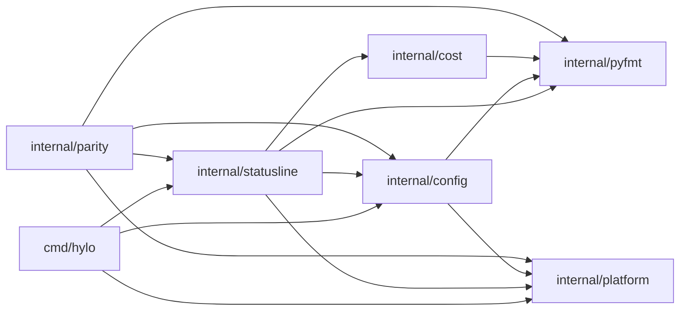

# Module Criticality Classification: hylo P1

> Approved 2026-11-15 alongside the subsystem breakdown (OD-131, recorded). S1-S6 are the
> P1 modules; S7-S12 are reserved (no BCs this cycle) and carry no tier until their phase.

## Tier Definitions

| Tier | Mutation Kill Rate Target | Description | Examples |
|------|--------------------------|-------------|----------|
| **CRITICAL** | >= 95% | Byte-parity-critical logic; a mutant silently changes user-visible bytes | status line widgets/parser, pyfmt |
| **HIGH** | >= 90% | Important functionality with parity or platform impact | config, platform, harness |
| **MEDIUM** | >= 80% | Supporting functionality | CLI dispatch |
| **LOW** | >= 70% | Glue | (none in P1) |

Mutation tool (P19, ADV-P1-A07): **gremlins** (go-gremlins/gremlins) — per-mutant `go
test` runs with per-package mutation-coverage reporting; go-mutesting rejected as an
unmaintained research prototype requiring custom driver integration. Property-sample
oracles: metamorphic invariants plus spot-pins against the committed CPython tables
(named in ARCH-00 §Verification feasibility).

**Gating schedule (OD-158):** the kill-rate targets in the table above are **Phase 6
targets**, tracked by the formal hardening phase — they do not gate P1. The P1 exit gate
for the module-critical modules (S1 Status Line, S5 Pyfmt) is **line coverage >= 95%**,
asserted from the coverage report of the package `go test` runs. Gate scope is settled
by OD-193 (owner 2026-11-18): S1 (`internal/statusline`, `internal/cost`) and S5
(`internal/pyfmt`) only — `internal/parity` (S6) coverage is reported, not gated; the
pass-7 widening of the gate to S6 is withdrawn. The 2026-11-17 owner
rulings OD-155..OD-165 are settled constraints for this schedule.

## Module Inventory

- **internal/statusline** — frame, guard, width/trim, widgets, transcript parser, metrics client, cost history, cache store (S1)
- **internal/cost** — cost history read/record and threshold coloring, split out of statusline (SS-01; tier inherited from S1)
- **internal/config** — registry, grammars, resolution, D4-EX-3 validation (S2)
- **internal/platform** — per-OS dirs and process-start probes (S3)
- **cmd/hylo** — dispatch, usage goldens, version (S4)
- **internal/pyfmt** — Python-compatible num/json/str/time helpers (S5)
- **internal/parity** — oracle execution, fixture corpus, comparison, exclusions, CI/timing (S6)

## Module Classification

| Module | Path | Tier | Rationale | Kill Rate Target | VP Count |
|--------|------|------|-----------|-----------------|----------|
| Status Line (S1) | `internal/statusline` | CRITICAL | carries all 101 render/parser/widget/store/subagent-panel contracts; byte-exact parity is the D4 definition of done; every CP-* crash path lives here | >= 95% | 21 (VP-001, -003, -005, -007, -008, -013, -014, -018, -019, -021, -022, -027, -028, -029, -030, -031, -036, -038, -039, -040, -041) |
| Cost History (SS-01, inherited S1) | `internal/cost` | CRITICAL (inherits S1) | split is architectural only (feasibility report decision log); its bytes are owner-visible history pinned by cost goldens | >= 95% | 3 (VP-018, -020, -021; VP-018/VP-021 span statusline and cost) |
| Configuration (S2) | `internal/config` | HIGH | typed domain and D4-EX-3 classes gate every settings interpretation; mutants shift error bytes/exit paths | >= 90% | 3 (VP-015, -016, -017) |
| Platform (S3) | `internal/platform` | HIGH | wrong dirs/probes corrupt caches and window age; per-OS divergence is subtle | >= 90% | 3 (VP-014, -032, -033) |
| CLI (S4) | `cmd/hylo` | MEDIUM | thin dispatch over statusline/config; usage goldens pin it | >= 80% | 5 (VP-001, -002, -003, -004, -016) |
| Pyfmt (S5) | `internal/pyfmt` | CRITICAL | parity foundation under every widget and both JSON modes; Python-semantics surface (half-even, WTF-8, divmod) is where mutants hide | >= 95% | 7 (VP-005, -006, -023, -024, -025, -026, -038) |
| Parity Harness (S6) | `internal/parity` | HIGH | referees D4: weak machinery fake-passes parity; strong mutants survive behind it | >= 90% | 8 (VP-009, -010, -011, -012, -019, -034, -035, -037) |
| Exporter (S7) | — | Reserved (P2) | — | — | — |
| Proxy And Routing (S8) | — | Reserved (P3) | — | — | — |
| Ledger (S9) | — | Reserved (P3) | — | — | — |
| Launcher Hook Doctor CA (S10) | — | Reserved (P4) | — | — | — |
| UIs (S11) | — | Reserved (P4/P6) | — | — | — |
| Multi-Backend (S12) | — | Reserved (P6) | — | — | — |

> VP counts regenerated from `verification-properties/VP-INDEX.md` (Catalog Module
> column; regenerated 2026-11-18, pass-5 A05 — includes VP-038..VP-041: VP-039 subagent
> elapsed clock, VP-040 frame/width property legs, VP-041 row-1 property legs split from
> VP-028 in pass-4, all `internal/statusline`). Derivation note (pass-10 A13): VP-038 is
> counted under Status Line via its declared source BC-1.03.004 — the VP-INDEX Module
> cell lists only its primary home `internal/pyfmt (str.go)`, so that one count is not a
> pure Catalog-column regroup. VPs listing several modules count in each: VP-005 (statusline,
> pyfmt), VP-014 (platform, statusline), VP-018 (statusline cache.go, cost), VP-019
> (parity swap, statusline cache.go), VP-021 (statusline cost.go, cost), VP-016 (config,
> cmd/hylo), VP-001/-003 (statusline guard, cmd/hylo), VP-038 (pyfmt str.go; statusline
> transcript line-splitting via source_bc BC-1.03.004, Home ARCH-03/ARCH-06); VP-020
> (internal/cost) has its own row since the ADV-P1-A16 burst; VP-035 spans
> internal/parity and CI; VP-037 (module "CI workflow") is attributed to S6 via
> source_bc BC-6.04.001. Union across the classifications = 41/41 (all 41 VPs; VP-041's
> catalog module is `internal/statusline`, per VP-INDEX).

## Per-Module Risk Assessment

| Module | Tier | Blast Radius | Security Sensitivity | Implementation Complexity | Test Priority |
|--------|------|-------------|---------------------|--------------------------|--------------|
| internal/statusline | CRITICAL | high | low (reads own caches + LAN metrics only) | high (Python semantics: big ints, WTF-8, half-even, crash-path register) | P0 |
| internal/config | HIGH | medium | none (typed env; no secrets in P1) | medium | P0 |
| internal/platform | HIGH | medium | none | medium (per-OS probing, TZ/timespan) | P0 |
| cmd/hylo | MEDIUM | low | none | low | P1 |
| internal/pyfmt | CRITICAL | high | none | high (CPython fidelity, fuzz targets) | P0 |
| internal/parity | HIGH | high (fake-pass risk) | none | medium-high (env construction, clock shim, exclusions) | P0 |
| internal/cost | CRITICAL (inherits S1) | medium | none | low-medium (goldens BC-SL-101/102 pin it fully) | P0 |

## Classification Summary

| Tier | Module Count | Percentage |
|------|-------------|------------|
| CRITICAL | 3 | 43% |
| HIGH | 3 | 43% |
| MEDIUM | 1 | 14% |
| LOW | 0 | 0% |
| **Total** | **7** | **100%** |

## Dependency Graph — Build Order

Arrows mirror the ARCH-00 §Package map import direction (importer → imported;
AD-01/AD-02), corrected per ADV-P2-A10:

(`internal/pyfmt` and `internal/platform` are import sinks; `internal/parity` is
test-only.)

## Implementation Priority Order

1. internal/platform — infrastructure import sink (the frame, config, window age and
   parity harness all import it); per-OS dirs and probes
   the frame, config defaults and window age need (correct order per ADV-P2-A10:
   config imports platform)
2. internal/pyfmt — pure sink; parity foundation; every widget consumes it (design step S1)
3. internal/config — imports platform and pyfmt; grammars gate every translated setting (step S2)
4. internal/cost — imports pyfmt; cost history split out of statusline
5. internal/statusline — imports cost, config, platform, pyfmt; frame first, then widgets,
   parser, metrics, cost (steps S2-S7)
6. cmd/hylo — imports statusline, config, platform; dispatch once they exist
7. internal/parity — test-only harness importing statusline, config, platform, pyfmt;
   grows with each step; goldens and exclusions close D4

## Cross-Cutting Concerns by Tier

| Concern | CRITICAL modules | HIGH modules | MEDIUM/LOW modules |
|---------|-----------------|-------------|-------------------|
| Error handling | guard + typed CP-* degrades; never-raise | typed config errors; never-raise platform I/O | usage errors to golden |
| Determinism | frozen clock injection (Env.Now); no globals | no implicit env reads | n.a. |
| Parity | byte-exact outputs and cache writers | byte-exact caches consumed | golden text |
