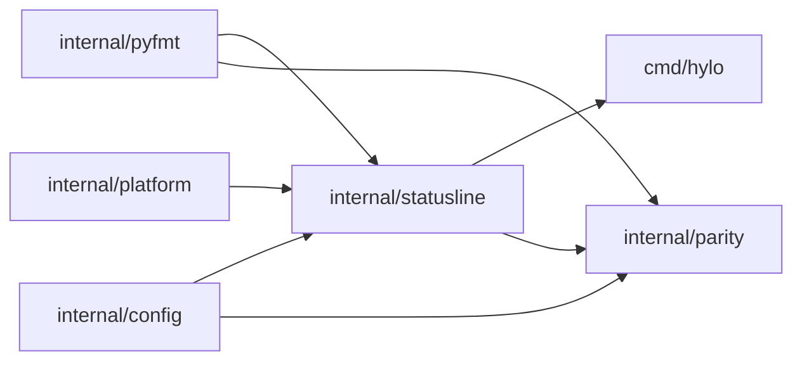

# Module Criticality Classification: hylo P1

> Approved 2026-11-15 alongside the subsystem breakdown (OD-131 pending). S1-S6 are the
> P1 modules; S7-S12 are reserved (no BCs this cycle) and carry no tier until their phase.

## Tier Definitions

| Tier | Mutation Kill Rate Target | Description | Examples |
|------|--------------------------|-------------|----------|
| **CRITICAL** | >= 95% | Byte-parity-critical logic; a mutant silently changes user-visible bytes | status line widgets/parser, pyfmt |
| **HIGH** | >= 90% | Important functionality with parity or platform impact | config, platform, harness |
| **MEDIUM** | >= 80% | Supporting functionality | CLI dispatch |
| **LOW** | >= 70% | Glue | (none in P1) |

## Module Inventory

- **internal/statusline** — frame, guard, width/trim, widgets, transcript parser, metrics client, cost history, cache store (S1)
- **internal/config** — registry, grammars, resolution, D4-EX-3 validation (S2)
- **internal/platform** — per-OS dirs and process-start probes (S3)
- **cmd/hylo** — dispatch, usage goldens, version (S4)
- **internal/pyfmt** — Python-compatible num/json/str/time helpers (S5)
- **internal/parity** — oracle execution, fixture corpus, comparison, exclusions, CI/timing (S6)

## Module Classification

| Module | Path | Tier | Rationale | Kill Rate Target | VP Count |
|--------|------|------|-----------|-----------------|----------|
| Status line (S1) | `internal/statusline` | CRITICAL | carries all 93 render/parser/widget/store contracts; byte-exact parity is the D4 definition of done; every CP-* crash path lives here | >= 95% | 17 (VP-001, -003, -005, -007, -008, -013, -014, -018, -020, -021, -022, -027, -028, -029, -030, -031, -036) |
| Configuration (S2) | `internal/config` | HIGH | typed domain and D4-EX-3 classes gate every settings interpretation; mutants shift error bytes/exit paths | >= 90% | 3 (VP-015, -016, -017) |
| Platform (S3) | `internal/platform` | HIGH | wrong dirs/probes corrupt caches and window age; per-OS divergence is subtle | >= 90% | 3 (VP-014, -032, -033) |
| CLI (S4) | `cmd/hylo` | MEDIUM | thin dispatch over statusline/config; usage goldens pin it | >= 80% | 2 (VP-002, -004) |
| Python-compatible formatting (S5) | `internal/pyfmt` | CRITICAL | parity foundation under every widget and both JSON modes; Python-semantics surface (half-even, WTF-8, divmod) is where mutants hide | >= 95% | 6 (VP-005, -006, -023, -024, -025, -026) |
| Parity harness (S6) | `internal/parity` | HIGH | referees D4: weak machinery fake-passes parity; strong mutants survive behind it | >= 90% | 8 (VP-009, -010, -011, -012, -019, -034, -035, -037) |

> VP counts from `verification-properties/VP-INDEX.md` (Catalog Module column,
> 2026-11-16). VPs listing several modules count in each: VP-005 (statusline, pyfmt),
> VP-014 (platform, statusline), VP-021 (statusline, cost); VP-020 (internal/cost) is
> attributed to S1; VP-035 spans internal/parity and CI; VP-037 (module "CI workflow")
> is attributed to S6 via source_bc BC-6.04.001. Union across the six modules = 37/37.
| Exporter (S7) | — | Reserved (P2) | — | — | — |
| Proxy & routing (S8) | — | Reserved (P3) | — | — | — |
| Ledger (S9) | — | Reserved (P3) | — | — | — |
| Launcher/hook/doctor/CA (S10) | — | Reserved (P4) | — | — | — |
| UIs (S11) | — | Reserved (P4/P6) | — | — | — |
| Multi-backend (S12) | — | Reserved (P6) | — | — | — |

## Per-Module Risk Assessment

| Module | Tier | Blast Radius | Security Sensitivity | Implementation Complexity | Test Priority |
|--------|------|-------------|---------------------|--------------------------|--------------|
| internal/statusline | CRITICAL | high | low (reads own caches + LAN metrics only) | high (Python semantics: big ints, WTF-8, half-even, crash-path register) | P0 |
| internal/config | HIGH | medium | none (typed env; no secrets in P1) | medium | P0 |
| internal/platform | HIGH | medium | none | medium (per-OS probing, TZ/timespan) | P0 |
| cmd/hylo | MEDIUM | low | none | low | P1 |
| internal/pyfmt | CRITICAL | high | none | high (CPython fidelity, fuzz targets) | P0 |
| internal/parity | HIGH | high (fake-pass risk) | none | medium-high (env construction, clock shim, exclusions) | P0 |

## Classification Summary

| Tier | Module Count | Percentage |
|------|-------------|------------|
| CRITICAL | 2 | 33% |
| HIGH | 3 | 50% |
| MEDIUM | 1 | 17% |
| LOW | 0 | 0% |
| **Total** | **6** | **100%** |

## Dependency Graph — Build Order

## Implementation Priority Order

1. internal/pyfmt — parity foundation; every widget consumes it (design step S1)
2. internal/config — grammars gate every translated setting (step S2)
3. internal/platform — dirs and probes the frame and window age need (steps S2/S7)
4. internal/statusline — frame first, then widgets, parser, metrics, cost (steps S2-S7)
5. cmd/hylo — dispatch once statusline and config exist
6. internal/parity — harness grows with each step; goldens and exclusions close D4

## Cross-Cutting Concerns by Tier

| Concern | CRITICAL modules | HIGH modules | MEDIUM/LOW modules |
|---------|-----------------|-------------|-------------------|
| Error handling | guard + typed CP-* degrades; never-raise | typed config errors; never-raise platform I/O | usage errors to golden |
| Determinism | frozen clock injection (Env.Now); no globals | no implicit env reads | n.a. |
| Parity | byte-exact outputs and cache writers | byte-exact caches consumed | golden text |
